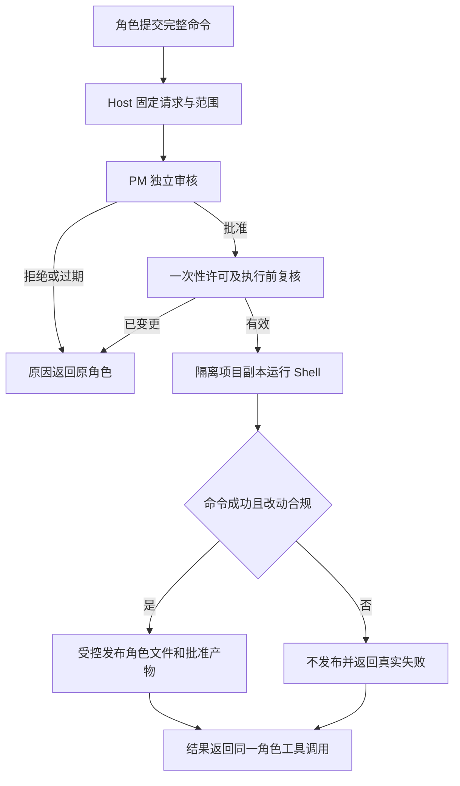

# Handwell 角色申请和 PM 审批项目 Shell

版本：v1 草案。状态：等待管理评审及客户确认，尚未修改应用代码。

## 使用效果

执行角色可以自己运行安装、编译、测试、文件处理等项目命令。例如终端界面角色需要安装项目依赖时，它提交完整命令和原因；PM 审查后批准或拒绝。批准后 Host 为原角色启动真实 Shell，将退出码和输出交回该角色的同一个待处理工具调用，它继续自己的任务。PM 不代替角色执行命令。

每次 Shell 工具调用均需审批，没有“以后都允许”的授权。同一调用中的管道、脚本和子进程继承本次许可；不是脚本每个内部子命令都另开一次审批。用户已经选择项目内通用 Shell，不限于安装命令白名单。角色仍只能发布自己拥有且本次任务允许的文件，控制目录及凭据不可读写。

## 请求到执行

1. 角色调用 `legion_request_shell`，提交完整 command、项目相对 cwd、原因、期望生成目录、联网模式及超时。Host 从当前运行推导项目、角色、任务、成员版本和文件边界，不采信模型自报身份。
2. Host 保存不可变请求，包含源文件基线、计划与文件归属摘要、环境策略、实际执行目录、效果范围和请求摘要。角色工具调用保持等待；模型活动预算与审批、Shell 的实际等待预算分开计算。现有 Adapter 的活动预算暂停仅覆盖 conversation，执行角色的 single_run 需要补齐对应预算接口与验证，不能宣称已有同等暂停能力。
3. Host 将请求交给 PM 的独立审核回合。PM 看到原角色职责、当前任务、完整命令和权限影响，使用 `legion_review_shell` 对精确请求 ID、版本和摘要批准或拒绝，并给出原因。对话里的“同意”不产生执行权限。
4. 批准产生 Host 管理的一次性短时许可，绑定 project/plan/task/role/instance/session/run、角色与 profile 版本、输入基线、环境策略、网络和生成效果摘要、实际目录及期限。审批和审计须先持久记录，失败不发许可。拿到资源锁后再次核验，spawn 前原子消费；任一变化即撤销。模型拿不到可重放的执行令牌。审核回合出错、无有效结构化决定或超时均不执行。
5. 命令在隔离的项目副本中实际运行。输出实时记入原角色对话，任务显示“执行 Shell”；PM 审核时显示“待 PM 审批”。成功结束后先检查改动，再受控发布允许的文件和产物。
6. 原角色收到批准结果、退出码、stdout/stderr 的有限输出、截断标记、改动清单、发布结果与安全错误分类。拒绝后可修订命令并重新申请，不能自动换命令或静默重试。

## 文件边界和真实隔离

首版拟在 macOS 使用专门的 OS 沙箱执行 Provider。现有固定 Node 检查沙箱禁止 fork，不能放开这一项后直接用作通用 Shell；新执行器需要独立 profile、真实能力探针和失败关闭机制。其他平台在没有对应隔离实现时明确显示不支持，不降级为裸 Shell。

采用项目副本的原因是普通编辑器、构建工具和原子保存常需创建临时文件、重命名或写父目录。直接给原项目父目录写权限会破坏角色独占文件规则。副本只复制普通项目输入和经验证的依赖；原项目、Host 用户数据、模型配置、控制目录和凭据不进入执行环境。审批与结果同时显示逻辑项目目录和真实副本目录，不能让用户误以为命令直接运行在原目录。

Shell 可以修改自己的私有执行副本，但发布门禁严格依据原项目归属和当前 task.writeSet。副本里修改了其他角色的源码，整次发布拒绝；退出码 0 也不能绕过。角色自身的源码改动通过原角色的受控 Mutation 权限发布。首版源码发布支持精确普通文件的创建、替换和删除；删除必须新增独立的受控操作及缺失/基线验证，现有 write/edit 不具备该能力。目录改名不直接发布；文件移动必须拆成获准路径的创建及删除。源码链接与特殊文件不发布。缺少文件归属或新增文件未获任务授权时，先申请正常的角色边界与计划更新。

实际 Shell 发布也进入任务 results、outputs 和依赖交接元数据；创建或替换记录真实新 SHA，删除记录专门的缺失状态与墓碑，不能因使用 Shell 丢失实际交付记录而触发 `task_outputs_missing`。输入快照和当前证据验证也须支持获准删除后的缺失基线；不能把已批准删除一律当作读取失败，也不能把任意缺失文件视为合法。

复制输入和发布产物均检查文件类型、真实路径、硬链接和符号链接；保护规则覆盖所有深度。采用 no-follow 打开并复核 descriptor 与路径身份及内容，避免扫描后换路径。普通输入存在多重硬链接或越界链接时拒绝，不能把凭据的普通文件别名复制进副本。npm 的 `.bin` 内部链接需专门验证仅为相对链接且目标处于同一批准依赖目录；拒绝环、断链及逃逸，不能因 npm 需要链接就放宽整个项目。拒绝设备文件、套接字、越界链接和特殊权限产物；不复制 ACL、xattr、setuid/setgid 等特殊属性。

## 依赖和生成产物

计划单独声明可生成的目录，例如 `node_modules/`、某个 `dist/`，并由 PM 在本条请求中确认。它们不成为任何角色的永久源码授权。安装命令只能发布经批准的依赖产物；package.json 和 lock 文件依然归各自所有者。需要改 manifest 或 lock 时由该文件的所有者修改。

同一项目的依赖安装、生成产物发布与源码发布使用可信 Host 管理的跨进程锁；使用依赖的检查或构建获得兼容读锁或固定不可变依赖版本，不能在安装过程中读取半套依赖。依赖发布改变 generation 摘要，相关旧检查和验收证据失效，必须重测。发布前重新验证源文件与依赖基线。另一角色已经修改相关输入时，本次结果过期并返回角色重新申请。副本可能耗费额外磁盘和复制时间，第一版优先保证文件边界，不使用未经验证的共享可写依赖缓存。

运行失败、超时或取消，副本中的部分改动只保留在隔离工作区，不发布回原项目。发布前先完成整批候选验证。发布本身不能假装跨多个源码与依赖目录天然原子；实现必须具备受控暂存、日志和恢复机制，出现中断时返回 `partial_published`、列出实际已发布文件、失效相关测试证据并暂停后续执行。需要回退时也校验当前版本，不能覆盖其后的合法改动。未经验证恢复完成前不得报告成功或宣称已经回滚。

## 环境 联网与生命周期

执行 `/bin/zsh -f -c`，固定干净 PATH，使用每次运行的 HOME、TMP 和缓存目录。不继承 SDK API key、Host 环境中的秘密、用户 shell 启动脚本、SSH agent、个人 npm 配置或代理凭据；关闭额外文件描述符与 Host IPC 权利。不支持 sudo、全局安装或原项目之外的写入。

联网默认关闭；角色确有需求时请求 localhost 或外网模式，PM 审批页面明确显示访问宿主服务或外网的风险。localhost 也不能默认开放。首版不宣称按 npm 域名或下载内容隔离：域名级限制需要额外下载代理，普通 OS 网络规则不能替代它。无凭据的外网命令仍受文件和进程隔离约束。

拟设执行总预算最长 15 分钟、默认 5 分钟，覆盖准备、命令和收尾，审批最长等待 5 分钟；超时需重新请求而非自动延长。stdout 和 stderr 合计最多 1 MiB 存档，返回模型最多 64 KiB，并明确截断。日志内容作为不可信文本渲染，剔除终端控制序列及已知秘密；不承诺识别任意未知秘密。

禁止命令通过新会话、进程组、后台守护或 IPC 脱离跟踪。执行器需要验证子进程继承隔离，限制系统服务、Keychain、launchd、其他同用户进程、设备及不必要的 Mach 权限。仅有进程组 kill 不能作为已证明完整清理的依据。

取消、切换项目、关闭应用、任务/角色/计划/配置变化会撤销待审和未消费许可。运行中取消终止此次跟踪的整个命令树并等待回收，不清理其他项目进程。命令组长退出但仍有后台子进程时，不得发布或报告成功。取消及超时后的清理最多另计 30 秒，超限标记隔离/清理故障并关闭该后端。执行结果或发布审计无法保存时也标记故障并暂停。重启后旧许可不可重放；中断的发布进入恢复状态，恢复也不得自动重跑旧 Shell。

## PM 上下文和界面

审批使用 PM 自己的持续上下文，并序列化 PM 回合；不并发复用同一个 SDK session。主执行角色等待工具结果，不能阻塞 PM 审批调度。队列操作仅做短暂状态提交，不持有主 Pipeline 的串行锁等待模型或 Shell。现有 deferred pending 调用可承载等待，但最终只能回应一次原 PiToolRequest；重启后的纯文本历史恢复不能恢复旧待处理调用或许可。

审核调度不得直接复用会递增 generation、撤销原执行绑定的普通 PM 初始化流程。保持原 active run 的绑定，同时串行保存 PM 记忆并核验 CAS；审批、正常 PM 回合与摘要不能并发覆盖同一份记忆。

主聊天页展示哪个成员等待审批、哪个成员执行 Shell，点击打开该成员“对话”。成员列表保持稳定。PM 审批请求和理由保存在 PM 对话；申请与命令输出保存在请求角色对话；共同使用请求 ID 关联。人类可以查看、取消执行，日常逐条命令审批由 PM 完成。

角色 Shell 的退出码 0 不等于角色自测或独立验收通过。现有 `legion_run_check` 保留独立沙箱、批准检查、证据与验收门禁；Acceptance 仍独立检查真实当前版本，失败由 PM 派原负责角色修复。

## 实现范围和验收

需要 KernelEngineer 提供请求/许可/结果 Model、审批验证与专用 Shell Provider，AgentAdapterEngineer 接入受控工具及同一 pending 调用恢复，DesktopEngineer 实现 PM 审核调度、发布协调与状态/对话展示。ProjectManager 更新公共契约和运行包；Tester 与 Reviewer 独立验证。新增文件的精确归属和执行配置由 Governance 准备，并遵守已接受的 ANS 确切配置规则。

必须实际验证：未批即执行被拒绝；只批准原命令；伪造身份、重放、过期与变更被拒绝；角色等待时 PM 可处理；普通管道/子进程/npm 安装真实运行；其他角色文件改动不发布；凭据/控制目录/原目录/Host 用户数据不能读取；链接与 IPC/进程逃逸被阻止；联网按审批模式；输出截断；超时/取消无残留；发布中断恢复；每个结果回到原角色上下文；原检查和独立验收仍有效。

当前仅完成代码调查和方案准备，这些行为尚未实现或测试。macOS 沙箱能力及安全发布是必须通过的实现门槛；失败时保留明确诊断并关闭该能力。

## 请求确认

确认本 v1 所述：项目内通用 Shell、PM 逐调用审批、隔离项目副本运行、受控发布、显式依赖/构建产物、默认断网及 PM 可批准 localhost/外网、首版 macOS 支持、其他平台失败关闭。授权按本版方案实施，并准备必要的角色边界和精确任务配置。应用代码派发仍须等待精确文件配置接受；本文的设计确认不能代替尚未生成的配置哈希确认。没有额外的可选功能。
