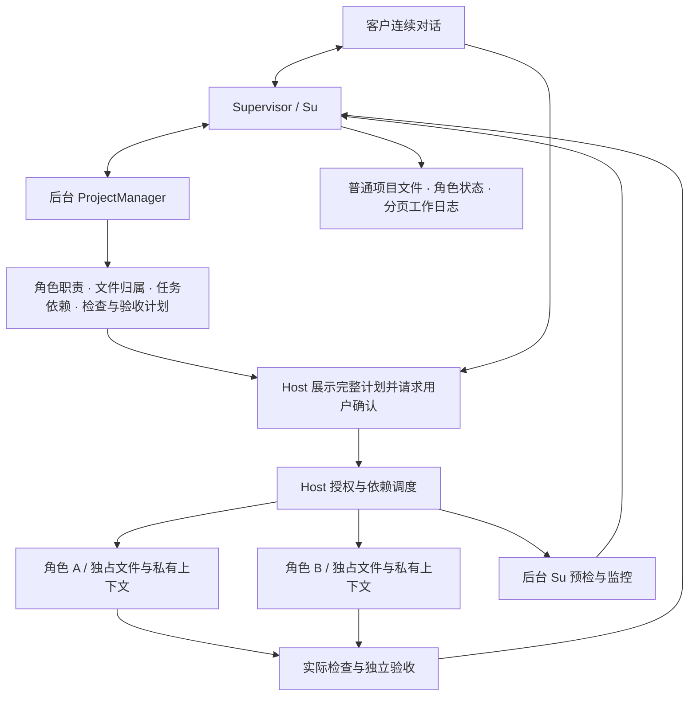

# Legion

**以角色为核心的多 Agent 项目运行时。** 底层使用 Pi 执行模型会话，上层将角色职责、项目意图、文件归属、依赖调度、记忆和验收组织成持续工作的项目。当前版本 **1.1.3**，优先交付可安装的 `legion chat` CLI。

客户始终与 Supervisor（Su）连续对话。Su 理解需求、读取项目、汇报状态；ProjectManager（PM）在后台编排角色与计划。每个角色拥有自己的上下文、记忆和文件职责，客户无需切换角色窗口。

## 核心能力

| 能力 | 当前行为 |
| --- | --- |
| 单一客户入口 | Su 承接连续对话，后台 PM 提问通过 Su 转达 |
| 全局项目理解 | 角色可读取权限允许的普通项目文件；Su 可自主读取、查询所有角色状态与分页工作日志 |
| 角色独占文件 | 持久文件归属决定可写范围；任务无需 `writeSet`。新增归属和转交由实际用户确认 |
| 依赖与并行 | 按任务依赖、角色归属和运行授权调度，无冲突任务可并行执行 |
| 项目分类记忆 | 保存坑（pitfall）、重大决策（decision）、用户偏好（preference）；偏好仅在当前项目共享 |
| 私有角色上下文 | 客户对话、PM 委托、Su 预检与监控、成员任务分别保存上下文，工作日志不暴露私有对话 |
| 检查与独立验收 | 实际 Check 和 Acceptance 决定结果；Su 汇报当前证据及阻塞 |
| 执行中交互 | 执行期间可继续向 Su 查询文件、状态和日志，不撤销正在工作的角色授权 |

“全局可读”限于普通项目文件：凭据、私有运行记录、受保护目录及不允许的符号链接仍受读取策略约束。Su 的业务写入和授权权限保持原边界，没有 Mutation、Check、Shell 或授予权限的工具。

## 工作流程



Su 和 PM 的建议不直接产生执行权限。Host 生成当前计划的完整确认，用户审阅任务、检查、归属与转交后，在 `Answer>` 输入 `yes` 或 `no`。普通聊天中的“同意”不能替代这一步。PM 的问题也在 `Answer>` 回答；选项问题使用显示的选项 ID。CLI 自动绑定请求版本与摘要，客户无需操作 SHA。

## 安装与启动

要求 **Node.js ≥ 22.19.0**。CLI 是 Node ESM 包，不依赖 Electron 或 Python；Pi SDK 与 pi-ai 固定为 1.0.4。

当前提供本地 npm 包安装，尚未声明发布到 npm registry。取得 `legion-runtime-1.1.3.tgz` 后，在消费者目录安装：

```sh
npm install ./legion-runtime-1.1.3.tgz --ignore-scripts
export LEGION_API_KEY='your-current-provider-key'
export LEGION_PROTOCOL='openai-completions'
export LEGION_PROVIDER='your-provider'
export LEGION_MODEL='your-model'
export LEGION_BASE_URL='https://your-provider.example/v1'
./node_modules/.bin/legion chat --project /absolute/project --user-data /absolute/private/legion-data
```

也可从本仓库生成本地包，再按上述方式安装：

```sh
npm pack
```

支持 `openai-completions`、`openai-responses`、`anthropic-messages` 三种协议。模型、provider 和 base URL 填写所选服务的实际值；非密钥字段也支持 `--protocol`、`--provider`、`--model`、`--base-url`。CLI 仅从本次进程环境读取密钥，不提供命令行密钥参数，不保存密钥。

启动后可直接说：“阅读这个项目，给我一个开发计划”，或“哪些角色正在工作？查看最近的工作日志”。运行中改变计划或文件归属需先取消，再确认新计划。

- `/cancel` 或 SIGINT：取消当前对话及委托，并停止当前项目执行；保留已成功写入的结果，撤销授权并等待受控操作结束。
- 取消完成后：可在同一进程输入新消息继续对话，取消轮的未完成模型回复不会作为后续有效历史恢复。
- `/exit` 或 SIGTERM：关闭 Host。
- `legion demo`：运行权限演示。

`--user-data` 指定私有项目目录；同一项目应复用同一目录。物理项目租约位于 `~/.legion-project-leases`，更换目录不能绕过文件归属来源。不要自行删除来源不明的租约或标记。

## 记忆、日志与执行边界

项目记忆记录可复用的坑、决策和偏好，角色的私有会话与恢复摘要按角色及用途分隔。新 Su 客户历史、PM 委托与后台监控不会混入旧 PM 历史；旧历史只读，旧确认与失效授权不会自动重放。

Su 工作日志呈现真实动作元数据与来源，如角色、任务、工具、资源、状态、原因和检查结果，并支持分页。日志不包含原始模型消息、提示词、私有摘要或凭据。文件写入仍在实际提交前校验当前角色归属、版本和物理项目租约。

1.1.3 已修复旧确认遮挡新计划、取消后无法继续，以及后台监控记忆干扰客户新消息的问题。旧计划的 `yes` 不会转用到新计划；失败后的新需求必须形成新草案和新的实际确认。

## 验证状态

当前 1.1.3 已完成真实 npm 安装及独立验收：

| 验证 | 结果 |
| --- | --- |
| 独立 Tester：安装后真实 `legion chat` | 14 场景通过 |
| 独立 Tester：既有回归 | 40/40 |
| 独立 Reviewer：结构审查 | 69/69 |
| PM：CLI 与 README Host 示例 | 10/10，示例实际运行通过 |
| Desktop 调用侧：归属 / Host / 并行 | 207/207 · 157/157 · 123/123 |

测试在 macOS 上使用受控本地 HTTP 协议端点与真实 Pi SDK，覆盖三协议、计划确认、并行归属、问答、检查与验收、记忆、监控、取消续轮及已知密钥负例。旧 GUI 验收继续暂停，Windows 与付费远端模型尚未验收。

最终已验收安装包 SHA-256：`e0ac5ebaee7caabc52175fe28e229c6fbc195d02890ec5bffe6ba76d80a6f73a`。这是已验收 tar 的身份；从修改后的仓库重新 `npm pack` 生成的包会有不同摘要。

已知密钥保护针对已捕获的原值和受控数据路径，不代表未知或编码秘密扫描，也不覆盖外部文件竞态、子进程自行重构秘密等一般情况。Shell 退出码为零不等于 Check 或 Acceptance 成功。

## 文档入口

- [项目 Wiki](docs/wiki/README.md)
- [当前功能地图](docs/roles/ProjectManager/feature-map.md)
- [CLI 项目工作流](docs/roles/ProjectManager/docs/feature/cli-project-workflow.md)
- [Su 入口与全局读取设计](docs/roles/ProjectManager/docs/design/2026-10-11_design_supervisor-frontdoor-global-read.md)
- [版本变更说明](docs/roles/ProjectManager/docs/change/2026-10-11_change_supervisor-frontdoor-global-read.md)
- [独立测试报告](docs/roles/Tester/docs/verification-cli-v1.md)
- [独立审查报告](docs/roles/Reviewer/docs/review-cli-v1.md)
- [1.1.3 已验收任务记录](docs/scheduling/legion-supervisor-frontdoor-v1-role-memory-race-repair-integration.md)

## JavaScript Host 示例

以下自包含示例使用真实本地 HTTP 协议和 Pi SDK，在空临时项目中完成一次 Su 对话，不调用付费模型或写入业务文件。安装包也导出 `legion-runtime/headless-workbench`，供 Node 程序复用同一 Host。

<details>
<summary>展开已验收的 Host 示例</summary>

```javascript
import { createHeadlessWorkbenchPipeline } from 'legion-runtime/headless-workbench';
import { createServer } from 'node:http';
import { promises as fs } from 'node:fs';
import { join } from 'node:path';
import { tmpdir } from 'node:os';
const directory = await fs.mkdtemp(join(tmpdir(), 'legion-su-example-'));
const project = join(directory, 'project');
await fs.mkdir(project);
const server = createServer(async (request, response) => {
  for await (const chunk of request) {}
  response.writeHead(200, { 'content-type': 'text/event-stream' });
  const first = { id: 'local', object: 'chat.completion.chunk', model: 'local',
    choices: [{ index: 0, delta: { role: 'assistant', content: 'Su discussion complete' }, finish_reason: null }] };
  const last = { ...first, choices: [{ index: 0, delta: {}, finish_reason: 'stop' }] };
  response.end('data: ' + JSON.stringify(first) + '\n\ndata: ' + JSON.stringify(last) + '\n\ndata: [DONE]\n\n');
});
await new Promise(done => server.listen(0, '127.0.0.1', done));
const host = createHeadlessWorkbenchPipeline({ userDataDir: join(directory, 'private'),
  profile: { protocol: 'openai-completions', provider: 'local', modelId: 'local',
    baseUrl: 'http://127.0.0.1:' + server.address().port + '/v1', env: { LEGION_API_KEY: 'readme-local-fixture' } } });
try {
  const selected = await host.selectProject(project);
  if (!selected.ok) throw new Error(selected.error.code);
  const sent = await host.sendMessage({ projectId: selected.value.currentProject.id, roleId: 'Supervisor', text: 'Discuss this project.' });
  if (!sent.ok) throw new Error(sent.error.code);
  let state;
  for (let attempt = 0; attempt < 200; attempt++) {
    state = await host.getState();
    if (!state.ok) throw new Error(state.error.code);
    if (state.value.turn?.status === 'completed') break;
    if (state.value.turn?.status === 'failed') throw new Error(state.value.error?.code ?? 'run_failed');
    await new Promise(done => setTimeout(done, 25));
  }
  if (state.value.turn?.status !== 'completed') throw new Error('example_timeout');
  console.log(state.value.turn.text);
} finally {
  await host.close();
  server.closeAllConnections();
  await new Promise(done => server.close(done));
}
```

</details>

预期输出：`Su discussion complete`。示例保留临时私有记录供检查，不更改 HOME 或租约根，也不删除共享标记。
