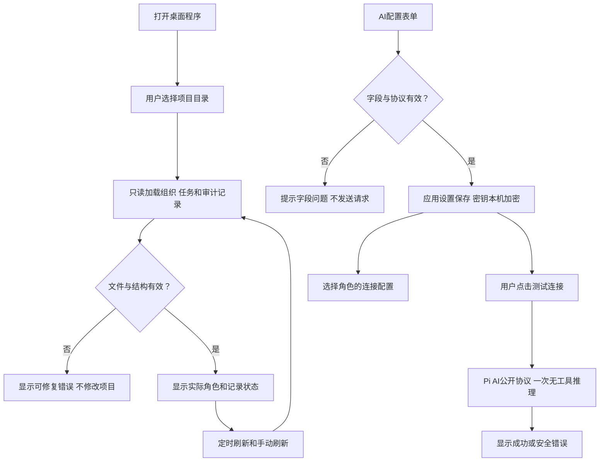

# Legion Desktop GUI v1 草案

日期：2026-10-07。版本：legion-desktop-gui-v1。状态：待 ProjectManager 同版评审与客户确认；没有 GUI 应用代码、安装或新测试执行。

## 用户目标与首版结果

客户要求桌面程序，能够配置 AI，看到角色和状态。首版提供中文 Windows 桌面应用：打开项目目录，管理模型连接，为角色选择连接配置，查看实际组织、任务记录与已有审计状态。产品继续采用 Node；原 Legion Runtime API、CLI、Pi1.0.4 与已验证的 Node 包保持现有契约。

采用 Electron + 普通 HTML/CSS/ESM；三个页面的规模暂不需要额外前端框架或打包器。Electron 内置 Chromium 与 Node，Forge 可打包桌面应用：[官方入门](https://www.electronjs.org/docs/latest/tutorial/tutorial-prerequisites)、[发行流程](https://www.electronjs.org/docs/latest/tutorial/forge-overview)。Electron/Forge 的具体维护版本在实施阶段按实际 registry 和内置 Node >=22.19.0 校验后锁定在独立 package-lock，不虚构未验证版本。

## 界面与操作

| 页面 | 用户操作与结果 |
| --- | --- |
| AI 配置 | 新增、编辑、删除连接；输入名称、协议/provider、模型ID、Base URL、API Key；保存并显示“已保存密钥”；点击“测试连接”发起一次无工具的短推理，显示成功、延迟或安全错误 |
| 角色 | 从当前项目的已接受组织读取角色、汇报关系、职责与文件边界；给角色选择 AI 配置；配置映射保存到桌面应用设置，不修改组织与角色权限 |
| 状态 | 显示项目、组织版本、最近任务阶段、角色任务记录状态、运行审计状态、失败原因与最近更新时间；约1秒刷新，支持手动刷新和状态过滤 |

角色名称来自当前组织文件，不在界面硬编码六个角色。当前项目的六角色定义和状态数据是真实读取源；实施新增 DesktopEngineer 后按实际组织版本展示。

“治理已接受”“任务记录 running/verified/blocked”“已有运行审计 completed/cancelled/failed”是三个不同字段。没有活动任务时显示空闲；没有运行证据时显示“暂无运行记录”，不从 ACCEPTED 推断正在运行。文件记录中的 running 只表示最后记录状态，不作为进程存活证明。应用重新打开时显示数据来源和记录时间，不恢复未知后台任务。



## AI 配置与数据

首版协议固定为 OpenAI Chat Completions兼容、OpenAI Responses和Anthropic Messages，分别使用已安装 Pi AI1.0.4 公开 `api/*` 入口。自定义模型ID和Base URL允许自建兼容服务；HTTPS以及明确配置的localhost HTTP可使用。协议选择决定受控 SDK 入口，配置不能提交函数、脚本、任意模块名或 Shell 命令。

连接测试由用户点击触发，只发送短探测提示词且不提供文件工具；不启动角色工作、不生成文件修改。外部供应商返回、超时、取消、认证失败与协议不兼容必须如实显示；本地受控测试不能标为真实账号已验证。凭据只在主进程和受控 SDK 调用中使用。角色连接映射按项目身份、角色ID保存，连接已删除或角色不存在时显示“未配置”，不切换到另一把密钥。

设置保存到 Electron userData：非秘密字段独立 JSON，API Key通过safeStorage加密。保存后输入框清空，读取仅返回hasSavedKey；编辑时明确区分保留、替换、清除密钥。加密不可用或解密失败时提示重新配置，不回退明文。Windows本机保护采用DPAPI，设置可复制不代表密钥可跨机器解密：[safeStorage官方语义](https://www.electronjs.org/docs/latest/api/safe-storage)。开发与自动化测试把userData指向本项目范围内的隔离目录，不写用户全局Pi配置。

## 桌面边界与合法调用

桌面是独立 `apps/desktop/` 包。Electron主进程持有配置和受控读取权限；renderer仅显示本地内容，通过固定preload方法通信。开启contextIsolation和sandbox，关闭renderer Node；preload为sandbox兼容的 `.cjs`。不暴露通用IPC、文件系统、进程执行或保存后的原始密钥。[隔离指南](https://www.electronjs.org/docs/latest/tutorial/context-isolation)、[sandbox与preload限制](https://www.electronjs.org/docs/latest/tutorial/esm)。

```text
桌面 main / renderer / preload Interface
  -> Desktop Pipeline（配置与观察流程）
  -> Profiles Service / Workspace Service
  -> Settings Provider / Workspace Provider / Probe Provider
  -> Electron safeStorage / 文件系统 / Pi AI 公开 API
```

共享桌面DTO的单一主责为DesktopEngineer；原Core/Agent Model继续由KernelEngineer主责。Interface负责窗口、IPC及输入输出适配；Pipeline负责调用独立Service；Provider执行文件读取、加密和外部推理。桌面Pipeline不调用Kernel Interface、既有PermissionRuntime Pipeline或其内部Service；首版无需改变Kernel编排。

IPC限定选择项目、读取快照、管理连接、设置角色映射、测试/取消连接探测与刷新。主进程检查固定窗口/主frame来源和字段，未知操作拒绝。项目路径由本机目录选择产生主进程句柄，不接受renderer任意文件路径。只读组织、角色定义、`docs/scheduling/*.md` 的已知task_ops记录与 `.ans/events/index.jsonl`；限制大小和条目数、拒绝越界路径和异常结构，日志与模型文本作为文本呈现。面板不调用task_ops、不改变接受权限、不把渲染内容作为指令。

现有任务记录和审计可能不存在、解析失败或不完整，显示“无记录/读取失败/最后有效快照”及时间，不能编造成功或吞掉错误。敏感原文、token、配置密钥、prompt和文件内容不出现在状态快照、日志或打包产物中。

原Kernel owner已只读确认两个现存事件格式：本项目治理index是`event_id/line/file/sequence`引用，daily包含snake_case的组织变更；Kernel工作区则保存camelCase完整Event镜像。Workspace Service分别校验和投影；治理引用不能当作Agent执行事件，未知格式或组织版本不符显示unavailable。有限读取治理daily时检查引用文件仍位于允许事件目录，不按未经验证的任意路径读取。

## 候选文件与所有权

下列为待确认实施范围，未扩展当前已接受 v3 mutation 权限；确认后Governance创建精确新阶段规则并保留旧冻结文件/版本。源文件仅由唯一owner写入。

- DesktopEngineer候选角色：`apps/desktop/src/interface/main.mjs`、`preload.cjs`、`index.html`、`renderer.mjs`、`styles.css`；`apps/desktop/src/pipelines/desktop.mjs`；`apps/desktop/src/models/desktop.mjs`；`apps/desktop/src/services/{abstract,public,impl}/profiles.mjs`与`workspace.mjs`；`apps/desktop/src/providers/{abstract,public,impl}/settings.mjs`、`workspace.mjs`与`probe.mjs`。其测试为 `apps/desktop/tests/unit/{profiles,workspace,pipeline,ipc}.test.mjs`。
- ProjectManager：`apps/desktop/package.json`、`package-lock.json`、`forge.config.mjs`、`main.mjs`、`README.md`，以及 `apps/desktop/tests/package/desktop-package.test.mjs`。main仅负责启动/进程退出与调用Interface，业务不放到root入口。原根package/lock、runtime与CLI不变。
- Reviewer：`apps/desktop/tests/reviewer/desktop-boundaries.test.mjs`，独立检查层边、IPC、凭据和只读范围。
- Tester：`apps/desktop/tests/integration/desktop-flow.test.mjs`、`apps/desktop/tests/e2e/desktop-ui.test.mjs`，独立验证GUI与真实Electron流程。
- KernelEngineer / AgentAdapterEngineer：本阶段只读接口影响评估，既有源码与测试保持；无首版业务修改。
- 各参与角色维护各自现有feature-map、functional-description、api-spec、changelog和architecture/交付（适用），新增本阶段 `docs/design/2026-10-07_design_desktop-gui-v1.md`；DesktopEngineer新增当前功能 `docs/feature/desktop-console.md`。新增确切角色文档路径由Governance在冻结manifest逐一展开，不能把本段当作任意docs写权限。

本阶段生成目录仅由实际owner在批准范围内使用：`apps/desktop/node_modules/`、`apps/desktop/out/`和`.ans/runtime/legion-desktop-gui-v1/{npm-cache,packaging,user-data,fixtures}/`。产物与测试数据不作为源码权限。其他项目、用户全局配置和已验证Node tarball只读；递归清理核对绝对目标及链接。

## 验收与发行

依次完成协议/DTO与设置、组织/状态读取、桌面界面、打包、独立评审和完整流程。必要检查包括连接CRUD/映射与加密错误、组织真实读取与三种状态分离、探测超时/取消、快照缺失/损坏、IPC非法来源和参数、卸载监听与重复关闭、重启设置保留、窗口真实启动与操作、Windows打包后启动。

连接测试使用本地受控HTTP供应商与公开Pi API完成真实请求及错误路径，不依赖付费账号。加密Provider单元替身只证明业务分支；必须另有真实Electron safeStorage保存/重启/解密检查。测试环境无法启动窗口或使用本机加密时保留失败/限制，不用跳过或截图替代行为证据。设置窗口、角色页面、状态页及错误状态需要视觉检查；旧141项结果不是新GUI已通过的证据。

首版交付Windows便携ZIP，包含可双击启动的应用与运行依赖，并验证解压后的启动。仅使用Forge package不等于独立单文件exe。下载桌面依赖在实施批准后进行；本阶段不发布商店或自动更新，也不承诺其他平台通过。

## 可选 O1：在GUI内派发、启动与取消Agent任务

建议作为下一步：用户从角色页直接创建精确writeSet任务并启动/取消真实Pi实例，状态由当前会话与终态审计产生。收益是从观察面板变为执行控制台；额外成本是Kernel公开任务/状态契约、合法跨Service编排、取消竞态与新增完整流程验收。

状态：PENDING，未选择，**不在本版GUI实施范围**。当前连接映射作为桌面已保存配置展示，不宣称外部CLI已自动加载，也不自动启动Agent。O1需另有具体合法Kernel入口及同版评审，不能通过Desktop Pipeline调用Kernel Interface的捷径实施。用户确认本版必需三页面不等于选择O1。

## 评审与确认

根Governance维护这份整体候选设计；原固定ProjectManager评审，并由受影响owner作只读意见。最终评审与SHA另记录在`.ans/decisions/`。本版待客户确认后才扩角色mutation边界、冻结新组织/配置并派发应用实现。
