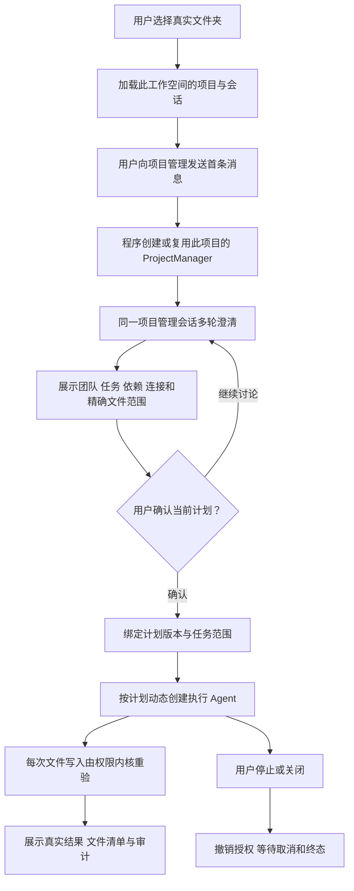

# Legion 工作台 v2

版本：legion-desktop-workbench-v2。当前是方案和交互预览，还没有修改或验证新工作台的应用代码。客户最终明确：“实际上我更希望是一个，就是项目管理。”因此采用唯一项目管理聊天入口，用户确认计划后动态创建执行 Agent。此前独立接待与项目经理的交接方案已撤销。原 GUI v1 的六个节点已验证、Tester 未派发，其证据保留；原 ZIP 不作为新工作台成品。

## 用户怎样开始一个项目

例如用户选择一个空文件夹，输入“我要开发桌面任务管理器，先做任务列表”。工作台始终展示“项目管理”聊天入口。收到首条消息时，程序自动为这个工作空间创建并绑定 ProjectManager，把该消息作为同一管理会话的首条需求。项目管理通过真实 Pi 多轮对话继续提问，提出可修改的计划；用户确认具体计划后，程序才为任务创建对应 Agent 并执行。后续需求、调整、确认和结果汇报仍在同一管理会话中。

这里的 Agent 是运行时动态实例。每个实例有名称、角色标识、AI 连接、任务和操作范围；同一通用 Agent 可以承担项目管理或实现任务。Legion 开发仓库的七个固定开发角色，不直接复制成客户项目的团队。客户文件夹不需要先存在 `.ans/organization` 才能开始聊天。其他 Agent 只能由项目管理按已确认计划创建和调度；用户可以查看它们的任务、文件范围与状态，不能直接发消息或启动它们。主进程同样拒绝这些直接调用，不能只在界面隐藏按钮。

首次使用先保存默认 AI 连接，之后选择文件夹进入对话。已有项目重新打开时恢复项目经理、会话和计划历史；未完成运行显示“上次执行已中断”，不自动恢复未知后台任务或重新付费调用。没有连接、密钥不可解密、目录不可访问时给出对应修复入口，保留尚未发送的输入。



项目管理的计划是待校验数据，不是权限。程序负责创建实例、绑定身份和保存计划；模型不能通过自称“已批准”启动执行，也不能自行扩大文件范围。选择文件夹本身不创建活动模型请求，首条消息才创建或复用管理实例并启动当轮对话；失败重试不能重复创建经理或团队。

## 界面重做

推荐“协作工作台”：左侧是当前项目和动态团队，中间是主要对话、计划确认和任务结果，右侧是可收起的项目上下文、当前阶段与操作范围。AI 设置作为次级入口。另一份“专注对话”预览去掉常驻右侧栏，把详情收起，适合先讨论需求。

使用紧凑的桌面字号和统一间距，浅色和深色均采用中性色；强调色只表达选中和状态。减少大标题、重复卡片与整页提示，把文件范围、来源和审计放到按需展开的详情。对话输入固定在工作区底部；生成中有明确停止按钮，失败保留用户输入和可重试状态。角色行显示本次实例状态，历史记录状态单独标注。

本次对话提供了可切换的交互原型，可以体验需求讨论、计划确认、创建团队、只读任务详情和停止的布局变化。原型使用示例数据，没有调用 AI 或执行项目任务；它不替代真实 Electron 验收。对应当前桌面功能历史是 [desktop-console](../roles/DesktopEngineer/docs/feature/desktop-console.md)。

## 多轮会话与可信执行

复用现有 Pi coding-agent 1.0.4，不另造一套通用引擎。原单次执行模式 `single_run` 保持默认和既有行为；新增 `conversation` 模式支持多轮、文本流、轮次取消和受限历史恢复。停止本轮不会销毁整个对话；关闭实例、停止执行和关闭窗口仍撤销实例授权并等待结束。晚到的旧轮次事件不能覆盖新轮次。

项目管理讨论使用空工具、空写范围。确认后的执行使用现有受控 `legion_write_file`，实例范围必须是角色边界和任务精确 writeSet 的交集。不会启用 Pi 默认文件工具、扩展发现或任意 Shell。

用户可明确选择需要作为上下文的项目文件；主进程经过有限读取和路径校验取得文本、大小与 SHA，再供模型使用。模型不能自行选择或扩大 contextReadSet。拟预算为 UTF-8 单文件 256KiB、16 个文件、总计 2MiB；确认时绑定读取版本，源变化导致计划失效时需要重新确认。任务输出可作为依赖任务的经验证输入，不把模型自行宣称的结果当作已写文件。

计划必须列出项目、版本、拟创建的角色、AI 连接版本、任务依赖和每个任务的精确文件清单。用户确认产生一次性确认凭据，绑定工作空间、planDigest、组织版本、roleId、taskId、writeSet、工具、profileVersion 和 contextSnapshotDigest。计划或范围变化不能复用旧确认；取消、撤回、关闭和版本变化使旧授权失效。既有 requiredApprovals 仍生效，`.ans` 控制面写入仍受硬拒绝规则约束。

本版“执行完成”指已确认任务的真实 Pi 运行和受控文件操作结果。生成验证用例不等于运行软件测试；没有实际运行证据的检查显示 `not_executed`。本版不新增自动 Shell 检查执行器。自动运行命令需有固定 checkId、参数、目录和取消契约，不能把任意命令藏在对话里。

## 保存、读取和错误

用户项目定义、对话文本、计划与历史保存在桌面 userData 中，按工作空间身份隔离；API Key 继续由 safeStorage 加密，不读回 renderer。讨论阶段不调用旧 PermissionRuntime 的写审计流程，不在客户项目产生审计文件。确认后的文件执行采用现有 Kernel 存储审计；界面在确认摘要中说明执行会产生项目审计记录。

恢复只接受已验证的用户/助手文本及项目资料，不能恢复 permit、确认凭据、pending 工具请求或活动任务。清理会话不会删除客户源码。认证错误、网络失败、取消、写入拒绝和审计故障必须分别显示安全错误；原始供应商错误和凭据不进入日志或状态 DTO。

原 GUI 的 1MB 任务文档预算已经让本仓库正在进行的任务也无法显示。新版拟采用单任务文档 16MiB、4096 事件、单次刷新总读取 64MiB 的明确预算，保留完整哈希链与渲染记录一致性验证；超限仍显示明确的预算错误，不截断后伪称验证成功。仅复用已验证且 mtime/size 未变的缓存，显示观察时间与最近验证时间；mtime 不能独立证明内容真实性。

只有用户发送消息、测试连接或确认启动任务才发起相应 AI 请求；启动应用和打开文件夹不自动发送模型请求。对话和执行会使用用户配置的供应商，可能产生该供应商的费用。开发验收使用 localhost 受控协议，不依赖付费账号成绩。

## 合法调用和发行

采用唯一 Workbench Pipeline，主责 DesktopEngineer，直接组合 Desktop、Kernel 和 Adapter 的公开 Service；不调用旧 Kernel Interface 或同行 PermissionRuntime Pipeline。讨论分支只调用 Conversation/History/Project 等所需能力；执行分支才使用 Kernel Policy/Mutation 与 typed authority。共享批准和 Pi 会话 Model 由 KernelEngineer 唯一主责。

```text
Desktop Interface → Workbench Pipeline
  → Profiles / Project / History Service → 各自公开 Provider
  → Kernel Policy / Mutation Service → 现有 Storage Provider
  → Adapter PiAgent Service → PiSession Provider → 真实 Pi SDK
```

旧 Desktop Pipeline、Settings、Probe 与原桌面 Model 可继续保留；Profiles 新增仅主进程使用的连接解析，返回受限 plain connection 和 profileVersion。PiSession Provider 自己根据固定协议选择公开 SDK 入口，Pipeline 不向下传入构造好的 streamSimple 回调。

Kernel 唯一拥有纯 `workbench` Model，具名公开 `ContextReadConfirmation`、`ContextSnapshot`、`ConfirmedTaskGrant`、`createWorkbenchAuthority({workspaceIdentity, organizationVersion, profileVersion, boundaries})`。factory 返回冻结的 `{controller, mutationAuthority}`：只有上层 controller 可确认上下文读取、绑定文本快照、确认任务、注册实例、开始/结束运行、签发和撤销；Mutation 接收的品牌 authority 只有 consume/recheck/release，不持有确认或签发能力。controller 具体方法为 `confirmContextRead/checkContextRead/bindContextSnapshot/confirmTask/registerInstance/instanceSnapshot/beginRun/finishRun/issue/revoke`。快照绑定每个资源路径、字节数和 SHA；现 Storage Provider 在真实写入前重查项目根、链接路径和上下文 SHA，变化即拒绝当前确认，不仅比较一份旧 digest。原 TaskDispatchContext.digest 保持原义。

Adapter 公共 `createPiAgentService` 保留原参数，新增纯数据 `connection` 与主进程私有 `credentials: {apiKey}`，与旧 `modelProviders` 二选一，同时传入或缺少完整连接/密钥均拒绝。Kernel 在共享 `agent.mjs` 定义 `PiConnectionProfile`：`profileId/profileVersion/protocol/provider/model/baseUrl/modelMetadata?`，无 key 或 function；限定现有三种协议，provider/model 必须匹配可信代理。每实例有独立凭据、Session、ModelRuntime registry、流与队列，冻结连接版本；Provider 内部静态选择 installed Pi SDK 公开协议入口。历史不能覆盖连接、代理或权限。未知 metadata、能力与费用保持 unknown；SDK 所需的零费用占位只用于运行适配，不展示为真实报价，也不据此计算预算。

发行使用新版 Legion Node 本地 tarball 与独立 desktop 包。PM 增加有限公开子路径 `legion-runtime/services/{policy,mutation,proposal,pi-agent}` 和 `legion-runtime/workbench-models`，透明地导出既有 public 层及必要纯 Model；不导出私有 `_createRuntimeAuthority` 或 lower-layer 对象。Desktop 通过实际安装的 tarball 调用，ZIP 必须包含全部依赖；禁止越出 apps/desktop 的相对源码导入、工作区 symlink 或依赖开发树来启动。

现有 0.3.0 tarball 与 GUI v1 ZIP 保留历史。新版发布新版本、本阶段独立产物路径，重新验证真实 ZIP 解压启动、公开子路径、生产依赖和所有 shipped source。精确文件 manifest 和版本由批准后的治理及 PM 打包阶段冻结，不沿用旧版冻结文件的修改权限。

实施依赖顺序为 Kernel Model/Policy/Storage → Adapter 多轮和连接 → PM 公开入口及新 tarball、desktop 实际依赖安装 → Desktop 工作台和界面 → PM 新 Windows ZIP → Reviewer → Tester。后段不得先用开发源码临时连通，再声称包依赖已验证。选择这个完整方案，是因为仅在旧三页面上加聊天框无法完成用户要求的确认后执行；取消独立接待则减少一次模型交接和重复上下文。真实流式会话、授权及发行变化涉及多个 owner，需要重跑影响到的旧回归和新版验收；没有待选的额外功能。

## 角色和验收范围

必要责任如下，最终精确清单由管理评审和治理 manifest 展开；本设计不是现行 mutation 权限。

| 固定开发角色 | 拟负责的必要变更 |
| --- | --- |
| KernelEngineer | 新纯 `src/kernel/models/workbench.mjs`；现有 `models/core.mjs`、`models/agent.mjs`、`services/impl/policy.mjs`、`providers/impl/storage.mjs`；对应模型、scope、context 重查和新 workbench 模型测试；单一确认/authority/会话 Model |
| AgentAdapterEngineer | 现有六个 `pi_agent` Service / `pi_session` Provider 文件；既有两份 Adapter 测试；多轮、流事件、取消和恢复，不造第二套引擎 |
| DesktopEngineer | 新 workbench DTO/Pipeline、Project 与 History 各层能力和单元测试；现 Profiles/Workspace 公开能力、五个 Interface 文件和既有四份桌面单元测试；专业工作台视觉与真实 IPC |
| ProjectManager | 新有限 npm 子路径入口、根包/锁与 desktop 包/锁、打包入口/配置/验证和 README；新版 Node tarball 与 Windows ZIP 验证 |
| Reviewer | 独立检查层边、确认凭据、动态身份、IPC、凭据和发行源身份 |
| Tester | 独立完整流程、真实 Pi 多轮与三协议、确认前零项目写、精确范围拒绝、取消竞态、重启隔离和实际 ZIP GUI 操作 |
| Supervisor | 依赖阶段、精确派发和证据收束；保持唯一调度，不代写同行应用 |

必须覆盖：任意文件夹首消息自动创建/复用唯一项目管理实例；所有需求、确认与结果在同一管理会话；其他 Agent 直接聊天/启动在 IPC 与 Pipeline 层被拒绝；多轮输入、流回复和停止本轮；没有 Human 确认不能执行；确认一次不能重放；动态团队和依赖调度；多个项目/会话隔离；越界和 `.ans` 拒绝；连接、源文件或计划变更使旧确认失效；退出不留下活动实例；DPAPI 重启；实际新版 ZIP 不依赖开发树；浅/深色、最小窗口和错误状态的真实视觉检查。原 141 项和 GUI v1 成绩不替代新版验收。

所有必要影响及上述公共 authority / plain connection 已取得对应 owner 的只读建议。当前待这份最终文档的同版管理评审及客户实施确认，没有启动新代码改动。
