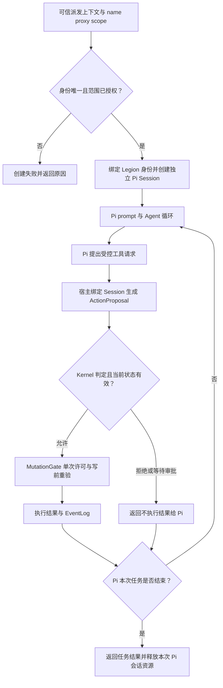

# Pi 通用 Agent 配置与受控执行：v2 草案

日期：2026-10-07。状态：SUPERSEDED。客户随后授权开发，并要求整个运行时切换 Node.js；当前实施以 [Node + Pi v3 设计](2026-10-07_design_node-pi-v3.md) 为准。本草案的 Python / 子进程接入安排不再实施。

## 用户要完成的事

Supervisor 通过 Legion 的薄配置入口创建 Pi Agent Session，只需要配置名称、代理连接和操作范围。Pi 直接提供实际 Agent、模型交互、对话上下文和执行循环；Legion 负责可信组织身份、实例登记、任务派发、受控工具与审计。两个实例可以使用不同名称、模型与范围，各自保留独立 Pi Session。KernelEngineer、Tester 等角色由组织与任务配置绑定。

执行引擎固定为 Pi。“代理”暂按 Pi 使用的模型 provider / 连接配置理解，保留参数名 `proxy`；它用于选择模型连接。若客户指的是 HTTP/SOCKS 网络代理，它应放在该连接配置内；此项连接语义待澄清，不据此安装或调用外部服务。

## 目标入口

下列是拟采用的 Python 使用方式，不是当前已存在的 API：

```python
agent = runtime.create_agent(
    name="kernel-worker-1",
    proxy=PiConnection(provider="configured-provider", model="configured-model"),
    scope=AgentScope(
        write=("src/kernel/models/core.py", "tests/kernel/test_models.py"),
        deny=(".ans/",),
        tools=("legion_write_file",),
    ),
)

result = agent.run(task)
```

`runtime` 已持有可信组织配置和 Supervisor 的当前派发上下文；`task` 是派发任务。角色身份、task_id、组织版本由该上下文提供，模型返回的身份声明不覆盖它们。

`create_agent`、`PiConnection` 和 `AgentScope` 是 Legion 拟提供的配置入口。Pi SDK 的原生入口是 `createAgentSession()`，不原生接收上述三个 Legion 参数；薄配置层将它们转换为 Pi 模型/会话/工具配置和 Legion 的可信实例记录。`agent.run(task)` 拟将任务交给 Pi 的 `session.prompt()`，并订阅其运行事件。对话推进、上下文管理和推理循环由 Pi 完成。

| 输入 | 意义 |
| --- | --- |
| name | 实例标识与审计关联；同一 Runtime 内唯一，不产生角色权限 |
| proxy | Pi 的模型 provider / 连接配置；交给 Pi 初始化模型访问，不产生文件执行权限 |
| scope | 本实例请求使用的写入文件/目录、显式禁止范围和工具集合；只允许缩小当前角色与任务已接受的权限 |

首版范围采用现有 Kernel 语义：以 `/` 结尾表示目录下文件，否则为精确文件，不支持 glob。角色权限、任务许可和实例请求必须同时满足；deny 优先。请求包含未获授权的文件或工具时，创建阶段明确拒绝并说明原因，不悄悄扩大授权或截掉部分范围后继续。

网络连接参数与凭据属于代理后端配置，不能被解释为权限；凭据不进入名称、提案或审计日志。

## 运行过程



Pi 保存每个实例独立的对话与 Agent 状态；Legion 保存可信 Session、固定角色与任务状态。共享的模型连接配置可以复用，运行中的可变对话和许可不能在不同 Worker 间复用。名称不能切换一个已经绑定的角色。任务完成、取消或组织/边界变更使旧执行许可失效。Pi 会话中的消息和名称不能替代 Legion 的可信身份记录。

Pi 只能使用宿主显式提供的工具。Pi 内置的直接 edit/write/bash、自动扩展或额外工具发现不能形成另一条业务执行路径；第一个闭环只提供已支持的 `legion_write_file`。scope 的说明可进入提示词帮助模型规划，实际权限必须在 Kernel 中执行检查。

## 复用与跨角色分工

当前 [Kernel 接口](../roles/KernelEngineer/api-spec.md) 已有 AgentSession、RoleBoundary、ActionProposal 和 PermissionRuntime，可复用可信身份、路径判定、单次许可、写前重验与审计失败语义。Runtime 拟提供 Pi 实例的薄配置与任务组合入口，使用 Adapter 的公开服务；Pi 桥接不自行修改 Kernel 的授权状态。

- KernelEngineer：共享配置 Model、实例范围校验、固定 Session、Pi 配置入口与 Runtime 的组合，及 owner 测试。
- AgentAdapterEngineer：Pi 会话公开服务、模型连接配置、生命周期桥接及受控工具请求转换，及 owner 测试。通过 Service → Provider 接触外部进程或 SDK，不让 Pipeline 直接调用基础设施。
- ProjectManager：评估本草案的架构、跨角色影响和具体实施范围。
- Supervisor：按已接受任务与边界创建实例和派发，不自行扩权。
- Reviewer / Tester：独立核验所有权与调用层次，以及两个不同配置实例经真实公开入口的隔离与回归。

现有 [Adapter 接口](../roles/AgentAdapterEngineer/api-spec.md) 只是本地受控提案转换，不代表 Pi 桥接已存在。新增源码、测试、TypeScript 桥接与依赖配置的精确路径须在正式方案中确定，由 Governance 更新已接受边界后才实施；本草案不授予这些路径写权限。

Pi 目前提供可嵌入的 [TypeScript SDK](https://pi.dev/docs/latest/sdk) 与 [CLI RPC](https://pi.dev/docs/latest/cli-integration)。SDK 可显式配置模型、SessionManager、ResourceLoader、默认/自定义工具，支持运行事件订阅、取消与释放。Python 内核拟通过一个 Node.js SDK 桥接进程创建受控 Pi Session；需要明确配置会话存储、资源加载与工具集合，具体消息协议及版本锁定留给正式接入方案。桥接进程中直接使用 Pi Agent，实现仅围绕配置转换、可信身份绑定和工具转发。

## 实施后需要证明

以下均待验证，不引用 v1 的 101 项通过结果作为 v2 证据：

1. 同一个薄配置入口创建两个不同名称/模型连接/范围的真实 Pi Session，Session 与对话互不串用。
2. 合法文件写入成功；越界、deny、未授权工具和模型伪称身份均拒绝。
3. 非法或重复名称、错误代理配置、标量字符串范围等输入明确失败。
4. 取消、任务完成与组织版本变化后旧许可不能执行，不能靠改名恢复权限。
5. Pi 正常结束、失败或取消时能释放会话/进程；审计失败仍如实报告已发生的修改。
6. Pi 工具请求实际通过公共 Kernel 入口；不存在默认写工具或 shell 绕行；当前 v1 的受影响回归重新通过。

本轮目标是通用配置实例与受控 Pi 写入闭环。模型读文件授权、通用 shell、任意动态插件和并行多角色调度均需各自确定能力契约，未包含在此草案的首轮实现范围。
