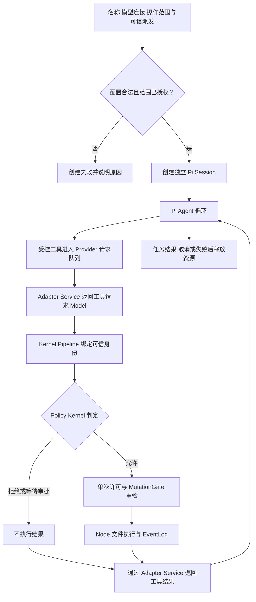

# Legion Runtime：Node.js + Pi 通用 Agent v3

日期：2026-10-07。客户已授权目标实施；独立 ProjectManager 与两位工程 owner 的只读评估已完成，本版固定接口、精确文件和验证顺序。此设计和治理接受不代表实现已完成；完成证据由新任务产生。

## 客户目标与授权

客户希望 Pi 直接承担通用 Agent，通过名称、代理连接和可操作范围创建不同实例。客户已在看到 [Pi v2 草案](2026-10-07_design_generic-agent-v2-draft.md) 后指示“开发把”，随后明确“你整个运行都切换成node 把，后面发行也好发行点”。本版把这些要求合并为全 Node.js 产品运行时与同进程 Pi 会话接入。授权原文与阶段变化见 [治理记录](../../.ans/decisions/legion-pi-authorization.md)。

目标是用户安装一个 npm 包后使用 Node API 或 CLI：同一个入口创建不同名称、模型连接与范围的 Pi 实例，模型提出修改时由 Legion 权限内核检查，返回实际执行结果并生成审计。发行包和产品测试不依赖 Python。

## 运行与配置

计划使用纯 ESM `.mjs` 源码，直接消费 Pi SDK，减少发行前编译步骤。宿主已验证 Node.js 24.11.1 / npm 11.6.2；Pi 1.0.4 要求 Node.js >=22.19.0。依赖以 package 与 lockfile 固定，使用项目局部安装，不写用户的 Pi 全局配置。

下列是固定的 Node 使用形式，实现完成后可用：

```javascript
const runtime = createRuntime({
  workspace,
  boundaries,
  organizationVersion: "v002",
  dispatchContext,
  modelProviders,
});

const agent = await runtime.createAgent({
  name: "kernel-worker-1",
  proxy: { provider: "configured-provider", model: "configured-model" },
  scope: {
    write: ["src/kernel/models/core.mjs"],
    deny: [".ans/"],
    tools: ["legion_write_file"],
  },
});

const result = await agent.run({ taskId: dispatchContext.taskId, prompt });
```

Runtime 持有可信组织和当前任务派发上下文，提供固定角色、task_id 与组织版本。name 用于实例识别，不产生权限；proxy 暂按已展示的模型 provider / 连接配置解释。实例请求范围必须同时满足已接受角色与任务权限；未授权请求明确失败，deny 优先。

每个实例使用独立 Pi AgentSession 与对话状态。Pi 负责模型交互、Agent 循环和上下文；Legion 的入口负责配置转换、可信身份、工具执行与审计。scope 可进入提示词，但其效力来自 Kernel 的实际检查。

## 权限执行链



相邻层路径为 Interface → Pipeline → Service → Provider → Pi SDK / 文件系统，Model 被各层共享。Pi 的自定义工具在 Provider 内等待结果；Pipeline 通过 Adapter Service 拉取请求和提交结果，不把上层业务 callback 注入 Provider。

首轮只启用 `legion_write_file`。默认 edit/write/bash、自动扩展、MCP 和额外工具发现必须关闭或使用显式空资源配置，以免形成旁路。模型 payload 中的 name/role/task/version 不覆盖可信 Session。

## Node 迁移与必要验证

KernelEngineer 迁移现有 Model、PolicyDecision、MutationGate、EventLog、PermissionRuntime 和 demo，并实现实例配置与范围绑定。原 v1 路径、审批别名、标量集合、单次许可、版本/任务失效、文件失败与审计失败语义必须保留。

AgentAdapterEngineer 提供同进程 Pi Session 的 Service / Provider、公开生命周期接口、受控工具请求与结果转换。ProjectManager 评估架构并负责 npm package、lockfile、发行文档与本地打包验证。Supervisor 仍是唯一执行 scheduler；Reviewer 与 Tester 独立检查结构和完整流程。

现有 Python 源码与测试保留为只读历史，新的产品入口与发行包只含 Node 实现。旧 v1 的 101 项通过不能直接证明迁移成功，必须转换并实跑受影响 Node 回归。至少验证：

1. Node 权限 demo 与 v1 行为一致：合法 Backend 写入成功，五类拒绝保持，Frontend 原值保留，审计有序可读。
2. 审批路径别名与标量限制回归不弱化，许可不能伪造或重放；取消、完成、边界/版本变化使旧权限失效。
3. 实际 Pi SDK 创建两个独立会话，使用受控本地测试模型运行模型→工具→Kernel→文件/审计闭环；不仿制 Pi，也不依赖付费模型请求。
4. 实例 scope 确实限制操作，实例之间不串用会话、工具请求、结果或许可；错误配置与资源释放有明确结果。
5. 文件与结果日志不是跨文件事务；替换后审计失败仍如实报告已发生的修改，并禁止继续执行。
6. 本地打包产物的入口与文件清单正确，在隔离临时目录中导入/启动成功，产品使用不调用 Python。npm 发布与外部部署不在本轮。

## 已评估的公共契约

KernelEngineer 是所有跨模块 Model 的唯一主责。`TaskDispatchContext` 固定 `roleId/taskId/organizationVersion/writeSet/tools`；writeSet 为任务的精确文件集合，不能被模型或实例配置扩大。`AgentConfig` 是 `name/proxy/scope`，scope 包含 `write/deny/tools`。创建时验证配置与角色、任务上限，实际每次执行仍取三者交集，deny 优先。集合必须防御性复制并真正不可变；冻结可变 Set 的外壳不能作为证据。

`AgentInstance` 公开只读 `instanceId/name/sessionId/roleId/taskId/organizationVersion` 和 `run/cancel/close`。`run` 校验 taskId，一次实例只运行一次任务；完成、取消或失败均释放会话。取消先撤销许可，再停止 Pi；晚到的创建结果也必须释放。未知 provider/model 在创建时失败。可信 Runtime 宿主可以 `updateVersion/updateBoundary/setTaskStatus`、观察事件和文件、`close`；Agent 不暴露 Kernel Service、Provider、SDK Session 或许可。

保留 Node `PermissionRuntime` 的 `prepare/execute/submit/updateVersion/updateBoundary/setTaskStatus/events/readFile/close` 公开语义。审计在相同工作区的不同 Runtime 间协调提交顺序；不声称隔离同进程恶意宿主，也不声称文件与两份 JSONL 是一个跨文件事务。

Pi Adapter Service 提供 `start_run(runId,prompt)`、`next_event(runId,{signal})`、`respond_tool(request,result)`、`cancel/close`。`start_run` 启动真实 Pi prompt 后立即返回，随后 Pipeline 拉取队列，避免工具等待与 prompt 等待互相堵塞。事件类别为 `tool_request/run_event/run_finished/run_failed/run_cancelled`，host 生成 runId。

`PiToolRequest` 包含 `requestId/runId/toolCallId/tool/parameters:{resource,content}`；`PiToolResult` 包含 `requestId/runId/decision/result`。结果只能回应原请求及当前 run 一次，重复、其他实例、已结束 run 或晚到回应不能复用。`PiRunResult` 包含 `runId/status/assistantText/toolResults/errorCode`，status 为 `completed/cancelled/failed`。Proposal Adapter 仅从可信身份和工具 Model 构造 ActionProposal，不赋权、不执行。

`modelProviders` 是可信宿主注册的 Pi 推理 provider/model 元数据与 `streamSimple` 策略，可使用内存凭证；它不能收到 Runtime、许可、写文件或 submit callback。真实 `AgentSession` 不可替换。测试可以给真实 SDK 注册受控本地推理模型，不能把自制 Agent 循环称为 Pi。

固定依赖 `@earendil-works/pi-coding-agent@1.0.4` 与 `@earendil-works/pi-ai@1.0.4`，lockfile 固定实际安装树。只用公共入口，安装后核验版本与导出。ModelRuntime 使用公共内存 credential store、`modelsPath:null/refreshOnCreate:false/allowModelNetwork:false`，Session/Settings 使用内存实现；显式空 ResourceLoader、关闭扩展/MCP/codemode/tool_search、唯一 active tool 为 `legion_write_file`，prompt 使用 `expandPromptTemplates:false`。不得读写用户 Pi 全局配置。

## 精确所有权与发行入口

执行策略 [project.json](../../.ans/project.json) 和六角色 boundary.md Section 1 列出全部精确文件。以下目录描述仅用于解释，不扩大该清单：

| Owner | 本轮实现 |
| --- | --- |
| KernelEngineer | 14 个 `.mjs`：core/agent Model；policy/mutation 三层 Service；storage 三层 Provider；permission Pipeline；runtime/demo Interface。8 个 Kernel Node 测试。 |
| AgentAdapterEngineer | 9 个 `.mjs`：proposal 与 pi_agent 三层 Service，pi_session 三层 Provider。3 个 Adapter Node 测试。 |
| ProjectManager | package.json、package-lock.json、runtime.mjs、bin/legion.mjs、README.md、tests/package/test_package.mjs。 |
| Reviewer | tests/reviewer/test_structure.mjs 与独立评审说明；业务源码只读。 |
| Tester | 两个 integration Node 测试与 controlled_pi_model.mjs；业务源码只读。 |
| Supervisor | 独占调度与本阶段交付说明；业务源码只读。 |

所有 owner 更新自己的四个当前导航/API/变更说明及本阶段 dated design；功能 owner 更新对应当前 feature。旧 phase1 design、review、verification 和 delivery 保持历史只读。

包为单个 ESM npm 包，`exports` 仅公开 `runtime.mjs`，`bin` 指向 `bin/legion.mjs`；入口只转到 Kernel Interface 公共 facade。以 `files` 白名单收录 Node 产品源码与必要发行说明，排除 `.ans`、Python、tests、开发工具、依赖缓存与临时包。用户可安装后导入 `createRuntime` 或运行 CLI demo；本轮验证本地 npm tarball，不向 registry 发布。

ProjectManager 独占依赖生成效果 `node_modules/`、`.ans/runtime/legion-pi-node-v3/npm-cache/`、`.ans/runtime/legion-pi-node-v3/packaging/`。这些是依赖或本地打包产物，不是可任意修改的业务源码，也不是 authored candidate。测试临时工作区只能放在获准的 workspace/TEMP，清理前验证绝对路径。

## 固定执行顺序与验收

七节点：`deps`（ProjectManager package/lock）与 `model`（Kernel 两个 Model 与两个测试）可并行；`adapter` 依赖二者；`kernel-runtime` 依赖 model/adapter；`package` 依赖 kernel-runtime；`reviewer` 依赖 package；`tester` 依赖 reviewer。最多两个 worker。阶段 writeSet 精确缩小角色边界，后段不普通覆盖已冻结前段输入；需要修复由 Supervisor 正式返工并重验受影响调用方。

deps 核验实际 public SDK 导出、两个1.0.4版本和完整依赖树。Model 跑两个测试。Adapter 跑三个测试。Kernel 分别验证 policy/scope、mutation/events、agent runtime、全部8个测试及 CLI permission demo。package 验证 Node facade 与 CLI，`npm pack --dry-run --json --ignore-scripts`，并在 package 测试里实际生成 tarball、隔离安装、公共导入、CLI 启动和文件白名单。Reviewer 独立结构测试；Tester 运行 permission flow 与真实 Pi generic agents 完整闭环。

具体无 shell 拼接 argv 固定在 project.json；Windows 的 npm 检查用已核验本机 npm-cli.js 经 Node 执行。依赖安装不能触发包脚本。SDK 不存在、真实会话未执行或离线测试失败必须报错，不能跳过或用旧 Python 成绩替代。

每个阶段记录精确 input hash、candidate、环境、命令、exit code 与未完成项。最终完成要求全部七节点 verified、当前候选全链验证、无活动 worker、owner 当前说明与本地发行 smoke 均一致。旧 v001 与原任务证据保留，治理工具 task_ops 的 Python 不属于产品运行或发行依赖。

参考：[Pi SDK](https://pi.dev/docs/latest/sdk)、[Pi 1.0.4 官方包元数据](https://registry.npmjs.org/@earendil-works/pi-coding-agent/1.0.4)、[显式配置示例](https://github.com/earendil-works/pi/blob/main/packages/coding-agent/examples/sdk/12-full-control.ts)。
