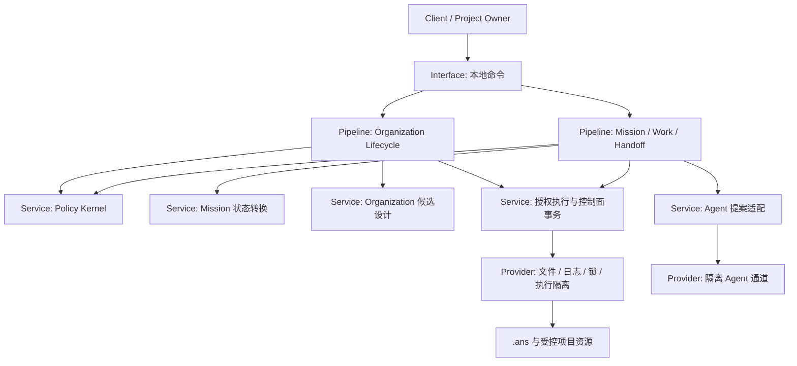
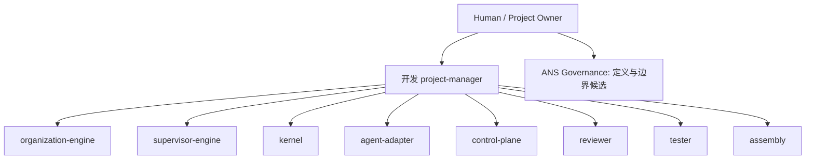
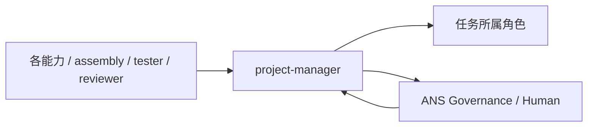
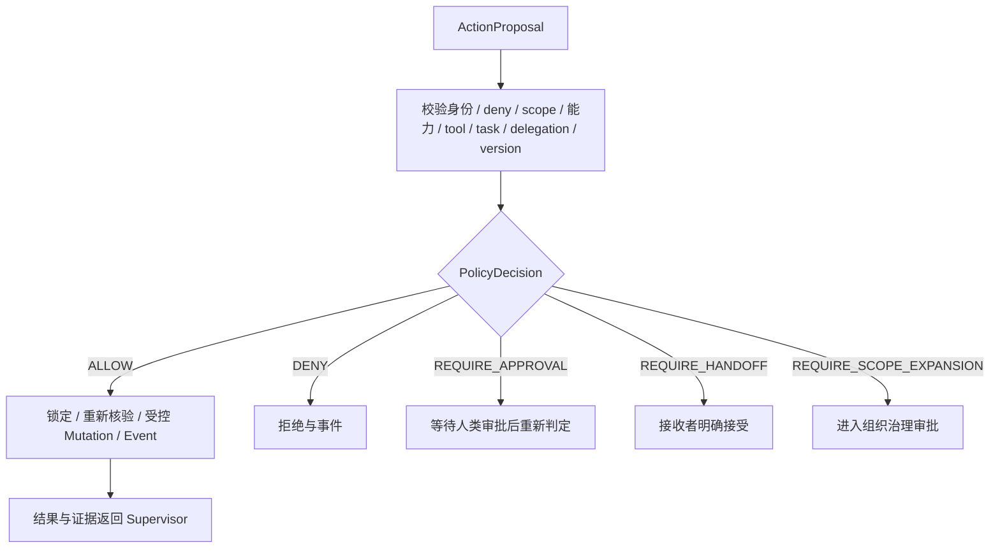
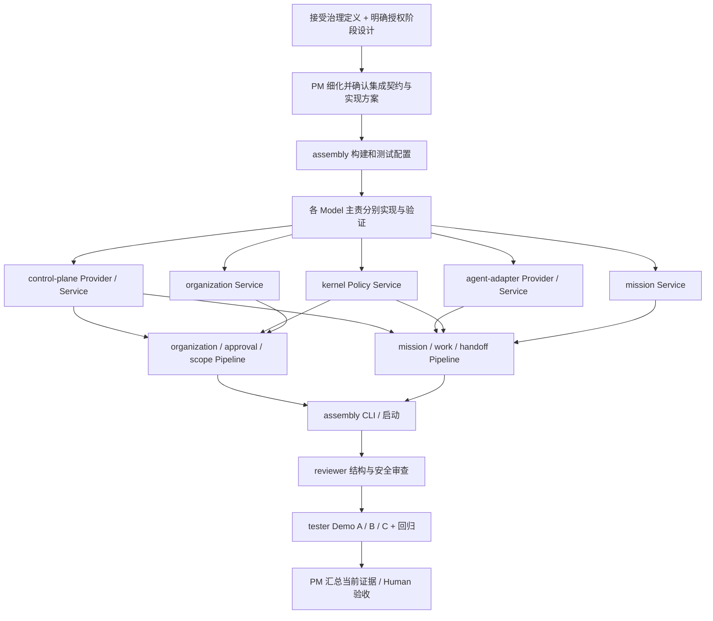

# Organization Proposal v1

一个人提出开发目标，Agent 负责拆解、提出修改和交接；确定性的系统负责判断谁能修改什么。比如 Backend 想修改 Frontend 的登录页，系统拒绝写入，返回交接或权限申请路径。用户要求增加数据库工程师时，先看到候选职责和边界，批准后才出现正式角色与新组织版本。

本次是新项目 bootstrap 候选，未实现软件、未启动 Agent、未批准角色。原始需求见 [用户原文](2026-10-07_original-requirements.txt)。从 [`.ans/README.md`](../../.ans/README.md) 开始阅读。

## 1. Project Architecture

第一阶段完成 Work Governance Loop 和 Organization Governance Loop，以及 Demo A 越权拒绝、Demo B 审批创建角色、Demo C 显式交接。所有第 32 节核心对象纳入 Model。先做本地命令入口和文件控制面；完整 Web Command Center、远程集群和额外 Agent SDK 适配不属于本阶段。

建议以 Python 源文件规划所有权；这是待接受的技术选择，当前不安装依赖。设计不依赖指定 LLM 厂商。第一阶段使用可复现的 Agent 测试适配器，真实模型适配另交方案。



接口只调用 Pipeline，Pipeline 组合不同 Service，Service 只调用 Provider 公共入口。Model 为共享数据与纯不变量，不能读取基础设施。Service 不调用其他 Service；Provider 不调用其他能力 Provider。公共入口按能力分别命名，避免公共聚合文件被多人修改。构造与注入也遵守相邻层限制，装配入口不直接实例化基础设施对象。

Policy Kernel 是纯确定性决策；执行控制面是可信计算基的一部分。规划 Agent 无原始宿主写入和 shell 工具，Adapter 只返回 Proposal。可信执行通道核验授权许可、调用者身份、任务与组织版本后执行；文档或 YAML 本身不是安全隔离。第一阶段只能宣称已验证的受控通道受到保护，不能宣称能阻止宿主管理员篡改。

## 2. Source Directory

这里只规划，当前不创建源码、测试或构建配置。

```text
src/
  main.py                              assembly
  interface/cli.py                     assembly
  pipelines/{organization,mission,work,handoff,approval,scope}.py
  services/abstract/{organization,mission,policy,agent,control_plane}.py
  services/public/{organization,mission,policy,agent,control_plane}.py
  services/impl/{organization,mission,policy,agent,control_plane}.py
  providers/abstract/{agent,control_plane}.py
  providers/public/{agent,control_plane}.py
  providers/impl/{agent,control_plane}.py
  models/{organization,mission,policy,agent,control_plane}.py
  common/{role-id}/                     各角色私有支持代码
  common/shared/                        仅 project-manager
tests/{role-id}/                         独占测试目录
docs/design/                            原始需求、候选总体方案
.ans/                                   所有治理控制数据
```

精确源码白名单见各角色 boundary.md Section 1。命名相似不代表拥有该文件；层内 abstract/public/impl 都由同一能力主责角色管理。没有整棵 src/ 写权限。

Model 唯一主责：organization-engine 拥有 Project、ProjectManager、RoleDefinition、RoleState、Organization、OrganizationVersion、OrganizationRequest、RoleCreationRequest、BoundaryChangeRequest、ScopeExpansionRequest、OrganizationChangeProposal、Contract、ApprovalRequest；supervisor-engine 拥有 Mission、Task、Handoff、CapabilityGap；kernel 拥有 AuthorityBoundary、ActionProposal、PolicyDecision；control-plane 拥有 Event。跨文件引用只读，不重复定义这些对象。

## 3. .ans Control Plane Directory

```text
.ans/
  README.md
  project.yaml
  organization/{current.yaml,graph.yaml,versions/}
  roles/{role-id}/{README.md,role.yaml,boundary.yaml,state.yaml,
                   role-card.md,boundary.md,changelog.md,docs/}
  missions/{active/{mission-id}/{README.md,mission.yaml,task-graph.yaml,state.yaml},archive/}
  handoffs/{active/,archive/}
  contracts/{contract-id}.yaml
  requests/{role,boundary,capability,organization,scope}/
  approvals/{pending,approved,rejected}/
  decisions/
  runtime/{agents,locks,queues,checkpoints}/
  events/{index.jsonl,YYYY-MM-DD.jsonl}
```

角色卡集中在用户指定的 `.ans/roles/`，不另建角色卡根目录。role.yaml 描述身份，boundary.yaml 保存候选机器边界；boundary.md Section 1 是本项目开发上下文的候选修改清单。bootstrap 从同一份路径集合生成两者；接受后变更须由 Governance 同步核验，冲突默认拒绝。role.yaml 不覆盖边界。

组织版本目录现在为空，current.yaml 的 version 为 null，候选版本标识为 proposal-v1；不得把候选 v001 写成已接受版本。首次正式提交才生成 v001。Mission 放 active 路径但状态是 PROPOSED，不代表已经开工。Approval、Event 与 Handoff 目录现在为空，不伪造批准和交接。

此仓库 `.ans` 管理开发本软件的组织；软件将来管理目标项目时，在目标项目自己的 `.ans` 建立运行时控制面。禁止运行时 Demo 直接改写本仓库的开发权限。产品 ProjectManager 与 Supervisor 是运行时职责，本项目开发 scheduler 为 project-manager；运行时 ProjectManager 能力由 organization-engine 实现，运行时 Supervisor 能力由 supervisor-engine 实现。

持久治理、审批、决策和事件应纳入版本控制；临时进程、锁、队列和临时 checkpoint 放 runtime，未来 assembly 创建 Git 忽略规则。关键 checkpoint 的事件与恢复引用须持久化；不能把权威审批留在临时状态。用户要求的稳定逻辑路径保持不变。

## 4–6. Initial Roles / Responsibilities / Boundaries

所有以下角色均为 CANDIDATE，当前没有被激活或获得权限。

| 开发 Role | 长期责任 | 候选修改范围 | 明确禁止 |
| --- | --- | --- | --- |
| project-manager | 本项目架构、集成设计、调度和共享基础支持 | 自己 docs、开发调度记录、common/shared 及对应测试 | 同行业务代码、Model、权限文件、替客户批准 |
| organization-engine | 产品 ProjectManager；组织请求、Role 生命周期、审批与扩权流程 | organization Model/Service/Pipeline，approval/scope Pipeline，自己测试 | 自批提案、修改其他角色源码 |
| supervisor-engine | 产品 Supervisor；Mission、依赖图、任务路由、Work 与 Handoff | mission Model/Service，mission/work/handoff Pipeline，自己测试 | 创建正式角色、授予权限、直接修改业务资源 |
| kernel | 确定性 PolicyDecision、授权许可与拒绝理由 | policy Model/Service，自己测试 | LLM 决策、动态自扩权、业务执行 |
| agent-adapter | Agent 通道、固定 Role 身份绑定、提案格式适配 | agent Model/Service/Provider，自己测试 | 原始写工具、继承创建者权限、自动顶替缺失角色 |
| control-plane | 稳定路径、受控执行、事务、组织版本、Event、恢复 | control_plane Model/Service/Provider，自己测试 | 替代审批人、绕过许可、直接修改治理规则 |
| reviewer | 独立审查权限提升、契约与结构；提出阻断意见 | 自己审查报告和结构检查测试 | 改生产代码、直接批准高风险组织变化 |
| tester | 独立联调、完整流程、回归与故障复现 | 自己集成测试、夹具与报告 | 改生产代码、放宽断言、改别人的单元测试 |
| assembly | 命令入口、分层接线、构建与启动 | main/cli、pyproject、gitignore、自己冒烟测试 | 业务规则、公共 Model、其他角色源码 |

治理定义文件由当前 ANS Governance 管理。所有其他角色只读角色卡与边界；评审不是人类审批。业务文件按精确路径分配，私有 common 和 tests 按独占目录分配。新增业务文件须先更新候选边界并接受，不能借新文件绕过角色边界。

## 7. Organization Graph



Reporting 只是责任关系，不是权限继承。开发 project-manager 可调度已接受范围内的阶段，不能给 worker 扩权。运行时 Project 创建必须建立 ProjectManager 和 Supervisor 独立职责；Runtime Metrics 只能产生 OrganizationSignal，不能直接改变组织。

## 8. Handoff Graph



开发调度 worker 返回问题给 project-manager，由它按所有权交接；worker 不派发 worker。运行时目标项目允许经批准 topology 中的 Backend → Frontend 等交接，但接收者权限重新核验，不携带发送者权限。

Handoff Pipeline：验证发送者、目标、task 和允许关系 → CREATED → SENT → 接收角色明确 ACCEPTED 或拒绝 → IN_PROGRESS → COMPLETED（附成果证据）→ CLOSED（任务验收）→ ARCHIVED。拒绝保留状态及原因并返回 Supervisor 重规划；未接受、重复交接、已失效组织版本不能默认执行。四个文件 handoff.yaml/context.md/artifacts.yaml/acceptance.md 组成独立事务目录；Contract 不放进去代替交接记录。

## 9. Contracts

候选正式契约见 `.ans/contracts/`，版本为 proposal-v1，尚未接受。

| ID / 主责 | 输入 → 输出 | 失败约束 |
| --- | --- | --- |
| policy-decision / kernel | ActionProposal + 身份/边界/任务/组织快照 → PolicyDecision | 缺字段、版本冲突或无法判定默认 DENY；不发许可 |
| control-plane-commit / control-plane | 已验证的一次性许可 + 预期版本 + 目标变更 → CommitReceipt + Event | 越权、过期、重放、锁冲突拒绝；部分写入可恢复但不可呈现生效 |
| organization-change / organization-engine | OrganizationRequest + 当前组织 → Candidate + 风险清单；审批后 CommitPlan | 重叠、未知 owner、自批准、不匹配审批阻断 |
| mission-handoff / supervisor-engine | Mission/Task/依赖 + 指定接收者 → TaskGraph/HandoffPlan | 不合法状态或无目标返回 CapabilityGap，不自动扩权 |
| agent-proposal / agent-adapter | 绑定身份 + 限定上下文 → ActionProposal/OrganizationRequest | 未绑定身份、非法输出、原始 mutation 工具拒绝 |

纯数据结构由各能力 Model 唯一拥有，跨角色只读；公共 Service 入口不返回 Provider 对象。接收方只使用约定公共入口。契约 detail 必须在实施阶段方案中确认字段与验证算法，再依赖实现。

## 10. Organization Lifecycle / Role Creation / Scope Expansion

组织请求来自 Client、Supervisor、Existing Role、ProjectManager 或 Runtime Signal。统一流程：REQUEST → INTAKE → NEED ANALYSIS → OVERLAP ANALYSIS → ROLE DESIGN → BOUNDARY DESIGN → CAPABILITY DESIGN → CONTRACT ANALYSIS → RISK ANALYSIS → APPROVAL → COMMIT → REGISTER → INTEGRATE → ASSIGN → MONITOR → EVOLVE / RETIRE。

Role Creation 是这条流程的专用分支：先判断是否已有能力、是否仅临时 Task，形成 CandidateRoleDefinition，再设计非重叠边界与契约。审批前不能启动 Agent。审批后原子提交四个角色文件、current、graph、不可覆盖的版本与事件。失败不得留一个已激活的半角色；集成失败标明 INTEGRATION_FAILED，禁止 assign，提交补偿变更须产生下一版本。

Split/Merge 必须同时缩减原角色范围和分配新范围，分析在途任务、Contract 及审批失效；Retire 先停止新任务，再安排显式交接，保留历史，不删除审计证据。MONITOR 指标产生建议，下一次调整重新走治理审批。

Scope Expansion：角色提交 requester/resource/action/current_boundary/reason/mission/task/risk/suggested_duration → 判断是否应 Handoff → 风险分析 → Human 审批 → 版本化限时 grant → Kernel 重新核验。拒绝/过期/撤回保留事件；权限变更产生新 OrganizationVersion，旧许可失效，不能批准一次后永久忽略任务限制。

## 11. Mission Lifecycle / Work Loop

Client 提 Mission → Supervisor 分解与依赖规划 → 将 Task 按当前 accepted owner 路由 → Kernel 验证合法状态、能力与身份 → Agent 只产 Proposal → Kernel 判定 → 受控执行 → Event → 自测/联调证据 → 任务验收 → Mission 完成。失败返回明确原因，合法范围内重规划；能力缺口转组织请求，不会临时继承别人的权限。

Task 合法状态拟为 pending/ready/running/awaiting-verification/verified/failed/blocked/cancelled。ready 需实际前置证据满足；verified 不由 Agent 自称完成直接获得。完成判断覆盖必需节点与完整流程测试；失败、取消、阻塞的必需节点不能算 Mission 完成。



deny_scope 优先；缺失身份、非法工具、无法安全规范化路径直接拒绝。可以申请的权限不足才返回 scope/handoff。Decision 返回 decision_id/reason_codes/organization_version/proposal_digest/next_step；只有 ALLOW 可获取绑定目标与参数的一次性执行许可。

## 12. Approval Model

ApprovalRequest 包含 id、proposal_id/digest、requester、approver、组织基线版本、授权 action/resource、有效期、状态、决定原因和可信来源。状态 PENDING/APPROVED/REJECTED/EXPIRED/REVOKED；重要转换产生 Event。审批人的身份来源不能由 Agent 在文件中自填。

高风险组织 Mutation 默认 Human / Project Owner 审批；v1 为便于审计，所有正式组织变化均要求 Human 批准，没有低风险自动批准例外。ProjectManager 只推进流程，Reviewer 只出意见。Requester 不得兼任 Approver。Approval 只覆盖匹配的提案 digest、版本和 scope，重新设计后旧审批失效。

EXPIRED/REVOKED 保留在原 approved 或 pending 文件位置，以状态字段检索；不创造用户未要求的额外审批目录。拒绝文件进入 rejected。已批准行为执行前仍重查当前状态；批准不替代 Kernel 检查。

## 13. Privilege Escalation / Write Scope Conflicts

| 提升权限路径 | 设计约束 | 必须验证 |
| --- | --- | --- |
| 修改 role 描述绕过 boundary | deny 优先，职责文本不参与授予权限 | 角色宣称全局 write 仍被拒绝 |
| ProjectManager 自批 / Supervisor 顶替 | 提案、批准、执行身份分离 | 自批准与缺失角色用例失败 |
| delegation / handoff 洗权限 | 有效权限取当前角色、任务与委派上限交集；接收者重新判定 | 高权限发送者不能传递权限 |
| LLM / tool 绕过 | Adapter 无原始 mutation 工具，执行器只接受可信许可 | 伪造 ALLOW、直接 shell 请求失败 |
| 路径穿越、Windows 大小写、链接逃逸 | 规范化实际目标并核验工作根、deny、符号链接/重解析点与执行时路径 | 别名和目录逃逸无法写入 |
| 提案检查后资源或组织改变 | 持锁重核验，许可绑定组织版本、资源、内容摘要、任务及过期时间 | 旧版本许可、审批撤回、重放拒绝 |
| 写权限冲突 | 精确单一主责；新增角色提交前检查全局 scope | 重叠写范围不能提交 |
| 控制面断电半提交 | staging + 持久 journal + commit 标记，读取者只读已提交版本 | 故障恢复不激活半角色、不丢事件 |
| 事件伪造 / 跳过事件 | 可信执行器产生事件；mutation 与审计事务绑定 | Agent 不可自报成功替代 receipt |

以上是需求所需防护，不是可选附加。路径、可信许可和故障恢复具体机制需 owner 在实现前给出可测试设计；没有实现证据前不声称隔离已生效。

Event Model：event_id、project_id、sequence、occurred_at（含时区）、actor_id/role_id、mission_id/task_id、kind、proposal_id、decision_id、approval_id、handoff_id、organization_version、resource、payload_digest、result、correlation_id。可选关联字段允许 null；事件正文不含密钥。按 sequence 排序回放，日期日志为正文，index.jsonl 引用日期与 sequence；索引可重建但不能替代事务 journal。

至少记录 ActionProposal、ALLOW/DENY 及其余决策、Handoff 状态、ScopeExpansionRequest、RoleCreationRequest、Approval 状态、OrganizationChange、RoleCreated/Retired、BoundaryChanged、ContractChanged、MissionStarted/Completed 及执行失败。

OrganizationVersion Model：version_id、parent_version、request/proposal/approval 引用、snapshot_digest、变更集、committed_at、committer 和完整组织快照。正式版本不可覆盖；current 与 graph 是同一已提交版本的投影。回滚产生新版本，不删除后续历史；组织版本与源码 Git 版本分开记录。

## 14. First Development Task Graph

候选图见 [task-graph.yaml](../../.ans/missions/active/bootstrap-phase1/task-graph.yaml)。这是治理阶段交付的 proposed Mission 图，不是已激活 scheduler 记录；接受后由独立 project-manager 上下文用 task_ops 建立开发执行记录。



每节点将绑定 owner、精确 write_set、输入契约版本、前置 release 条件、输出、单元/契约/完整流程 checks 及候选源码版本。同一 owner 的节点不能有并发重叠写。独立节点仅在接受授权、输入就绪、scope 不重叠时并行，Governance 不派发实现 Agent。

阶段验收：A Backend 写 frontend/login.vue 拒绝且文件不变；B Database Engineer 未批准不注册，批准后一次完整提交、新版本与事件可查；C Frontend 未 ACCEPT 不开始，明确接受后记录交接完整生命周期。另验证伪造许可、deny 优先、版本失效、scope 冲突、审批过期/撤回、事务中断与日志回放。计划中的 checks 尚未运行。

## 15. Bootstrap Files To Be Created

本次创建：新项目目录、原始需求副本、本方案、`.ans/README.md`、project.yaml、候选 organization/current.yaml 与 graph.yaml、9 个角色各 README/role/boundary/state 和 role-card/boundary.md/changelog、5 个候选 contracts、候选 Mission 四文件以及固定控制面目录。角色 docs/design、feature、change、fix 为空，feature-map 等由后续接受的 owner 写，不能伪造当前功能行为。

Governance 候选边界记录于 `.ans/decisions/bootstrap-governance-boundary.md`。不创建应用代码、测试代码、构建配置、已批准审批、正式组织版本、活跃 Agent 和正式交接。

下一步由客户接受或修改 Organization Proposal v1。接受治理候选不自动授权任何业务实现；明确授权某阶段同版设计后，移交独立 project-manager 上下文安排 owner。当前上下文始终保持 ANS Governance。
