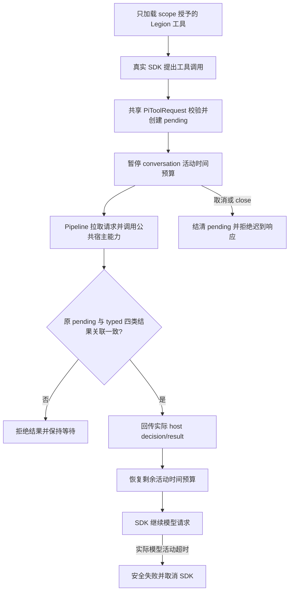
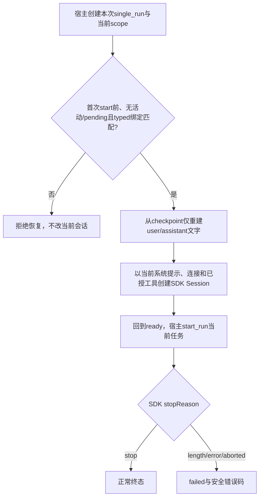

# 模型提出组织、交互和检查请求，宿主返回真实结果

依据[客户已确认整套设计](../../../ProjectManager/docs/design/2026-10-08_design_legion-governed-workflow.md)及本次 adapter-tools 精确派发，本层扩展真实 SDK 的受控工具集。保持原读、完整写、局部编辑流程，注册七项新工具；共享类型直接复用 Kernel Model。SDK 不获得执行检查进程、写客户文件、选调用身份或改权限的能力。

六项控制工具恰收 `{payload}`，根为有界 plain record；`legion_run_check` 恰收 `{checkId}`。注册 JSON schema 拒绝额外顶层字段，payload 以有限深度 JSON schema描述字符串、有限数字、数组和普通对象；最终深度、节点、字符、字节、secret/getter/caller 拒绝由 PiToolRequest 的共享 Model 执行。实际调用权限仍由宿主按当前实例核验。

## 分层及边界

Provider 负责 SDK 工具 schema、typed deferred 往返、活动时钟与 SDK 生命周期；Service 通过 Provider 公开入口转发并核对事件。ProposalService 只接受原写/编辑请求，新控制和检查请求不转为 ActionProposal 或 MutationResult。Kernel 的 AgentTools/AgentControlTools、AgentControlDecision/Result、CheckDecision/Result 是唯一共享定义。

`respond_tool` 必须验证原对象 pending、一次响应、当前 runId、requestId，以及匹配的四类结果。检查还核对 request.checkId 与 decision/result.checkId；控制核对 request.tool 与 decision/result.tool。拒绝、取消、unsupported、stale、error 原样传回 SDK，不生成通过证据。空 SDK discovery/extensions/skills/resources 保持隔离。single_run 允许只获新控制或检查工具的执行成员；原只读 single_run 仍需适当任务入口。conversation 仍禁止文件写工具与非空 write 范围，可加载获授的读、控制、检查工具。

## 等待、预算与取消

真实桌面使用客户提供的 DeepSeek v4 flash 连接时，原七角色迁移连续三次只得到泛化失败；随后两角色 core/Acceptance 的真实提案及 PM 工具审批已成功，但 ui/desktop 角色实际在 60 秒结束为安全 `pi_turn_timeout`。架构师可能先保存 pending 提案再生成最终回复，因此超时不表示宿主从未提交任何效果；该效果与界面回报由 Desktop 处理。本层观察到的确定问题是工程任务使用原 2048 输出、60000ms 活动预算不足。

在已确认完整工作流范围内，本次必要修复已将 conversation 默认和最大 `maxOutputTokens` 改为 8192、`turnTimeoutMs` 改为 180000ms，保留 queue256/text65536。宿主可按调用缩小任意预算；8193 输出及 180001ms 必须拒绝。8192 是宿主配置的请求上限，不是已核实的供应商能力；缺失模型能力和价格仍为 unknown，SDK 的上下文、输出及零价格字段只是内部运行占位。

活动计时开始于 start_run，第一次进入 host pending 时扣除已用时间并停表；全部 pending 回应/终止后恢复剩余预算，不重置为完整预算。等待用户、架构师或其他 host 响应均不消耗活动模型时间。每次真实网络请求仍带有有限 timeout/maxTokens/maxRetries=0，活动模型总计时也会主动 abort。cancel/close 立即通过 SDK signal 取消，不等待 180 秒预算到期。

cancel_turn 保留会话但结束本轮；cancel/close 永久结束实例。未回答 pending 均释放，取消后的响应及旧轮事件不得加入下一轮。项目或权限变更由宿主先撤销权限，再调用本层 cancel/close；本层不持久保存用户批准。Desktop 持久化交互后可用原请求 respond_tool 继续当前活会话，重启恢复只重建文本，不重放旧工具。

## 当前 mutation contract 与验证

只修改本次 18 文件 writeSet；生成副作用迁至 `.ans/runtime/legion-governed-workflow-v1/AgentAdapterEngineer/`。固定检查为 task_ops `unit`，实际四文件：test_proposal.mjs、test_pi_provider.mjs、test_pi_service.mjs、test_control_tools.mjs。通过条件是无失败、取消或跳过，且候选未改变。

预算修复由 `legion-governed-workflow-v1-model-budget-final` 精确派发到七个既有源码、测试和 owner 文档；原六文件尝试已停止，将既有工具等待测试纳入同一已批准配置范围重新派发，不增加产品文件或调用边界。Provider 复用现有预算校验、活动计时和 typed 生命周期合同，只改变有界常量。补默认与精确上限的真实流 options、三协议 wire 输出预算、缩小调用预算及非法配置断言；超时使用明确的 100/250ms 小预算，取消验证不运行三分钟等待。最终 source/doc freeze 后执行该任务配置的四套件 `unit`，结果以本任务记录为准。

Provider 先以真实 SDK 官方 Faux 流验证七项注册 schema、允许/拒绝结果、关联错误、旧 run、等待超过缩小的预算、恢复剩余预算、取消/close、后续轮隔离；另用真实 localhost SSE 证明模型网络 timeout 和原三协议回归。Service 验证其公开 factory/typed 队列到 Provider 的实际往返；Proposal 验证新工具均拒绝转换。检查只证明本层 SDK bridge，不代表 Kernel 的完整检查 Provider/Service、Desktop 的持久交互或独立验收已经完成。

[当前功能](../feature/pi-agent.md) · [实际 API](../../api-spec.md) · [本次 task evidence](../../../../scheduling/legion-governed-workflow-v1.md)

## 本层已运行的验证

Node24.14.0、SDK1.0.4，bridge/Proposal25项与Provider/Service三协议44项分别实际通过，无失败或跳过。首次旧回归因sandbox监听localhost被EPERM拒绝，授权escalation后运行。Anthropic SDK裁剪根schema，payload defs移到property内后经三个协议实际wire schema编译与合法/非法值验证；根未知字段仍由共享Model严格拒绝。最终状态与不变candidate以任务unit记录为准，本层不自verify。

预算修复临时同一四套件实际72项通过，0失败/取消/跳过。默认及精确cap8192/180000、caller2048/60000、8193/180001及非法预算拒绝、配置复制、原队列/文本限制、三协议真实wire8192均通过。默认180秒下cancel_turn/cancel/close立即中断挂起HTTP且只请求一次；原七工具等待超过小预算仍安全、恢复剩余活动时间后超时、typed结果/取消/旧轮隔离均通过。正式unit以依赖及七文件冻结后的[修复任务](../../../../scheduling/legion-governed-workflow-v1-model-budget-final.md)记录为准，临时验证不能替代真实桌面工程角色复验、新runtime安装或独立验收。

## 2026-10-09 单轮角色记忆恢复

开发或验收成员开始新任务时，宿主先创建新的 single_run 实例和当次 scope，再用已有 `restore_history(PiConversationCheckpoint)` 在首次 `start_run` 前注入该项目、该角色的纯文本记忆。Adapter 只接受已构造的 checkpoint、`AgentInstance` 和 `PiConversationHistory`，逐字段核对当前 instance、profileId、profileVersion；不增加序列化入口或新的公共方法。

恢复仅在 single_run 新实例的 `ready` 状态、尚未运行、尚未恢复且没有 pending 请求/事件/消费者时允许一次。成功后回到 `ready`，首轮模型请求仍使用当前创建时冻结的 system prompt、连接、工具和 scope。已启动、运行中、运行结束、取消、关闭、恢复中、重复恢复或绑定不匹配均拒绝。conversation 原有 `ready/idle` checkpoint 行为保持不变；conversation 禁写范围/写工具的校验不放宽。

`#createSession` 仅把 history 中的 user/assistant text 重新构造成消息；SDK session、tool calls/results、待答复工具、旧任务批准和身份都不从 checkpoint 恢复。外部供应商若返回 `stopReason: "length"`，Provider 会把本轮映射为既有安全失败码 `pi_model_error`；部分文本只用于诊断，`status` 为 `failed`，宿主不能据此提交不完整摘要。该映射不增加 Kernel Model 字段，也不改变 Adapter 的既有预算或 SDK retry/auto-compaction 配置。

本次实现只涉及 Adapter Provider/Service contract、既有 Provider/Service 测试和本角色 API、功能、设计、changelog 文档。待验证：跨任务新 instance 可读到旧纯文本；工具结果不能以 tool role 重建、当前工具 loadout 不变；伪造/错绑/重复/运行后恢复拒绝；conversation writable scope 仍拒绝；SDK `length` 产生 failed 终态。当前业务 run 的 8192 output/180000ms cap、调用方预算、队列/文本预算、零 retry、SDK automatic compaction disabled 均保持。
