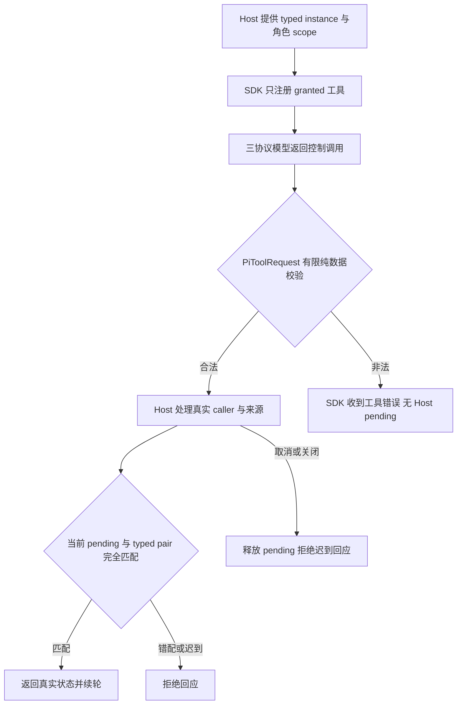

# CLI 角色文件提示与分类记忆、监督工具

角色执行当前计划时，要知道自己持久拥有的精确文件，也要能查询项目事实、修订己方事实和提交监督建议。例如 Backend 可查询已生效的 pitfall，提交带来源的 decision，但不能由工具自报身份或更改文件 owner。

本设计细化 Human 已确认的 [角色独占文件 v2](../../../ProjectManager/docs/design/2026-10-10_design_cli-role-owned-files-v2.md)，执行由 `adapter-controls-1` 派发。当前 [功能说明](../feature/cli-controls.md) 在实现后补齐。产品 task 不含 writeSet；ANS assignment 的仓库开发范围仅限制此次作者修改。

## 过程与选择

Host 从持久 owner 快照构造角色级 AgentScope.write，并完成 Kernel authority 注册；Adapter 不读取 owner 台账、不缩减任务文件子集、不创建授权。Provider 提示写明当前角色 owned 精确文件、deny 和任务授予的工具。无源码写工具时不提示调用写工具；空 owned 文件不能在提示中获得写权。

三项工具使用 Kernel 已验证的 AgentControlTools、通用有限 `{payload}` schema、PiToolRequest 与 AgentControlDecision/AgentControlResult，不建立第二套 Model。分别提供清晰领域说明：remember_fact 提交 add/revise/retract 和分类/来源/expectedRevision；query_memory 查询 kind/cursor/limit；submit_supervision 提交当前计划 phase/planDigest/findings/recommendation。这些字段的领域校验、事实 CAS、来源与真实 actor 绑定属于 Host，Adapter 仅传输。不得向模型说明能够直接发 grant 或 owner 变更。

保留控制工具与 Mutation converter 的隔离；completed/denied/cancelled/stale/error 均只表示 Host 控制结果。SDK Anthropic 省略 schema 根 additionalProperties 是 wire 差异，Model 仍严格拒绝额外根字段；测试同时检查两者，不能放松 Model 断言。

实施检查发现 single_run 的未授控制工具只被 SDK 返回工具错误后继续，Provider 原 guard 仅限制 conversation/Shell。这与受限控制行为不符，故将既有 guard 扩为共享 AgentControlTools，明确返回 pi_unexpected_tool_call；不改变已授工具的 typed 续轮，也不扩大作用范围。

## 修改与验证契约

仅修改本 assignment 已列的 Provider、Adapter 五个测试及 API/changelog、本设计和当前功能说明。现有旧阶段未提交修改保留；新测试运行路径为本角色 v2 runtime 下 fresh 子目录。现有固定 fixture 兼容例外保持原有只初始化目录语义。

固定 unit：`node --test --test-concurrency=1 tests/adapters/test_control_tools.mjs tests/adapters/test_pi_provider.mjs tests/adapters/test_pi_service.mjs tests/adapters/test_proposal.mjs tests/adapters/test_memory_supervision_tools.mjs`，最终通过 task_ops run-check 执行并记录当前候选。

待验证：completions/responses/anthropic 实际 SSE 工具调用、typed 完成/拒绝/stale/error 回应进入续轮；单轮角色和多轮 Supervisor conversation；未授予工具、伪 caller 与 extra-root 请求不形成 Host pending；错误 request/run/tool/对象身份与 Mutation pair 被拒绝；pending 取消与活动 HTTP 取消/超时/鉴权错误脱敏；角色 owned 提示与未授写工具提示；实际公开 Service 与真实 SDK，不替换 Session。上述 Adapter 结果不替代 Desktop 事实存储、租约、owner 转交及完整安装消费者验收。
