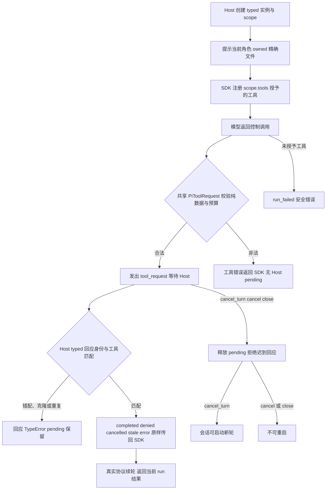

# Pi 分类记忆与监督请求

## Su v0.3 本角色实施说明

### 取消后同实例安全历史恢复

按同版已确认范围，本次仅在 Adapter 六文件内复现“真实 SSE 部分文本 → cancel_turn → 安全 checkpoint restore → 同实例新 run”，并与不 restore 的对照比较。Human 原文必须完整保留，取消 partial 不进入历史，第二次真实 HTTP 必须到达。先以实际 SDK 回归确认异常，再修最小生命周期；不修改 Host、不加重试或等待掩盖错误。最终五文件固定 unit 与当前候选见 [取消修复记录](../../../../scheduling/legion-supervisor-frontdoor-v1-su-cancel-repair-integration.md)。

当前真实 Provider 和公开 Service 回归使用生产 Su 八工具、独立 Supervisor 实例，首轮确实收到部分 SSE。cancel_turn 等待旧 run 收束后，Adapter 原历史仅含首轮用户输入；Host 可将完整 Human-only 安全历史作为同实例/profile checkpoint 恢复，再发新 run。实际第二 HTTP 到达、旧 partial 未进入请求或历史；不 restore 的对照也成功。未重试或额外等待；此回归未复现 Reviewer 的 Host cancel→Continue 失败，因此未修改 Adapter 实现，仍待 Host 原用例定位与独立重验。

不能从 Host 的 pi_run_failed 标签判定 SDK prompt 异常：Host prepareMemory/restoreRole 发生无领域 code 的异常也会生成该标签。先前关于资源 runtime 被 dispose 后复用的怀疑尚未被实际回归证实，不能当成根因或修复结果。

依据已确认 [Su v0.3](../../../ProjectManager/docs/design/2026-10-11_design_supervisor-frontdoor-global-read.md)，本次 a-su-tools 接线三个 typed 控制工具。delegate schema 区分 start(plan/role_design/repair) 和 resume，repair 明确 acceptanceId/taskId，resume 只接受 delegationId/humanAnswerRef；activity/log 使用严格有限过滤器与分页字段。Model 承担真实 UTF-8 字节预算，Host 承担用途、来源、累计读取与日志安全投影。SDK schema 不代替这些守门。

前台与后台工具集合完全来自 Host scope.tools；Adapter 不根据 lifecycle 或模型 purpose 授权。前台可 delegate、read/memory/question/query；后台可 read/memory/query/submit_supervision。复用现有独立 Session、pending、checkpoint 与取消，不增加上调 callback。委托结果 needs_human 只表示后台待答；唯一 Human 执行确认仍由 Host 创建并处理。

本次只改 assignment 九文件，保留旧包和证据。固定五测试 unit 验证三协议有限 schema/实际续轮、typed 状态、旧run/跨实例/克隆/Mutation拒绝、loadout、questionRef与取消。实施结果与当前候选见 [新任务证据](../../../../scheduling/legion-supervisor-frontdoor-v1.md)，不将旧通过算作新工具证据。

已授予工具的角色可以查询项目内有效事实、提交己方事实修订，Supervisor 可以提交当前计划的有来源建议。Adapter 把请求交给可信 Host，并将实际控制结果送回同一 SDK 会话；记忆查询或监督建议不会产生源码写权。

例如模型调用 `legion_query_memory({payload:{kind:"pitfall",limit:10}})`，Provider 发出当前 run 的 `tool_request`。Host 处理项目事实视图后，通过原请求对象返回 `PiToolResult(AgentControlDecision,AgentControlResult)`；模型在真实协议续轮中收到结果。记忆的领域字段、来源校验和原作者 revision/CAS 由 Host 处理，Adapter 不持久化事实。

三项工具共用有界 `{payload}`：`remember_fact` 用于 add/revise/retract，分类为 pitfall/decision/preference；`query_memory` 可带 kind/cursor/limit；`submit_supervision` 带 phase/planDigest/findings/recommendation。Host 从受信实例绑定 caller；模型自报身份、授权、owner 不构成权力。只注册当前工具清单，SDK 默认工具、skills、extensions 和资源发现关闭。

角色 scope 提示来自 Host，列出其持久独占的精确文件、deny 与本任务实际 granted tools。Adapter 不解析产品任务文件列表、不读取 owner 台账；owner generation 和提交前重查由 Kernel/Host 完成。控制专用角色没有写工具提示。

Host 等待暂停累计模型活动预算；合法结果恢复剩余预算。拒绝、过期或错误的结果可完成一次工具续轮，但这不表示项目任务完成。三协议鉴权失败返回脱敏错误，活动超时和取消中断当前 HTTP；不重试，也不把 provider 原文或密钥放入结果。Anthropic wire schema 省略根 additionalProperties，共享 Model 仍在 Host pending 前严格拒绝额外根字段。

入口与契约见 [API](../../api-spec.md)，实现位于 `src/adapters/providers/impl/pi_session.mjs`，Service 沿自身公开 Provider 转交。真实 SDK/localhost 三协议、typed 状态、未授工具、caller 欺骗、取消与 HTTP 错误的固定检查见 [本阶段证据](../../../../scheduling/legion-cli-role-owned-v2.md)；结果只覆盖 Adapter，CLI 安装和 Host 事实存储仍由其他 owner 验收。

演变历史：[2026-10-10 设计](../design/2026-10-10_design_cli-controls.md)。
