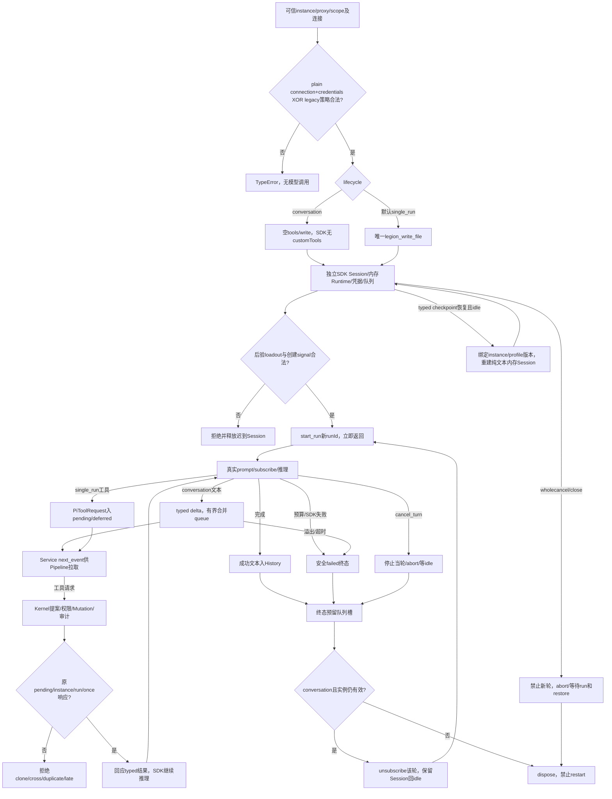

# 对话等待Human，文件操作等待Kernel

客户唯一项目管理Human入口由Desktop提供。本层同一Pi Service/Provider既支持项目管理零工具多轮对话，也保持默认single_run受控执行；不建立第二套引擎，不将Legion开发固定角色复制进客户项目，不调用Mutation或读取客户文件。

plain PiConnectionProfile固定protocol/provider/model/baseUrl/profileId/version，无secret/function；credentials只私有字面key。Provider内部静态导入pi-ai公开api/openai-completions、openai-responses、anthropic-messages，支持自定义modelID，不依赖catalog。legacy modelProviders路径保持兼容且与plain互斥。每实例Runtime registry/stream/key/session/history/queue隔离；未知metadata为unknown，SDK零cost/能力占位不作为报价。只有start_run发模型请求，创建/恢复不自动请求。

single_run固定工具及execute deferred保持原语义。Kernel Pipeline得到原请求与可信Session、构造提案，再由policy/mutation回应原pending；Adapter不授予权限。conversation工具全空，意外toolCall明确失败，无写入或权限回调。默认工具、MCP/扩展/资源/模板发现关闭，loadout后验active/callable/all。

conversation每轮新runId、拒绝并发，必须消费上一轮terminal再继续。SDK每轮listener闭包捕获原runId，结束waitIdle/unsubscribe；旧listener晚交付也不能被标记为新轮。delta只含Kernel PiTextDelta{runId,text}，合并邻接文本，固定queue256/text65536/output2048/deadline60000；仅允许缩小预算，溢出明确failed并保留terminal。终态assistantText为最后回复，错误只固定安全code，原SDK error/key不公开。

get_history只typed user/assistant文本；user提交即保留，成功assistant入历史，failed/cancel partial不作为恢复上下文。restore_history只有idle、queue/consumer空、typed checkpoint与可信instance/profile匹配，重建真实内存Session，无模型请求；不恢复system/SDK模型选择/工具/permit/确认/pending/活动任务。host仍需验证workspace来源。恢复错误终止实例。

cancel_turn只停止本轮，abort/waitIdle后Session回idle，可继续下一轮。wholecancel/close永久终止；等待进行中的run和restore、释放晚到Session；close清所有queue/consumer，本方法不代替上层撤销Kernel许可。执行撤权/终态审计由Workbench Pipeline按Kernel契约组合。

实际Provider27/Service4/Proposal只读7=38通过，0失败/取消/跳过。旧23断言保留；SDK1.0.4官方Faux流与真实localhost三协议SSE驱动createAgentSession，验证多轮历史/无tool/customID/key/上下文/隔离，401脱敏/deadline，typed restore、预算、捕获真实旧事件重放、close/cancel恢复竞态。Faux不是Session替身，事件注入只是有限晚到guard验证，不宣称SDK天然产生该竞态或OS级隔离。

首扩展34项因沙箱localhost EACCES为29pass/5fail；独立fetch复现，同套件自动批准require_escalated后全部通过，断言未弱化。最终38项日志与不变candidate以[当前任务](../../../../scheduling/legion-desktop-workbench-v2.md)approved unit为准。缺SDK/version不符直接fail，不skip。无安装/付费/shell executor；生成仅本角色本阶段fixtures/user-data/tmp。owner测试不替代Human确认→真实执行→审计、Desktop/DPAPI/新tarball与ZIP/独立验收。

[实际API](../../api-spec.md)、[当前设计](../design/2026-10-07_design_desktop-workbench-v2.md)、[canonical](../../../../design/2026-10-07_design_desktop-workbench-v2.md)。[旧Node设计](../design/2026-10-07_design_node-pi-v3.md)、[旧任务](../../../../scheduling/legion-pi-node-v3.md)保留历史，旧23项不是工作台完成证据。

