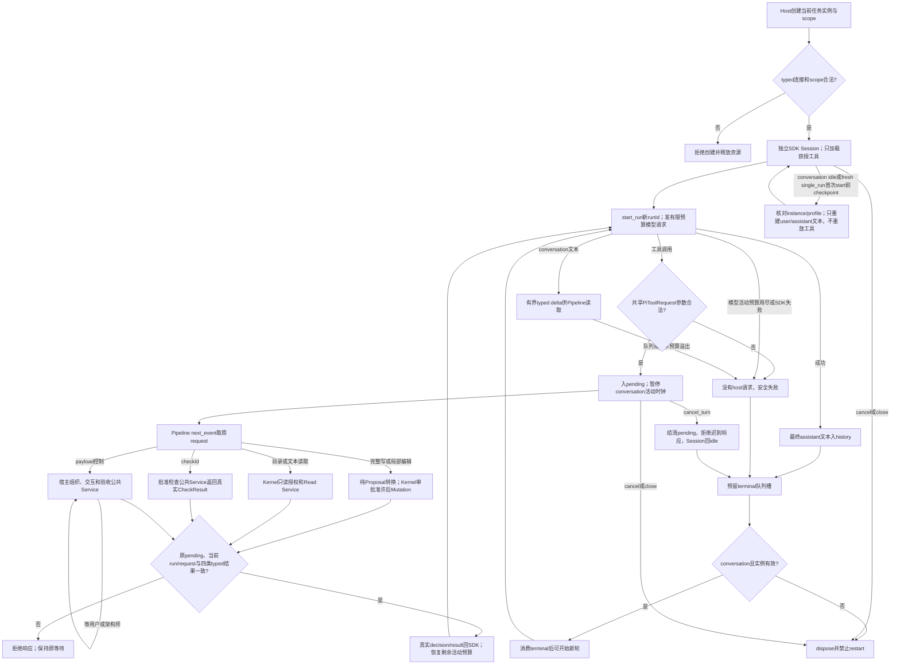

# 模型请求真实宿主操作，等待回答后继续

PM可以通过获授工具请求角色设计、审批、询问用户和限定返修；角色架构师提交提案，开发/验收成员请求批准的检查，验收成员提交结论。宿主负责真实身份、批准和执行，本层让同一真实Pi引擎获得这些真实结果后继续回答。文件读取、完整写入与旧SHA绑定局部编辑仍由宿主和Kernel处理。

从Desktop发送需求后，Workbench Pipeline创建公开 `createPiAgentService(options)` 并调用 `start_run(runId,prompt)`。每个实例只加载可信 `scope.tools` 已授予的工具。conversation保持空写范围且禁止写/编辑工具；single_run可只获控制/检查工具，或获写/编辑并结合读取。没有工具授权的对话仍为纯文本。工具参数不提供调用者身份或许可。

开发/验收角色跨任务继续记忆时，Desktop为新任务创建新的single_run实例、连接和scope，再调用已有 `restore_history` 恢复按项目和角色保存的 `PiConversationHistory`。Provider只接受首轮前的一次恢复，并逐字段匹配当前 `AgentInstance`、profileId和profileVersion；当前run仍按新scope加载工具。plain checkpoint只含user/assistant文本，SDK工具调用、工具结果、旧确认、pending和任务身份不会恢复。conversation仍可在ready/idle恢复多轮历史，且其无写范围和无写工具限制不变。

恢复对象不是普通JSON入口：必须是冻结typed `PiConversationCheckpoint`，其history由 `PiConversationHistory`校验，只允许user/assistant text。plain object、坏role、跨instance/profile、运行中、pending、close后、已有run或重复注入均拒绝。SDK若以 `stopReason:"length"`结束输出，终态是 `failed/pi_model_error`；partial assistantText保留在错误结果中供诊断，不能被宿主作为完整摘要保存。

例如，获授 `legion_request_interaction` 的PM模型提出 `{payload:{question:'是否继续？'}}`，本层发送冻结 `{type:'tool_request',request}`。Desktop验证真实PM会话并持久保存交互、展示弹窗；用户回答后，宿主构造同requestId/runId/tool的AgentControlDecision和AgentControlResult，以原request调用 `respond_tool`。Adapter核对pending和关联后把真实结果交SDK，模型继续。等待超过60秒也不消耗模型活动预算；下一次模型请求仍受剩余时间和输出上界约束。弹窗、持久化与批准逻辑由Desktop负责，本层只实现宿主桥接。

`legion_run_check` 恰收 `{checkId}`，SDK不能提交命令、目录、进程或凭据。检查结果保留CheckDecision/CheckResult，包括实际状态、执行证据和日志；控制工具恰收 `{payload}`，六项分别为design_roles/propose_roles/review_roles/request_interaction/submit_acceptance/request_repair，均加legion_前缀。payload有界且只能是plain JSON数据，禁用secret、getter、prototype及caller身份字段。宿主仍按真实实例做领域验证和权限核对，本层不自行执行检查或写客户文件。

四类结果严格对应请求：文件写/编辑使用PolicyDecision+MutationResult并校对资源和摘要；读使用ProjectReadDecision+ProjectReadResult并校对资源及状态；检查校对checkId及内外身份；控制校对tool及内外身份。跨类、clone、跨实例、跨run、重复、取消后或close后响应均拒绝。拒绝/失败/unsupported/stale/cancelled会真实回传，不被改成成功。ProposalService只处理写/编辑，新工具不能转成文件提案。

默认及最大conversation预算为queue256/text65536/output8192/活动180000ms，只能向下设定。真实桌面工程角色曾在旧60000ms活动预算下返回 `pi_turn_timeout`，本次提高这两个有界预算以支持已确认的工程工作流；调用方仍可显式采用2048/60000等更小配置，8193输出或180001ms拒绝。8192是宿主请求上限，供应商缺失的能力和价格仍为unknown，不能把SDK占位当作报价或能力证明。计时从start_run开始，在host pending期间暂停，回应后恢复剩余时间；多次等待也不会补回已消耗预算。每次SDK网络流有剩余timeout、maxTokens和零重试，真实模型等待超时产生安全 `pi_turn_timeout` 并abort。SDK默认文件、Shell、MCP、extension、skills、资源和模板发现保持关闭。三协议实际wire schema可解析payload内defs；SDK1.0.4 Anthropic省略根additionalProperties，本层PiToolRequest仍在创建host请求前拒绝额外根字段。

cancel_turn停止当轮并结清pending，保留Session以供下一轮；cancel/close永久结束实例，close清队列和消费者。SDK listener绑定原run，迟到事件不能标成下一轮；旧工具回答也不能补入新run。项目、连接或权限变化由Pipeline撤销上层批准后调用本层cancel/close。get_history/checkpoint仅保存已提交user和成功最终assistant；恢复只重建纯文本，并验证instance/profile版本，不恢复工具批准、pending或身份。模型可能在回复中引用工具内容，历史文本不能充当可信文件/检查证据。

本层实际以SDK1.0.4官方Faux流驱动真实Session完成七工具schema、typed允许/拒绝/取消、关联拒绝、长host等待、剩余预算timeout、取消/close和恢复；localhost真实三协议验证旧多轮、七工具wire及回答后的网络timeout。bridge+Proposal25项、SDK/Service44项实际通过，无失败、取消或跳过。沙箱首次localhost监听EPERM，授权escalation后真实执行，未放宽宿主校验。生成效果只在本次角色runtime；最终四文件unit、不变candidate与日志见[任务记录](../../../../scheduling/legion-governed-workflow-v1.md)。本层检查不替代Kernel完整隔离运行器、Desktop持久交互或Tester独立验收。

预算修复临时四套件72项通过、无失败/取消/跳过。新默认、精确cap和调用方缩小预算均经过真实SDK options验证，三协议实际wire都使用8192输出上限；默认180秒下cancel_turn/cancel/close实际终止挂起的HTTP请求且零重试，停止不用等预算耗尽。超时检查继续使用100/250ms小预算，工具等待仍暂停活动时钟并恢复剩余时间。正式冻结候选unit见[本次修复任务](../../../../scheduling/legion-governed-workflow-v1-model-budget-final.md)，真实桌面模型复验和新包安装由相应owner执行。

[实际API](../../api-spec.md) · [本层工具设计](../design/2026-10-08_design_governed-agent-tools.md) · [已确认整体设计](../../../ProjectManager/docs/design/2026-10-08_design_legion-governed-workflow.md)

本次单轮记忆恢复设计：[2026-10-08设计记录](../design/2026-10-08_design_governed-agent-tools.md)。

演变历史：[局部编辑](../../../ProjectManager/docs/design/2026-10-08_design_legion-file-ownership-and-agent-edit.md)、[项目广读](../../../ProjectManager/docs/design/2026-10-08_design_legion-project-wide-read.md)、[工作台v2](../design/2026-10-07_design_desktop-workbench-v2.md)、[原Node单次Pi](../design/2026-10-07_design_node-pi-v3.md)。旧证据保留于对应任务，不能代替本轮最终候选验证。
