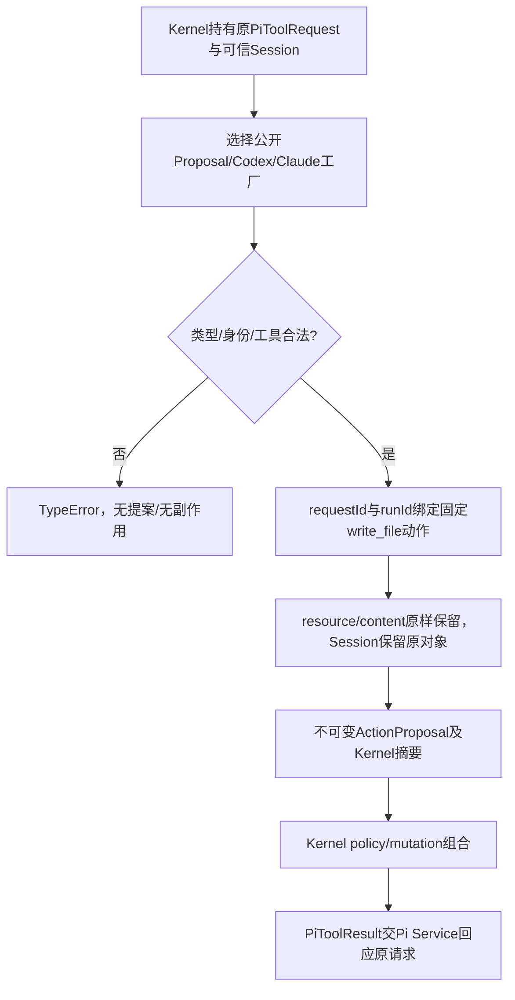

# 受控请求保留宿主身份

真实Pi Provider只提供PiToolRequest数据。Kernel Pipeline持有可信AgentSession，调用ProposalService.convert(request,session)，获得不可变ActionProposal再进行权限与写入检查。本角色不执行写入或颁发权限。

实际public入口是src/adapters/services/public/proposal.mjs，createProposalService/createCodexAdapter/createClaudeAdapter均返回本层ProposalService。convert要求PiToolRequest和AgentSession，不接受鸭子对象或模型身份声明。Model严格拒绝额外role/task/action字段和非法类型；tool仅legion_write_file，resource非空，content可空。proposalId来自requestId，runId当前run，action/capability固定write_file。提案保留Session对象，三个变体同输入同摘要；run/content改变摘要。路径权限与Session登记由Kernel负责。两个品牌名字是本地变体，没有厂商账号/流协议兼容承诺。

七项纯转换测试覆盖公共契约、精确身份/绑定、不可变与稳定digest、空内容与路径保留、非法tool/type/identity、严格未知字段、run/content摘要变化，无变更输入或效果。三套件合计23通过、零跳过，最终候选/approved unit日志见[当前任务](../../../../scheduling/legion-pi-node-v3.md)。代码仅Model及本层依赖；owner证据不替代独立验收。

[实际API与示例](../../api-spec.md)、[Pi完整流程](pi-agent.md)、[v3设计](../design/2026-10-07_design_node-pi-v3.md)。[phase1设计](../design/2026-10-07_design_phase1.md)、[Python原证据](../../../../scheduling/legion-v1-development.md)、[旧依赖复核](../../../../scheduling/legion-v1-approval-repair.md)保留历史，Python文件不参与当前Node运行。

