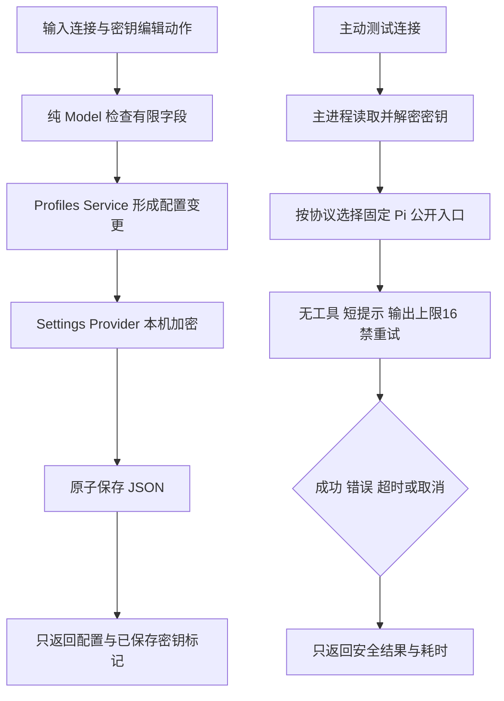

用户在中文桌面程序中保存连接，为项目角色选择连接，然后主动测试一次连接。密钥保存后不再读回表单；编辑时明确选择保留、替换或清除。加密不可用与保存密钥无法解密是不同错误，均不保存明文。

本说明落实[已确认的整体设计](../../../../design/2026-10-07_design_desktop-gui-v1.md)和[实际客户实施确认](../../../../../.ans/decisions/legion-desktop-gui-v1-authorization.md)。整体文件中的历史待确认措辞保留；本版“开发”授权已覆盖实施。O1 任务启停仍未选择。

Profiles 阶段仅写任务指定的 12 个文件。共享 Model 提前定义三页面的有限输入和安全快照，以便后续 Workspace、Pipeline、Interface 使用冻结契约。治理接受、任务记录状态和已有审计状态分开；记录时间不证明进程在线。工作区快照只含限定字段和来源时间，不包含原始文件、提示词或凭据。

Settings Provider 负责 JSON 和 Electron safeStorage；Service 负责连接 CRUD、删除后清除映射、项目角色映射和安全投影。生产公开工厂只接受普通路径与数值选项，不允许调用者注入 SDK、加密回调或任意模块。层内测试可使用基础设施替身，它不能作为 DPAPI 证明。

Probe Provider 固定使用 Pi AI 1.0.4 三个 `api/*` 入口，先 `normalizeContext` 再 `streamSimple(...).result()`。显示用 provider 名称不参与 SDK 路由。一次连接测试有总截止时间，取消与超时终态分开；`error`、`aborted` 或不完整终态不算成功。模型元数据仅用于短探测，不宣称真实能力或价格。

验证按 Model → Provider → Service 进行，命令是 `node --test apps/desktop/tests/unit/profiles.test.mjs`。测试应覆盖有限输入、不可变 DTO、密钥三动作、存储损坏、加密/解密错误、CRUD/映射、三协议 localhost 真请求、认证与协议失败、总超时、取消和关闭。隔离数据只生成于本角色 `.ans/runtime/legion-desktop-gui-v1/{fixtures,user-data}/DesktopEngineer/`。

Profiles 的 12 个文件已实现。共享 Model 包含固定协议、密钥三动作、不可变安全 DTO、固定 IPC 输入，以及后续工作区所需的角色、治理、任务与审计投影。实际治理记录的七位小数时间原样保留，八位与非日期输入拒绝；工作区组织 ID 将从其稳定身份派生，因为实际组织文件没有 `id` 字段。

本角色 14 项测试已通过，未跳过：4 项 Model、2 项 Settings、3 项 Probe、4 项 Service（含实际 localhost 调用）和 1 项结构检查。加密替身采用测试内 AES 来证明密钥编辑和失败分支，明确不是 Windows DPAPI。公开 Service 工厂实际验证无密钥的配置保存与读取；带密钥集成用层内基础设施替身和真实 Pi HTTP 请求。

首次受控 HTTP 检查遭遇沙箱 loopback `EACCES`；在已授权的本地效果范围内升权后执行成功。首次结构扫描误识别正则与空值合并，已修正识别并保留拒绝三元的断言。首次存储检查定位到 Windows 对父路径为文件返回 `ENOENT`，Provider 已明确检查目录；Anthropic 测试服务按固定 SDK 的 `/v1/messages?beta=true` 路径处理，仍严格验证三协议路径、无工具与 16 token 上限。详细的正式候选、命令和日志以[协调记录](../../../../scheduling/legion-desktop-gui-v1.md)为准；本角色不自行验收。

真实 Windows DPAPI 重启、窗口操作与 ZIP 启动仍待后续独立阶段验证。本阶段结果不替代这些证明；当前功能说明将在已授权的 Interface 阶段建立于 `../feature/desktop-console.md`。
