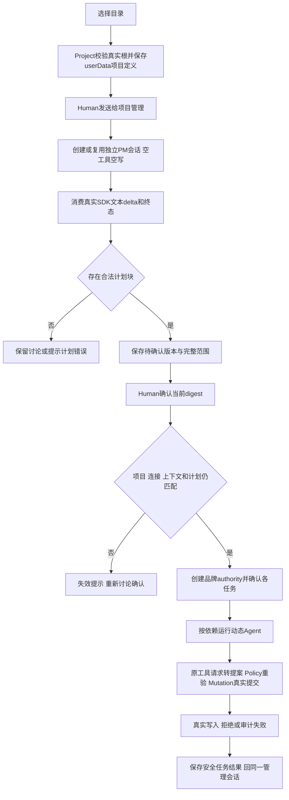

用户选择真实文件夹，在唯一“项目管理”入口发需求。首消息创建或复用这个项目的 PM；文件夹不需 `.ans`。PM 使用真实 Pi 多轮文本会话澄清、给出可校验计划。用户确认当前计划后才按精确文件清单运行动态 Agent；其他 Agent 只能查看任务，IPC 与 Pipeline 均拒绝 Human 对其直接聊天或启动。

本设计落实[客户已确认方案](../../../../design/2026-10-07_design_desktop-workbench-v2.md)（SHA715639b5dd278437059f29bde1e7c02ac90d94af18f9bf5a6b5367d16e9ab5d3）及[实施确认](../../../../../.ans/decisions/legion-desktop-workbench-v2-authorization.md)。默认专注对话，无接待角色；详情按需展开、设置次级页。当前仅30个capabilities输出，12个Interface及其五份当前文档待后段，功能链接保留[desktop-console](../feature/desktop-console.md)。

## 可信计划与调用

唯一 WorkbenchPipeline 通过已安装0.4.0 `legion-runtime/services/{policy,mutation,proposal,pi-agent}` 和 `legion-runtime/workbench-models` 调用真实公开接口。不得开发树相对导入、Kernel Interface/PermissionRuntime、Service同行、Pipeline构造SDK callback或Provider上调业务callback。生产工厂只接受 `{userDataDir}`。

PM 的文本仅为待校验输入。宿主在每轮提示约定唯一 `legion-plan` JSON fenced block：`{goal,roles:[{id,name,purpose,profileId}],tasks:[{id,title,roleId,profileId,dependsOn,writeSet,instruction}]}`。Model拒绝未知字段、重复/保留角色、非法路径、未知连接、空任务、环和缺失依赖；不静默裁剪。稳定拓扑按任务ID排序；同一时刻仅执行一个ready任务，失败/取消阻塞其下游。宿主补 projectId、组织版本、计划版本、profileVersions、当前context digest后计算确定性 planDigest，保存为待确认计划。模型说“已批准”不改变状态。

公开 Pipeline 预留完整后段契约：`getState({force?})`、`selectProject(trustedRoot)`、`refreshProject()`、`setDefaultProfile({profileId})`、`saveProfile(input)`、`deleteProfile({id})`、`assignProfile({roleId,profileId})`、`sendMessage({projectId,roleId,text})`、`selectContext({projectId,resources})`、`confirmPlan({projectId,planDigest})`、`cancelTurn({projectId,turnId})`、`stopExecution({projectId})`、`testConnection({profileId})`、`cancelProbe({probeId})`、`close()`。send仅ProjectManager，确认不接受renderer自带计划、路径、tools或grant。getState返回安全WorkbenchDTO，含profiles/defaultProfileId/projects/currentProject/dynamic roles/history/turn/plan/tasks/context/observation/error，不返回下层对象、密钥、根路径或许可。完整Model先落实并冻结，Interface不普通改前段。

## 有限状态与基础设施

Project Service/Provider独占userData中的目录登记、默认连接、动态PM/团队、计划及任务记录。选择目录只验证现存真实目录与canonical/dev/ino，派生稳定项目ID；不读取或复制Legion开发七角色，不在客户根创建文件或审计。Project Provider只读Human精确选择的文件：`ContextReadConfirmation.assertForRead` 校验opaque品牌及workspace/org/profile/resources，读取前后再验根、组件、fd身份/时间/大小和SHA；16文件、单256KiB、合计2MiB，严格UTF8，无递归发现。仅传readAuthorization与有限binding，不传controller。文本供当轮模型，上下文描述与SHA供DTO/计划。

History Service/Provider按project与管理会话分区，持久化Kernel typed PiConversationHistory的user/assistant文本；最多256条、单65536字符、总2097152字符、UTF8 JSON最多8MiB。显示Human原消息和最终助手文本，不持久化注入的应用指令、文件文本、credentials、许可、pending或SDK对象。恢复先验证项目/当前连接，再构造typed checkpoint；历史不能恢复权限或活动运行。

Profiles新增主进程 `resolveConnection(profileId)`：Settings公开read/decryptKey足够，无需改Settings或旧desktop Model。基于规范私有存储连接（含ciphertext）确定profileVersion；返回无key PiConnectionProfile和单独credentials。名称、地址、模型或密钥变更使旧绑定失效。未知metadata和费用为unknown，不把SDK占位数值显示成报价。

Workspace新增有限观察方法，读取真实已有治理/任务/审计，完全独立于客户组织。任务Markdown上限16MiB、4096journal events、每轮读取64MiB；完整验证链与human render。旧组织/角色小预算保留，已验证且文件身份/mtime/size未变才缓存；缓存标观察时间与最近验证时间，手动force重新读取并验SHA。缺失的开发记录不是客户项目非法；未知、超限或损坏有明确source错误，保留上次有效观察需标过期。旧public refresh兼容安全WorkspaceDTO，新增观察DTO满足有限v2来源/时间契约。

执行按任务建立绑定当前profileVersion的authority，使用typed ContextSnapshot及ConfirmedTaskGrant；不向模型提供controller。纯Model构造数据不等于授权。先验证完整DAG与所有profile/context绑定，再消费Human确认，记录计划状态并创建执行实例。成功写入且审计成功的原提案正文可作为已确认依赖任务的受控输出交接；拒绝、audit_failed或observedMutation不完整的结果不能假装成功，不扩大Human文件读取集合。软件检查始终not_executed，不启任意Shell。

项目切换、连接变更、计划/范围/context变更、停止和close先禁止新动作并同步revoke，再await SDK取消、运行及终态审计，最后close Mutation。以project/session/turn/epoch过滤晚到事件，close幂等只关闭本次资源。重启保留文本和历史计划，旧running任务标interrupted，不自动再次调用模型或重用确认。取消当前PM turn保留会话可继续；执行与PM显示状态、实际文件结果和来源记录分开。

## 验证安排

目录登记与History在创建任何应用数据目录前，比较已核验的canonical目录关系，拒绝项目与userData重合或任一方包含另一方；组件junction/symlink明确拒绝。历史项目根删除或移动只令该历史项目不可执行，不阻断登记新有效项目。catalog只核对历史定义的存储隔离，保存当前活动项目和context仍核对真实dev/ino；不把失效旧根当作当前可执行根。

每个profile拥有绑定同一Human计划的controller；任一根、context、profile或plan绑定失效，统一撤销全部controller，阻塞所有尚未运行节点，包含独立节点。恢复旧SHA不能复活旧确认。stopExecution对匹配当前project在入口同步撤权，错误project不影响当前执行；close先closed/epoch/revoke，再等API队列、SDK和自身资源收束。确认过程每个await后再验epoch，尚未赋值active时也不能越过关闭。SDK restore_history先await再start_run。

SDK terminal completed仅表示本轮结束。每个任务的全部精确writeSet必须有真实成功写入结果；无工具、缺目标或拒绝时任务failed，显示task_outputs_missing或task_write_failed。audit仍反映实际SDK run终态，实际文件结果单独呈现，software checks固定not_executed。执行结果由有限tasks/result DTO回到同一项目对话视图；不假称模型又作了未运行的汇报请求。

分层实际结果：Model5、Project4、History3、Profiles15、Workspace12、Workbench8，共47用例。包括真实Windows路径/junction、独立userData、Kernel品牌、三个固定协议的真实localhost SDK多轮与DAG提交、空工具终态、旧SHA恢复不复活、停止/关闭竞态、历史隔离、实际当前v004与>1MiB任务链/render、缓存/force、4097events和64MiB总预算拒绝。首次sandbox realpath不可用后使用已授权精确elevation；修正测试构造多余resources字段、实际旧治理事件均unavailable的期待；保留严格断言。Settings加密替身仅证明Service组合，本阶段未运行原生DPAPI/UI/ZIP。

按Model→Providers→Services→Pipeline有限验证；最终approved capabilities六suite serial300秒，包含旧Profiles/Workspace回归及新增Model/Project/History/Workbench。实际安装包、真实本地FS与localhost SDK请求是证据；Service边界替身只证明该层组合，不算DPAPI或UI。生成仅 `.ans/runtime/legion-desktop-workbench-v2/DesktopEngineer/{fixtures,user-data,tmp}`，caller TEMP/TMP指向自身tmp，清Node options/compile cache。上述分层检查已运行；最终approved capabilities检查由task_ops记录当前完整候选，交Supervisor核验。原生Electron/DPAPI/浅深色截图和ZIP由后段按实际角色范围验证，原型和旧成绩不替代。
