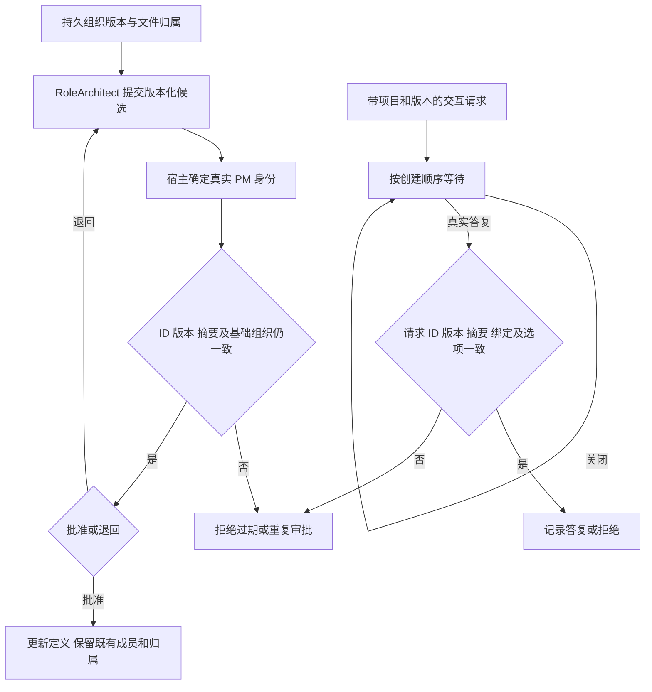

# 计划结束后成员仍然存在，真实检查后才交付

例如 SSH 项目增加 SFTP 时，已批准的 SSH 角色继续留在成员表；角色架构师提出新增职责，PM 审阅具体版本后才加入新成员。用户关闭一个提问弹窗时，该请求仍待答复；输入普通“是”不会生成执行批准。

早期阶段先建立纯Model和其真实单测；当前完整Desktop派发已经实现三层组织Provider/Service、唯一Pipeline、IPC与GUI接线。[完整已批准设计](../../../ProjectManager/docs/design/2026-10-08_design_legion-governed-workflow.md) 继续决定整个工作流；当前 [桌面工作台功能](../feature/desktop-console.md) 的用户入口接线由后续阶段实现。初期五文件范围是两个Model、两份单测和本文，彼时没有外部效果；本次完整阶段的实际接线和证据见下文。

组织采用稳定角色 ID、角色 revision/digest、组织 revision/digest；提案单独保存，绑定基础组织摘要，不因写入待审提案改变组织版本。PM、RoleArchitect、Acceptance 有固定职责；具体文件边界仍需提案批准。PM 无业务写边界，RoleArchitect 只发布角色文档候选，Acceptance 只允许自己的测试和文档。所有边界均为精确文件，复用 runtime 的资源规范化和凭据排除。成员停用保留文件归属，不能借清空边界把文件重新分配。角色文档候选含 resource、contentDigest 和 summary，发布时重查批准提案及内容摘要；该结果是纯数据，实际写入仍需 Human 批准的计划。

交互采用三种 kind，普通用途 discussion 与 execute_plan 分开。请求保存 origin、文本/选项、明确 bindings、createdOrder、version/digest；答案必须绑定当前项目、请求、版本和摘要。确认只能提交布尔值，选择只能提交存在的选项，询问必须提交非空文本。重复相同答复返回同一结果，冲突重复拒绝。关闭是验证后原样返回。恢复保留持久请求和答案，仅提供 `resumeToolResponses: false`，不会制造旧运行实例的工具答复或权限。

当前Provider负责 userData 锁、原子写和 digest CAS；Service 负责可信宿主身份、提案及交互持久调用；唯一 Workbench Pipeline 负责工具等待/取消、实际运行身份、Human 计划确认与权限签发；UI 负责三类弹窗、队列、答案回到对话和成员详情。Model 传入的 actor 必须由可信宿主提供；不能从模型或 renderer payload 的 roleId 推导。检查数据由 Kernel Model 定义，当前两个模型不定义检查/证据类。

已通过真实单测验证：组织持久成员、退回再提、准确审批与重复/过期拒绝、停用保留归属、旧计划迁移标 legacy/待补全、受保护及凭据拒绝；三类答案、关闭/恢复、绑定变化失效、跨项目/版本/选项拒绝及去重。固定检查为 `node --test apps/desktop/tests/unit/organization-model.test.mjs apps/desktop/tests/unit/interaction-model.test.mjs`，通过 task_ops `model` 记录实际候选。初期23项断言测试通过，无skip；当前完整接线已经实现，最终候选与独立验收按下文任务记录。

## 实际公开函数与持久字段

两个源文件直接具名导出，下游无需访问私有函数。所有返回值深度冻结；无随机 ID 或取当前时间，ID、序号和时间由可信宿主提供。`projectId` 沿用工作台的64位十六进制项目标识。摘要是SHA-256，角色和资源列表先规范化与排序；保存的摘要不匹配时拒绝。各输入仅接受列明字段，错误包含有限的 `code`。

### organization.mjs

| 导出 | 参数与结果 |
| --- | --- |
| `FIXED_ROLE_DUTIES` | 三个固定职责的只读映射 |
| `OrganizationValidationError` | 拒绝无效组织、角色、版本、边界或审批的错误类 |
| `organizationDocument(value)` | 校验/规范化组织与摘要 |
| `createOrganization(projectId)` | 三个固定系统职责、无文件边界、revision 0；system表示内置职责，不表示历史Human批准 |
| `migrateLegacyOrganization(projectId, {members, fileOwners})` | 观察成员仅含id/name，恢复所有归属角色，status legacy、revision 0、未知purpose为空，即待补全 |
| `roleProposalDocument(value)` | 校验具体候选及审批记录；候选digest不随审阅状态变化 |
| `createRoleProposal(organization, {id, version, members}, actor, previous = null)` | RoleArchitect起草；首次version 1，退回后必须previous/version+1 |
| `reviewRoleProposal(organization, proposal, input, actor)` | PM批准或退回；返回 `{organization, proposal}` |
| `approvedRoleDocument(organization, proposal, input, actor)` | 对仍是当前角色版本的批准候选返回纯发布描述；验证resource/contentDigest，既不读取内容也不签发写权限 |
| `roleProposalLedgerDocument(value)` | 校验持久提案台账，完整digest包含状态和review |
| `createRoleProposalLedger(projectId)` | 空提案台账 |
| `submitRoleProposal(ledger, organization, input, actor)` | 追加新ID或已退回ID的下一版，保留旧版，拒绝pending/approved ID重提 |
| `reviewQueuedRoleProposal(ledger, organization, input, actor)` | 从台账选当前最新版本；返回 `{organization, ledger}`，拒绝旧版/重复审批 |

组织字段为 `schemaVersion:1/projectId/revision/status:ready|legacy/members/fileOwners/digest`。角色字段为 `id/name/purpose/interfaces/boundary/documents/revision/enabled/status:system|approved|legacy/digest`。boundary均为精确安全相对文件路径；files拥有唯一角色，停用/清空边界仍保留历史fileOwners。文档候选仅有 `resource/contentDigest/summary`，必须在对应 `docs/roles/<id>/`；fileOwners仅有 `resource/roleId`。不同角色的边界或既存归属不能重叠，无隐式转交。

固定ProjectManager边界为空；RoleArchitect只能声明 `docs/roles/<id>/` 下文件；Acceptance只能声明 `tests/Acceptance/`、`test/Acceptance/`、`docs/roles/Acceptance/` 中的精确文件。固定职责不能被重新命名成另一责任或停用。新执行角色首次revision 1，已有角色每次定义修改必须revision+1。提案中的status approved表示拟批准后的定义形态，只有PM审批转换会将其合入持久组织；pending提案不是已激活成员。

提案字段为 `schemaVersion:1/id/projectId/version/baseRevision/baseDigest/members/submittedBy/status:pending|approved|returned/review/digest`。`submittedBy` 与 `reviewedBy` 包含 `projectId/roleId/instanceId`，来自函数单独actor参数。PM review input仅有 `proposalId/version/digest/organizationRevision/organizationDigest/decision:approve|return/reason`；退回必须非空reason。发布input仅有 `proposalId/version/digest/resource/contentDigest`。台账字段为 `schemaVersion:1/projectId/revision/proposals/digest`，最多256版。Service使用台账操作而非从模型payload接收旧pending对象，Provider CAS比较台账完整digest与组织digest，并在同一锁下提交组织和台账。

### interaction.mjs

| 导出 | 参数与结果 |
| --- | --- |
| `InteractionValidationError` | 拒绝非法请求、答案、绑定和队列的错误类 |
| `interactionBindings(value)` | 有限绑定字段校验，不接受任意metadata |
| `interactionDocument(value)` | 持久请求/答复校验，digest覆盖请求定义而非后续答案 |
| `createInteraction(input, trustedOrigin)` | 创建pending请求；origin单独由可信宿主提供 |
| `answerInteraction(request, input, actor, currentBindings)` | Human真实答案校验，完全一致重复返回原结果，冲突重复拒绝 |
| `closeInteraction(request)` | 校验并原样返回，保持pending |
| `invalidateInteraction(request, reason)` | 标invalidated，保留已发生的真实答案 |
| `interactionQueueDocument(value)` | 有完整持久摘要的单项目队列，按createdOrder排序 |
| `createInteractionQueue(projectId)` | 空队列revision 0 |
| `enqueueInteraction(queue, request)` | 追加pending请求，ID和createdOrder唯一且递增 |
| `answerQueuedInteraction(queue, input, actor, currentBindings)` | 以请求ID找到当前请求并更新队列，重复答案不增加revision |
| `pendingInteractions(queue)` | 仅按创建顺序返回pending请求 |
| `restoreInteractionQueue(queue)` | 返回 `{queue, resumeToolResponses:false}`；保留记录，无工具重放能力 |

请求字段为 `schemaVersion:1/requestId/projectId/version/kind:confirmation|choice|question/purpose:discussion|execute_plan/origin/title/text/options/allowSupplement/bindings/createdOrder/createdAt/status:pending|answered|rejected|invalidated/answer/invalidationReason/digest`。origin为 `roleId:ProjectManager/instanceId/runId/toolRequestId`，无工具来源时后二者同时null。options只用于choice，由 `id/label` 组成，1至32项；支持一个选项及已启用的补充文本。

bindings仅接受 `planDigest/organizationRevision/organizationDigest/contextDigest/profileVersion/workspaceDigest`，execute_plan必须是confirmation且至少含前三项；Pipeline在真正权限签发前还必须绑定工作空间、上下文、连接、角色、任务、writeSet和工具。普通discussion无执行意义。response input仅有 `requestId/projectId/version/requestDigest/answerId/answeredAt/value`；actor仅有 `projectId/roleId:Human`，由可信宿主提供。confirmation value为布尔；choice value为 `{optionId,text}`，未补充时text为空字符串；question value为非空可多行文本。持久answer为 `answerId/answeredAt/value`。时间是宿主提供的规范UTC ISO时间，无本地时钟效果。

队列字段为 `schemaVersion:1/projectId/revision/requests/digest`，最多256请求。Provider以完整队列digest做CAS。已答复请求不会重复弹出；新提问使用新requestId，版本/摘要不符的旧答复拒绝。Model恢复后只保存答案事实，不能以任何记录本身替代Kernel branded authority。Pipeline不得向旧runId/toolRequestId重放工具结果；真实新运行需重新验证宿主身份和当前全部绑定，取消或项目/权限变化调用失效转换。

本阶段不定义检查/验收结果schema。后续接线直接使用Kernel的公开typed检查契约，在工作台层完成检查metadata及证据校验，避免Desktop产生另一套检查类型。后续源文件、公开包导出和功能导航更新需要对应阶段派发，本阶段只交付上述五文件。

## 完整Desktop实现（2026-10-08）

本次沿用相同canonical批准和45文件精确派发，扩展至组织事务、七类SDK工具、真实架构师/PM审批、队列弹窗、Kernel CheckService、独立Acceptance和原owner限定返修。当前职责与完整分支见[功能](../feature/organization-and-acceptance.md)，精确公开签名/typed字段/持久位置见[API](../../api-spec.md)。前面的纯Model阶段与23项成绩为历史，本阶段最终候选看task_ops model/unit。

组织及proposal ledger/queue/evidence/acceptances/repairs同文件锁+CAS提交。History亦使用锁+CAS。角色提案增加可选显式transfers；必须更新双方边界，PM精确审批digest，再由Human确认计划中的转交，原文件审计及局部编辑SHA仍按Kernel执行。

Plan roles增加revision/digest；task增加checks与Acceptance accepts；governance绑定组织revision/digest和maxRepairRounds。Service检查角色版本、名称/职责、精确scope、checks覆盖自身及依赖、独立验收覆盖。Pipeline只组合公开Services，可信actor来自真实SDK实例，用户答案来自有限Human IPC。

执行确认请求绑定plan/organization/profile/context/workspace/fileOwners，Human按requestId/version/requestDigest真实回答；普通yes不授权。用户等待、关闭、重复、恢复及取消分支已通过真实SDK单测。后台轮询只刷新待答复提示，打开弹窗是用户动作，避免抢输入焦点。重启答复作为事实开启新PM turn，不回应旧tool请求。

软件检查使用Kernel公开typed CheckSpec/Authorization/Result和CheckService。Scope/Dispatch/Grant同checks；实际SHA、物理根与host live信号重查；Provider由CheckService创建，输出在独立userData/checks。任务无当前通过自测不complete，Acceptance当前证据与原owner失败问题持久保存；PM按已确认次数返修，原role重测、Acceptance复验。无支持或未执行不能通过。角色文档提交的UTF8内容SHA先匹配批准候选，再通过已确认RoleArchitect文档任务的原Mutation路径写入。

实际完成状态仍为implemented-unverified：owner的真实Model/领域/SDK/软件检查验证不能替代fresh runtime重装、独立Reviewer、Tester原生UI与实际客户项目、PM最终发布。最终check后停止改source。

## 原生真实模型返修（2026-10-08）

实际原生窗口使用已有安全存储连接时，PM两次design_roles均得到architect_failed且未持久提交角色提案。原代码把所有架构师terminal failure抹成同一原因；Model迁移已恢复旧fileOwners，但架构师prompt只传members（legacy边界为空），因此没有可靠的旧归属输入。PM还因未明确三种interaction的options/allowSupplement约束多次收到invalid_options；实际choice已确认关闭仍pending，重新打开后提交成功。

本返修在相同已确认机制内，仅改Pipeline、其真实SDK测试及四份文档。对typed PiRunResult.errorCode使用明确Adapter安全码allowlist；未知码及任何raw vendor error一律fallback architect_failed，不返回原文或凭据。PM仍获得正常typed control失败结果，不能用诊断签发权限。现有typed结果不包含finish_reason，因此不能把某个通用错误臆断为输出截断，不提高2048输出/60000活动预算。

架构师prompt传入完整组织revision/digest、members和fileOwners，并明确每次提交最小成员子集，保留归属；用实际legacy-owner fixture验证。PM指南补confirmation/question的options=[]及allowSupplement=false和choice的最短有效示例。严格失败回归先复现，再修复，最终单独task_ops unit后冻结；原已verified实现节点不重标或改写。任务：[真实模型返修](../../../../scheduling/legion-governed-workflow-v1-live-architect-repair.md)。

## 持久对话锚点与已观察提案返修（2026-10-08）

实际Renderer先渲染全部history、再追加queue答案、最后追加active用户消息，导致答案早于问题且重启答案落到后来的turn后；当前SDKhistory只有role/text，不能靠文本匹配还原顺序。真实架构师已成功提交pending提案后又pi_turn_timeout，原控制失败payload为空，让PM误称零提案。这两项修复属于已确认的纯聊天、持久答复及真实作用呈现，不增加任意权限。

当前29文件任务采用host持久timeline：稳定turn/message/request/answer ID与单调呈现顺序在组织Provider同一锁、完整CAS、原子写中保存；提问/答案与queue同事务。SDK checkpoint仍仅投影plain role/text，不保存工具批准或重放旧run。活动文字以实际消息段记录，问题→真实答案→继续回复按锚点呈现；相同文字不误配，answerId去重，恢复的continuation显式绑定原答案。旧无锚点history/问题只保留旧记录并明确交互顺序未知，不编造时间。History继续作为SDK文本投影，不成为第二份界面时间线。

架构师宿主仅记录实际此instance/run收到的propose成功结果，再从当前同项目ledger核对ID/version/digest与pending状态。后续terminal failure保持安全reason/error，仅附这些已经观察到的pending提案；取消、stale、跨项目不返回其他scope数据或SDK原文/密钥。PM可审阅确切候选，失败不冒充success。

Adapter新的有界defaults/caps为maxOutputTokens8192、累计活动180000ms，caller只能缩小；取消/等待停表和严格caps保留，vendor能力仍unknown。最终证据等待Adapter源码、fresh实际包安装及Tester输入冻结；原6文件115项是历史，不能作为新输入current。任务：[对话与部分作用返修](../../../../scheduling/legion-governed-workflow-v1-conversation-repair.md)。

## 长对话输入预算与启动拒绝返修（2026-10-08）

独立Tester准确保留的governedDTO已67733字符，超过installed Adapter固定65536 prompt cap，尚未加GUIDE/连接/归属/上下文/Human消息。原Pipeline把UI的完整timeline和历史checks重复塞入每轮模型输入，并先beginTurn再start_run；同步history_or_prompt_budget被泛化internal_error，留下running锚点。这是已确认长对话机制的真实缺陷，不通过扩cap、删断言或截UI历史解决。

本9文件修复分离完整UI DTO与当前模型事实projection。保留当前组织/角色精确revision、digest、边界、当前pending候选及失败验收/检查关联摘要；全历史timeline、answeredqueue与旧checks不重复入prompt。历史省略计数和日志摘要裁剪明确声明。PM、RoleArchitect、恢复continuation、执行任务在调用SDK前按实际拼接的65536预算验证；Human明确选择的上下文与本次instruction不无声截断，装不下就明确拒绝。本次不改变Adapter硬预算或产品视觉。

start_run同步拒绝必须收束已beginTurn为failed，给有限安全原因、保留草稿，不恢复工具/权限。长多轮与rival实例fixture继续严格验证；先保留确切超预算失败，再实际回归。任务：[prompt context返修](../../../../scheduling/legion-governed-workflow-v1-prompt-context-repair.md)。

## 及时雨 / Handwell 生产界面交接（2026-10-09）

Human 已确认 [ProductDesigner 沉稳近黑 v2 与双语名称](../../../ProductDesigner/docs/design/2026-10-08_design_legion-ui.md)，并明确可以开发；本轮依据绑定该实际设计版本的 [精确实施任务](../../../../scheduling/legion-ui-handwell-implementation-v1.md)实施。本轮生产接线已实现，固定检查结果与独立验收状态见任务记录。生产采用“及时雨 / Handwell”字标、近黑画布与同一中心输入容器；源码路径、IPC 协议与持久数据标识继续沿用现有契约。

界面只使用主进程公开 WorkbenchDTO。选择空客户项目时已经存在的 ProjectManager、RoleArchitect、Acceptance 系统成员继续显示；其余成员取实际组织，不能复制原型七名成员或 SSH 示例。成员固定身份与当前宿主活动分开；点击成员仅打开资料。所有实际成员可使用既有 assignProfile 配置连接，入口集中在 AI 连接页。

对话、设置、任务浮层均留在同一个 workspace 容器内。任务浮层分为任务、文件与上下文、成员、记录四页签：保留任务依赖、完整文件/归属/转交、角色版本/职责/接口/边界、真实检查日志与输入 SHA、独立验收问题、原成员返修次数、候选审批以及治理/task_ops/审计来源。欢迎时同一个 composer 居中，已有完整 timeline 后位于底部。后台轮询只更新改变的事实，保持已聚焦控件、折叠内容、映射/密钥/上下文/消息草稿、筛选与浏览位置；首次进入项目定位最新消息，返回会话保持原位置。

待答复提示位于输入上方，用户主动打开当前队首请求。三类答复只向既有 answerInteraction 发送真实 projectId/requestId/version/requestDigest/value；执行确认在同一弹窗完整展示计划目标、角色连接版本、任务依赖、全部 writeSet/owner/transfers、checks、独立 Acceptance accepts、maxRepairRounds 和公开绑定。关闭、Esc、稍后只调用 closeInteraction，仍 pending，窗口内同请求草稿可恢复；轮询不自动弹窗。不改变任何授权或确认语义。提交中禁重复、空问题与非法选择在 UI 阻止，失败保留答案，过期请求提示重新查看。

此次精确修改为四个现有 Interface 文件、两个既有 unit 文件以及本角色 API、changelog、两个 current feature 和本文，共 11 文件。IPC 操作、preload、Pipeline/Service/Provider/Model、检查执行和持久事务不变。Renderer 只适配展示和 Human 输入，继续 textContent 安全输出和固定 CSP；没有内联脚本、网络访问、新依赖或模拟商业能力。

验证计划：既有 model/unit 命令通过 task_ops 执行；UI unit 覆盖实际事件、输入/选择焦点、滚动与草稿、IME、请求 nonce/关闭/草稿/重复提交、完整许可清单、全部成员连接、检查/验收/返修。独立 Tester 随后验证真实 Electron 960×640、1260×860、1440 宽、明暗主题、减少动效、原生目录选择、三协议及完整真实流；本角色 DOM 替身与单测不能代替这些独立结果。

本轮上述入口已在四个现有 Interface 文件实现。所有展示使用真实公开 DTO，两个既有 unit suite 已补充实际事件/输入与焦点回归；本角色测试结果只证明其实际运行范围，独立原生验收与 Reviewer 审查仍按本次任务后续阶段进行。

## 真实记录变化时的键盘焦点返修（2026-10-09）

独立 Tester 在真实 Chromium 中调用生产 Renderer.region，令同一证据由“当前计划”变为“历史计划”。旧 summary 节点因实际内容变化断开，浏览器立即把 activeElement 回到仍 connected 的 BODY；原判断读取当前 activeElement，未能找回同 key 的新 summary。真实失败 proof 位于 Tester 的 actual-region-focus.json/focus-repro.log，旧证据只读保留。[本次最终任务](../../../../scheduling/legion-ui-handwell-final-v1.md)将修复、Tester 完整复验、Reviewer 排为顺序阶段。

最小方案在替换前记录原焦点节点和 disclosure key；替换后根据原节点是否断开判断，并先恢复相同 key 的展开状态，再恢复新 summary 和原滚动位置。实际未变节点仍复用；若焦点已被用户或控件主动移到另一已连接节点，不把它抢回。另按已确认设计补齐当前页与当前项目的 aria-current，更新当前功能文档中遗留的“直接提交 digest”说明为查看真实执行请求→nonce 答复→宿主重验的路径。

Tester 的真实组织锁 organization_busy 失败场景保留答案、弹窗和提交按钮焦点，B 已通过，未作推测修复。样式、IPC/权限、主进程、API 及其余通过能力保持。仅本次派发七文件可修改；unit DOM 替身须模拟 focused 子树被删除后 UA 回 BODY，严格验证 A 变化后的同 key 焦点、展开与滚动和主动改焦点分支，不删除旧断言。实施后两固定 model/unit 绑定同一新候选；真实 Electron 完整矩阵由独立 Tester 复验。

上述最小方案已实施，现有 unit suite 增加实际 UA focused 子树断开后的严格回归与当前导航标记验证；固定检查结果和独立 Chromium/Electron 完整矩阵以最终任务的当前候选为准。

## 真实答复保存失败后的提交焦点返修（2026-10-09）

最终独立 Electron 验收以实际组织锁触发 organization_busy。答案仍在、弹窗仍打开、提交按钮重新可用，但本次实际 Chromium 将焦点移到了 BODY，严格 submitfocus 断言失败。之前同场景偶发保留焦点，不能替代本次真实失败；Tester final-v1 的 actual-host-submit-focus.json/png 与 formal UI 日志保持只读。[本次 v2 最终任务](../../../../scheduling/legion-ui-handwell-final-v2.md)只派发四文件返修。

方案仅在禁用按钮前捕获实际聚焦的提交/拒绝控件。普通宿主失败后重启用按钮，在相同仍打开的请求弹窗内、当前焦点只因禁用落到 BODY 且用户没有主动改到其他控件时，恢复该有效发起控件。stale 继续禁旧确认，若需要恢复焦点则指向有效关闭入口，不能聚焦 disabled 的旧提交。主动进入 textarea 或其他控件的焦点保留。没有延时重试或改变 nonce、权限、宿主/预算、A 修复及其他已验收 UI 能力。

unit DOM 替身模拟实际已观察的 disabled→BODY 分支，严格测普通 submit/reject 失败恢复、等待期间主动改焦点不被抢回、stale 不恢复旧提交。固定 model/unit 绑定新冻结候选，随后独立 Tester 运行同一严格完整 gate，旧失败证明不覆盖。

上述 B 最小方案已在本次四文件范围实施，三个新增 unit 回归以实际禁用控件导致 BODY 的 UA 分支验证；正式固定检查及下游严格 Electron 完整 gate 的结果由 v2 最终任务记录，不复用旧偶发通过结果。

## 长期成员等待状态的准确展示（2026-10-09）

root 在真实 Mac 客户项目观察到七名成员实际 activity=waiting，既没有 pending 请求也没有 PM waiting 轮次，侧栏和成员详情却显示“等待答复”。原因是成员展示复用了全局 PM 轮次 waiting 的翻译。当前同一未验收 final-v2 assignment 中准确化既定状态：成员 activity=waiting 单独显示“等待任务”，waiting_answer 才显示“等待答复”；legacy waiting 仍“职责待补全”，working/依赖/failed 不变。

不更改全局 LABELS.waiting、宿主状态或业务。只在已有 Renderer、unit 和两份历史文档四文件内实施，增加严格 waiting/waiting_answer/legacy 断言，然后重新 model/unit 绑定新候选并提交新 complete 报告；旧焦点通过证据保留，不能作为新候选最终验证。

## 两个正式导航与欢迎设置入口（2026-10-09）

最终 Reviewer 实际宿主结构验收发现 data-page 标记计数为3，而既有严格契约为两个正式页面导航；新增的 welcome-settings 是进入设置的欢迎 CTA，也被复用了导航标记。真实页面仍只有对话与设置，原结构断言不改。[v3 最终任务](../../../../scheduling/legion-ui-handwell-final-v3.md)只做五文件最小返修：移除欢迎 CTA 的 data-page，以其现有 ID 专门处理点击并调用同一 navigate('settings')，保留完整入门功能。

先前焦点 A/B、aria-current、准确成员活动文案、样式、主进程、IPC/权限和其他能力保持。unit 同时严格断言生产 HTML 两个正式标记与欢迎 CTA 不带标记，并用事件实际打开设置；两固定 model/unit 绑定新候选，再由 Tester 和 Reviewer 原严格完整 gate 复验。旧 structure 失败日志保留，不改计数或放宽断言。

## 聊天 Markdown 与侧栏焦点的三项用户纠错（2026-10-09）

用户在已实现的及时雨 / Handwell 中直接指出：聊天 Markdown 没有按格式显示，点击项目名出现滚动条，成员详情 Esc 返回后的选中样式很刺眼。这是当前界面的缺失和可见缺陷，沿用已确认 UI 范围实施；本轮不改 ProductDesigner 原设计或业务权限。[本次精确任务](../../../../scheduling/legion-ui-markdown-and-focus-v1.md)绑定十个既有文件：Interface 的 index/renderer/styles/main，两份既有 pipeline/ipc unit、本角色 API/changelog、当前 desktop-console 功能和本文；不新增文件、包、角色或配置。

### 模型回复按 Markdown 格式阅读

现 Renderer 仅把回复赋给 p.textContent，标题、粗体、列表、代码和表格因此显示原始符号。采用已安装且 package-lock 锁定的 production transitive marked 18.0.11（由 @earendil-works/pi-tui 引入）的 Lexer，把回复变为结构化 tokens；不调用其 HTML Parser。[官方 Lexer 说明](https://marked.js.org/using_pro#lexer)说明词法阶段生成嵌套 token 树，而 HTML 由后续 Parser/Renderer 生成。[官方安全说明](https://marked.js.org/#warning-marked-does-not-sanitize-the-output-html)明确库自身不清理 HTML。安全保障来自本界面的白名单 DOM 构造、textContent 与 URL 校验，不能将它说成 Marked 自动提供 sanitizer。

生产 index 在严格 self CSP 下加载已安装 node_modules/marked/lib/marked.umd.js 作为本地 module script，使 pure Lexer 在浏览器全局可用；不从 Renderer 导入 Node、peer 业务源或相对 node_modules 模块，不改变 Interface→Pipeline/Model 源码规则。库版本、实际本地文件与安装/打包契约纳入本次 readSet；现生产依赖链和 prune 行为保留它，后续需验证离线原生加载与持续安装。若依赖失效，回复仍以完整可读纯文本显示，并明确提示 Markdown 未加载；不能把失败默默当作渲染成功。没有 manifest/vendor/依赖源码修改。

模型回复的标题、段落、strong/em、列表、块代码/行内代码、引用、表格和链接通过固定元素类型创建；原始 HTML、脚本、样式、iframe、表单、input 和未知 token 均作为文字，不转可执行 DOM。不使用 HTML 字符串、HTML Parser、DOMParser、innerHTML、eval 或 new Function。Human 消息与旧 plain text 仍可读；完整原始回复保留按需查看，可选中复制，不截断会话 source。隐藏协议 legion-plan 的未闭合流式 fence 也必须从正文隐藏，保留原文入口；普通未闭合代码/强调等交给 Lexer 容错呈现，不影响真实历史或授权。仅更新实际变化的消息；未变消息 DOM、阅读位置、原文披露、聚焦控件与草稿保持，避免一秒轮询重复词法处理和重建。

链接只有经界面和主进程两次校验的绝对 HTTP/HTTPS 可激活；拒绝 javascript/vbscript/data/file/mailto/custom scheme、授权凭据以及编码控制字符/异常 URL，并保留被拒文本原文可读。Markdown 图片仅显示 alt 和合法图片网址的普通链接，绝不建立远程 img 或自动抓取。解析和渲染不发网络请求、不打开 URL。用户显式点击合法 a 才经现有受控新窗口处理请求系统浏览器；主进程仍 action:deny，不建 Electron 外页，导航/mainFrame、iframe/webview 和所有 WB IPC 约束保持。真实打开失败需要明确说明，并提供原文网址供手动使用；不能只渲染一个点击后被静默拒绝的合法链接。

### 项目名不因焦点样式新增滚动条

现项目按钮 width:100%，父列表 overflow:auto，又继承 outline-offset:3px 和 active translateY(1px)，焦点环或位移可能越出可滚动边界。项目/成员导航采用克制的内侧可见键盘环，不扩布局尺寸，也不对导航做按压位移；真实长项目/多项目仍保持合理滚动。Tester 用真实 UA 测点击、focus、键盘和 mousedown 时的 scrollWidth/scrollHeight 与可见矩形，不能仅靠 CSS 文本推测通过。

### Esc 返回成员时保留安静的键盘焦点

root 已在真实 Mac 项目复现：焦点正确回到成员按钮，但外侧粗亮环被列表左侧裁切，且 selectedMember 在关闭后仍有效。关闭详情清除不再查看的选态；键盘焦点仍返回发起控件，以内侧安静环显示。不能通过统一 blur、删除全部 focus-visible 或禁键盘交互掩盖问题。其他 A/B 焦点修复、导航 aria-current、实际活动标记、pending/nonce、busy/流式和完整检查验收历史均保持。

验证将覆盖实际 Lexer token→DOM 的常用格式、未闭合流式与协议 fence、完整 raw、恶意 HTML/链接/image/input 无外部效果、合法 HTTP/S 用户点击与宿主失败边界、脱机本地 script 加载及依赖缺失 fallback、项目/成员真实几何和 Esc 焦点。固定 model/unit 绑定最后同一候选，再由独立 Tester/Reviewer 检查原有完整 gate 与新增真实原生路径。本文先记录具体方案；Source/测试当前未改，待 root 在聊天说明后按同一直接纠错授权继续实施。

本轮上述十文件生产接线与 unit 回归已形成候选，新增原生 unit 使用实际 Electron 的纯 UI DTO 和受控 OS opener 重放；正式固定检查结果与独立 Tester/Reviewer 当前验收仍看本次 task_ops，不能把受控 opener 称为实际系统浏览器已经打开。

具体用户激活边界采用 Electron44.6 本地 typings 的 before-mouse-event / before-input-event：左键按下与释放各读一次固定 DOM hit-test、Enter 只读 active anchor，绑定当前 window/document/mainFrame、精确 href/target，window request 一次消费；异步读取只关联该次真实激活。没有 userGesture 字段的 setWindowOpenHandler 本身不被当作用户授权，也不靠任意最近点击放行。

真实原生输入回归确认：local UMD 顺序与 Markdown DOM 正确，mouse 合法链接一次打开，synthetic/programmatic 无打开；noreferrer 下 frameName 仍为指定目标，disposition 为 foreground-tab。实际 Enter 的 new-window 请求可能晚于 keyUp 到主进程，故同一次 Enter 绑定在 renderer 事件队列的固定只读 roundtrip 完成后才撤销未消费部分，不用时间窗或任意最近点击。新增“unused Enter 过队列后程序打开不得复用”的严格回归；原始 source 与未知顺序显示注记分离，raw 仍是实际完整宿主文字。

## 取消后真实需求恢复、一次完整角色方案与成员工作对话（2026-10-09）

用户停止新的 SSH 开发/全流程测试，要求先修复 Handwell：非 PM 成员工作时在主聊天页可见，点击查看该成员真实对话；RoleArchitect 一次返回完整角色方案，不再按1至2名拆批。实际取消的 PM 轮次虽已保存 Human 需求和已回答讨论，却未进入下一轮 SDK history；架构师又只得到 PM instruction，漏了原始需求。这次按 [原批准完整工作流](../../../../../.ans/decisions/legion-governed-workflow-v1-design.md)与用户明确纠错实施，不改模型/权限预算。[精确合并任务](../../../../scheduling/legion-workflow-context-and-member-chat-v1.md)限定20个已有文件。

### PM 与架构师使用真实持久 Human 上下文

当前 #drainConversation 仅 completed 时保存 #history，#ensureManager 又只 restore 该缓存。修复令 SDK 的 plain role/text checkpoint 从已验证持久 timeline 投影，恢复取消/失败轮次的真实 Human 需求、实际讨论问题和 Human 答复；不把未完成回复冒称成功，不重放旧工具，不纳入旧 execute_plan yes 为权限，也不把非 PM 日志混作 PM 回复。原始完整 journal 保留，模型每轮最近128消息与65536 prompt 上限不扩大，省略明确计数；重要原始需求与已答决定的实际 Human facts 用同一有界投影传入自动委托，不由模型摘要猜造。依赖版本/许可仍由宿主另行重验。

架构师收到实际持久 Human 需求/讨论答复、PM 本次任务说明、全部现有组织与 owner 事实，统一要求本次必要角色变更一次完整提交；固定的三系统职责约束单列，不能把全部开发成员称作不可修订。已有开发成员可按真实 Model 规则 revision+1 经 PM 精确审批修订；既有 owner 持续，转交仍须批准提案和 Human 新计划两步。无预算扩大、无限重试、拆批 fallback 或删除旧失败/批准。合法完整提案由 PM 审阅，确有问题才退回；无合法提案/预算不足明确失败。

### 真实非 PM 对话独立保存与查看

在现有 interaction Model 增加项目内有摘要的成员会话 journal，run 元数据精确绑定 project/role/task/instance/run，另有 planDigest、开始/结束和实际终态。events 仅来自宿主真实 SDK text_delta、tool request/response 和 terminal，不用 task instruction 或离线 fixture 填聊天。工具只公开 tool/requestId、相对 resource/checkId/status/reason/digest 等白名单事实，不保存整段文件、read 结果、API 原文、credentials 或隐藏 reasoning。文本来自既有可公开 SDK 回复；持久预算明确拒绝溢出，旧内容不靠悄悄裁剪伪装完整。

Organization Service 在现有完整文档同锁、摘要 CAS 和原子写中提交 journal；Provider 仍只负责当前通用 whole-document 存储。旧字段缺失先按旧字段集合验证原 digest，再补空 journal，后续 CAS 仍用原 raw.digest，不使正常旧 userData 变 corrupt。旧版本未记录的成员对话显示没有记录，不伪造；重启中断成员 run，不恢复工具或 grant。

主聊天区域显示实际非 PM working 成员的轻量按钮；点击打开现有成员详情中的只读会话区域，按角色和具体 run 查看实际文字/工具事实及来源身份。稳定节点只更新改变的事实，不抢焦点、输入草稿或滚动；结束后的历史保留。侧栏成员点击仍是只读查看，没有对非 PM 发送或任意启动入口，正式页面导航仍两个。新增 DTO 经原 getState 与 governedWireDTO 重新校验和有限投影，不扩 WB_OPERATIONS/preload/main 权限。

### 当前实施与验证边界

仅写已有 interaction/workbench Model、Workbench Pipeline、organization Service 三层、index/renderer/styles、六个既有 unit 与五份本角色说明，共20文件。Model organization、Provider、main/preload 和 SDK/Core 源码保持只读，原 CAS/owner/nonce/CSP/检查/审计预算不弱化。

用户明确本轮先不用测试：可以编写取消/失败需求与答复 checkpoint、完整一次角色委托、旧 digest 迁移/CAS、真实角色事件隔离/预算/隐私、UI 活动/详情稳定与 IPC 白名单的针对性回归，**全部留待后续运行**。不运行 unit、Model、GUI/E2E、模型 probe、新 SSH 开发或 run-check；任务的原 model/unit checks 保留为 pending，不清空、不自 verify。完成时仅交付代码已写、静态自审及未测试/未验收状态，旧已通过/失败证据不当作本候选成绩。

本次20文件补丁已写入，六份既有unit追加了旧digest迁移/Actor隔离、实际SDK取消答复与重启上下文、完整一次提案/root-list与停止旧run、非法resource原拒绝、长timeline先挑128、纯string/accessor拒绝、稳定UI旧链接与setext结构、原IPC有限重建等针对性回归。全部未执行；保留原checks为pending，不生成通过/验收证据。静态反馈已修正：PM普通入口同样携带完整Human facts；非completed助手不撑破单message限额；根目录/非法路径日志投影null不拦原Policy；旧run显式宿主stop中断；成员正文按event.id+实际source更新而不是整份region重建，未知终态时间不补造。

最终静态收尾：20个实际变化文件均在assignment范围内；显式宿主失败/停止的终态记录不称为SDK正常完成。原Model/unit checks保留pending，本轮从未执行run-check、任何test、模型probe、应用或新SSH开发。代码完成状态为implemented-unverified，独立只读审查和之后获授权的验证仍待进行。

最后决策语义核对：discussion Human fact带实际queue request的kind/title/text/options和同answerId的answer.value，因此a/b或true的含义不会丢给Architect/超过128的PM；execute_plan仍全部排除。已追加a/b标签与discussion confirmation的精确上下文交付回归，未运行，旧code-complete候选保留而由新冻结候选替代。

最终活动入口生命周期补正：关闭详情在清 selectedMember 前捕获同角色稳定 sidebar button；原工作入口仍connected则优先返回，结束已移除则回sidebar，再无同角色才回details-toggle。详情不拥有焦点时保留用户主动移开的控件，不统一blur，不改变侧栏原Esc反馈或克制样式。对应13项新回归全部未运行；仍只交付代码完成与tests deferred。

## 用户恢复测试后的首轮具体回归返修（2026-10-09）

用户指令“把两个ssh项目都清空，重新测试”已恢复原固定model/unit测试；客户目录清空、实际GUI和真实模型测试仍由root负责。本角色先在原98e432候选运行：model通过；unit164项145通过19失败，实际失败日志保留于任务。

多数旧SDK fixture仍按“固定职责不可变：全部成员”旧文案截JSON，localhost模拟响应因此网络错误；本次只更新测试解析到实际“三系统固定约束/全部可修订成员”分区并继续严格校验，不改生产指导或放宽审批。新增手动Architect用例须显式manualArchitect，不能被旧自动方案helper拦截；重启用例沿用已有同一加密stand-in，不在Node假装真实安全存储可用。原取消历史期待0条的旧断言与此次明确保留需求的合同相冲，更新为逐字保留原始需求与后续文字的严格断言。原权限/owner/nonce检查与预算保持，失败不删除。

本次先修这些具体tests/说明，生产源仍为98e432加载版；最终固定门将在最后同一候选重新运行。没有客户项目、主窗口或真实模型操作。

第二轮固定unit162/164通过，剩两项具体fixture：返修用例把真实JSON后下一行硬编码成“可选连接”，新增Human facts行后匹配失效；改为严格提取当行JSON，原失败证据与限定返修断言保持。新增架构师text/tool用例的旧completion helper在tool分支丢掉给定文字；改为协议合法的实际content与tool_calls同时输出，继续断言真正text_delta记录，不以指令填日志。生产源仍98加载版，没有预算或权限变化。

## 本轮用户恢复测试后的验证状态（2026-10-09）

用户最新“把两个ssh项目都清空，重新测试”已撤销此前tests deferred。Owner按原固定model/unit执行：首轮unit145/164，旧架构师prompt fixture解析、取消需求旧预期与新增manual/加密重启fixture错误已明确修正；第二轮162/164，再修同一JSON行布局与实际content+tool_calls协议fixture。全部原权限/owner/nonce/审计/预算断言保留，取消预期严格验证原需求不丢；生产源未因这些fixture返修改动。旧失败日志永久保留。

随后同固定model28/28、unit164/164通过，无fail/cancel/skip，包括新增13回归与隔离Electron原生用例；最终说明冻结后重新固定检查的候选/日志看 [当前任务](../../../../scheduling/legion-workflow-context-and-member-chat-v1.md)，不复用旧151或此前deferred候选证据。此为Owner实际单元/受控SDK与自有原生fixture结果，两个客户SSH目录清理、真实GUI/真实模型新开发及独立验收由root安排，不能称已完成真实客户项目验证。之前“未测试”是当时状态，当前代码仍待完整产品验收。

## 完整角色提案的字段诊断与成员中心详情（2026-10-09）

真实GUI连续提案被 control_failed 拒绝、无待审候选并耗尽180秒。只读调查明确组织路径 normalizer 的 TypeError 没有 code，而控制层用 error.code 或泛化失败；现提示列字段但缺具体类型，模型可能将描述/目录/glob写入精确边界。用户另明确“点击成员应显示该成员当前任务及相关内容”。本次按 [新精确任务](../../../../scheduling/legion-role-proposal-diagnostics-and-member-detail-v1.md)在16个既有文件内纠错；前20文件任务已verified，不改其formal记录。

### 拒绝仍严格，指出可修正的字段

组织Model将已知本方输入校验错误转为OrganizationValidationError，并附固定字段路径（例如members[2].boundary[0]）与静态expected类型/路径规则。不返回错误值、原TypeError message、SDK/API原文或credential；未知运行错误不伪装输入错误。现精确文件边界、控制/凭据排除、三系统固定职责、revision/digest/owner/转交仍严格，不接受glob、目录授权或自然语言权限说明。

Control Tool只投影该本方诊断类的有限payload.validation，帮助Architect按实际拒绝修正同一完整候选；没有放宽或假审批。PM/Architect共享具体字段类型、长度、数组、revision/version、status、documents真实SHA要求与合法对象例子，仍一次完整提交、成功后结束、不probe/分批/预算fallback，不改变8192/180000及prompt/checkpoint上限。真实已失败/超时/pending/批准事实全部保留。

### 点击成员看自己的当前任务与事实

现成员页把所有role cards堆在一起，且缺所选角色当前任务。改为按selected project+role显示：当前实际任务/状态/精确writeSet/checks与自身实际证据；自己的职责、接口、文件边界和模型连接；独立真实run对话与历史。其他成员卡不混入主视图，不把instruction冒充对话。RoleArchitect的role-design仅依据实际活动run说明，不假造计划业务任务；无task/check/证据/对话如实标明。保留四tab、两个正式导航、安静样式、稳定DOM/阅读/focus行为。

Host使用实际已解析连接的profileId（包括Architect的PM fallback），界面只关联既有公开ProfileDTO，不解密、不泄露credentials，也不误报正在使用模型为无连接。历史run的已知身份/事实保持，当前连接与历史来源分清；没有新WB IPC、任意启动/非PM聊天或权限。

先记录设计，再在Model/pipeline与成员UI实施，新增针对性Model/Service/SDK/UI/IPC回归；固定model/unit按新task记录实际候选和失败日志。Root独立当前真实提案结构观测/GUI会继续，Owner不调用真实模型或操作其主窗口。最终检查通过和冻结后由root普通入口重启，不保留diagnostic wrapper。

Root只读结构trace实际命中5成员：Acceptance和四开发的boundary类型均string[]，但冒号职责说明和glob/目录导致normalizer absolute_resource/invalid_component；没有记录payload正文或API。当前16文件候选据此实施Model安全field/expected、共有typeGuide和成员中心事实展示，新增Model/Service/真实SDK/UI/IPC针对性回归，待固定model/unit实际验证；生产变化已告知root，普通入口重启和真实完整提案验收后续进行。

本次Owner固定model30/30、unit170/170首轮通过，无fail/cancel/skip；新增6项明确验证实际形态prose/colon/glob拒绝的安全field/expected、不合法方案不提交pending/owner、SDK据提示改精确完整候选、所选成员自己的任务/证据/卡、公开fallback连接及原权限流程。16文件最终说明冻结后的同候选固定检查以 [新任务](../../../../scheduling/legion-role-proposal-diagnostics-and-member-detail-v1.md)当前证据为准，不能复用旧164或原失败。原真实5成员失败/180秒trace保留，root普通入口真实完整提案/GUI验收仍后续独立进行，没有假审批或客户项目操作。

Reviewer在成员中心详情发现明确共存分支：RoleArchitect仍有旧completed/invalidated文档计划任务时，真实active role-design被“无计划任务才显示设计任务”的条件屏蔽。最小修复独立显示来自实际running journal的完整角色设计，再另标计划文档任务；无实际run不产生设计任务。仅现renderer与既有UI回归及说明修改，其他schema/权限不变，旧3ee1证据保留。

## 2026-10-09 已确认角色持续上下文与独立对话页实施

依据已冻结的 [ProjectManager完整方案](../../../ProjectManager/docs/design/2026-10-08_design_legion-governed-workflow.md#2026-10-09-已确认集成追加角色持续上下文与成员对话-v1)，本角色按新任务的20既有文件范围实施；旧基础设计与该冻结方案不修改。

### 持久工作记忆

组织文档新增`roleMemories`，按项目与角色保存摘要、最多128条有来源的纯文本消息、摘要已覆盖来源水位、输入摘要及记忆修订。来源为本项目真实PM timeline/讨论queue、同角色真实成员journal及宿主已发送的安全任务简报；执行yes、原工具回复、读取正文、凭据和SDK私有数据不进入记忆。原始journal不因摘要删除。旧数据先验证缺失新字段时的原digest，再补空记忆；Provider仍期待raw.digest，原锁/CAS保持。

当前Host每轮原样注入canonical角色名称/职责/接口/边界/revision/digest、owner、当前任务/checks与依赖；历史摘要不改写当前定义，不赋予写入或检查权限。每个新任务保持新instance/run/grant，只在首次运行前恢复绑定该新实例与当前连接的纯文本checkpoint。PM在未变化idle会话继续使用现存实例，重启或记忆变化才恢复。

### 自动摘要与失败

合并本次完整输入、当前pins、摘要与近文后硬限65536 UTF16字符；49152字符或96条消息且有旧内容时触发，先预留当前输入与pins。近文目标16384字符/64条完整消息，摘要8192字符，全项目记忆2MiB。已覆盖旧Human只经摘要+来源水位延续，未覆盖Human/实际问答含原题目/选项/答案完整保留，不能再灌回全量已覆盖facts。

Host使用同角色当前真实连接，发起一个无tools/read/write/check的摘要conversation，输出2048token/活动30秒，不自动重试；费用未知。只有真实completed、非空且长度合法摘要可在来源digest/版本仍一致时CAS保存。length终态、失败、取消、超长、竞争均保旧记忆与当前完整输入；若旧上下文超硬限则拒绝新调用，不能静默截断。真实window缺失只采用本地限制并标估算，不用SDK默认窗口/零cost占位声称实际能力。原业务run8192/180秒上限不升。

### 五页签与来源

详情顺序任务/文件/成员/对话/记录。成员页只selected role当前任务、范围/checks/证据、职责/接口/真实连接；对话页同project+role真实PM timeline或成员run journal及历史。侧栏成员打开成员页，主区工作入口打开对话页；选中role共享，保留既有稳定event节点、各tab/run阅读位置、焦点/draft和Esc回原trigger或同角色稳定button。固定ProjectManager/RoleArchitect/Acceptance始终系统角色，真实approved非固定成员为项目角色，legacy来源未记录。

### 验证安排

新增角色记忆Model预算/来源拒绝、旧digest迁移/CAS、四类角色跨任务和重启/项目隔离、阈值与Human完整性、摘要失败/length/取消旧记忆保留、canonical purpose原样引用、五页签键盘/scroll与origin回归。正式检查仅本次任务原model/unit固定命令，使用已安装的新runtime；独立Tester/Reviewer随后验收。实施时不调用真实模型、不操作客户SSH项目或主窗口。

#### 提交点与真实任务输入补充

补充3Provider任务仅将原write增加可选AbortSignal：准备文件与fsync结束后，在rename发起前作最后取消检查；rename发起为提交点，之后取消不能宣称回滚，返回已提交文档，宿主停止后续业务。真实fs准备阶段取消须保旧target并清本次tmp/lock。

非PM任务真正start_run成功后记录独立`host_briefing`事件，仅真实instruction/taskId/title/writeSet/checkId；不含读取正文、文件输出、授权或私有连接。对话页明确显示宿主任务输入，不能标为成员回复；同角色后续任务将其作为纯数据历史，current canonical pins仍优先。运行未开始时不造已发送briefing。

本轮检查记录：补充任务首轮固定unit163/173、10fail、0skip，日志`legion-role-memory-cancel-commit-v1/evidence/organization-cancellable-commit-1-unit-078a6e33.log`保留。具体修复重复import、合法新来源badge/完整checkpoint断言、实际timeline种子（已import空legacy不重复导入）、cancel发生在prepare未start的真实分支与真实fs最终取消查询夹具；未更改预算或权限、未删除严格断言。新冻结候选待同固定门重验，最终结果以正式report为准。

最终来源保护修正：source工作文本按原始已记录createdAt规范排序，legacy未知来源优先且不伪造时间。活动PM running/waiting回合的真实Human与discussion问答为required完整来源，不能进入older摘要集合；近文选择先预留这些来源、当前完整prompt/pins和摘要wrapper。required+当前输入已超65536时不调用摘要或业务模型，明确拒绝并保原文。新增纯Model和真实localhost SDK“旧架构师45000字回复+本次完整Human”的回归，严格断言摘要请求不含当前需求、后续Architect实际请求含其逐字完整内容，原长journal不删除。此前主model33/unit187通过的c762候选与日志保留作为当时历史，最终固定门将对新候选重新执行；Provider3文件保持已核验原样，最终主unit包含其真实提交取消回归。

同一必要来源保护进一步覆盖执行角色情况：用本角色previous.messages/covered的ID+digest区分已交付与新Human/讨论答案；有previous时，尚未递送的新Human/答案required，且最新需求轮即使PM已completed仍保持完整。初次旧迁移历史至少保护最新真实Human及其问答（legacy无轮次保护最新user）；旧已听内容仍可摘要。required本身超过近文目标16k也不截断，目标先扣其占用；合并65k/恢复128硬限不升。新增纯Model和真实localhost双计划/实际自测验收回归，验证completed PM的18000字符新Human在worker实际请求逐字保留，而摘要仅处理自己前轮45000字符历史，旧工具结果不重放、原文不删除。最终门仅以本轮最新candidate证据为准。

本轮后续固定unit189/191（15eb32a1）保留：required+prompt超限的公开Model行为为提前prompt_budget，回归严格验证throw及完整原文保持；Native记录在自身Enter阶段前出现额外真实Enter输入，原fixture会抢前台。现将实际Electron fixture保持隐藏并只聚焦webContents以隔离用户键盘，真实sendInputEvent与全部精确一次打开/拒绝synthetic/几何/Esc断言及30秒限额不变，不修改Main。最终新候选再运行固定门，旧结果不复用。

## 2026-10-09 角色来源标识挤压名称的布局修复

普通真实窗口截图`09-five-tabs-role-origin.png`显示来源small与名称strong在同一flex行，长中文角色名只剩两字宽、名称多次换行并撑高侧栏。此为已批准界面的实际显示缺口，按新4文件任务作CSS修复，不修改renderer/DOM、角色数据或交互。

成员按钮改为三列两行grid：头像固定26px、名称占剩余可用宽度、活动点固定6px；来源标识放在名称正下方，头像与状态点跨两行居中。名称保留完整文字，正常换行，取消ellipsis/裁切，不通过改名或扩大侧栏掩盖问题。既有完整aria/title、来源文案、身份、scroll/focus/点击/Esc与五tabs不变。

这项低影响CSS不新增镜像测试；全部source/docs一起冻结后在新任务运行原固定unit191项，旧7c98上下文候选的证据保留当时版本，root普通窗口与独立Tester随后验证多个长角色的实际阅读布局。

## 2026-10-09 隐藏项目成员列表滚动条

Human明确要求“去除项目成员那里的滚动条”。按新4文件任务，仅对`.member-list`隐藏滚动条：`scrollbar-width:none`与定向webkit伪元素；取消stable预留槽为auto，恢复名称可用宽度。列表仍`overflow:auto`，保留滚轮、键盘焦点导航及滚动访问所有成员。原三列两行grid、完整名称/来源/身份/aria/title、焦点/滚动行为保持，不影响其他页面/日志的滚动条，不修改renderer/main或业务权限。

低影响CSS不新增镜像测试；样式与本角色既有说明统一冻结，按新任务执行原固定unit191项，真实普通窗口可见性由root reload和独立Tester核验。

## 2026-10-09 依赖交接不得自动灌入源码正文

真实SSH R1的Core已完成9文件约90787bytes并实际28项自测通过，后继Renderer在SDK调用前prompt_budget拒绝。原因是`active.outputs`积累每次成功write的proposal.content，子任务JSON.stringify全部依赖（包含重复write与随后edit的旧正文），把约90k源码自动塞进65k输入；当前instruction/checks/canonical/evidence并非主要爆量。旧业务文件、检查及失败证据保留，只修已确认预算/读取契约的接线。

### 最小实现

Workbench纯Model投影依赖只包含`resource,taskId,roleId,action,contentDigest,proposalDigest`六种实际已观察元数据。`resource`为安全精确相对文件，task/role为真实producer；action仅实际write_file/edit_file；成功full-write按本次实际proposal.content的完整UTF8计算contentSha256；edit只采实际成功MutationResult.contentDigest，缺失为null，不能拿UI通用proposalDigest或之前write正文/旧SHA冒充当前SHA。按同规范resource去重复，跨依赖按实际任务完成顺序，保留最后一次成功写/编辑记录；新未知SHA不能退回旧已知SHA。

Pipeline不再为交接保存proposal.content，保留完整实际执行结果/原始journal/客户文件，成功变更更新同resource最新元数据。对子任务只注入去重元数据与明确指示：使用现有legion_read_file自主读当前磁盘依赖，不把历史write正文当当前内容，不扩大写scope。当前Human/当前pins/硬65536/原读取2MiB与权限/nonce/evidence全部保持；若元数据本身或完整必要输入仍超预算，明确拒绝而不截Human。

### 验证

新增纯Model实际字段/重复write+edit最终SHA/未知SHA不伪造/禁止正文泄漏回归；真实localhost SDK依赖producer分多owned文件写超过65k、重复写再edit，真实自测后child带完整Human/canonical收到最新去重元数据，并自主read当前实际内容、仅写自身scope再真实自测/独立验收。所有旧严格权限/失败检查/新确认断言保留。冻结全部7文件后按新任务固定model/unit门，不访问客户Core源码、主GUI或真实模型；root随后从普通入口让PM重新确认剩余任务，不续旧grant。

本轮固定unit首轮192pass/1测试文件失败（193总项）日志1510e5ca保留。新大handoff夹具误用了read.content/contentDigest和edit.expectedContentDigest，真实公开接口是read.text/sha256与edit.expectedSha256；edit被严格拒绝，错误夹具不断重复导致V8 OOM。仅修此夹具字段及真实denied/error终态收束，仍严格要求最终completed、真实checks passed、完整Human/canonical、最新SHA和实际read正文。生产预算/权限、原191断言、argv、300秒与heap不变；source/docs重新冻结后同固定两门对新候选重验，不复用首轮Model证据。

随后0663aea9仍OOM的确切持续请求原因：多次write复用夹具completion默认toolCallId=call1，真实Adapter明确拒duplicate_tool_call，SDK错误不带Host result envelope，夹具success停在1并重复错误请求。每个实际write现使用唯一ID，实际tool消息必须有typed Host result；schema/duplicate/denied/error及错phase立即按失败收束，夹具自定义handler最多24请求以防错误循环，不改变production预算。按Supervisor指令先仅新case局部实际运行，handoff-focused-diagnostic-1.log记录12个自定义handler阶段、1/1成功（约2.47秒），父4次write→read→check failed→edit，子真实read当前全文/sha再write，全部原selfcheck/Acceptance最终completed断言保持。1510/0663失败留存；现在对统一冻结新候选重新跑固定model/unit，不将局部1/1冒充正式门或真实SSH完成。
