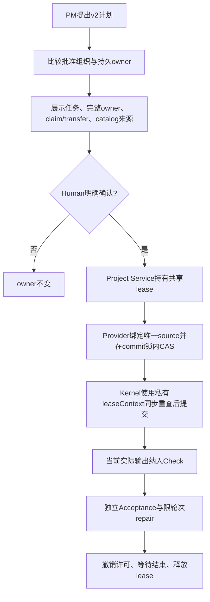

# CLI Host v2 实施说明

依据已确认的 [角色独占文件 v2](../../../ProjectManager/docs/design/2026-10-10_design_cli-role-owned-files-v2.md) 与 runtime 0.9.1 纯数据 leaseContext 契约实施。新运行计划 schemaVersion 2，不接收 task.writeSet；持久角色 owner 决定全部精确文件权限，任务目的/工具/检查/效果仍绑定 Human 确认。旧 v1 先原样验证，再以只读历史保留并使活动计划失效；迁移在共享租约内写私有原字节备份和原子 catalog。

Human 确认显示 owner 差异、全部角色文件与 catalog 来源。确认时 Project Provider 在同用户固定私有 lease 根独占创建不可变 owner-source marker，然后在 commit mutex→catalog lock 内 CAS。异源 userData 拒绝；marker 已创建但 CAS 失败只允许同源重试。无差异保留 owner generation。每次 catalog 写和 Kernel 源码提交使用同一 commit mutex；leaseContext 只在 Host 传给 Mutation，最终同步 owner/holder/source 重读由 Kernel Storage 自行做。

完成根据当前 task/run 的真实 Mutation、Shell 发布或核验恢复输出；verify 可零写。检查输入是已确认规格加实际相关输出/依赖，最后修改后必须新检查。Acceptance 精确归因，repair 不含文件子集；旧 Shell 恢复不重放许可。

本阶段不实施新并发调度或完整分类记忆/Supervisor。当前 settings 的 Electron 依赖是函数内动态 import，静态 Profile 链可在 Node 导入；后续 Headless 工厂必须实际证明未调用 Electron Provider，安装包闭包由 PM/独立消费者验证。

## 已实现的公开入口与确认条件

`createProjectService({userDataDir,leaseRoot?})` 增加 `acquireExecution(project)`、`assertExecution(project)`、`releaseExecution(project)`、`ownerSource(project)` 和 `migrationPending()`。leaseRoot 仅可信隔离测试覆盖，产品固定使用同用户私有根。Pipeline 不直接调用 Lease Provider；私有 nonce/identity 只送入 Kernel Mutation 构造，不进入 SDK、日志或状态。

首次 v1 选择与新计划在内存保留旧 owner 与只读历史，原 catalog 字节不改。执行确认正文显示物理项目身份、规范 catalog 路径及完整旧 owner，并要求 Human 实际肯定这句话：“我确认已关闭该项目所有旧版 Legion 实例，并选择上述 catalog 为本项目权威 owner 来源；同意当前计划。” Host 撤销并等待自己跟踪的实例，不声称枚举未知旧 v1 进程。待答复或拒绝不建 source marker、不备份写回、不发执行 grant；真正确认后在共享保护内重核来源、保存原字节私有备份、绑定 marker，再以 catalog CAS 提交 v2。marker 创建后 CAS 失败仅同源重试，不能自动改绑。

执行状态中的 `generatedOutputs` 是 Host 从本 run 的真实 Shell publishedResources 记录的观测，影响检查时序与 change 完成判断；它不是计划或 Human 授权字段，schema v2 任务拒绝该输入。生成权限仍来自已确认 generatedEffects/artifactScopes。目录交接用 generationDigest 校验，普通实际文件加进 CheckAuthorization.inputVersions；无改动的 verify 仍需当前检查，change 必须有真实效果。

实际验证：固定 owner 全量 168 项通过（0 skipped），覆盖真实三协议 SDK、PM/Architect 读取、同 owner 写与跨角色拒绝、转交、Check/Acceptance/repair、Shell 部分恢复、唯一路径来源与失败 CAS、commit mutex，以及真实 Human 迁移待答复/false/true。详细候选与命令输出见本阶段 task_ops evidence。新并行、Headless 产品工厂及最终 npm 安装消费者仍由后续节点实施验证；分类记忆/Supervisor 由下述节点实施。

检查还绑定 Host 私有 input mutation epoch：另一个任务在检查后写入相同字节仍使旧检查 stale；仅比较 SHA 不足以证明检查发生在最后相关 Mutation 后。该观测只由实际 task/run Mutation/生成输出计算，不是模型计划字段，不保存源码正文。

## 分类记忆与独立 Supervisor 实施设计

本节点在已确认 v2 的角色 owner 规则下，建立独立 Memory Model→Provider→Service：项目事实与既有 roleMemories 自动摘要分开，原摘要不自动导入。记忆 kind 仅 pitfall/decision/preference；源 id 与 digest 由 Organization Service 根据真实 Human turn/答复、已确认 v2 计划、Check/Acceptance 和实际任务失败生成。模型只能提交己方 add/revise/retract 与 expectedRevision，不提供 actor、时间或 sourceDigests。decision/preference 必须是可核对短原文/结构化值；pitfall 必须为作者自己的真实失败元数据。存储为私有 userData 项目集合，CAS、预算、取消、链接与项目身份检查保留，撤回留历史。源撤销/改变后停止注入，已知当前密钥及疑似凭据内容拒绝，记忆正文不进入默认 renderer/日志。

各角色通过只读 query 查看本项目所有 owner 的当前有效事实，启动时注入有预算的相同视图；当前 Human、当前 canonical plan/owner 优先，记忆不生成许可。来源索引只显示有限标签，不输出原始 SDK/工具/Human 正文或私有摘要。

Supervisor 为第四固定系统角色。旧三角色组织先核原 schema/digest，再以 CAS 增 revision/digest 补齐；旧待执行确认失效。Pipeline 创建独立 Supervisor Pi instance/run，只有 remember/query/submit_supervision 控制工具，无 Mutation/Check/Shell 授权。预检必须收到绑定当前计划与来源的合法 typed 建议并正常终态，才显示新的 Human 执行确认；未完成由 PM 重试。block/revise 是建议，不改变任务/owner/grant。执行异常/返修触发后台 monitor，Host 校验后保存安全建议给 PM，既不逐任务批准，也不阻塞 ready-set；原始 Supervisor SDK 会话不写 renderer/member 日志。

验证包括真实 SDK preflight/monitor、无 grant、伪造 actor/digest/source/非法终态拒绝；分类事实归属、三种来源、跨角色读/作者修订、跨项目隔离、撤回/过期/CAS/取消和凭据拒绝，以及旧组织原 digest 与迁移重试。

### 当前实现与证据

Memory Service 已提供 `remember(project,payload,trustedActor,registry,secrets,signal)` 与 `query(...)`：模型只提供 action/kind/statement/sourceRefs/expectedRevision，项目、作者与活跃 run 来自 Host。事实存储在私有 `workbench-memory/<projectId>.json`，保留作者 revision/supersedes 历史和撤回；查询仅返回已生效短事实及来源标签，不返回 SDK/原始 Human 正文或私有摘要。默认 renderer 状态没有事实正文。

Organization `captureMemorySources` 在成功 Human 确认后、替换旧计划前及清理 failed 状态前登记安全不可变来源。旧 confirmed plan 和真实 task failure 不因 plan/repair 当前视图替换而消失。已有已验证 ref 的临时索引缺项不代表撤销；新 add/revise 仍必须引用当前受信登记。真实来源撤销、digest 变化或凭据污染才使事实 stale，模型不能补造来源。

独立 Supervisor 为 single_run Pi instance，直接 `restore_history(checkpoint)`，不调用仅 conversation 可用的 get_history。完整必要输入含计划目标/指令、职责、owner/待 claim-transfer、完整 CheckSpec、依赖/Acceptance；预算不足明确失败，不截断授权事实。预检 typed 建议与正常终态都有效才显示 Human 执行确认。成功、失败、返修均可触发后台 monitor，携带真实 Check/Acceptance 摘要；失败只记录未完成监督，不把成功任务改 failed。Supervisor 没有 Mutation/Check/Shell工具，raw SDK 文本不进入 member/renderer 日志，PM 只读安全 typed 建议。

固定 host 回归涵盖真实 Pipeline 的 `confirmed decision and actual failure facts survive a real repair and another real plan`、独立 Supervisor 完整输入/成功终态监控、text-only 未完成预检，以及 memory 作者权限、跨角色读、引用/凭据拒绝、stale、CAS/取消/链接、旧三角色原 digest 校验与幂等迁移。具体候选和命令输出由 task_ops 保存；旧 owner 与本节点失败证据保留。当前并行共享 agent/metadata/check 状态的改造由后续已确认 Dparallel 节点完成。

## 已知本进程密钥的必要拒绝门

按已确认环境密钥不持久要求，Host 在首次状态/历史恢复前经公开 Profile Service 取得私有凭据，登记进程已知精确 key；Pipeline 不读取环境。纯 Model guard 只比较这些已知值，拒绝模型、工具或 Human 输入中出现它，不扩任意未知 secret 扫描。Human 含 key 在任何记录/授权前失败，不改字继续。

助手 delta 在每 run 私有内存累计，完整安全终态前不写文本日志或 DTO；跨 delta/工具轮边界匹配即拒绝并取消上下文，禁止先写碎片再擦。终态、工具请求/结果、自动摘要、交互、组织提案/审阅、验收/返修、Shell 审核/输出、源码 write/edit、记忆及监督都在相应持久化/效果前验证。合法非敏感 Human 原文和有限工具保持原样。Service/Provider 私有文档读写再守护精确已知 key，既有客户文件不删除/改写，读取中含 key 只安全拒绝扩散。真实回归比较 fresh 持久文件、DTO、源码，并保留长 Human/nonce/owner/并行/Shell强门。

当前接线以runtime0.9.2公开factory knownKeys纯数据选项为准。Node工厂Environment身份显式注入，首个状态/恢复前取得key；Desktop只读加密metadata不强制解密，实际连接解析后先守Human输入再记录。PM拒绝关闭实例，普通取消捕获entry manager/promise并消费真实终态。源码edit核实际只读候选加原CAS；Shell输出hook串行归档，规范化后再守。安全界限仍是已知精确值，外部TOCTOU和child自构直写获准tmp/outputs已review，不能扩大成全称不泄漏保证。
