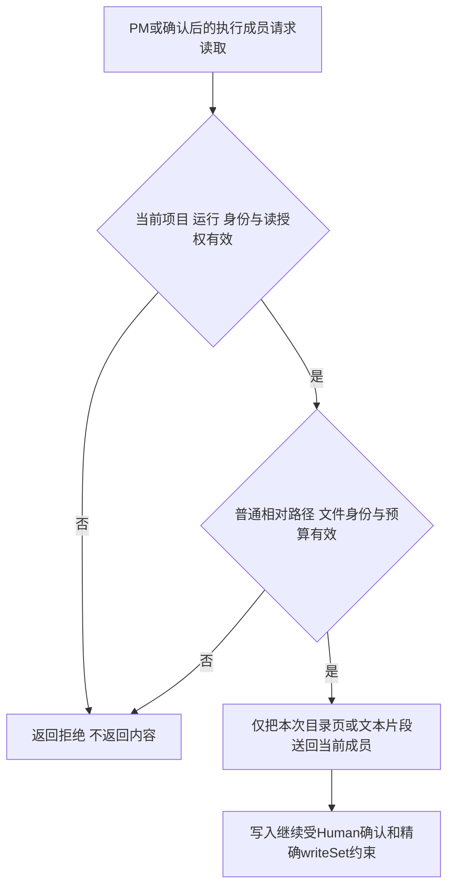
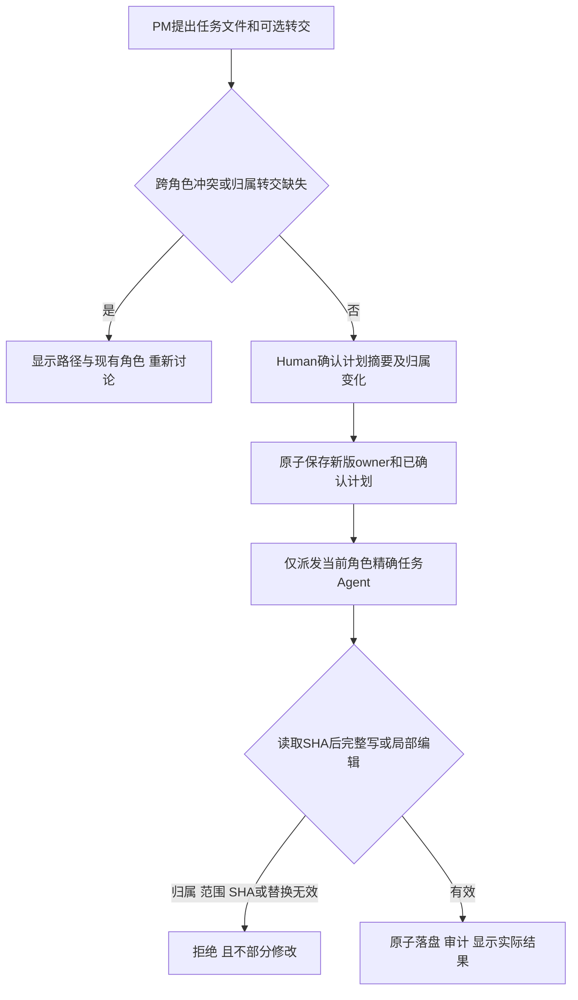
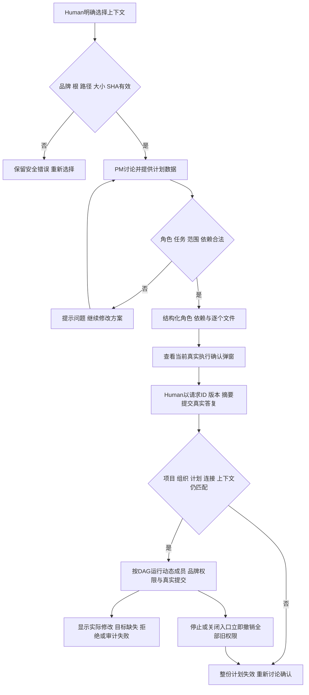
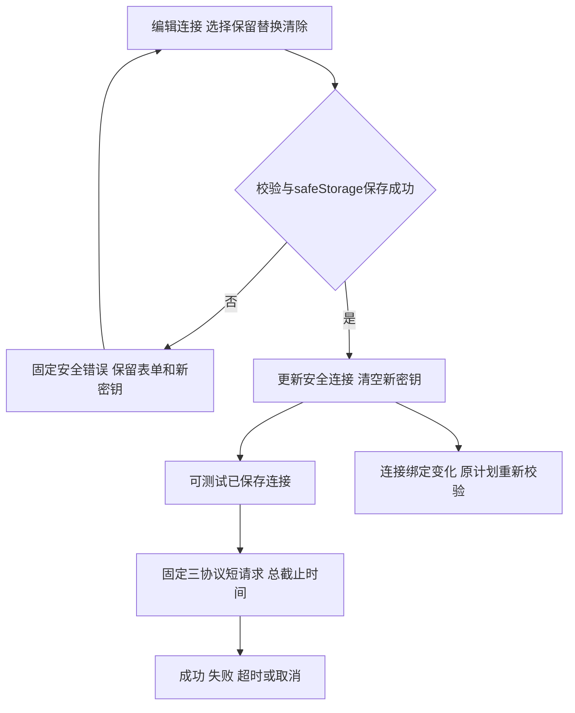
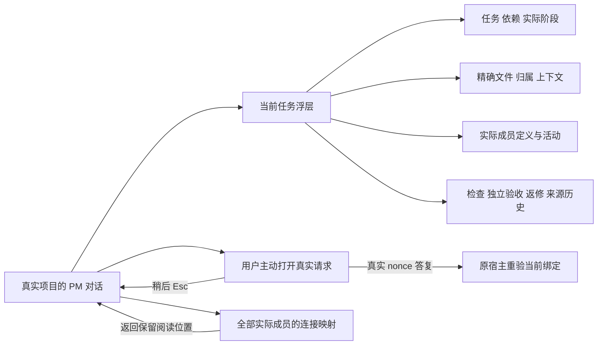
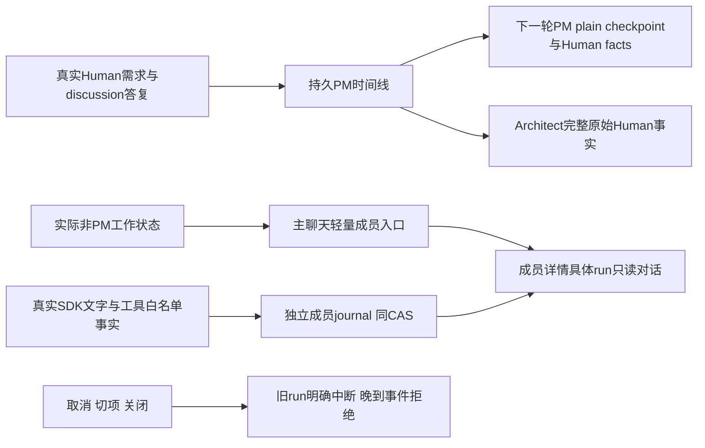

# 在客户项目中讨论并确认精确任务

选一个真实文件夹，与同一个项目管理讨论需求，检查它提出的角色、任务、逐个文件归属和显式转交，再由你确认执行。项目不需要 Legion 的开发组织文件。默认界面专注对话：左侧项目与成员，中央消息，欢迎时同一输入居中，已有消息后位于底部；上下文、实际结果和来源详情在任务、文件、成员、对话、记录五页签浮层查看，AI 连接设置在次级页。成员详情展示持续职责、边界、任务和真实检查。

先点左侧“选择项目”，用系统目录框选真实目录。应用在自己的 userData 保存项目定义和受限文本历史，选择与讨论不在客户目录写文件。目录与应用数据重叠或通过链接越界时提示更换目录；旧历史目录丢失不会阻止选择新项目。再次选择同一目录可恢复其会话。没有连接时打开 AI 设置，保存连接并选为默认，返回对话发送第一条需求；它会创建或复用此项目的 PM。

发送失败保留文字；成功才清空已接受文字。PM 回复可停止后继续，讨论可使用受控项目目录列表和文本读取工具，不能写客户业务文件，可启动只读角色架构师并审阅确切候选。角色定义批准后才可形成引用角色版本的计划；执行确认、选择和询问通过持久请求弹窗。完整流程见[持久组织与独立验收](organization-and-acceptance.md)。每秒刷新保留消息、密钥动作、映射、上下文、筛选和滚动，正在聚焦的连接选择器也保留；首次进入项目定位最新消息，返回页面保持原会话阅读位置，项目消息草稿互相隔离。

## 持续角色记忆与对话页（当前实现）

同项目每个角色保存自己的工作记忆，跨任务、返修与重启延续。详情“成员”只显示选中角色的任务/范围/checks/证据/职责/连接；旁边“对话”显示该角色真实PM消息或成员run历史。点击主区工作入口直接打开对话，点击侧栏打开成员；原始消息不因摘要删除。宿主实际发送的任务简报单独标“宿主任务输入（非成员回复）”，不拿任务说明冒充成员回复。三固定ID始终系统角色，已批准动态成员为项目角色，legacy来源未记录。来源放在完整成员名称下方，固定头像/状态点跨两行；名称可正常换行，不与来源抢宽或用ellipsis省略。项目成员列表不显示滚动条，仍能用滚轮与键盘滚动查看全部成员。

模型工作上下文含摘要、近文和未覆盖需求/问答。Host每轮原样附当前定义/owner/任务与检查；历史文字不恢复权限或当前通过证据。合并输入软限49152字符/96消息、硬限65536；近文按当前完整输入与摘要wrapper余量选择完整消息，目标16384字符/64条。自动摘要为同角色连接的无工具请求，2048输出token/30秒/一次，费用未知；失败保旧记忆，仍超预算就拒绝调用并保当前输入。窗口未配置时只用本地计量，不能用SDK占位值声称真实能力。

本候选Owner固定检查尚待运行，实际SSH项目和独立验收另行记录；[具体实现设计](../design/2026-10-08_design_governed-workbench.md#2026-10-09-已确认角色持续上下文与独立对话页实施)。

若要将重要文件固定到计划确认，展开详情，在“上下文”逐行填写明确的项目相对文件路径并点读取。最多16个文件、单256KiB、总2MiB；可以提交空列表清除。主进程验证品牌读授权、根、文件身份与 SHA，不自动扫描或让模型扩大固定集合。模型另可按需列出当前客户项目普通目录和分段读取普通 UTF-8 文件；这些自主读取不会自动成为计划 SHA 绑定。固定上下文正文只供当前轮次，历史和界面只保留有限描述与校验时间。

PM 与确认后的执行成员可调用 `legion_list_files` 浏览项目根或普通子目录，并调用 `legion_read_file` 按行分段读取普通 UTF-8 文件。路径每次相对当前客户项目验证；控制目录、常见凭据文件、链接、越根路径、非普通文件及超预算读取会给模型明确拒绝结果。单次目录最多 200 项，文本最多 64 KiB，每轮累计返回最多 2 MiB。切换项目、取消或关闭会使旧读取失效；执行成员的写工具仍只接受确认任务的精确 `writeSet`，读工具不产生写许可。PM 自主读取不写客户审计或持久保存正文；模型回答里引用的内容也不作为固定上下文证据。

PM 方案的自然语言显示在对话中，内部 `legion-plan` JSON 默认隐藏，原始助手历史完整保留，可按需展开。合法方案另显示目标、角色与连接、每个任务依赖、精确文件列表、角色申领及归属转交。不同角色申领同一文件会拒绝；同角色在多任务重复修改文件，后续任务要直接依赖前一次。已归属文件转给别的角色时，计划必须明确写出路径、原角色和新角色。非法格式、安全范围或缺少转交会提示重新讨论，并显示冲突文件与现有角色。看清后点“查看执行确认”，打开当前真实执行请求；弹窗完整列出范围、检查与独立验收，再以请求 ID、版本、摘要和真实布尔答复提交。宿主重验全部当前绑定后才签发权限，聊天里的“批准”不能发许可。

文件归属版本和逐个 owner 留在此项目的应用 userData 中，跨后续计划持续有效；旧项目自动从空归属表开始，已有计划、上下文和历史不会丢失。计划确认时，归属更新和确认状态在同一项目文档写入；任务派发及每次改动前，宿主再检查当前 owner 和任务的精确 `writeSet`。执行成员可用 `legion_write_file` 完整写入，也可先用 `legion_read_file` 获得完整文件 SHA，再用 `legion_edit_file` 对已有普通文本做受控局部替换。SHA 过期、替换文本不唯一、文件不安全或不在其任务范围都明确拒绝，不部分修改。成功编辑记录最终文件摘要和实际审计；PM 仍只能读取。

若两个工作台实例同时修改同一项目目录，应用数据目录中的排他锁会让它们依次检查完整目录版本。先提交者成功，后提交者看到已变更的 owner 或目录时收到冲突提示，刷新后可重试；另一实例的归属不会被覆盖。选择另一项目或更改默认连接也经过相同检查。锁路径若是链接或争用持续超过 2 秒，操作拒绝且不会删除不属于本次操作的锁。这个保护针对都使用 Legion 协议的实例；其他程序直接改写应用数据不受该锁约束。

任务区报告实际成功修改几个授权目标，并区分完整写入与局部编辑；模型结束但未调用工具、目标缺失或改动被拒绝时明确失败。审计失败与实际文件结果分别显示。历史无证据任务显示“未运行（not_executed）”；当前获批检查与独立验收完整流程见下方组织与验收功能。执行成员点击展开成员详情再定位，不提供直接聊天、启动或范围变更入口。绑定失效会撤销同一计划全部 authority，包含独立等待任务；恢复旧 SHA 或归属版本也不能再次使用旧确认。重启恢复文本和历史定义，活动任务变 interrupted，不恢复许可。

在 AI 设置保存 OpenAI Chat Completions、OpenAI Responses 或 Anthropic Messages 连接。编辑密钥明确保留、替换或清除，仅显示已保存标记；失败保留输入，成功清空新密钥。密钥由 Electron 主进程 safeStorage 加密，不入 Renderer、历史或错误原文。测试已保存连接发无工具短请求，限16输出token、零重试和总截止时间，可取消；它只说明此次请求结果，费用与未知 metadata 保持 unknown。

任务详情还显示已有治理、task_ops 阶段和运行审计来源，三个状态互不推导，不表示进程在线。缺少开发组织文件的客户项目仍可讨论和确认自己的动态计划。实际来源缺失、版本不匹配、损坏或超限明确不可用；旧有效快照保留时标过期，来源显示观察与最近验证时间。任务记录上限16MiB、4096events、本轮64MiB，校验完整事件链与人类表格；一秒轮询可用已验证缓存，手动刷新强制 SHA。未知 YAML/事件格式、穿越和链接拒绝。

## 接线与当前验证

UI 只经固定 preload IPC 调用 main，main 检查窗口/frame/URL/字段后进入唯一 WorkbenchPipeline。Pipeline 组合公开 Project/History/Profiles/Workspace 与实际安装 Kernel/Adapter Services，各 Service 只调用自己 Provider。模型文字和来源使用文本节点，Node 留在主进程。完整字段、预算和生命周期见 [API](../../api-spec.md)，行为见 [功能描述](../../functional-description.md)。

v2能力正式47/47已经 Supervisor 核验，五测试caller目录修复后完整47/47再次核验。当前Interface有限7用例覆盖真实公开Pipeline本地选择、草稿/焦点/项目滚动/worker详情、发送保存失败保留，以及IPC固定映射和有限投影。DOM替身是组合回归；本阶段未运行v2真实Electron窗口、DPAPI重启或便携ZIP，不能把旧v1或原型当产品证明。本候选正式成绩与后续独立验收见 [当前协调记录](../../../../scheduling/legion-desktop-workbench-v2-fixture-repair.md)，[原任务](../../../../scheduling/legion-desktop-workbench-v2.md) 保留旧候选历史。

## 演变历史

| 日期 | 类型 | 状态 | 变化 | 详细记录 |
| --- | --- | --- | --- | --- |
| 2026-10-07 | GUI v1设计与实施 | 历史同版阶段已核验，保留当时证据 | 安全连接、有限记录观察与中文三页；原角色窗口/DPAPI证明只属于v1 | [本角色v1设计](../design/2026-10-07_design_desktop-gui-v1.md)、[整体v1设计](../../../../design/2026-10-07_design_desktop-gui-v1.md) |
| 2026-10-07 | v2能力设计与实施 | 47用例已正式核验 | 任意真实客户目录、项目与历史、PM讨论、品牌上下文、Human确认DAG与实际文件结果 | [本角色v2设计](../design/2026-10-07_design_desktop-workbench-v2.md)、[已确认整体v2](../../../../design/2026-10-07_design_desktop-workbench-v2.md) |
| 2026-10-08 | 当前项目广读精写 | Desktop角色候选，待独立产品验收 | PM与确认成员按需列目录、分段读取普通文本；固定上下文SHA与精确写入保留 | [已确认项目级读取设计](../../../ProjectManager/docs/design/2026-10-08_design_legion-project-wide-read.md)、[变更记录](../../changelog.md) |
| 2026-10-08 | 文件独占与受控编辑 | Desktop角色候选，待独立产品验收 | 跨计划持久owner、显式转交、任务Agent完整写或按SHA局部编辑、实际结果展示 | [已确认归属与编辑设计](../../../ProjectManager/docs/design/2026-10-08_design_legion-file-ownership-and-agent-edit.md)、[变更记录](../../changelog.md) |
| 2026-10-07 | v2当前界面 | 当前7用例候选待正式核验与独立产品验证 | 专注对话、结构化确认、详情按需展开，轮询保留与PM唯一入口；caller目录修复另经47用例核验 | [变更记录](../../changelog.md)、[当前任务](../../../../scheduling/legion-desktop-workbench-v2-fixture-repair.md) |

## 当前完整工作流

当前主区保持对话；详细计划和日志已移入详情，待答复提示打开持久队列的三类弹窗。确认计划须提交请求ID/version/digest及真实Human答案，普通yes无权限效果。角色成员跨计划保留，历史completed仍not_executed/未验收。软件检查与Acceptance失败、证据过期和原owner限定返修见[完整功能](organization-and-acceptance.md)及[2026-10-08设计](../design/2026-10-08_design_governed-workbench.md)。

本候选处于实现后待独立验收状态，最终source候选与checks以[本次task_ops](../../../../scheduling/legion-governed-workflow-v1-desktop-implementation.md)为准。

## 本轮界面交接

Human 已确认及时雨 / Handwell 的沉稳近黑界面。生产实现已按 [当前设计交接](../design/2026-10-08_design_governed-workbench.md#及时雨--handwell-生产界面交接2026-10-09)与 [精确任务](../../../../scheduling/legion-ui-handwell-implementation-v1.md)完成；固定检查的候选与结果见任务，独立原生验收仍待后续阶段。

当前点击“当前任务”打开任务/文件与上下文/成员/记录四页签；关闭返回原聊天位置。设置中可为全部实际成员保存已有连接映射。输入上方待答复按钮主动打开三类请求；执行确认完整列出文件与归属转交、检查、独立验收和返修上限，稍后及 Esc 保留 pending 和当前窗口草稿。提交中的重复动作、空问题、非法选项和输入法合成发送不派 IPC。检查与验收历史、原始回复、来源和旧顺序注记完整可读。

2026-10-09 的独立 Chromium 检查发现实际检查记录内容变化后 summary 焦点丢失。当前渲染在替换前记录原焦点节点，替换后恢复相同证据 key 的 summary、展开状态和原滚动；未变记录继续复用节点，主动移到其他控件的焦点保留。当前页面与当前真实项目以 aria-current 标识。[返修与实际复验](../../../../scheduling/legion-ui-handwell-final-v1.md)保留原失败和新候选证据。

## 当前对话格式与侧栏键盘反馈

助手回复现在按常用 Markdown 阅读：标题、强调、列表、引用、代码、表格与链接；Human 文字保持原样。原始完整回复可展开并选中复制，流式未闭合格式可读，内部未闭合 legion-plan 协议块不再短暂露出。图片显示描述和网址，没有自动取图；原始 HTML/表单/脚本只作为字面文字。未变消息不重复渲染，解析依赖失效或超展示预算时明确保持完整纯文本，持久历史不裁剪。

点击合法 HTTP/HTTPS 链接才在系统浏览器打开。宿主核对当前真实窗口/主 frame 下的鼠标或 Enter 激活和该条精确链接，一次消费；自动显示消息、程序 window.open 或其他控件点击不授予开任意网址的能力。危险协议/凭据/编码控制字符链接保留原文不激活；系统打开失败有安全提示。当前 UI 不新建外部 Electron 页面，所有 WB 执行权限不变。

项目和成员使用内侧克制焦点环，点击不因外侧环/按压位移撑出滚动条。关闭成员详情清除查看选态，Esc 仍回到发起按钮保持可见键盘焦点；真实多项目/成员内容仍可滚动。[三项纠错设计](../design/2026-10-08_design_governed-workbench.md#聊天-markdown-与侧栏焦点的三项用户纠错2026-10-09)、[当前候选检查及独立复验](../../../../scheduling/legion-ui-markdown-and-focus-v1.md)。

## 当前补丁：取消后继续与正在工作的成员（未测试、未验收）

取消或失败后，Human原始需求与真实讨论答复仍从持久PM timeline进入下一轮普通/恢复会话；选择题的真实定义随决定一起传递。旧legacy用户文字标来源/顺序未知，只作数据。SDK checkpoint最近128与prompt65536不扩大，Human facts过大明确拒绝，不截本次输入或恢复旧execute_plan授权。未完成助手文字和完整UI历史仍保留。

非PM实际工作时主聊天显示轻量成员/task入口，点开现有成员详情的实际运行对话；历史也能从成员入口进入。选具体run可读实际text_delta和工具白名单事实，标task/instance/run与实际来源；不拿任务说明补聊天，不给成员直接发送/启动入口。旧未记录对话明确为空，interrupted结束时间未知写未记录。每个event.id复用原节点，后台追加新的文字/工具不重建正在阅读的旧行；不同run保存窗口内阅读位置，PM输入和焦点不被轮询抢走。

[本轮设计](../design/2026-10-08_design_governed-workbench.md#取消后真实需求恢复一次完整角色方案与成员工作对话2026-10-09)、[未运行的验证任务](../../../../scheduling/legion-workflow-context-and-member-chat-v1.md)。代码和针对性回归已写，按用户先不用测试的要求，未运行unit/模型/应用，未验收。

## 本轮用户恢复测试后的验证状态（2026-10-09）

用户最新“把两个ssh项目都清空，重新测试”已撤销此前tests deferred。Owner按原固定model/unit执行：首轮unit145/164，旧架构师prompt fixture解析、取消需求旧预期与新增manual/加密重启fixture错误已明确修正；第二轮162/164，再修同一JSON行布局与实际content+tool_calls协议fixture。全部原权限/owner/nonce/审计/预算断言保留，取消预期严格验证原需求不丢；生产源未因这些fixture返修改动。旧失败日志永久保留。

随后同固定model28/28、unit164/164通过，无fail/cancel/skip，包括新增13回归与隔离Electron原生用例；最终说明冻结后重新固定检查的候选/日志看 [当前任务](../../../../scheduling/legion-workflow-context-and-member-chat-v1.md)，不复用旧151或此前deferred候选证据。此为Owner实际单元/受控SDK与自有原生fixture结果，两个客户SSH目录清理、真实GUI/真实模型新开发及独立验收由root安排，不能称已完成真实客户项目验证。之前“未测试”是当时状态，当前代码仍待完整产品验收。

## 点击一个成员，看该成员自己的工作

成员详情当前先显示该role的真实计划任务与状态、逐项精确文件和checks、自己的实际证据，再显示自身职责、接口、边界、公开连接和run对话历史；其他成员卡隐藏，不混其他role的任务或日志。RoleArchitect role-design只有真实运行记录时才显示设计任务，未记录/未执行据实说明。实际解析模型profileId由Host给出，Architect未专属映射使用PM fallback也能正确展示，不解密Key。

角色提案边界拒绝现在说明安全field/expected，职责prose/冒号/glob/目录仍拒绝；并明确字段types与完整一次提案规则，帮助实际修正参数而非误以为无权限。具体源码/检查/真实普通入口验收见 [本次任务](../../../../scheduling/legion-role-proposal-diagnostics-and-member-detail-v1.md)与 [设计](../design/2026-10-08_design_governed-workbench.md#完整角色提案的字段诊断与成员中心详情2026-10-09)。

本次Owner固定model30/30、unit170/170首轮通过，无fail/cancel/skip；新增6项明确验证实际形态prose/colon/glob拒绝的安全field/expected、不合法方案不提交pending/owner、SDK据提示改精确完整候选、所选成员自己的任务/证据/卡、公开fallback连接及原权限流程。16文件最终说明冻结后的同候选固定检查以 [新任务](../../../../scheduling/legion-role-proposal-diagnostics-and-member-detail-v1.md)当前证据为准，不能复用旧164或原失败。原真实5成员失败/180秒trace保留，root普通入口真实完整提案/GUI验收仍后续独立进行，没有假审批或客户项目操作。

本轮检查记录：补充任务首轮固定unit163/173、10fail、0skip，日志`legion-role-memory-cancel-commit-v1/evidence/organization-cancellable-commit-1-unit-078a6e33.log`保留。具体修复重复import、合法新来源badge/完整checkpoint断言、实际timeline种子（已import空legacy不重复导入）、cancel发生在prepare未start的真实分支与真实fs最终取消查询夹具；未更改预算或权限、未删除严格断言。新冻结候选待同固定门重验，最终结果以正式report为准。

最终来源保护修正：source工作文本按原始已记录createdAt规范排序，legacy未知来源优先且不伪造时间。活动PM running/waiting回合的真实Human与discussion问答为required完整来源，不能进入older摘要集合；近文选择先预留这些来源、当前完整prompt/pins和摘要wrapper。required+当前输入已超65536时不调用摘要或业务模型，明确拒绝并保原文。新增纯Model和真实localhost SDK“旧架构师45000字回复+本次完整Human”的回归，严格断言摘要请求不含当前需求、后续Architect实际请求含其逐字完整内容，原长journal不删除。此前主model33/unit187通过的c762候选与日志保留作为当时历史，最终固定门将对新候选重新执行；Provider3文件保持已核验原样，最终主unit包含其真实提交取消回归。

同一必要来源保护进一步覆盖执行角色情况：用本角色previous.messages/covered的ID+digest区分已交付与新Human/讨论答案；有previous时，尚未递送的新Human/答案required，且最新需求轮即使PM已completed仍保持完整。初次旧迁移历史至少保护最新真实Human及其问答（legacy无轮次保护最新user）；旧已听内容仍可摘要。required本身超过近文目标16k也不截断，目标先扣其占用；合并65k/恢复128硬限不升。新增纯Model和真实localhost双计划/实际自测验收回归，验证completed PM的18000字符新Human在worker实际请求逐字保留，而摘要仅处理自己前轮45000字符历史，旧工具结果不重放、原文不删除。最终门仅以本轮最新candidate证据为准。

本轮后续固定unit189/191（15eb32a1）保留：required+prompt超限的公开Model行为为提前prompt_budget，回归严格验证throw及完整原文保持；Native记录在自身Enter阶段前出现额外真实Enter输入，原fixture会抢前台。现将实际Electron fixture保持隐藏并只聚焦webContents以隔离用户键盘，真实sendInputEvent与全部精确一次打开/拒绝synthetic/几何/Esc断言及30秒限额不变，不修改Main。最终新候选再运行固定门，旧结果不复用。

当前成员来源布局修正：真实窗口曾出现长中文角色名两字一行，现用三列两行CSS grid使来源独立放在名称下方，保留完整名称和原aria/title、头像、状态点、焦点/滚动与点击路径。新4文件候选的固定unit及实际窗口验收以新任务`legion-role-origin-sidebar-layout-v1`证据为准；原上下文191通过属于7c98历史候选。

Human要求隐藏项目成员列表滚动条：仅`.member-list`隐藏bar与预留槽，原overflow:auto和三列两行名称/来源布局保留。新候选的固定unit与普通窗口验收以任务`legion-member-list-hidden-scrollbar-v1`证据为准，不复用旧CSS候选的通过。

## 当前任务间依赖交接（2026-10-09）

后继任务不再自动收到依赖文件的整段源码或重复write旧快照。Host仅交接最新成功变更的精确resource、producer task/role、action、contentDigest及proposalDigest；按实际任务完成顺序/同resource去重，full-write SHA按成功写入的完整UTF8正文计算，edit只用实际结果SHA，未知为null。接收角色用已有legion_read_file自主读取磁盘当前内容，不能把旧write正文或通用提案摘要当当前代码SHA。

当前Human/角色职责与owner/任务/checks原样保留，合并65k输入、读取2MiB、写scope与确认/evidence规则不扩大。原始执行结果、失败检查及已写文件不删除；元数据也超预算时仍明确拒绝。真实SSH Core约90k导致后继prompt_budget的旧记录保留，本轮仅修自动灌正文接线。新候选的固定门与独立/真实项目验收分别记录于`legion-bounded-dependency-handoff-v1`。

本轮固定unit首轮192pass/1测试文件失败（193总项）日志1510e5ca保留。新大handoff夹具误用了read.content/contentDigest和edit.expectedContentDigest，真实公开接口是read.text/sha256与edit.expectedSha256；edit被严格拒绝，错误夹具不断重复导致V8 OOM。仅修此夹具字段及真实denied/error终态收束，仍严格要求最终completed、真实checks passed、完整Human/canonical、最新SHA和实际read正文。生产预算/权限、原191断言、argv、300秒与heap不变；source/docs重新冻结后同固定两门对新候选重验，不复用首轮Model证据。

随后0663aea9仍OOM的确切持续请求原因：多次write复用夹具completion默认toolCallId=call1，真实Adapter明确拒duplicate_tool_call，SDK错误不带Host result envelope，夹具success停在1并重复错误请求。每个实际write现使用唯一ID，实际tool消息必须有typed Host result；schema/duplicate/denied/error及错phase立即按失败收束，夹具自定义handler最多24请求以防错误循环，不改变production预算。按Supervisor指令先仅新case局部实际运行，handoff-focused-diagnostic-1.log记录12个自定义handler阶段、1/1成功（约2.47秒），父4次write→read→check failed→edit，子真实read当前全文/sha再write，全部原selfcheck/Acceptance最终completed断言保持。1510/0663失败留存；现在对统一冻结新候选重新跑固定model/unit，不将局部1/1冒充正式门或真实SSH完成。
