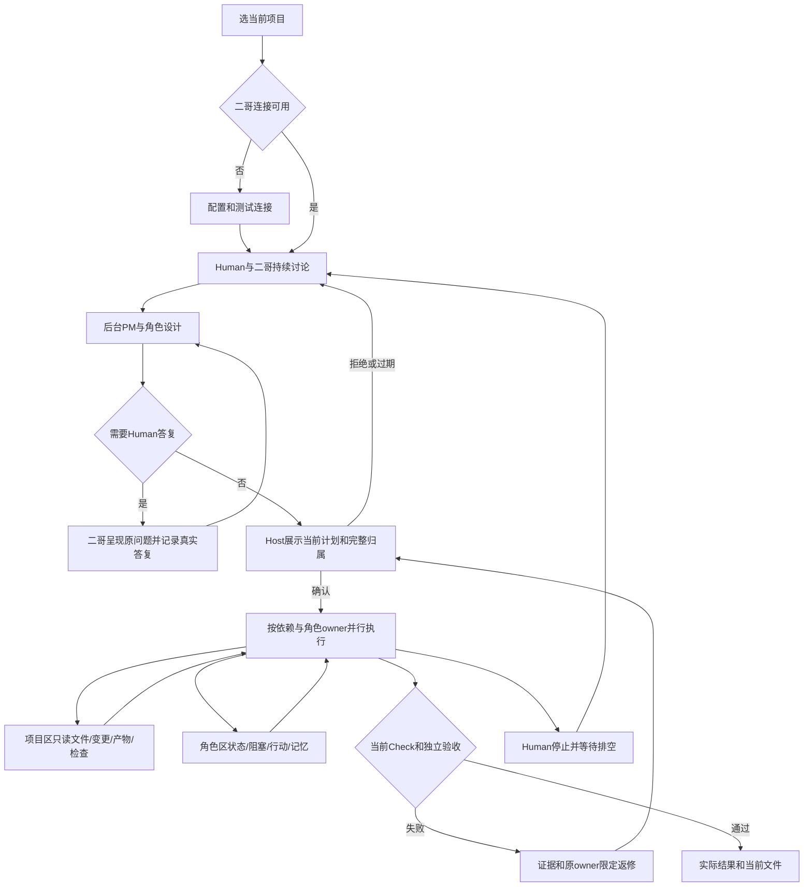

# 二哥项目指挥台

选择一个普通项目目录，在二哥对话区说明目标。后台 PM、角色架构师、工作角色和独立验收仍由唯一 Workbench Pipeline 组织，客户只有二哥一个发送入口，其内部 `roleId` 仍为 `Supervisor`。计划必须先由 Human 查看当前角色归属、任务依赖、软件检查和验收后确认；对话中的肯定文字不会授予执行权。执行期间二哥可回答只读进度问题，项目与角色工作区可同时查看真实文件、改变和检查。点击“停止当前执行”会撤销当前运行权限并等待本次执行排空。

## 当前页面

宽屏是二哥对话、项目工作、角色运行三列，各列独立滚动。左侧“主入口”只有二哥卡片，标明内置身份和当前状态；“其他角色（查看/调试）”逐项显示当前组织成员的职责摘要与真实活动状态。二哥卡片回到当前项目客户对话，其他角色只打开角色运行区的公开资料和行动事实，不提供直接客户聊天。未选择项目时主卡提示先选项目并禁用；无计划显示待讨论，只有实际执行确认请求才显示等待你确认，真实待答复或执行中状态分别标明。

宽度不超过 1280px 时二哥与选中的项目或角色工作区并列；不超过 900px 时使用三个顶层页签切换全宽工作区。900px 顶部有可发现的“项目与设置”按钮：打开同一分组侧栏，能进入 AI 连接、切换明暗主题或选项目；点击二哥同时切回对话工作区，输入可用时聚焦输入框，缺连接时聚焦可见的连接按钮。Escape 与背板关闭并回到按钮，进入设置/角色时焦点转给目标控件。顶部仍有“选择项目”。AI 连接设置是独立页，Electron safeStorage 保存用户主动输入的密钥，密钥不返回 renderer。切换页签和每秒状态刷新保留二哥对话区未发送文字、当前问题草稿、文件预览、角色选择、滚动和已聚焦的连接字段。

- **二哥对话**：真实 Human/二哥客户 timeline、后台 PM 通过二哥呈现的原问题、当前执行确认和输入框。每条客户助手气泡都以二哥为头像和名称；待答复问题标“二哥 · 转达待答复问题”，并保留问题原文，不伪装成可直接聊天的 PM。计划协议尚未完整呈现时也由二哥引导查看当前任务；无计划时引导客户先告诉二哥目标。提交确认使用当前 requestId、version、digest 与 planDigest；拒绝或稍后不产生许可。
- **项目工作区**：普通目录分页、UTF-8 文件分段预览、实际变更、发布与生成产物、当前 Check 与独立 Acceptance。文件浏览与 `selectContext` 分开，不会更新固定上下文或撤销计划。计划提到的文件与已观察到的写入明确分开；没有旧正文时不伪造 diff。
- **角色运行区**：长期职责与当前角色状态、任务依赖及阻塞、按角色/任务/计划绑定的分页行动日志、带真实来源的 `pitfall`/`decision`/`preference` 分类事实。私有成员原文、宿主简报、模型恢复摘要、Shell 命令/输出、凭据不进入客户公共 DTO。

文件列表最多每页 200 项，文件分段最多 64 KiB，仍遵循 Kernel Read Service 的普通资源、根身份、no-follow、二进制、控制目录和预算拒绝。角色日志每页默认 20、最多 50 项和 32 KiB，游标绑定项目、筛选、来源摘要和边界；事实与产物页也绑定当前计划与数据摘要。首页不带 cursor 字段，只有实际收到非空 nextCursor 后才能请求下一页；游标过期或非法时清除旧游标、隐藏“下一页”，保留已读列表并提示刷新，键盘焦点回到刷新按钮，不静默混合两次快照。分类记忆浏览只计算来源有效性，不保存新的记忆修订。

## 来源与失败分支

界面状态来自当前 Host 项目、组织、任务结果、Check 证据、Shell 发布事实和独立验收；模型文字不会被显示为已完成或已通过。顶部只计数运行、阻塞、失败和待答复，不编造百分比。查看产物时，只有真实生成/发布记录可列为产物；当前生成目录摘要与记录不同时显示过期。删除显示真实 absence/墓碑，不显示不存在的内容。检查未运行标“未运行”，旧 run 或输入改变的证据不算当前通过。

角色工作日志只含工具名、结果码、资源、检查 ID、时间和来源引用。私有成员 journal 仍保存在宿主供本角色恢复与审计，但公共 `getState` 不传整本 journal，详细行动通过有限查询加载。公共 `getState` 的 Shell 仅保留最近有限状态摘要；完整命令、reviewText、stdout/stderr 和逐项发布由私有台账保存，客户产物区只读取安全的实际发布元数据。分类事实由 Host 按当前项目、可信来源与已知密钥校验；失效事实不被当作当前偏好。

执行中二哥模型的 PM 委托、记忆修改和新讨论请求在 Host control-tool 被明确拒绝，普通文件读取、角色状态/日志与记忆只读检查仍可用。客户工作区读取与 worker 执行并发：每个响应返回前再核当前项目、根身份及执行 epoch，旧项目/失效查询不污染新工作区，也不签发 Mutation 或更改 grant。停止、关闭、换项目和连接变化沿原 owner/lease/context/profile/计划绑定撤销全部当前许可。

AI 设置把默认连接标为“默认二哥对话连接”；后台 PM 仍是独立系统角色，可在项目成员映射中指定连接。Shell 的逐条 PM 结构化审核、失败返修的 PM 协调以及后台角色卡保留真实 PM 身份。没有活动计划时保存连接或映射只提示后续使用；存在 draft/confirmed/running 活动计划才提示失效。以上仅改变客户可见文案，不改变 profile 解析顺序或后台权限。

无法读取普通文件时显示真实安全原因（缺失、链接、二进制、超预算或目录变化），不显示空文件冒充成功。请求失效保留该问题的未提交草稿但不提交旧 answer。角色没有行动或记忆时明确显示空状态；`not_recorded` 显示“尚未运行”，普通 `waiting` 显示“等待任务”，只有 `waiting_answer` 显示“等待你的答复”。没有活动计划时保存默认连接只提示后续讨论使用新连接，不声称旧计划失效；活动计划才显示真实失效提示。旧项目迁移和旧计划不会恢复旧许可；旧事实只作历史显示。

## 接线与验证

`interface/index.html` 与 `renderer.mjs` 只用固定 `preload.cjs` IPC；`main.mjs` 验证当前窗口、主 frame、document URL、精确输入，并为每个只读查询重建有限 DTO。唯一 `pipelines/workbench.mjs` 组合公开 Organization、Memory、Project、Profiles 和 Kernel Read Services；没有 renderer 文件系统直读、第二状态库、任意 Shell 或跨层 Provider 调用。精确操作、预算和结果见 [当前 API](../../api-spec.md)。

DesktopEngineer 的本阶段代码与本地测试属于实现证据；最终四个固定门、真实 Electron 页面与独立 Tester/Reviewer 以 [本次协调记录](../../../../scheduling/legion-desktop-command-center-v1.md) 的最终候选为准，不借旧 Handwell/CLI 结果。macOS 本机已安装 Electron，Windows 便携包和独立 GUI 验收由后续 owner 负责。

## 历史

原对话与抽屉界面、五页签的设计和当时证据保留在 [Workbench v2 设计](../design/2026-10-07_design_desktop-workbench-v2.md)、[组织与验收](organization-and-acceptance.md)、[本角色变更记录](../../changelog.md)。当前指挥台依据 [已接受的 v0.3 设计](../../../ProjectManager/docs/design/2026-10-12_design_desktop-command-center.md) 实施；本页是当前客户行为，不把旧成员原始聊天页作为可公开功能。
