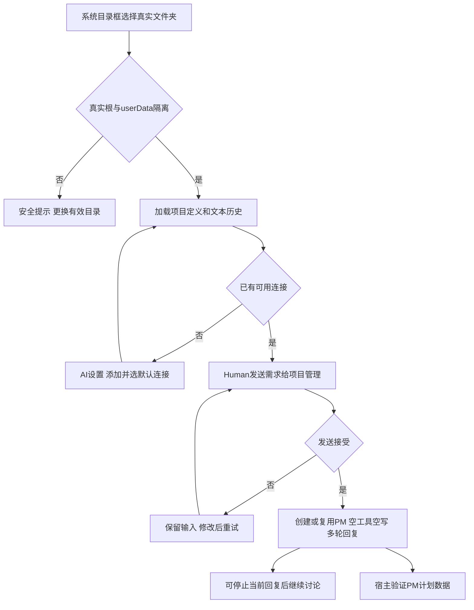
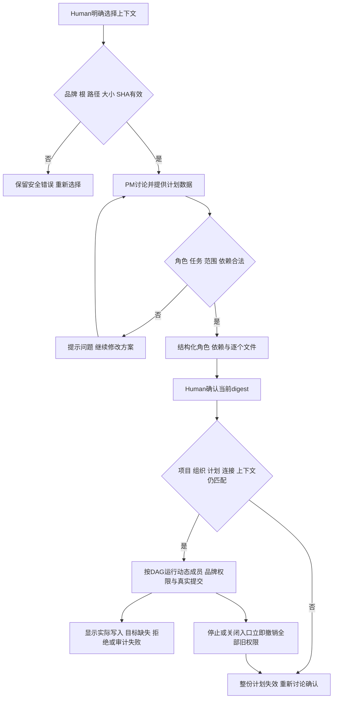
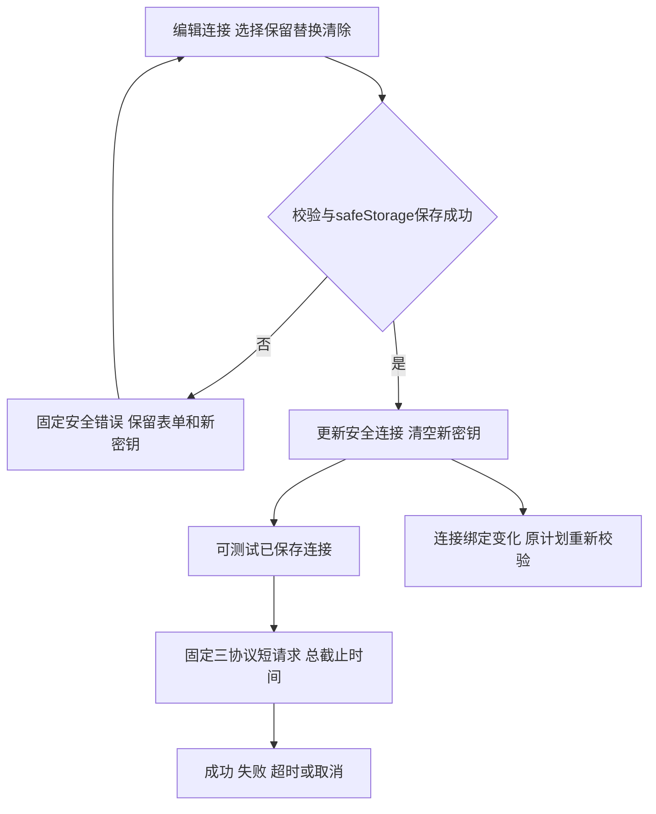

# 在客户项目中讨论并确认精确任务

选一个真实文件夹，与同一个项目管理讨论需求，检查它提出的角色、任务和逐个文件范围，再由你确认执行。项目不需要 Legion 的开发组织文件。默认界面专注对话：左侧项目与成员，中央消息，底部固定输入；上下文、实际结果和来源详情需要时展开，AI 连接设置在次级页。执行成员只能查看状态。

先点左侧“选择项目”，用系统目录框选真实目录。应用在自己的 userData 保存项目定义和受限文本历史，选择与讨论不在客户目录写文件。目录与应用数据重叠或通过链接越界时提示更换目录；旧历史目录丢失不会阻止选择新项目。再次选择同一目录可恢复其会话。没有连接时打开 AI 设置，保存连接并选为默认，返回对话发送第一条需求；它会创建或复用此项目的 PM。

发送失败保留文字；成功才清空已接受文字。PM 回复可停止后继续，讨论无工具与客户文件写入。每秒刷新保留消息、密钥动作、映射、上下文、筛选和滚动，正在聚焦的连接选择器也保留；换页/切项目回顶，项目消息草稿互相隔离。

需要模型参考已有文件时，展开详情，在“上下文”逐行填写明确的项目相对文件路径并点读取。最多16个文件、单256KiB、总2MiB；可以提交空列表清除。主进程验证品牌读授权、根、文件身份与 SHA，不自动扫描或让模型扩大集合。正文只供当前轮次，历史和界面只保留有限描述与校验时间。

PM 方案的自然语言显示在对话中，内部 `legion-plan` JSON 默认隐藏，原始助手历史完整保留，可按需展开。合法方案另显示目标、角色与连接、每个任务依赖和精确文件列表。非法格式、安全范围或依赖错误提示重新讨论。看清后点“确认当前计划”；按钮只提交宿主当前 digest，聊天里的“批准”不能发许可。

任务区报告实际成功写入几个授权目标；模型结束但未调用工具、目标缺失或写入被拒绝时明确失败。审计失败与实际文件结果分别显示。软件检查显示“未运行（not_executed）”，尚无自动 Shell 或测试执行器。执行成员点击展开成员详情再定位，不提供直接聊天、启动或范围变更入口。绑定失效会撤销同一计划全部 authority，包含独立等待任务；恢复旧 SHA 也不能再次使用旧确认。重启恢复文本和历史定义，活动任务变 interrupted，不恢复许可。

在 AI 设置保存 OpenAI Chat Completions、OpenAI Responses 或 Anthropic Messages 连接。编辑密钥明确保留、替换或清除，仅显示已保存标记；失败保留输入，成功清空新密钥。密钥由 Electron 主进程 safeStorage 加密，不入 Renderer、历史或错误原文。测试已保存连接发无工具短请求，限16输出token、零重试和总截止时间，可取消；它只说明此次请求结果，费用与未知 metadata 保持 unknown。

任务详情还显示已有治理、task_ops 阶段和运行审计来源，三个状态互不推导，不表示进程在线。缺少开发组织文件的客户项目仍可讨论和确认自己的动态计划。实际来源缺失、版本不匹配、损坏或超限明确不可用；旧有效快照保留时标过期，来源显示观察与最近验证时间。任务记录上限16MiB、4096events、本轮64MiB，校验完整事件链与人类表格；一秒轮询可用已验证缓存，手动刷新强制 SHA。未知 YAML/事件格式、穿越和链接拒绝。

## 接线与当前验证

UI 只经固定 preload IPC 调用 main，main 检查窗口/frame/URL/字段后进入唯一 WorkbenchPipeline。Pipeline 组合公开 Project/History/Profiles/Workspace 与实际安装 Kernel/Adapter Services，各 Service 只调用自己 Provider。模型文字和来源使用文本节点，Node 留在主进程。完整字段、预算和生命周期见 [API](../../api-spec.md)，行为见 [功能描述](../../functional-description.md)。

v2能力正式47/47已经 Supervisor 核验，五测试caller目录修复后完整47/47再次核验。当前Interface有限7用例覆盖真实公开Pipeline本地选择、草稿/焦点/项目滚动/worker详情、发送保存失败保留，以及IPC固定映射和有限投影。DOM替身是组合回归；本阶段未运行v2真实Electron窗口、DPAPI重启或便携ZIP，不能把旧v1或原型当产品证明。本候选正式成绩与后续独立验收见 [当前协调记录](../../../../scheduling/legion-desktop-workbench-v2-fixture-repair.md)，[原任务](../../../../scheduling/legion-desktop-workbench-v2.md) 保留旧候选历史。

## 演变历史

| 日期 | 类型 | 状态 | 变化 | 详细记录 |
| --- | --- | --- | --- | --- |
| 2026-10-07 | GUI v1设计与实施 | 历史同版阶段已核验，保留当时证据 | 安全连接、有限记录观察与中文三页；原角色窗口/DPAPI证明只属于v1 | [本角色v1设计](../design/2026-10-07_design_desktop-gui-v1.md)、[整体v1设计](../../../../design/2026-10-07_design_desktop-gui-v1.md) |
| 2026-10-07 | v2能力设计与实施 | 47用例已正式核验 | 任意真实客户目录、项目与历史、PM讨论、品牌上下文、Human确认DAG与实际文件结果 | [本角色v2设计](../design/2026-10-07_design_desktop-workbench-v2.md)、[已确认整体v2](../../../../design/2026-10-07_design_desktop-workbench-v2.md) |
| 2026-10-07 | v2当前界面 | 当前7用例候选待正式核验与独立产品验证 | 专注对话、结构化确认、详情按需展开，轮询保留与PM唯一入口；caller目录修复另经47用例核验 | [变更记录](../../changelog.md)、[当前任务](../../../../scheduling/legion-desktop-workbench-v2-fixture-repair.md) |

