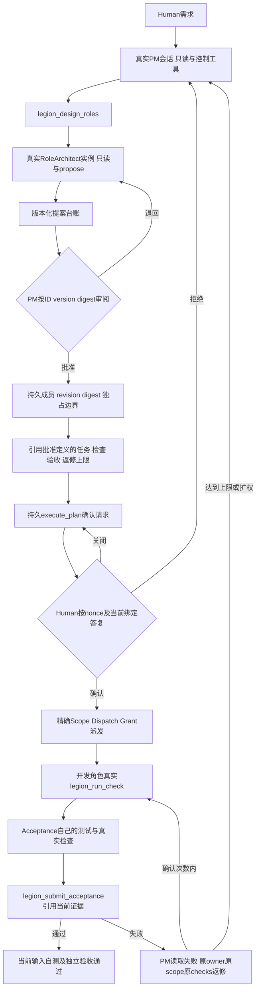

# 持久成员、真实答复与独立验收

用户为同一个项目增加下一轮功能时，之前的成员继续存在。ProjectManager 负责讨论和审阅，RoleArchitect 起草职责、协作和精确文件边界，Acceptance 维护自己的测试、夹具和报告。新计划引用已批准定义的 revision/digest；待审候选不会成为成员。旧项目从当前计划和持久文件归属恢复成员 ID，未知职责显示 legacy/待补全，不编造历史批准。

## 当前角色上下文与独立对话

组织userData新增private roleMemories，以project+role隔离摘要/来源水位/近文和修订。真实PM Human/discussion问答与该角色自身实际文字、固定工具事实、已发送安全任务briefing构成来源；非PM回复不成为PM回复，执行yes和旧工具授权不进SDK恢复队列。选择题保留原题目、选项与实际答案。摘要覆盖来源ID/digest可追溯，已覆盖Human不会再全部重注入；原始journal仍保存。

每个新任务仍是新instance/run/grant，只在首次运行前绑定当前instance/profileVersion恢复plain checkpoint；PM idle记忆相同时复用，变化/重启重建工作文本。Host原样pins角色purpose/revision/digest/interfaces/boundary、当前owner/task/checks，摘要不能覆盖这些值。旧自测/验收仍为历史，当前通过只由真实输入与证据判定。

预算65536合并字符、49152软阈值/96条、近文目标16384/64条、摘要8192、checkpoint128、全项目2MiB；先保完整当前输入和pins，再按剩余空间选择整条近文。仅一次同角色tool-less摘要2048token/30秒，真实completed且合法完整输出及源版本仍一致才CAS保存；length/超长/失败/取消/冲突保旧记忆，超限明确拒绝。旧文档先验原digest再default新字段，原Provider锁/CAS/16MiB保持。write可选signal，最后准备完成后rename发起前取消保旧target；rename开始为提交点，之后取消不能声称回滚，停止后续业务。

详情新增第5个“对话”，紧挨“成员”。成员只selected role任务/定义/连接，对话只selected project+role+run实际历史；host_briefing明确宿主输入不是成员回复。原事件节点/焦点/各tab与run阅读位置/draft保留。来源固定3系统ID、approved项目角色与legacy未知分开。

当前新候选已写入，Owner固定model/unit尚待运行，历史通过不作为本轮证据。[本轮设计](../design/2026-10-08_design_governed-workbench.md#2026-10-09-已确认角色持续上下文与独立对话页实施)。

成员在侧栏按稳定 ID 更新，展示工作、等待、失败和待补全。点击成员打开职责、接口、精确边界、任务与检查详情。主区只显示会话、真实答复及待答复提示；计划、归属、具体执行与检查输入 SHA 在详情。后台轮询不会自动打开弹窗或抢正在输入的焦点，用户点击待答复提示打开队首请求。

确认有确认/拒绝动作，选择提交已有选项及允许的补充文字，询问提交非空文字。关闭弹窗保留 pending；已答复请求不会再次弹出。队列、答案及完整摘要在 userData 保存，刷新、切换、重启不丢失。取消当前回复使其待答复请求失效，关闭窗口释放实际SDK等待并保留持久问题。恢复答案是新PM上下文中的事实，不能向不存在的旧run/toolRequest重放结果。

执行请求绑定完整planDigest、组织revision/digest、当前profile、上下文和物理workspace/fileOwners。普通对话“yes”、缺nonce、错误版本、过期绑定或重复动作均不会生成新执行授权。角色审批不授予业务写权限；RoleArchitect发布批准文档仍需要Human确认其治理文档任务，提交的UTF8内容SHA须匹配候选。

每项任务有明确CheckSpec，Scope、Dispatch与ConfirmedTaskGrant携带相同checks。工具只收checkId；当前角色、任务、session、instance、run、plan/profile/物理根/owner与live信号全部由可信宿主绑定。Pipeline通过Kernel公开CheckService创建实际Provider，输出在物理userData/checks，候选只读。当前Node检查隔离禁止子进程，其他环境不支持时明确unsupported，零测试、失败、错误或未执行不会complete。

检查记录保存实际结果、关联ID、参数、运行时、隔离能力、输入SHA和日志；界面日志是有界文本投影，原始证据仍在私有台账。完成前和独立验收提交时重查所有声明输入，任务与依赖变化使旧证据过期。旧completed写入记录仍显示not_executed/未验收。Acceptance只能申领tests/Acceptance、test/Acceptance、docs/roles/Acceptance的精确文件，不能取得业务源码写权限。

PM返修只针对当前失败报告的问题，派回原任务owner，保持原writeSet/checks和Human确认的maxRepairRounds。复验重新运行真实开发自测与独立验收。新增文件、转交或扩大检查必须新计划确认；明确转交还须先由角色提案审阅移除旧边界并声明新owner。达到上限保留失败证据并请求讨论。

Provider在同一锁内以完整digest CAS和原子替换提交组织、proposal ledger、queue、checks、acceptances、repairs。会话历史和项目目录也使用锁与CAS。独立窗口覆盖、链接路径、数据目录与客户根重叠会拒绝。

验证状态：本角色已实际运行组织/交互、三协议SDK真实审批与任务、安全取消/CAS/编辑、真实Node检查失败与依赖过期、独立验收和原owner返修。最终候选以task_ops固定model/unit记录为准；本角色单测不代替Tester真实窗口与完整项目验收、Reviewer结构审查、PM重新安装的fresh runtime及发布。

历史：[本角色设计](../design/2026-10-08_design_governed-workbench.md)、[完整canonical设计](../../../ProjectManager/docs/design/2026-10-08_design_legion-governed-workflow.md)、[工作台入口](desktop-console.md)、[任务及证据](../../../../scheduling/legion-governed-workflow-v1-desktop-implementation.md)。

## 真实模型失败的诊断

架构师失败返回Adapter的有限安全错误码，让PM区分认证、协议、网络、活动预算和取消；未知码保持architect_failed，不返回SDK原文或凭据。当前接口没有finish_reason，协议错误不能被表述为已证明截断。架构师prompt包含组织revision/digest和旧fileOwners事实，保留legacy归属，每次先提交最小成员子集再由PM审阅。PM有三类最短有效交互示例，避免凭猜构造invalid_options。

历史：[原生真实模型返修设计](../design/2026-10-08_design_governed-workbench.md#原生真实模型返修2026-10-08)、[单独返修任务](../../../../scheduling/legion-governed-workflow-v1-live-architect-repair.md)。原实现候选与本次返修检查分别留证，实际native窗口和客户完整流仍由独立Tester负责。

## 提问与答案保持实际先后

对话按host持久timeline显示，不再把所有答案追加在全部历史之后。发起消息、实际问题、Human答案、PM继续回复有稳定ID和实际顺序；同样文字仍是不同消息，同answerId只显示一次。重启回答已保存问题时，新的continuation绑定原答案，SDK仅从纯文本事实继续，不恢复旧工具或权限。旧无锚点记录显示交互顺序未知，不能把猜测当真实时间。queue与timeline同事务CAS提交，History是SDK文本投影。

架构师若已经真实提交候选却在后续SDK运行失败，PM取得安全error结果及此instance/run实际观察、当前仍pending的候选。失败保持失败，候选保持候选，PM按确切ID/version/digest另行审阅。取消或旧项目不会返回其他scope候选。[本阶段设计](../design/2026-10-08_design_governed-workbench.md#持久对话锚点与已观察提案返修2026-10-08)、[任务](../../../../scheduling/legion-governed-workflow-v1-conversation-repair.md)。

## 长对话保持完整，模型每次只接收当前事实

时间线与完整证据继续在界面保存，模型每轮使用有界当前角色、精确候选、当前失败验收/实际检查摘要。历史省略数量和日志摘要裁剪有明确标记；旧timeline不再重复塞入每轮SDK prompt。最近完整128条SDK文本作为plain checkpoint，较早消息省略明确说明，不重放旧工具/权限。Human选择的上下文及本次任务instruction不能无声裁剪，拼接超65536则明确提示并不调用模型。SDK同步拒绝留下failed事实，保留输入草稿，可以提交较小有效输入。

历史：[真实长对话返修](../design/2026-10-08_design_governed-workbench.md#长对话输入预算与启动拒绝返修2026-10-08)、[任务](../../../../scheduling/legion-governed-workflow-v1-prompt-context-repair.md)。

## 本轮界面交接

Human 已确认及时雨 / Handwell 的沉稳近黑界面。生产实现已按 [当前设计交接](../design/2026-10-08_design_governed-workbench.md#及时雨--handwell-生产界面交接2026-10-09)与 [精确任务](../../../../scheduling/legion-ui-handwell-implementation-v1.md)完成；固定检查的候选与结果见任务，独立原生验收仍待后续阶段。

当前任务的记录页完整展示公开检查历史（真实状态/测试数/输入 SHA/环境/日志裁剪）、独立验收期望/实际/复现、原成员限定返修范围与次数及角色候选审阅事实。历史计划单独注明，不与当前证据混用。执行确认弹窗展开全部文件、归属转交、任务检查、Acceptance 覆盖和 maxRepairRounds；提交真实 nonce 后权限仍由原宿主签发，界面不产生新执行能力。

真实检查记录由当前计划变为历史计划时，变化的披露内容可替换，当前同 key summary 的键盘焦点、展开状态和滚动会恢复；未变内容保持原节点，用户主动移开的焦点不被抢回。该已复现缺陷的修复及独立完整验收见 [最终任务](../../../../scheduling/legion-ui-handwell-final-v1.md)。三类弹窗答案、nonce 与失败行为沿用原实现；真实 organization_busy 场景仍保留答案、弹窗和提交焦点。

## 当前补丁的一次完整角色设计与独立会话来源（未测试）

RoleArchitect在同一现有预算内一次提交本次必要新增/修订成员，成功后正常结束；不probe、不拆批或全量替换组织，不删除旧失败/批准。三系统固定职责单列，已有开发定义仍可revision+1由PM按当前组织与候选digest精确审批，旧owner和未参与成员保留，转交仍走原两步批准。Human原始需求和实际discussion决定从validated timeline+queue自动交给PM与Architect，旧执行yes不授予新许可。

实际非PM run会话独立memberConversations持久，绑定project/role/task/instance/run；只有SDK text_delta与工具白名单元数据，不含文件读取正文/SDK私密原文或任务instruction。旧字段缺失先校验旧digest再补空记录，原Provider锁、完整CAS和预算不变。明确stop捕获旧run记interrupted，late事件guard不放宽，也不将旧项目文档更新成新项目状态；重启不恢复旧SDK工具或grant。

[本轮具体设计](../design/2026-10-08_design_governed-workbench.md#取消后真实需求恢复一次完整角色方案与成员工作对话2026-10-09)、[pending验证任务](../../../../scheduling/legion-workflow-context-and-member-chat-v1.md)。相关20文件补丁和针对性回归已写，用户明确本轮先不用测试，所有model/unit/应用/模型回归未运行，不能称为验收或以旧成绩替代。

## 本轮用户恢复测试后的验证状态（2026-10-09）

用户最新“把两个ssh项目都清空，重新测试”已撤销此前tests deferred。Owner按原固定model/unit执行：首轮unit145/164，旧架构师prompt fixture解析、取消需求旧预期与新增manual/加密重启fixture错误已明确修正；第二轮162/164，再修同一JSON行布局与实际content+tool_calls协议fixture。全部原权限/owner/nonce/审计/预算断言保留，取消预期严格验证原需求不丢；生产源未因这些fixture返修改动。旧失败日志永久保留。

随后同固定model28/28、unit164/164通过，无fail/cancel/skip，包括新增13回归与隔离Electron原生用例；最终说明冻结后重新固定检查的候选/日志看 [当前任务](../../../../scheduling/legion-workflow-context-and-member-chat-v1.md)，不复用旧151或此前deferred候选证据。此为Owner实际单元/受控SDK与自有原生fixture结果，两个客户SSH目录清理、真实GUI/真实模型新开发及独立验收由root安排，不能称已完成真实客户项目验证。之前“未测试”是当时状态，当前代码仍待完整产品验收。

## 完整角色方案的严格拒绝可诊断

boundary只收精确项目相对文件数组；真实已观察的职责冒号prose/glob不变为授权。已知本方校验失败有固定members索引字段路径与静态expected，Control有限传给当前SDK，禁止回显坏值/API/credential或把未知bug当输入错误。Guide说明职责purpose、接口interfaces、边界file、真实documents SHA与版本类型；完整方案仍一次提交，成功才出现pending，PM/Human/owner/revision和预算不变，旧失败和批准不删除。

成员相关事实按选中role过滤，包括实际任务、scope/checks、证据、定义/连接、独立真实对话；未检查或无run不伪造。新固定门与root真实项目验收见 [新任务](../../../../scheduling/legion-role-proposal-diagnostics-and-member-detail-v1.md)。

本次Owner固定model30/30、unit170/170首轮通过，无fail/cancel/skip；新增6项明确验证实际形态prose/colon/glob拒绝的安全field/expected、不合法方案不提交pending/owner、SDK据提示改精确完整候选、所选成员自己的任务/证据/卡、公开fallback连接及原权限流程。16文件最终说明冻结后的同候选固定检查以 [新任务](../../../../scheduling/legion-role-proposal-diagnostics-and-member-detail-v1.md)当前证据为准，不能复用旧164或原失败。原真实5成员失败/180秒trace保留，root普通入口真实完整提案/GUI验收仍后续独立进行，没有假审批或客户项目操作。

本轮检查记录：补充任务首轮固定unit163/173、10fail、0skip，日志`legion-role-memory-cancel-commit-v1/evidence/organization-cancellable-commit-1-unit-078a6e33.log`保留。具体修复重复import、合法新来源badge/完整checkpoint断言、实际timeline种子（已import空legacy不重复导入）、cancel发生在prepare未start的真实分支与真实fs最终取消查询夹具；未更改预算或权限、未删除严格断言。新冻结候选待同固定门重验，最终结果以正式report为准。

最终来源保护修正：source工作文本按原始已记录createdAt规范排序，legacy未知来源优先且不伪造时间。活动PM running/waiting回合的真实Human与discussion问答为required完整来源，不能进入older摘要集合；近文选择先预留这些来源、当前完整prompt/pins和摘要wrapper。required+当前输入已超65536时不调用摘要或业务模型，明确拒绝并保原文。新增纯Model和真实localhost SDK“旧架构师45000字回复+本次完整Human”的回归，严格断言摘要请求不含当前需求、后续Architect实际请求含其逐字完整内容，原长journal不删除。此前主model33/unit187通过的c762候选与日志保留作为当时历史，最终固定门将对新候选重新执行；Provider3文件保持已核验原样，最终主unit包含其真实提交取消回归。

同一必要来源保护进一步覆盖执行角色情况：用本角色previous.messages/covered的ID+digest区分已交付与新Human/讨论答案；有previous时，尚未递送的新Human/答案required，且最新需求轮即使PM已completed仍保持完整。初次旧迁移历史至少保护最新真实Human及其问答（legacy无轮次保护最新user）；旧已听内容仍可摘要。required本身超过近文目标16k也不截断，目标先扣其占用；合并65k/恢复128硬限不升。新增纯Model和真实localhost双计划/实际自测验收回归，验证completed PM的18000字符新Human在worker实际请求逐字保留，而摘要仅处理自己前轮45000字符历史，旧工具结果不重放、原文不删除。最终门仅以本轮最新candidate证据为准。

本轮后续固定unit189/191（15eb32a1）保留：required+prompt超限的公开Model行为为提前prompt_budget，回归严格验证throw及完整原文保持；Native记录在自身Enter阶段前出现额外真实Enter输入，原fixture会抢前台。现将实际Electron fixture保持隐藏并只聚焦webContents以隔离用户键盘，真实sendInputEvent与全部精确一次打开/拒绝synthetic/几何/Esc断言及30秒限额不变，不修改Main。最终新候选再运行固定门，旧结果不复用。
