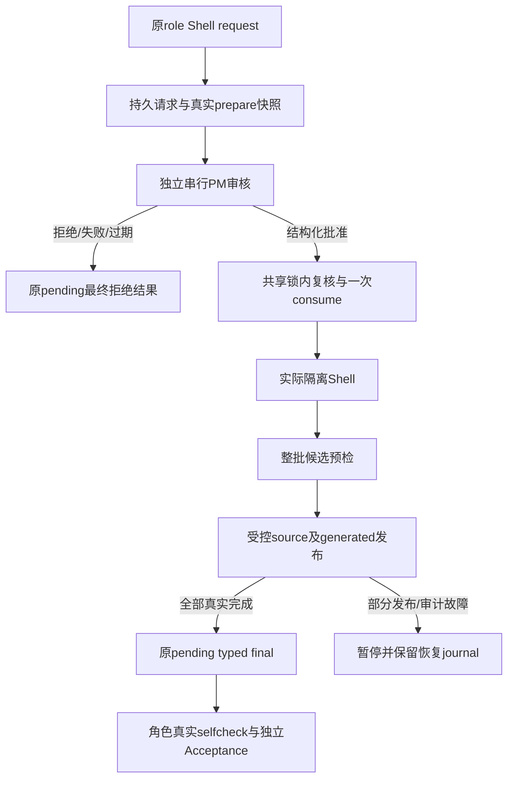

# 角色申请PM审批项目Shell

执行角色提交完整项目命令，由同一个ProjectManager逐调用审批。批准只针对本请求、当前任务与版本，角色留在原待处理工具上下文，真实执行后继续任务。命令在隔离副本运行，只通过原role权限发布自己task范围源码与Human确认产物；不会得到其他角色文件权限。Shell退出0不是自测或验收通过。

PM审批不等待Human逐命令点击，主composer执行时禁用不阻塞审核。人类可查看/取消；原成员对话显示申请和有限输出，PM对话显示真实审核理由，主区显示真实phase。拒绝后角色可修订命令重新申请；关闭/取消/切项目撤销旧批准与进程，重启不重放。

Owner生产接线和真实本地SDK/native回归已写入；最终固定检查与独立验收仍以当前candidate证据为准；[具体设计](../design/2026-10-10_design_project-shell.md)。

发生部分发布时项目暂停，已经真实发布的文件保留。重新打开仍保持暂停，普通resume和旧确认不能执行旧命令。Human可以确认包含当前SHA/缺失基线的新恢复计划；恢复在新授权中完成后，旧失败历史保留并链接新计划/检查证据。

macOS隔离需要本机CLT/SDK与实际startup探针；缺少或失败明确unsupported，没有裸Shell降级。此Owner本地验证使用离线包与localhost模型服务，没有客户SSH开发或外部模型调用。当前公开Shell预览默认8KiB按本地字符余量缩小，限额归档1MiB；二进制正文只在Host内处理。

### 当前Host发布契约（0.8.2）

每个源码发布proposal取得本次Shell Service的fresh时间事实后，才请求一次受控许可。时间由Provider观察，Model只比较显式事实；消费与真正提交前仍重新检查有效期。旧审批时刻不会替代后续检查，原角色SDK与UI不增加时钟字段。当前运行输入0.8.2 tarSHA1a2a7c483f04f2bb939d6bf4d25aa7a4318bc866a473dcac251f74d1ee592622，此前0.8.1证据属于历史组合。

## 2026-10-10 absence wire、活动入口焦点及正确资产恢复（同v1必要修复）

真实删除检查基线仅state:absent/sha256:null/byteLength:0/noexec可经原getState wire公开；legacy present仍严格SHA，非法状态/字段冲突/未知字段拒绝。成员证据和检查记录显示获准缺失，不显示SHA null。活动入口采用既有内侧1px/-3px焦点及无按下位移，保留真实鼠标/键盘/Esc回原trigger和结束fallback，不blur或隐藏键盘焦点。阶段截图由实际DOM/transition稳定判定，不猜新生产bug。

只针对旧partial中真实成功/observedMutation、actual publishedResources与candidate一致且当前仍匹配目标SHA/bytes/safeexec的产物，Host在新Human明确当前baseline和新plan确认后创建独立recovery_verified_retained事实。事实绑定旧request/proposal/candidate摘要、新Human请求/plan、currentowner/task/instance/run与已核验baseline；task.retainedOutputs与新Mutation results分列，不伪造observedMutation，不重写正确binary，不泛化普通nochange。新计划仍声明原精确writeSet与检查输入，保留事实仅承接该已明确范围内的交付。Human确认明示可核验保留的资源/来源，SDK只得到Host事实不是许可。当前selfchecks/Acceptance和末次磁盘/生成版本复核之后才append recovered，旧partial结果不改。SHA/bytes/mode改变、缺provenance、baseline/owner/task/plan不符均拒绝。

Core/Adapter/SDK工具/IPC操作与0.8.2包不变，公共Organization abstract/public/impl facade一致，仅Desktop可选task-state元数据兼容旧缺失字段。真实自有SDK/native partial→restart→newHuman/newPM/newShell保持正确binary无diff/无新Mutation，保留事实后检查/Acceptance；否定changedSHA/mode/missingprovenance；wire原IPC和native focus分支严格回归。全部三个固定门同新candidate，不复用旧177/34/199，独立验收由Supervisor后继调度。
