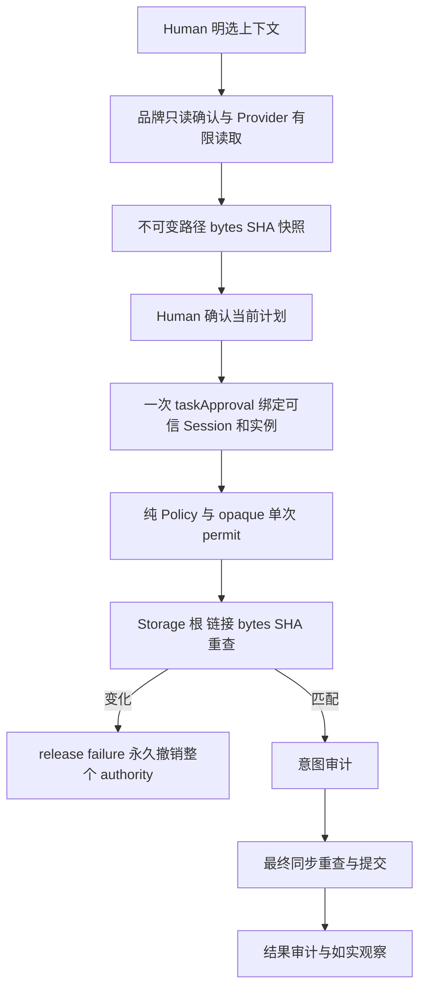

# 工作台确认与提交前验证

用户先与唯一 ProjectManager 讨论；明确选取的上下文只由 Desktop ProjectProvider 有限读取。确认计划后，Desktop 唯一 WorkbenchPipeline 组合公开 Policy/Mutation/Adapter Services。讨论不调用旧 PermissionRuntime，不产生客户工作区审计。本角色不实现 Desktop 编排或 Adapter 会话。

本次只改派发的 5 源码、6 测试、7 文档。旧 Node 设计、Interface/Pipeline、Adapter、发行包均保留；依据 canonical SHA 715639b5dd278437059f29bde1e7c02ac90d94af18f9bf5a6b5367d16e9ab5d3 及客户同版确认实现，不增加审批 gate。

## 纯数据与权限

agent.mjs 增加 PiConnectionProfile、PiTextDelta、受限文本 History/Checkpoint 和 AgentConfig.lifecycle（默认 single_run）。conversation 必须空工具、空写范围。历史不恢复权限、活动任务或工具请求。Model 无文件、环境、时间、随机或 SDK 效果；确定性 digest 只处理已提供数据。

workbench.mjs 定义 ContextReadConfirmation、ContextSnapshot、ConfirmedTaskGrant、MutationVerification。根身份为 Provider 得到的 canonicalPath/deviceId/fileId 字符串。上下文限精确文件，单文件 256 KiB、16 文件、总 2 MiB；路径别名统一，集合复制冻结且拒绝标量。旧 TaskDispatchContext.digest 不变。

createWorkbenchAuthority 返回冻结 controller 和品牌 mutationAuthority。确认值本身没有权限；confirmContextRead 返回私有 registry 中的 opaque readAuthorization，静态 assertForRead 仅验证其当前品牌、身份/版本和精确子集。bindContextSnapshot 绑定资源/bytes/SHA；confirmTask 绑定计划、上下文、连接、组织、角色、task 和精确 writeSet，返回一次注册用 taskApproval。registerInstance 消费它并复用既有纯授权不变量，instance/run 保持一次执行。

controller 只有冻结契约中的十种方法；mutationAuthority 只有 consume/recheck/release。issue 不相信伪造 ALLOW，仍重验可信 Session、范围、task、版本、审批和实例/run。recheck 返回 typed MutationVerification。Provider 不持有 controller，不回调 Pipeline。

release(receipt,{verificationFailure}) 仅接受本 authority 当前 receipt 与固定三个原因；真实 root/context 不一致或无法验证时同步永久 invalid 整个 authority，清空全部 permits/receipts/read/task 确认并撤销实例。恢复旧 SHA/版本不复活。成功 release 只释放该 receipt，允许同 task 后续独立 permits。

## 真实提交

Storage impl 接受公开 authority 及旧私有 _authority（互斥）。在工作区串行提交内从 receipt 得到验证载荷，真实核对根 identity、路径组件、Node 可识别 symlink/junction、context bytes/SHA。最终同步核对后同步 rename，中间不让出事件循环。旧 intent 审计失败零目标写；commit 后 result 审计失败保留 observedMutation/auditFailed 并停后续写。不是跨文件事务或恶意共享进程沙箱。

## 验证

按 Model→Provider→Service 分层实际运行有限 Node native 测试；Storage 严格回归在既有 test_mutation，新增纯 Model 测试在 test_workbench_models。保留 single_run/close/approval alias/scalar/audit 回归。最终固定 unit 显式九套件，serial，300 秒，缺失失败且零 skip。测试 TEMP/TMP 在本阶段 KernelEngineer/tmp，禁止写旧 runtime；NODE_DISABLE_COMPILE_CACHE=1 并清除 NODE_OPTIONS/NODE_COMPILE_CACHE。若 native junction 创建 EPERM，仅注明的受控 lstat 刺激，不宣称原生端到端。

实际Model45、Storage/Event24、Policy/Scope17分层通过（0skip）；固定九suite最终结果与候选见 [本阶段任务](../../../../scheduling/legion-desktop-workbench-v2.md)。首次环境与断言失败及最后输出父链timing回归失败均保留本阶段tmp日志，API说明实际修正和元数据刺激限制。软件检查无 executor 时为 not_executed，不引入 shell。Adapter/发行/桌面组合由后续 owner 重新验证。
