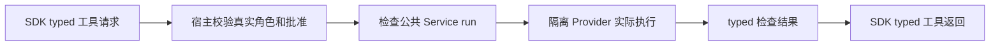

# 检查和控制工具的共享契约

依据 [已确认整体设计](../../../ProjectManager/docs/design/2026-10-08_design_legion-governed-workflow.md)，KernelEngineer 的本阶段只建立纯 Model 和测试。客户确认已覆盖此范围，无需重复批准。软件检查运行、隔离及 Desktop 领域审批尚待后续阶段实现。

用户通过获批检查 ID 请求软件检查。Model 固定检查能力和版本绑定，并将实际运行证据与文件写入结果区分；它不执行文件或进程操作，也不创建客户批准。控制工具使用有界 plain payload，Desktop 按真实宿主身份和自己的领域 Model 验证具体内容。



## 本阶段范围与检查

只修改 assignment 中的 check.mjs、agent.mjs、workbench.mjs、三个 Model 测试和本文。检查为 task_ops 的 model 固定检查；保留旧读写与确认回归。原读写 runtime 白名单在 core.mjs，该文件不在本阶段 writeSet：7 类工具的 runtime grant 接入需后续精确授权，不通过裁剪工具绕过原授权。

## 设计选择

CheckSpec 固定 checkId、node-test、固定 `--test` 和明确测试资源、输入资源、输出能力、300 秒以内超时、none/localhost 网络和日志预算。CheckAuthorization 绑定 workspaceIdentity、planDigest、organizationVersion、roleId/taskId/sessionId/instanceId/runId、profileVersion、fileOwnersDigest、确认标识、批准检查和输入版本。CheckResult 保存实际命令、退出码、日志、环境、时间与输入版本，passed 要求已执行、退出码 0、实际测试数量大于 0。

六类控制工具参数为 `{ payload: plainRecord }`，legion_run_check 为 `{ checkId }`。请求不接收 caller 身份字段，payload 中角色 ID 只能表示领域对象；真实调用者始终由宿主绑定。最终 constructors、字段和公共 Service 创建签名见下文。

## 最终公开 Model

本阶段模块路径就是 Model 的导入入口，不修改 package export facade。

| 模块 | 实际 export |
| --- | --- |
| `src/kernel/models/check.mjs` | `CheckSpec`, `CheckRequest`, `CheckAuthorization`, `CheckDecision`, `CheckResult`, `checkSpecs` |
| `src/kernel/models/agent.mjs` 新增 | `AgentControlDecision`, `AgentControlResult`, `AgentControlTools`, `AgentTools` |
| `src/kernel/models/agent.mjs` 扩展 | `PiToolRequest`, `PiToolResult`, `AgentScope`, `TaskDispatchContext`；其余旧 export 保持原契约 |
| `src/kernel/models/workbench.mjs` 扩展 | `ConfirmedTaskGrant`, `createWorkbenchAuthority` 的 checks 绑定；其余旧 export 保持原契约 |

所有 constructors 接收一个 options record，未知字段拒绝。值复制并冻结，constructor 不具备宿主身份、客户批准或执行真实性证明能力。

### CheckSpec(options)

| 字段 | 精确格式 |
| --- | --- |
| `checkId` | 非空 string，批准计划内唯一 ID |
| `kind` | 必须 `node-test` |
| `testResources` | 1–1024 个精确项目相对文件，不接收目录、`..`、绝对路径、受保护目录/凭据或 `-` 开头的测试文件 |
| `argv` | 必须 `['--test', ...testResources]`，只含 runner 参数，运行时绝对 executable 由宿主 Provider 决定 |
| `inputResources` | 1–1024 个精确文件，包含每个 testResource 和所有声明的依赖/夹具；按大小写忽略规则拒绝别名重复 |
| `outputResources` | 可选，默认 `[]`；最多 1024 个普通相对文件或尾随 `/` 的目录能力；不得覆盖只读输入 |
| `timeoutSeconds` | 整数 1–300 |
| `network` | 可选 `none`（默认）或 `localhost` |
| `logMaxBytes` | 可选整数 1–1048576，默认 262144，stdout+stderr 合计预算 |
| `digest` | getter，整个固定 spec 的 SHA-256 |

`checkSpecs(values = [])` 接收最多 64 个 CheckSpec 或可构造 record，拒绝重复 checkId，返回冻结 typed 数组。

### CheckRequest / CheckAuthorization

`CheckRequest({requestId, runId, checkId})` 三字段均非空 string；只绑定请求，不含 shell、argv、目录或调用者 roleId。`digest` getter 绑定这三字段。

`CheckAuthorization` 的必填字段：

| 字段 | 格式及来源 |
| --- | --- |
| `authorizationId`, `confirmationId` | 非空 string，由宿主对应实时有效的确切客户批准 |
| `workspaceIdentity` | `{canonicalPath, deviceId, fileId}`；绝对、无跳转路径，设备/文件编号为十进制 string，fileId 不能为 `0` |
| `planDigest`, `fileOwnersDigest` | lowercase 64 位 hex SHA-256 |
| `organizationVersion`, `profileVersion` | 非空 string |
| `roleId`, `taskId`, `sessionId`, `instanceId`, `runId` | 非空 string，由实时宿主会话绑定；不能从模型参数取得 |
| `approvedChecks` | 1–64 个 typed CheckSpec 或对应 record |
| `inputVersions` | 最多 1024 个 `{resource, sha256, byteLength}`；精确文件、lowercase SHA-256、非负安全整数 byteLength；包含所有批准 spec 的输入 |
| `inputDigest`, `digest` | getter，分别摘要规范排序输入数组和完整授权 |

CheckAuthorization 是数据值，不是 opaque bearer capability。宿主 Service 必须重新验证 live grant、取消/关闭/版本状态、workspace 实际 identity、检查批准及每个当前输入版本；仅 new 一个对象不能获得运行权。批准输入依据 host 审阅记录，不允许由 Model 自己填充摘要并宣称客户确认。

### CheckDecision / CheckResult

`CheckDecision({allowed, reason, requestId, runId, checkId, authorizationDigest})`：allowed 必须 boolean；reason 与各 ID 非空 string；authorizationDigest 为 SHA-256。宿主批准失败仍能返回拒绝 decision 与未执行的 error/stale 结果，未有效批准时 digest 可为宿主拒绝上下文摘要，不能代表批准。

`CheckResult` 所有字段均必填：

| 字段 | 精确格式 |
| --- | --- |
| `requestId`, `runId`, `checkId`, `reason` | 非空 string |
| `authorizationDigest`, `specDigest` | SHA-256 |
| `status` | `passed` / `failed` / `cancelled` / `unsupported` / `stale` / `error` |
| `executed` | boolean，表示实际已启动执行 |
| `actualArgv` | string 数组，保留原始顺序和重复参数；包含宿主实际 executable 和 argv；未执行为 `[]` |
| `exitCode` | null 或 0–255 整数；未执行必须 null |
| `testCount` | 实际完成的测试计数，非负安全整数；未执行必须 0 |
| `stdout`, `stderr` | string（可空），合计最大 1048576 UTF-8 bytes；Service 另按 spec.logMaxBytes 截断 |
| `logsTruncated` | boolean |
| `inputVersions` | 与授权相同 record 格式，实际核查/运行输入；提供 `inputDigest` getter |
| `environment` | 未执行可 null；执行时必填 `{platform,runtime,runtimeVersion,isolation,network}`，每项非空 string，network 为 none/localhost |
| `startedAt`, `finishedAt` | UTC ISO string，格式 `YYYY-MM-DDTHH:mm:ss.sssZ`，结束时间不可早于开始时间 |
| `digest` | getter，完整结果摘要 |

passed 要求 executed、exitCode=0、testCount>0、非空输入证据；failed 要求实际执行且非零 exitCode；unsupported 必须未执行。cancelled 可表示执行前取消或已启动后的取消；timeout 用 cancelled + `reason='timeout'`。stale 可以表示启动前版本变化或执行后的输入变化。error 保存真实可诊断但不泄露凭据的 reason。Provider 返回真实观测，Service 检查实际命令/spec、隔离、输入和退出状态，再生成上述结果，不能接收模型自报通过。

### Pi 工具精确参数 schema

| 工具 | parameters schema | 实际身份校验负责人 |
| --- | --- | --- |
| `legion_design_roles` | `{payload: plainRecord}` | Desktop：PM |
| `legion_propose_roles` | `{payload: plainRecord}` | Desktop：RoleArchitect |
| `legion_review_roles` | `{payload: plainRecord}` | Desktop：PM |
| `legion_request_interaction` | `{payload: plainRecord}` | Desktop：PM |
| `legion_run_check` | `{checkId: nonemptyString}` | Check Service + Desktop：当前获批开发/验收实例 |
| `legion_submit_acceptance` | `{payload: plainRecord}` | Desktop：Acceptance |
| `legion_request_repair` | `{payload: plainRecord}` | Desktop：PM |

六类控制 payload 是 Desktop 领域输入的包装，Model 不引入 Desktop 依赖：root 必须 plain record；值仅 null、boolean、有限 number、string、array 和 plain record。递归深度最多 8、节点最多 4096、单 string 最多 65536 chars、序列化最多 262144 UTF-8 bytes；拒绝 functions、getters、symbols、class instances、`__proto__`/constructor/prototype、apiKey/credentials/token，以及 callerRoleId/callerSessionId/callerInstanceId。领域对象的 roleId 可以出现在 payload 内，它不是调用者凭据。Adapter 对这六类工具注册此包装 schema，Desktop 再验证具体领域字段；不能把 payload 直接当成权限。

`AgentControlDecision({allowed, reason, requestId, runId, tool})` 中 allowed 必须 boolean；tool 必须上表六种控制工具。`AgentControlResult({requestId, runId, tool, status, reason, payload?})` 的 status 为 completed/denied/cancelled/stale/error；payload 默认 `{}` 且同样有界、冻结。所有 string 身份/原因字段非空。

PiToolRequest 保持旧 requestId/runId/toolCallId/tool/parameters 和读写 schema。PiToolResult 支持四种准确匹配：PolicyDecision+MutationResult、ProjectReadDecision+ProjectReadResult、CheckDecision+CheckResult、AgentControlDecision+AgentControlResult。后两种必须与外层 requestId/runId 相同，检查 checkId/authorizationDigest 相同或控制 tool 相同；拒绝执行不能携带真实检查执行，拒绝控制不能 completed。文件 MutationResult 不能替代检查。PiRunResult 仍要求每一项真实 PiToolResult、同一 runId、无重复 requestId。

### AgentScope / TaskDispatchContext / ConfirmedTaskGrant

三个已有值新增可选 `checks` typed 数组；不传时保持旧对象形状和 digest 内容。传入时 digest 绑定完整 spec。TaskDispatchContext writeSet=[] 时拒绝 write/edit 工具。ConfirmedTaskGrant 接受已有四类读写和七类新工具；保持读工具必须成对的旧约束，非空 writeSet 必须有写工具，空 writeSet 禁止写工具，legion_run_check 必须有非空批准 checks。createWorkbenchAuthority.registerInstance 对 dispatch 与 grant checks 完全相同、scope.checks 不扩大 grant 做检查。

本阶段没有更改 `core.validateInstanceGrant`。下一 kernel-checks 阶段必须在该处实施最小新工具 capability allowlist 和 check spec 范围验证，真实 runtime grant 保留原角色/任务/工具交集和文件读写授权；Adapter/Workbench 新工具注册需等待此实现通过。纯 grants 能描述只读验收，但不能把本阶段 Model 测试宣称为新工具 runtime 已执行。

## 后续公共检查 Service 契约

公共入口固定建议为 `src/kernel/services/public/check.mjs`：

```js
createCheckService({ workspaceRoot, runtimeExecutable, outputRoot, authorizationValidator })
service.run(request, authorization, { signal } = {})
service.close()
```

factory 返回本层 CheckService contract，具体实现不导出。workspaceRoot、runtimeExecutable、outputRoot 为非空绝对路径 string，来源为可信宿主配置；Provider 自行验证实际路径身份、可写输出能力、运行时和隔离。生产公共 factory 自行创建相邻公开 CheckProvider，Pipeline 只能传上述配置与可信授权校验端口，不能创建 Provider 后跳层注入。provider 注入只适用于本层 internal construction 或单测相邻 contract double，不是 Pipeline 的公开生产 API。authorizationValidator 是宿主注入的 live 授权 capability，公开 `validate(request, authorization, {signal})` 返回 `{decision: CheckDecision, authorization: CheckAuthorization}`。它负责宿主实时会话和实际客户批准，不是随意 plain 模型数据或 Desktop 私有实现导入。Service 自己核对 typed 身份、批准 spec 与返回授权的相同 digest、时间/取消，再通过相邻 Provider 获取实际文件 identity/版本和隔离执行；注入 validator 不能替代 Service/Provider 的 recheck。authorizationValidator 只停留在 Service，不传给 Provider；Provider 不回调 Pipeline 或组合其他 Services。

`run(CheckRequest, CheckAuthorization, {signal?: AbortSignal})` 异步返回冻结 `{decision: CheckDecision, result: CheckResult}`，与 PiToolResult 精确配对。无批准、stale、unsupported、取消和执行失败以明确状态返回；非法调用参数以 TypeError 拒绝。不支持隔离返回 unsupported、executed=false；不得通过 unrestricted fallback 执行。close 异步且可重复，撤销正在运行的本 Service 检查并释放其资源。cancel/timeout 只终止本次跟踪进程。只接受批准 ID，不暴露 arbitrary shell/runCommand 方法。

这些是后续实现建议，不是本阶段已提供的 Service。生产 factory 的相邻层创建规则已经固定；准确配置参数和可信授权校验端口签名由实现阶段在公开 API 文档中固定，并同步本文与消费者契约后运行相关测试。不得将 provider 注入暴露为 Pipeline 的生产捷径，不能直接导入 impl 绕过公共入口。

## 本阶段验证结果

Model 固定检查已真实运行并通过，覆盖 immutable/serialization、检查参数和能力边界、批准/输入版本绑定、真实执行证据字段、七类 Pi request、typed result 身份匹配、只读验收 grant 和旧读写确认回归。最终候选证据以 task_ops 当前 model 记录为准；真实隔离、进程运行及 SDK/Desktop 集成待后续 owner 验证。
