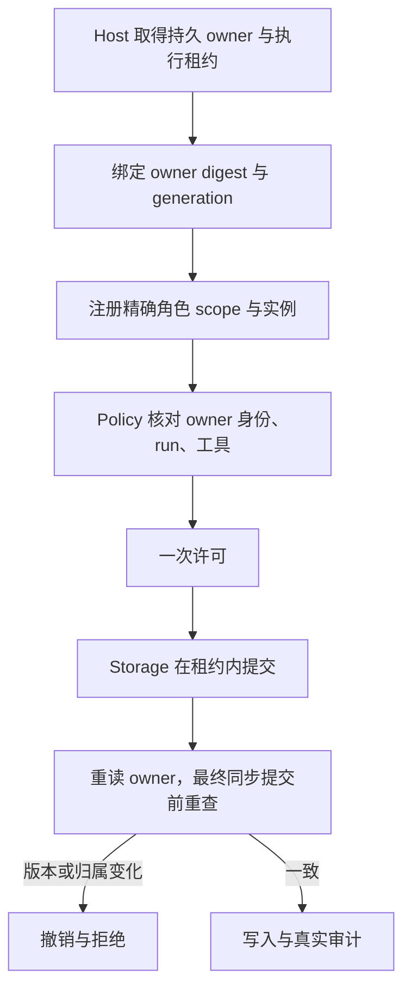

# Kernel：角色 owner 与 CLI 控制工具

本设计落实[已确认管理设计](../../../ProjectManager/docs/design/2026-10-10_design_cli-role-owned-files-v2.md)，不扩展已派发文件范围。角色跨计划拥有精确文件；task 只绑定身份、工具、checks、生成效果与 owner 版本。旧 writeSet grant 直接拒绝。

`TaskDispatchContext` 与 `ConfirmedTaskGrant` 使用 `fileOwnersDigest`、`ownerGeneration`。`createWorkbenchAuthority` 和 `PermissionRuntime` 必须提供 `ProjectFileOwners`，无 owner 不授写权。`AgentScope.write` 可按工具需求为空；授源码写工具时必须与该角色全部 owned 文件相同，不能重建任务文件子集。Boundary 的额外 deny、approval 与工具能力仍生效。

Storage 消费私有纯数据 leaseContext；Provider 自行取得共享 root 中以 workspace dev:ino 标识的 commit.lock，同步 no-follow 读 holder witness、不变owner-source marker及4MiB当前catalog。marker由ProjectProvider在Human新计划确认后建600文件，并绑定真实workspace与唯一catalog目录identity。Kernel不调用上层或peer Provider；旧回调方案已删除。最后同步owner/permit核对与实际提交无事件循环间隙。所有v2项目catalog改写同样先commit mutex再catalog lock；持久映射/holder变化拒写并要求Host撤销旧计划。精确字段、锁顺序和fixture见[API](../../api-spec.md#cli-角色-owner-v22026-10-10)。
ShellAuthorization 以 fileOwners 与 ownerGeneration 核对源码候选，task 不带 writeSet；生成效果与 artifactScopes 按已确认任务保留。Shell publication 继续经过受控 Mutation，因此最终 owner 重查同样生效。

CLI 记忆 query/propose/revise 与 Supervisor typed 建议工具仅产生 AgentControlDecision/Result，保持 bounded plain payload，能力分别独立验证；不得变为 Mutation 或 owner 授权。固定 unit 验证旧 grant 拒绝、owner/工具/实例/版本检查、最终重查、原 CAS/审计失败关闭。
