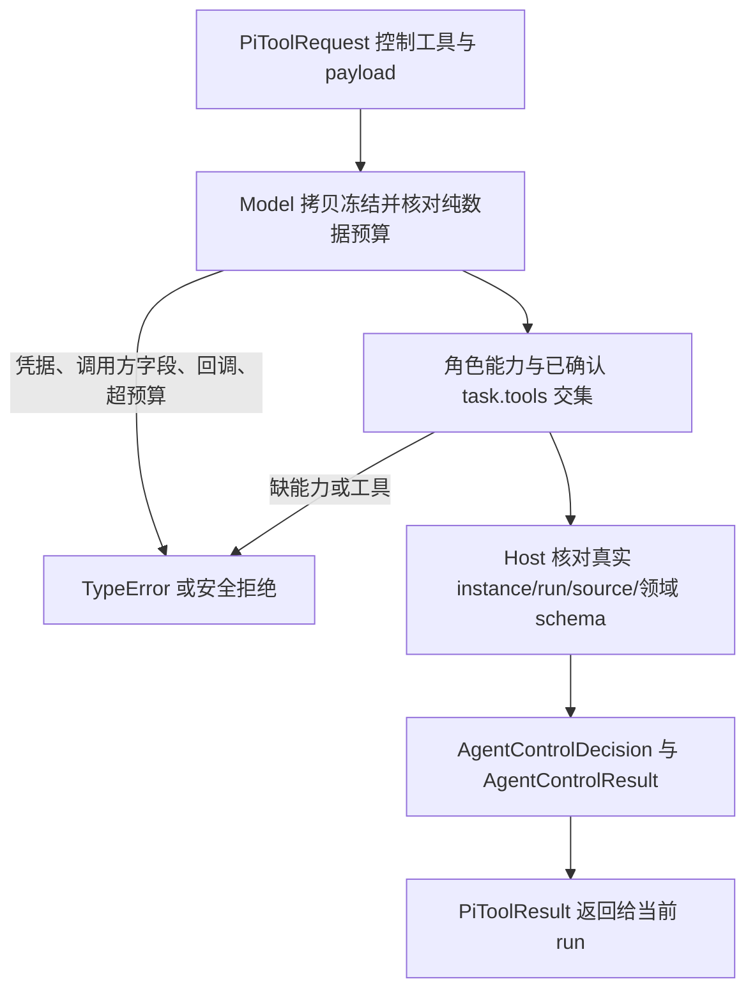
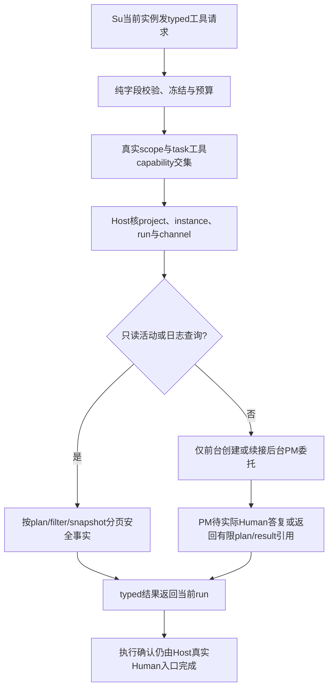

# CLI 记忆与 Supervisor 控制工具

角色需要读取项目内已生效分类记忆、提交己方事实修订，或给 Host 当前计划提供监督建议。Kernel 提供十种 typed 控制工具；新增三种是 query_memory、remember_fact 和 submit_supervision。成功得到有预算限制的结构化结果；来源、身份或权限不符时 Host 返回拒绝，控制请求不会变成源码写操作。

Model 不储存项目记忆、不产生 owner 变更、不发源码许可。Host 按原作者及 expectedRevision 做事实修订/CAS，按可信来源核 Supervisor findings；此领域实现由 Desktop owner 维护。工具分别要求 `query_memory`、`remember_fact`、`submit_supervision` capability。所有控制 payload 禁止 token/apiKey/credentials 等凭据、效果回调及调用方伪造字段，并有深度/节点/字节预算。

代码：`src/kernel/models/agent.mjs` 的 AgentControlTools、PiToolRequest、AgentControlDecision/Result；`src/kernel/models/core.mjs` 的 controlledCapabilities 与 validateInstanceGrant。测试：`tests/kernel/test_control_memory.test.mjs` 校验三个新工具的 typed 返回与独立能力拒绝；`test_agent_models.test.mjs` 保留全部控制工具的 bounded payload 和 host 对应性。

[具体设计](../design/2026-10-10_design_cli-controls.md) · [API](../../api-spec.md) · [本阶段执行证据](../../../../scheduling/legion-cli-role-owned-v2.md)。当前 Kernel 单元检查不是 CLI/Host/安装后完整流程的独立验收。

## Su唯一前台与后台查询（2026-10-11）

Su用delegate_pm提出plan/role_design/repair或引用真实答案resume；Host按独立前台registry创建有界后台PM委托，不把请求当Human确认。query_role_activity/query_role_log前后台都可用，返回Host现有事实的安全投影，不读取`.ans`或原SDK会话。Model提供十三工具允许列表、独立capability、typed请求/结果及领域预算；普通list/read仍走既有Read门。

委托指令≤8KiB/sourceRefs≤32，日志默认20/最多50条、查询结果payload≤32KiB、关联run累计读取/查询≤2MiB。跨项目/旧cursor/伪调用者/未知字段与预算超限拒绝；Model不能伪造foreground，Host不能把后台同roleId会话当客户会话。真实效果、PM续答、用途隔离及分页证据需下游Host/Adapter独立验证。

[已确认Su v0.3设计](../../../ProjectManager/docs/design/2026-10-11_design_supervisor-frontdoor-global-read.md) · [精确API](../../api-spec.md) · [本次任务证据](../../../../scheduling/legion-supervisor-frontdoor-v1.md)。
