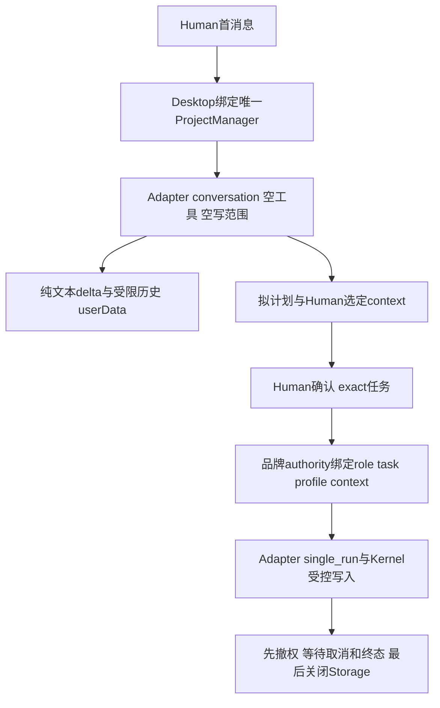
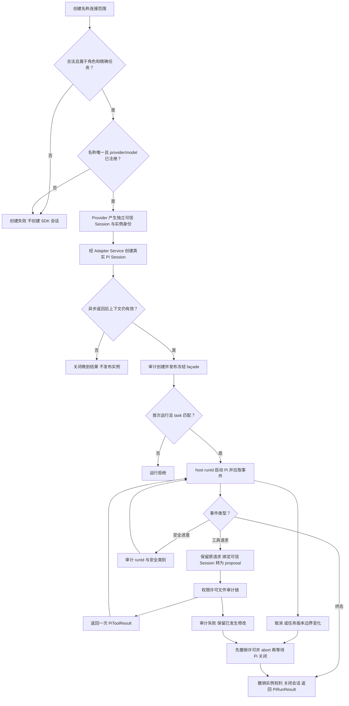

# 用名称、模型连接和范围创建独立实例

工作台 v2 共享 Model 新增 AgentConfig.lifecycle，默认 single_run 保留；conversation 必须 tools:[]/write:[]。PiConnectionProfile 是无key/function的版本化纯连接；PiTextDelta 绑定 runId，History/Checkpoint 仅保留不可变 user/assistant 文本与可信 instance/profile 绑定，不恢复 permit、确认、pending工具或活动run。

唯一 ProjectManager 的首消息/恢复、其他Agent禁止Human直接聊天启动、Human确认和动态任务编排由 Desktop 唯一 WorkbenchPipeline 实现；不通过旧 Runtime/createAgent/run 讨论，讨论只涉及 Adapter 和 userData，不写客户目录审计。本角色当前只提供这些纯契约和执行权限链。真实 Adapter 多轮、三协议、tarball/ZIP/GUI由后续owner重新实跑，当前不能用Model测试宣称这些产品流已验收。

本阶段 Model45、Policy/Scope17、Storage/Event24 层检查0skip；固定九suite保留原真实single_run/close/audit回归，结果以[当前任务](../../../../scheduling/legion-desktop-workbench-v2.md)为准。[当前设计](../design/2026-10-07_design_desktop-workbench-v2.md) · [公开契约](../../api-spec.md)。下列为继续保留的v3 Runtime操作路径。

可信宿主给 Runtime 当前角色、task、版本及精确 writeSet，通过 createAgent({name,proxy,scope}) 获取只读身份与 run/cancel/close。Pi 真正执行模型交互与循环；模型工具提出修改时必须经过 Kernel，范围不能被提示词或身份声明扩大。

scope.write 请求必须为 task 精确文件中的子集并属于角色 writeScope，目录请求不能扩大有限任务列表；角色或实例 deny 优先。scope.tools 恰为 legion_write_file，并属于角色及 task 工具集合。未知模型、scalar scope、模型冒充 role/task/version、重复名称和额外执行 callback 拒绝。

公开 modelProviders 是可信配置数组；Pipeline 私有转换 keyed record 给 Adapter，只含元数据、内存凭证与 streamSimple。Provider 不得到 Runtime/submit/文件 callback。Adapter 默认工具、扩展、MCP/codemode/tool_search 禁用，仅受控工具；Session/Settings 与凭证为内存实现，不读写用户全局 Pi 配置。

start_run 立即返回，Pipeline 用 next_event 拉取；tool_request 的 runId 位于原 request，terminal 的 runId 位于 result。ProposalService 只转换，不授予权限。结果回应原请求/current run 一次，工具响应中的 decision/result 摘要一致。每实例一次 run，两个实例会话/消息/工具请求/许可隔离。任务取消或版本/边界变化永久撤销，恢复旧值不复活旧实例；创建期间变化也释放结果。

Runtime SDK 错误返回安全 errorCode；普通取消是 cancelled/kernel_run_cancelled，审计故障是 failed/kernel_audit_failed。结果保留各 toolResult 的 observedMutation/auditFailed，无法审计时停后续写，不能宣称文件回滚。Runtime.close 先同步撤权，等待 Adapter 停止与所有完整运行的终态审计，最后关闭 Mutation 并清理临时工作区。run.finally 不等待 Runtime.close，避免 mutual wait。

当前 owner pipeline13项：保留原12项并新增1项真实 Runtime.close 取消/终态审计回归。真实安装 Pi1.0.4 与公开 Faux 推理流实跑两个独立 SDK Session、受控工具写入/拒绝、独立 transcript、异步创建撤销、活动 inference 取消、写入等待中任务撤销及写后审计失败。无 fetch/付费请求，未跳过 SDK；完整 Kernel74项不代替下游独立集成。原73项及 Tester19通过/1失败保留为历史，原严格 close 测试只读修前失败、修后通过；当前证据见[修复任务](../../../../scheduling/legion-pi-node-v3-close-repair.md)。

[API 和使用形式](../../api-spec.md) · [Interface](../../../../../src/kernel/interface/runtime.mjs) · [本阶段设计](../design/2026-10-07_design_node-pi-v3.md) · [当前任务证据](../../../../scheduling/legion-pi-node-v3.md) · [总设计与授权](../../../../design/2026-10-07_design_node-pi-v3.md)。
历史：通用实例源于已授权 Pi 目标，客户随后要求全 Node，canonical v3 替代 bridge 草案；原 Python 权限记录继续保留于[历史设计](../design/2026-10-07_design_phase1.md)，不代表 Node 当前证明。
