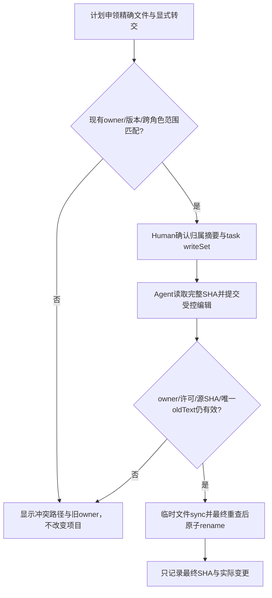
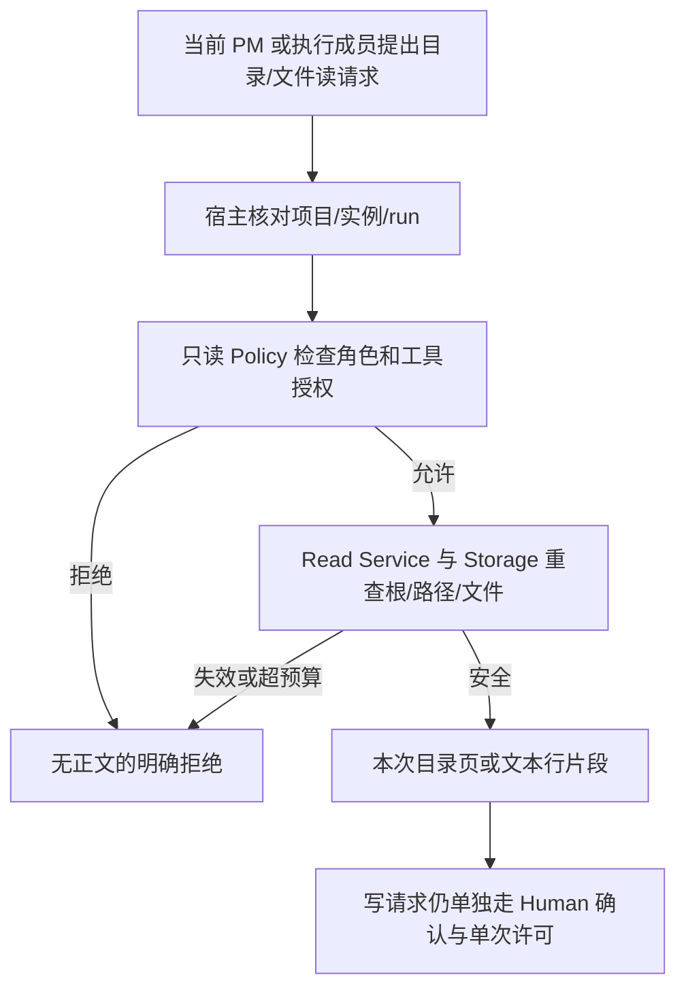
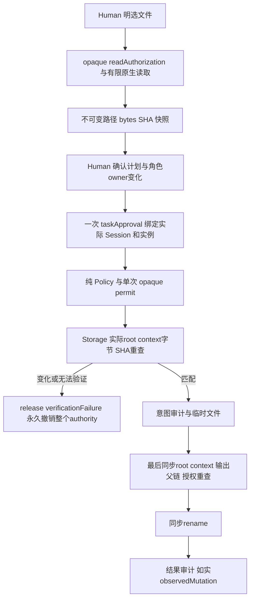
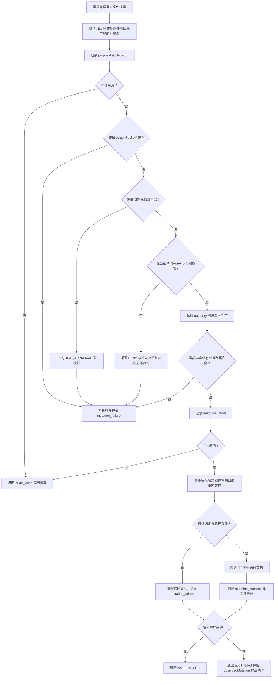
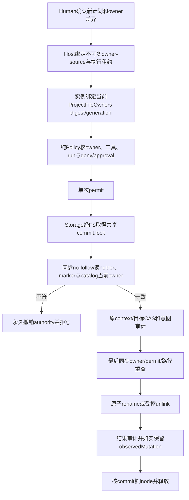

# 只修改有权修改的文件

文件独占与编辑 v1 将客户项目每个可写精确文件绑定唯一角色。纯 `ProjectFileOwners` 保存项目、版本和 owner；`FileOwnershipPlan` 把新申领和显式转交绑进一个摘要。同一角色可以在多个相依任务中写同一文件，不同角色对同一路径（含大小写别名）申领会报告路径和旧 owner。Runtime 创建或更新角色边界时也拒绝不同角色交叉的目录/文件写范围，失败不改边界、不撤旧许可。Workbench 的 `ConfirmedTaskGrant.fileOwnersDigest` 绑定已确认归属；任务确认、颁发许可和 Mutation 提交重查 owner，宿主发现持久归属变化时用 `controller.assertFileOwners` 永久撤销旧 authority。原精确 task `writeSet` 仍须同时满足。

归属路径补强：owner 快照、计划申领、转交和 owner 查询现在都使用受控读取的同一纯路径规范化规则；嵌套 `.git/.ans/.ssh/.docker/.kube`、`.env`、`.npmrc` 和私钥等已知保护组件及大小写/反斜杠别名不能写进归属表。普通 `src/nested/feature.ts` 仍可申领。此规则只依据已知路径名，不能判断任意命名文件的内容。见[补强任务](../../../../scheduling/legion-file-ownership-and-agent-edit-v1-owner-path-repair.md)。

执行 Agent 的 `legion_edit_file` 将旧完整文件 SHA 与最多16个按序替换交给宿主。Kernel 只在已有普通 UTF-8 文件、当前完整 SHA 匹配且每个 oldText 当时恰好出现一次时，构造不超过2MiB的新正文；再沿原单次许可、意图审计、临时文件、最终根/上下文/路径/源重查、同步 rename 与结果审计完成替换。失败返回具体原因，旧文件不部分修改；成功结果与审计仅增加最终正文 SHA。`requiredApprovals:['write_file']` 和精确路径审批同时适用于 edit，PM 仍无写工具。详情见[API](../../api-spec.md)、[确认方案](../../../ProjectManager/docs/design/2026-10-08_design_legion-file-ownership-and-agent-edit.md)和[当前任务](../../../../scheduling/legion-file-ownership-and-agent-edit-v1.md)。

完整组织工作流增加七类工具的实际 capability 白名单与批准 checks 交集，核心身份仍来自宿主 session/instance/run。空 writeSet 禁止写/编辑工具；只读验收可以获批精确检查和提交验收工具，控制工具本身不授予源码写权限。检查使用独立 CheckDecision/CheckResult，经公共 CheckService 的 live 批准和实际 macOS 隔离执行，结果不能伪装成 MutationResult。[检查完整流程](software-checks.md) · [本次契约设计](../design/2026-10-08_design_software-checks.md) · [当前任务证据](../../../../scheduling/legion-governed-workflow-v1.md)。

项目内广读 v1 增加独立的读决定和结果。PM 或执行成员发出 `legion_list_files`/`legion_read_file` 后，宿主先验证当前项目、角色、实例和 run；Kernel 的 Policy 只依据 `readScope:['.']` 与工具交集判定读授权，Read Service 经 Storage 核对项目根、各级路径、链接、文件身份、UTF-8 和预算，再返回一页目录或一段完整行文本。控制目录与常见凭据路径在任一层拒绝。列表和文件读取都不产生写许可，PM 无确认任务也可查看普通项目文件；原写入仍只限 Human 确认的精确 `writeSet`。自主读不修改 `ContextSnapshot`，旧 SHA 绑定只覆盖 Human 固定的上下文。

Reviewer 用假凭据复现 `.npmrc` 与 `.netrc` 可被读取。修复后的纯 Model 路径规则在每层阻断这两个文件及同类已知凭据文件、`.ssh/.docker/.kube/.gnupg/.azure/.gcloud/.terraform/.terraform.d` 目录；Storage 的直接读取和目录列表共用该规则。混合大小写和反斜杠别名同样拒绝，普通 `package.json`、源码和说明文件仍可读。规则是有限名单，不判断任意名字的内容是否为秘密。见[修复任务](../../../../scheduling/legion-project-wide-read-v1-credential-repair.md)与[API](../../api-spec.md)。

此增量的具体构造字段、分页和预算见[API](../../api-spec.md)，确认方案见[项目广读设计](../../../ProjectManager/docs/design/2026-10-08_design_legion-project-wide-read.md)。Owner 结果以[当前任务记录](../../../../scheduling/legion-project-wide-read-v1.md)为准；下游 Adapter、Desktop 和独立 Tester 仍需在各自当前候选上验证。

工作台 v2 先由 Human 明选精确 contextReadSet，Desktop ProjectProvider 用品牌只读断言有限读取；ContextSnapshot 绑定路径、字节/SHA。CLI owner v2 的计划确认产生一次 taskApproval，绑定 workspace identity、plan/profile/context、组织、role/task 与持久 owner digest/generation；运行时没有 task.writeSet。Model 构造本身不授权，旧 requiredApprovals 仍返回 REQUIRE_APPROVAL，控制面写仍硬拒绝。

mutationAuthority 公开纯 invalidateOwnership/ownerBinding/consume/recheck/release；recheck 返回 MutationVerification，Provider 不调用 controller 或 Pipeline。成功 release 只清理本次 receipt，允许同task后续独立 permit；三个验证失败原因会立即永久 invalid 全部 read/task/permit/receipt，恢复旧文件/版本不复活。授权写若改变确认上下文，也不能静默刷新旧SHA。

本阶段 Model45、Storage/Event24、Policy/Scope17 已通过；最终九suite证据见[工作台任务](../../../../scheduling/legion-desktop-workbench-v2.md)。新增context链接EPERM及输出父链晚变用例明确为元数据刺激；其余root替换/SHA/字节/原生审计实跑。下列 Runtime 使用与 close 行为继续兼容；旧74项成绩是历史。参见[当前设计](../design/2026-10-07_design_desktop-workbench-v2.md)和[API](../../api-spec.md)。

可信宿主通过 createRuntime 注册角色边界和固定身份，提交文件提案后得到决策及实际结果。Backend 合法文件写入成功；越界 Frontend 登录文件保持原值。公开入口为 Runtime.submit；permission demo 用临时工作区实跑六个场景并退出清理。

七个边界集合字段必须为元素集合，字符串不能拆成字符。审批 write_file 为 action token；其余条件为合法完整相对资源。策略和许可共用 Model 谓词，规范化分隔符和大小写；非法条件直接拒绝构造。创建和执行都遵守 deny 优先，审批/交接/扩权仅返回，不执行组织生命周期。

prepare 返回 decision/opaque permit；execute 再查当前状态与摘要且消费许可。替换内容、目标、身份、run、grant 或任务/边界/版本会失效；恢复旧版本也不恢复旧许可。正常 public Provider/Mutation 工厂无授权，伪造 ALLOW 或 permit 无法写入。Controller 身份与 Session 从可信宿主绑定，不相信模型声明。

内部审计只写 .ans/events/index.jsonl 及日期文件，时间由 Provider 生成 +08:00。工作区和所有父组件检查 Node lstat 可识别 symlink/junction；普通提案写控制面始终拒绝。同工作区不同 Runtime 串行提交。坏日志关闭后续写，index/daily/目标不是事务；替换后审计失败如实报告已经改动。

原Node demo 输出一成功、五拒绝、backendWritten=true、frontendPreserved=true 与23条有序事件，其断言包含在当前固定九suite。原生文件/审计回归与注明的链接元数据刺激分开记录，不声称所有reparse tag覆盖。完整命令与结果字段见[API](../../api-spec.md)。

Runtime.close 同版修复仅改变关闭顺序：先撤销权利，等待活动 Pi 运行取消与终态审计，再关闭 Mutation。权限决策、文件及审计故障语义不变，真实审计失败不会被误报为取消。当前74项 owner 与五项最终检查见[修复任务](../../../../scheduling/legion-pi-node-v3-close-repair.md)；原73项为历史，严格 Tester 关闭发现保留。

[Pipeline 源码](../../../../../src/kernel/pipelines/permission.mjs) · [当前设计](../design/2026-10-07_design_node-pi-v3.md) · [当前任务证据](../../../../scheduling/legion-pi-node-v3.md)。
历史：[Python v1 设计](../design/2026-10-07_design_phase1.md)、[审批同版修复](../../../../scheduling/legion-v1-approval-repair.md)、[原独立缺陷](../../../Reviewer/docs/review.md)。这些保留原发现与成绩，不充当当前 Node 验收。

## CLI owner v2 提交流程（2026-10-10）

角色 owned 精确文件跨任务持续；任务只授工具与当前检查/生成效果。旧 TaskDispatchContext、ConfirmedTaskGrant、ShellAuthorization 的 writeSet 字段直接拒绝。owner缺失、归属他人、代数变化、实例/run变动均不能写。

Storage无IO callback、无上层/peer Provider调用；source marker/catalogDir/holder身份被原生核对，catalog读取有4MiB预算。释放锁失败也不能抹掉已观察修改。纯数据字段与锁顺序见[API](../../api-spec.md)。[本阶段设计](../design/2026-10-10_design_cli-controls.md)与[新任务证据](../../../../scheduling/legion-cli-role-owned-v2.md)取代上文历史成绩；Host完整租约/CAS/迁移与安装流程仍由下游独立验证。
