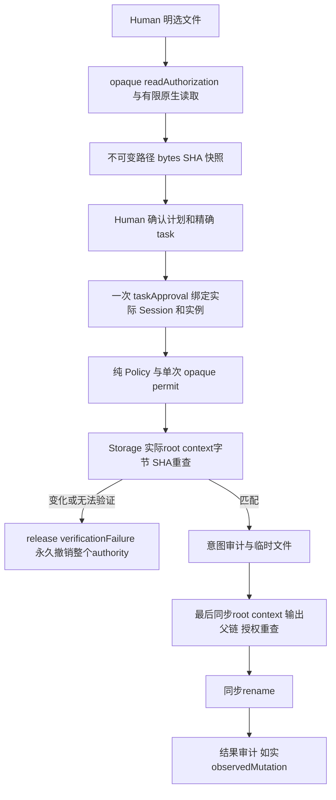

# 只修改有权修改的文件

工作台 v2 先由 Human 明选精确 contextReadSet，Desktop ProjectProvider 用品牌只读断言有限读取；ContextSnapshot 绑定路径、字节/SHA。计划确认产生一次 taskApproval，绑定 workspace identity、plan/profile/context、组织、role/task 和精确 writeSet。Model 构造本身不授权，旧 requiredApprovals 仍返回 REQUIRE_APPROVAL，控制面写仍硬拒绝。

mutationAuthority 只有 consume/recheck/release；recheck 返回 MutationVerification，Provider 不调用 controller 或 Pipeline。成功 release 只清理本次 receipt，允许同task后续独立 permit；三个验证失败原因会立即永久 invalid 全部 read/task/permit/receipt，恢复旧文件/版本不复活。授权写若改变确认上下文，也不能静默刷新旧SHA。

本阶段 Model45、Storage/Event24、Policy/Scope17 已通过；最终九suite证据见[工作台任务](../../../../scheduling/legion-desktop-workbench-v2.md)。新增context链接EPERM及输出父链晚变用例明确为元数据刺激；其余root替换/SHA/字节/原生审计实跑。下列 Runtime 使用与 close 行为继续兼容；旧74项成绩是历史。参见[当前设计](../design/2026-10-07_design_desktop-workbench-v2.md)和[API](../../api-spec.md)。

可信宿主通过 createRuntime 注册角色边界和固定身份，提交文件提案后得到决策及实际结果。Backend 合法文件写入成功；越界 Frontend 登录文件保持原值。公开入口为 Runtime.submit；permission demo 用临时工作区实跑六个场景并退出清理。

七个边界集合字段必须为元素集合，字符串不能拆成字符。审批 write_file 为 action token；其余条件为合法完整相对资源。策略和许可共用 Model 谓词，规范化分隔符和大小写；非法条件直接拒绝构造。创建和执行都遵守 deny 优先，审批/交接/扩权仅返回，不执行组织生命周期。

prepare 返回 decision/opaque permit；execute 再查当前状态与摘要且消费许可。替换内容、目标、身份、run、grant 或任务/边界/版本会失效；恢复旧版本也不恢复旧许可。正常 public Provider/Mutation 工厂无授权，伪造 ALLOW 或 permit 无法写入。Controller 身份与 Session 从可信宿主绑定，不相信模型声明。

内部审计只写 .ans/events/index.jsonl 及日期文件，时间由 Provider 生成 +08:00。工作区和所有父组件检查 Node lstat 可识别 symlink/junction；普通提案写控制面始终拒绝。同工作区不同 Runtime 串行提交。坏日志关闭后续写，index/daily/目标不是事务；替换后审计失败如实报告已经改动。

原Node demo 输出一成功、五拒绝、backendWritten=true、frontendPreserved=true 与23条有序事件，其断言包含在当前固定九suite。原生文件/审计回归与注明的链接元数据刺激分开记录，不声称所有reparse tag覆盖。完整命令与结果字段见[API](../../api-spec.md)。

Runtime.close 同版修复仅改变关闭顺序：先撤销权利，等待活动 Pi 运行取消与终态审计，再关闭 Mutation。权限决策、文件及审计故障语义不变，真实审计失败不会被误报为取消。当前74项 owner 与五项最终检查见[修复任务](../../../../scheduling/legion-pi-node-v3-close-repair.md)；原73项为历史，严格 Tester 关闭发现保留。

[Pipeline 源码](../../../../../src/kernel/pipelines/permission.mjs) · [当前设计](../design/2026-10-07_design_node-pi-v3.md) · [当前任务证据](../../../../scheduling/legion-pi-node-v3.md)。
历史：[Python v1 设计](../design/2026-10-07_design_phase1.md)、[审批同版修复](../../../../scheduling/legion-v1-approval-repair.md)、[原独立缺陷](../../../Reviewer/docs/review.md)。这些保留原发现与成绩，不充当当前 Node 验收。
