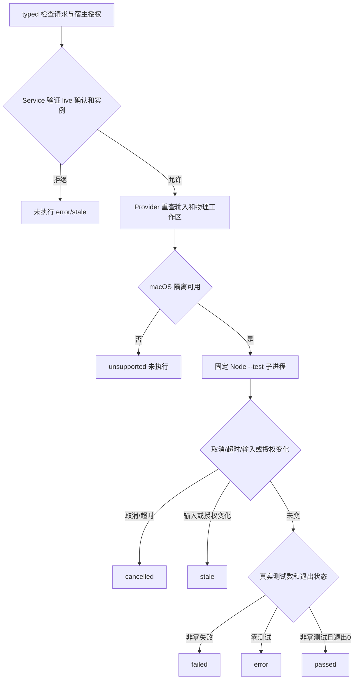

# 软件检查

开发和验收角色按用户批准的检查 ID 请求固定 Node 测试，公共检查 Service 校验宿主 live 确认后，在 macOS 隔离执行并返回真实证据。本角色已验证公共 Service、Provider 和工具授权；SDK/Desktop 由后续角色接线和验收。

调用者提交 CheckRequest 和 CheckAuthorization；构造 typed 值不能替代客户确认。宿主 validator 返回 matching 决定、确切授权和撤销 AbortSignal。Service 在执行前后复验，并把组合取消信号交给自行创建的相邻 Provider。Provider 重查物理项目/运行时/输入版本，只读批准的依赖文件，只写本次批准输出和临时目录。

运行器固定 `--test-isolation=none`，macOS 实际禁止创建子进程。需要 spawn/fork 的测试明确失败；此模式不代表测试支持任意程序/原生构建。environment.isolation 含 `no-child-process`，界面必须显示这一限制。reporter 初始化生成受限的结果发送者，事件先经运行密钥认证和序号校验；直接 fd3 JSON、假认证和 stdout/TAP 不会成为通过证据。空文件、只有 skip/todo 的检查返回 error。输出环境 LEGION_CHECK_OUTPUT_ROOT 指向 outputRoot 本次 `check-*/outputs/`，Spec outputResources 只在这里生效。

超时或主动取消返回 cancelled，真实失败为 failed，零测试为 error；缺失隔离为 unsupported；候选、宿主批准或角色/任务版本变化为 stale。这些都不能显示为验收通过。close 撤销并等待当前运行；输出证据目录保留，调用者负责按自己的证据生命周期管理。

最短使用示例和精确 factory/validator 字段见公开 API。固定 unit 在本机 macOS + Node v24.14.0 普通 Node 与实际 Electron 宿主合计实跑 162 项，0 fail/skip；覆盖真实通过/失败、控制和凭据读取、源码写入、无批准、版本变化、取消/超时、日志预算、不支持分支、假 TAP/空文件、实际无子进程策略与旧 Runtime/Mutation 回归。其他平台分支为模拟拒绝检查；Electron Node 模式已做真实 Provider/Service 兼容复验，GUI 完整验收由后续 owner 完成。最终候选以任务记录为准。

## 演变历史

2026-10-08：依据已确认整体设计先验证共享 Model，再实现 macOS 安全 Node 检查。发现 detached 进程可以绕过普通进程组清理后，Supervisor 确认固定同进程、禁止创建子进程的运行模式；严格失败证据保留于 task_ops 历史，最终实际策略重新验证。

[共享 Model 契约设计](../design/2026-10-08_design_software-checks.md) · [公开 API](../../api-spec.md) · [当前任务证据](../../../../scheduling/legion-governed-workflow-v1.md)

2026-10-08 结果通道返修：协调者发现直接写 fd3 可以伪造事件；owner 用空脚本真实复现并保留失败记录。修复增加每次运行的初始化认证、唯一 reporter、捕获方法引用与补充 API 限制。直接 fd3、假 MAC、重复/伪造报告调用、builtin export 与 stream 完成入口替换已测试；inspector、binding、addon、worker 入口实际拒绝，原通过/失败与 153 项回归继续通过。[返修任务与候选证据](../../../../scheduling/legion-governed-workflow-v1-reporter-repair.md) · [精确结果通道约定和限制](../../api-spec.md)。

这项结果校验只覆盖已列场景。候选与 reporter 同进程，不能宣称对任意恶意 JavaScript 的一般不可篡改保证；测试内容和覆盖仍由独立验收审阅。Node Permission 仅补充 API 限制，macOS 文件/网络/无子进程规则继续生效。需要未授予的运行时 API 或修改固定事件入口的检查明确失败/不支持，不能切换无隔离模式。

2026-10-08 Electron 兼容返修：PM 真实宿主发现 Electron 由其他应用调用时忽略 NODE_OPTIONS。相同固定权限参数现显式传到 probe 和正式 run 的 argv，Service 校验完整固定前缀。已用实际 Electron 44.6/Node v24.21.0 验证检查通过、非零失败以及公共 Service 的 live 批准和 typed 返回；普通 Node 原 160 项继续通过，完整 162 项 0 fail/skip。无子进程、macOS 文件范围与认证结果通道的原约束保持有效。[实际候选与证据](../../../../scheduling/legion-governed-workflow-v1-electron-runner-repair.md)。
