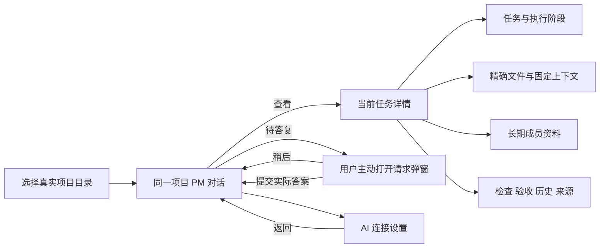
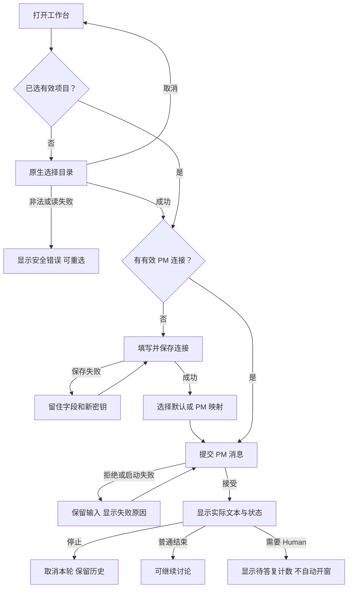
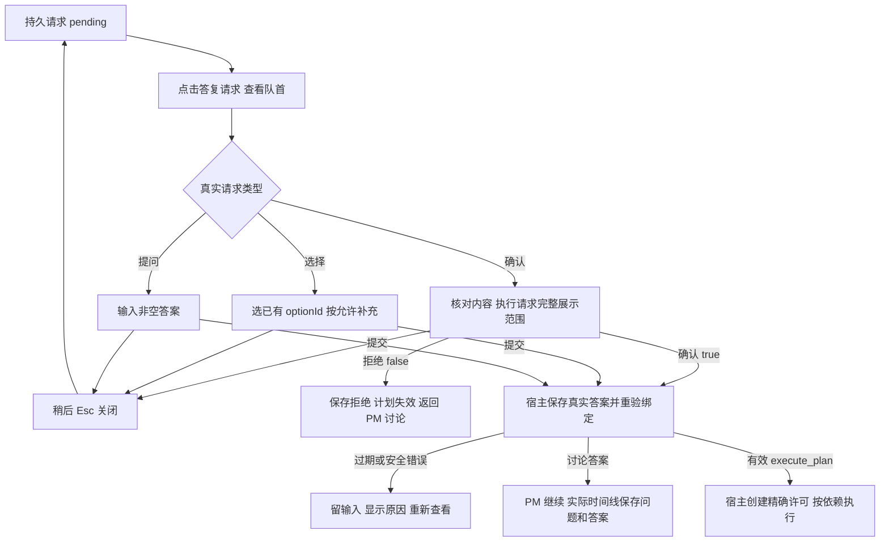
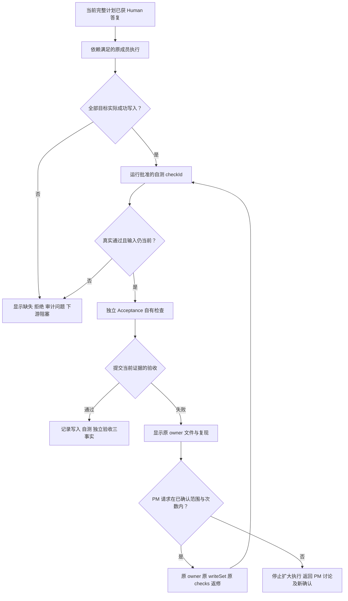

# 让想法与对话成为画面的中心

用户打开已有的 Legion SSH 项目，向项目管理提出“把常用 SSH 命令放到会话旁边”。他需要理解 PM 给出的方案，确认哪些文件会变、由谁修改、如何检查，然后查看执行和验收结果。当前实现把大量任务、职责、SHA 与记录挤进 355px 详情栏，内容层级弱，关键决定与技术记录难区分。v1 先整理了操作层级，但视觉仍偏管理后台。v2 继续保留完整操作能力，将画面重心改为沉稳的近黑对话空间、居中输入和按需浮起的详细信息。

本次完成的是设计与离线原型，生产界面还没实施。ProductDesigner 是本仓库建设角色；不加入客户项目团队，不给 PM 增加新的模型职责，不增加云端、订阅、指标面板或业务能力。原型的七名成员与 SSH 文件是演示的已有项目，不能当作新项目的默认成员，也不能当作本仓库真实执行证据。

实际当前功能：[客户项目工作台](../../../DesktopEngineer/docs/feature/desktop-console.md)、[持久组织与验收](../../../DesktopEngineer/docs/feature/organization-and-acceptance.md)。交接契约索引：[现有 UI/API](../../api-spec.md)。原型：[单文件离线预览](../../prototypes/legion-ui.html)。治理与任务：[已接受范围](../../../../../.ans/decisions/legion-ui-productdesigner-role-v1.md)、[v2 task_ops](../../../../scheduling/legion-ui-productdesigner-v2-grok.md)。

## 2026-10-09 用户反馈与 v2 方向

用户看过 v1 后明确反馈：“现在这个设计我不是很喜欢，感觉不够灵动，没有未来感。喜欢那种 grok 页面带来的那种沉稳感觉。”v1 的蓝色侧栏、纸白工作区、分区边框和卡片呈现像传统管理界面，未满足这次视觉偏好。v1 的静态交付检查与原型操作核对保留为旧候选证据，不表示客户接受其视觉方案。

v2 以实际观察的 [Grok 官方公开首页](https://grok.com/) 为空间与气质参考：近黑暖中性色整体画布、安静的导航、宽而圆润的输入容器、克制的浅色文字和大片有效留白。参考的是画面组织方式，不复制其标识、品牌图形、文字、登录或其他产品功能。新方向把欢迎页中心从“步骤卡”改为想法与输入，让成员、任务和设置安静地存在于同一画布；复杂内容用浮起的详情、设置分区和确认弹窗承接。

灵动来自 150–240ms 的受控过渡、焦点时输入表面轻微提亮、细小悬停反馈、真实流式状态指示与自然的滚动。减少动画偏好下关闭非必要动效。不会添加循环霓虹、粒子、科幻装饰或与任务无关的动态图。修改仍只涉及六个设计交付文件；业务、API/IPC、权限、持久问题和原角色返修语义与 v1 保持矩阵一致。生产还没实施，v2 仍待客户评审。

## 当前双语品牌搭配：及时雨 / Handwell

用户提出中文名“及时雨”，表达“需要时帮得上忙”。本轮按这个选择采用**中文及时雨、英文Handwell**的品牌搭配，在离线原型中预览。Handwell的 `hand + well` 与帮助、把事做好是英文品牌联想；**它没有 rain 或“及时”的字面词义，及时雨是中文寓意对应，不是词源翻译**。

中文界面左上显示“及时雨”，次行 `Handwell / CANDIDATE`；顶部和欢迎小字同时呈现两者，标记“品牌搭配预览 / 生产未实施”。英文名仍独立成立，沿用上一版英文读写和联想说明。只更新这些品牌字符串，保留沉稳近黑风格、全部交互、示例Legion SSH、成员及API/IPC、源码/包/仓库/发行标识。这次没有新增“及时响应”、自动抢答或主动执行能力；帮助仍按照现有讨论、确认、检查与验收流程进行。

2026-10-09单轮查询“及时雨 + AI/软件/官网”：[及时雨客服官网](https://jishiyukefu.com/)已经使用相关名称，业务为客服托管；本轮未核对到名为“及时雨”的同类AI协作产品一手官网。第三方目录与“如同及时雨”的比喻不当作确定同名产品。本轮是有限产品混淆观察，不是名称独占、商标或域名可用性结论。[双语命名任务](../../../../scheduling/legion-productdesigner-naming-v3-bilingual.md)记录三文件候选；生产品牌尚未实施。

## 英文主名依据：Handwell（命名 v2 延续）

用户要求名称在英文区也能独立成立。本轮 **主推荐 Handwell**，建议读作 **HAND-well**：8个字母、2个音节，由英文 `hand` 与 `well` 组合的品牌名；它不是现成词典词，也不是中文拼音。英文用户可直接读“Handwell, help me think this through.”。本轮英文主名继续保留，中文品牌按用户最新选择搭配为“及时雨”。

名字表达的是“一个能把事情稳妥处理好的协作伙伴”。英语中，hand 可以承载帮助与技能的联想；[Cambridge 的英语习语说明](https://dictionaryblog.cambridge.org/2021/01/06/youre-in-good-hands-idioms-with-hand-part-2/)解释了 `in good hands` 的可信、熟练照料含义，并把 `a safe pair of hands` 明确标为英国英语中对可靠同事的说法。**词典支持这些习语；把它们转化为 Handwell 的品牌联想是本次设计判断**，不是词源事实，也不能推断所有英文用户都会自然感到“可信协作”。

我仍选择它，是因为相较当前其他候选，它能同时表达帮助、能力和人际协作感，读写不依赖翻译，声音温和但不幼稚。取舍也明确：8字母比Grok式短名更长，`hand + well` 可能带来传统服务、家居或护理联想，单凭名字的未来感较弱。当前产品首先需要一个可协作的伙伴身份，现代感由简洁字标、近黑界面和受控交互共同承担；不把名字包装成所有气质都完美的选择。

| 候选 | 英文成立方式与定位 | 真实使用及最后取舍 |
| --- | --- | --- |
| **Handwell · 主推荐** | 两个常用英文组件组合；HAND-well。像伙伴的名字，强调帮助与把事做好 | 已有同名品牌咨询工作室和公司字样使用，有限检索未定位到同名AI协作产品官方页；名字不是全球空白。上述服务/护理联想是需要用户评审的代价 |
| **Evenhand · 备选** | EE-vən-hand；取平稳、公正的联想。[even-handed 的词典义](https://www.oxfordlearnersdictionaries.com/definition/english/even-handed)是公平处理不同对象，不等于本产品新增公平治理功能 | 已有[开发者本人发布的费用结算CLI](https://github.com/brod-dev/evenhand)。名字偏平衡/规则，伙伴感弱于Handwell，因此不优先 |
| **Surefoot · 备选** | SURE-foot；[sure-footed 的词典义](https://www.oxfordlearnersdictionaries.com/us/definition/english/sure-footed)包含困难环境中自信稳妥的含义，品牌截取联想而非承诺不犯错 | 已有[Surefoot自有官网的定制软件业务](https://surefootdata.com/about-surefoot/)，与开发领域更接近；另外有身体/户外联想，因此不优先 |

基础检索日期2026-10-09，查询包含候选名与 AI/assistant/software/company。一手[Handwell公司LinkedIn页](https://www.linkedin.com/company/handwell)的公开收录将其描述为品牌与字体专家团队；英国[Handwell Group官方公司记录](https://find-and-update.company-information.service.gov.uk/company/12474333/filing-history)也有同名使用。官网 `handwell.co` 本轮工具未能读取，不猜其内容。这些是实际已有使用，不是本产品的品牌或合作关系；未找到同名AI产品仅是本轮有限查询观察，没有商标或域名可用性结论。

已排除明显相近产品：**Steady**已有[团队协作及AI/MCP能力](https://runsteady.com/docs/article/143-mcp-server/)；**Fenn**已有[审批后执行的AI助手](https://www.foxreach.io/product/fenn)；**Arden**已有[iMessage AI助手](https://www.tryarden.io/)；**Avenor**已有[多代理工作区](https://avenorigin.com/)。这些名称的读音或联想虽合适，但同类混淆比本轮主推荐明显。其他中途候选不继续铺成字典式名单。

英文命名v2原型曾只展示 `Handwell / CANDIDATE`，顶部注明“暂未定名”；当前双语搭配预览见上节。保留已有v2风格、全部功能、示例Legion SSH项目及运行角色/API/IPC/代码路径。先前序宁及中文备选留作退选历史。客户还没确定名字，这次不改生产应用、仓库、包名、发行名或任何内部标识。[本轮命名任务](../../../../scheduling/legion-productdesigner-naming-v2-global.md)记录三文件交付；正式品牌采用与迁移另行确定实施范围。

## 前版命名：序宁（因 English-first 要求退选）

2026-10-09前版以中文为主推荐“序宁 / Xuning”，备选予澄、澄一、泊言。含义偏理清项目、安静协作；其英文只是拼音写法，不能满足客户随后明确的“最好英文区也能理解，不要光考虑中文”，所以退选。

前版做过基础同名检索：[Xuning电气企业](https://www.xnelectricpower.com/)、[Yucheng机械企业](https://www.yuchengmachine.com/)、[澄一科技官方页面中文收录](https://cleadeep.com/)、[泊言馆官方页面](https://www.bolanguages.com/)分别显示英文拼写或相关中文字样已有使用；当时也排除了已有同类[Nori项目助手](https://heynori.ai/)与[Nori云端编码代理](https://usenori.ai/)。这些记录不代表名称可用性保证。前版原型曾显示序宁候选，现在显示Handwell候选；客户从未正式定名。[前版命名任务](../../../../scheduling/legion-productdesigner-naming-v1.md)保留其真实交付记录。

## 当前行为清单与设计依据

本次逐项读取真实 Interface：`apps/desktop/src/interface/{index.html,renderer.mjs,styles.css,preload.cjs,main.mjs}`，并追到 `models/{workbench,interaction,organization}.mjs` 和 `pipelines/workbench.mjs`。最新组织/检查/时间线实现优先于旧 v2 的限制描述。来源观察与客户团队是不同数据；界面不能把开发仓库角色变成客户成员。

| 用户现有能力 | 当前实际行为与待改善点 |
| --- | --- |
| 进入项目 | 原生选现存目录，userData 保存目录登记和独立会话。历史项目按钮仍唤起选目录；不能凭 renderer 的 projectId 绕过原生选择。没有自动建目录/模板能力 |
| 模型连接 | 三协议、默认连接、映射、增改删、加密 Key、固定短请求测试/取消。表单与测试结果目前分散 |
| 与 PM 讨论 | 首消息创建/复用 PM；流文本与状态独立；只给 PM 发消息；草稿、失败、取消、多轮历史保持 |
| 成员 | 长期定义与当前活动分开。RoleArchitect 提案，PM 审阅；待审不能变成员。职责、接口、边界、连接与检查可读 |
| 计划 | 完整目标/角色/任务/依赖/精确文件/归属及转交/checks/Acceptance/返修上限；Human 当前请求答复后宿主重验并执行 |
| Human 请求 | confirmation/choice/question，version/digest 绑定；关闭保持 pending；刷新/切换/重启保留问题和答案事实；取消轮次可使请求失效 |
| 上下文 | 手工逐行精确文件，有限预算/SHA；普通文件读取能力另由模型按需调用。变更固定上下文使计划绑定失效 |
| 执行与检查 | 实际写入、缺失目标、拒绝、审计失败；自测证据与独立验收分开。Node checks 有固定安全限制，不是任意 shell |
| 失败与返修 | PM 依据 Acceptance 失败请求原 owner、原范围、原检查、确认次数内返修；扩权或超限需重新讨论与 Human 确认 |
| 来源与历史 | host 持久时间线保持完整 UI 历史，未知旧顺序如实标记；既有开发记录有缓存/校验时间/过期/不可用。模型输入有界并不删除 UI 历史 |

## 拟采用的信息架构

窗口分三层：稳定的项目与成员侧栏、专注对话主区、按需打开的任务详情。全局只增加界面组织方式，不新增系统功能入口。

1. **侧栏**宽 206px：品牌、项目选择、当前“对话”、长期成员、底部 AI 连接与主题。它使用与主画布接近的中性色，成员名称是主要可见内容，不把每个状态写成第二行列表。成员按稳定 ID 保留顺序和位置；工作/等待/失败标记动态变化，悬停和无障碍名称能读到状态，成员不因任务结束消失。ProjectManager 显示“项目管理”，RoleArchitect 显示“角色架构师”，所有成员点击只打开信息。旧 legacy 显示“职责待补全”。无“直接聊天”“启动成员”“添加产品经理”。
2. **对话**默认占主区：标题为项目名，次级行说明 PM 连接；聊天正文与输入最大 760px，文字 14px。欢迎/空会话将短标题和宽输入容器放在画面中心，保留充足上下留白；有内容后同一输入容器位于底部，对话成为主区焦点。顶部只保留低对比项目与连接信息，以及刷新、当前任务入口。待答复提示位于输入上方、独立于正文。计划、原始 JSON、日志和任务卡不塞进会话；问题/真实答案仍在实际时间线位置。执行中的 composer 保留草稿但发送不可用，指向当前任务。
3. **当前任务**按钮打开独立详情状态，宽 620px，作为有细边界与轻阴影的独立浮层，距工作区边缘12px、圆角20px。四页签“任务 / 文件与上下文 / 成员 / 记录”，页签只组织既有数据。任务页先给真实阶段和下一步，再任务步骤、角色/依赖/检查/独立验收/返修；文件页精确范围与归属，手动上下文；成员页职责、接口、边界与映射入口；记录页实际写入/检查/验收/修复历史及高级来源。关闭回原聊天位置。
4. **AI 连接**为现有次级设置页。左列轻量连接导航，右列完整编辑，去除包住每块内容的卡片边框；字段本身保持清晰边界。页面顶部默认连接、下方当前项目映射；测试结果跟随被测的已保存连接。把 current-member 的既有 assignProfile 能力集中展示；当前 Renderer 只露 PM 编辑，但 Pipeline 已支持当前组织成员。没有成员时不展示虚构映射。保存/删除/默认/映射的绑定失效行为保持并以就地文字解释。
5. **决策弹窗**由用户点“答复请求”打开队首；轮询只更新计数。执行确认在弹窗中给完整可写文件/归属/转交、检查、独立验收覆盖及返修次数，不把“7 个文件”摘要当许可。次按钮“稍后答复”关闭；明确拒绝返回讨论。普通讨论确认用不同文案，不能误称执行授权。

选择大详情视图是因为精确文件、检查与验收需要足够横向空间；继续在狭窄栏堆折叠条目会让用户难以比较。保留主区的纯对话可让普通讨论保持低负担。代价是实施时要维护独立详情导航与焦点，不得让后台轮询反复重建视图。

## 从进入到下一轮的完整交互

### 项目、连接与会话

首次无项目时主区显示两步引导“选一个项目文件夹 → 配置 AI 连接”。点第一步真实 chooseProject，不用输入路径模拟原生授权。取消返回当前页面；非法路径/目录与 userData 重叠显示安全错误；历史缺失不阻止选新目录。选好项目且无连接时聊天空态给“配置 AI 连接”，成员在真实首消息创建前保持空态。

进入设置先新增连接；编辑默认 keep，新建默认 replace，clear 明确说明删除已存 Key。只在 replace 启用新 Key 输入；keep 显示“已保存密钥，不可读回”。本地字段检查不代替主进程校验；失败保留所有输入与新 Key，成功才清空。三协议不预填未知模型价格或能力。测试仅使用已保存连接，运行期间禁重复测试、提供取消；成功显示该短请求延迟，失败显示认证/协议/超时等安全错误，取消单独显示。费用未知。

默认选择与成员映射保存发生旧计划失效和执行停止，提示必须就在操作附近；保持既有删除确认。设置草稿不是运行配置，不默认让模型使用未保存值。选择现有成员映射不允许新建角色。

发送按钮只有项目、有效默认连接或实际 PM 映射、非 running/waiting 活动 PM 轮次、非 confirmed/running 执行、非发送处理中才启用；空输入不派发。待 execute_plan 确认只表示当前计划为 draft，不等于 PM 仍在 waiting：PM 轮次已结束时，用户可以补充需求。宿主接受新消息前使旧计划和确认请求失效，再开始新的 PM 讨论；这不授权执行。真正讨论提问/选择的活动 waiting 轮次仍需先提交 Human 答复，执行中则需要等待或停止执行。Enter 换行，Ctrl/Cmd+Enter 发送，输入法合成中不发送。点击发送保存当次 text；成功仅清空与提交相同的输入版本，失败保留输入；这与“后台刷新保持草稿”是同一个实现要求。流式文本仅在实际 delta 到来时显示；停止回复保持已保存会话并撤销该轮请求。

### 角色、计划与三类请求

RoleArchitect 运行、候选提交、PM 精确审阅是系统现有过程；Human 查看状态，不能在设计里获得 PM 审阅权限。成员详情分别写“定义版本”和“当前状态”，候选台账在记录中标待审/批准/退回。架构师失败后实际已经提交的候选仍是待审，不能拿失败当批准或丢弃真实候选。

执行确认弹窗先列目标、版本、任务与依赖、各角色连接，再逐行列全部精确文件与 owner、独立高亮转交、每任务 checks/Acceptance accepts、maxRepairRounds。关键清单默认展开并可独立滚动，主按钮固定在底部；无自动勾选许可。高级区域保留完整公开 digest、组织/计划/连接/上下文绑定，普通用户不用理解 SHA 也能核对文件。原始助手内容按需查看，文本安全渲染。

提交值由当前请求决定：confirmation 仅 true/false；choice 选实际 optionId，allowSupplement=true 才显示补充；question 非空文本、最大16384字符。提交中按钮禁重复。安全错误留弹窗与答案，stale 显示“请求已更新，请重新查看”，刷新当前请求后明确由用户再提交。普通 yes、缺 nonce 或旧请求不产生执行权限。

“稍后答复”、Esc 和关闭按钮统一 closeInteraction，不提交 false。请求仍 pending、计数不变，下次主动点回到队首。未提交文字/选项可以在当前窗口同请求保留，但不声称重启持久；重启保留的是宿主问题和真实答案。关闭后其他请求不自动抢焦点。取消当前 PM 回复使相关请求失效；关闭应用释放旧 SDK 等待但持久问题可保留。重启以新 PM 上下文继续真实答案事实，不重放旧工具或确认。

### 执行、验收与返修

任务详情区分三事实：文件是否实际写入、自测是否真实通过、独立验收是否真实通过。每步是离散阶段，不造百分比或预计时间。列表按现有依赖显示等待/工作/失败/阻塞/取消/中断，筛选只改变显示。

执行中“停止执行”走既有 stopExecution，按钮待收束期间显示停止中；不把取消称完成。观察到 mutation 但审计失败时逐文件提示需要核对；日志在记录页有检查ID、真实测试数、状态/原因、实际输入 SHA、开始/结束和公开环境隔离字段。长日志有裁剪说明，不隐藏 stderr；完整私有台账不在 renderer 读取。未执行/不支持/零测试/错误/证据过期均不通过，旧 completed 只说目标已写入、未检查/未验收。

独立验收失败展示具体文件、期望、实际、复现及原 owner。提示“项目管理将依据失败记录协调原成员返修”；回 PM 讨论按钮只填写真实问题相关文本到 composer，不直接运行返修、不创造 Human requestRepair API。返修状态由 DTO 更新，次数来源真实 repairs；达到确认上限显示“需要重新讨论”，扩大文件/检查或转交须新计划确认。复验重新显示开发自测和 Acceptance 自有证据，不能复用旧通过标记。

### 刷新、切换、历史和来源

一秒安全状态轮询保留聚焦控件、菜单、所有草稿、各页筛选、滚动和 dialog；只差量更新事实。首次进入和主动切换预览状态/项目时定位到最新消息，使短窗口能读到最近完整回复；此后底部附近才跟随新消息，阅读旧消息时不跳到底。新内容不移动焦点，短窗口成员列表采用紧凑间距，并保留可滚动区域和滚动提示语义。项目切换保存窗口内项目草稿、结束旧执行/PM、过滤迟到事件，打开新项目真实历史。历史成员不因没任务消失。

“刷新”强制重查来源 SHA；成功仅小状态提示，失败保持现有输入。客户项目不要求 `.ans`：没有开发来源显示“此项目没有可用的开发记录”，不阻止会话。过期快照标时间；治理接受、task_ops、运行审计分别展示，不叫在线状态。UI 完整历史与模型每轮有界事实区分；模型略去更早输入时只用实际已有提示，不能说 UI 已删历史。旧未知顺序/校准文本显示明确注记，不编造时间。

## 功能保持与入口对应矩阵

| 能力与风险点 | 新界面位置 | 现有入口/数据 | 实施必须保持 |
| --- | --- | --- | --- |
| 首选/切换目录/取消 | 项目按钮 + 入门空态 | chooseProject | 原生可信选择、隔离验证；历史同目录恢复 |
| 无项目/无连接/坏目录 | 主区空态/就地错误 | currentProject / Result.error | 无虚构成员，无静默目录创建 |
| 连接增改删 | AI 连接页 | saveProfile/deleteProfile | Key keep/replace/clear，失败留值、成功清密钥 |
| 默认/现有成员映射 | AI 连接页，成员详情跳转 | setDefaultProfile/assignProfile | 仅实际成员与现有连接，绑定失效/撤权 |
| 连接测试/取消 | 对应连接测试区 | testConnection/cancelProbe | 已保存配置、真实短请求状态、费用 unknown |
| PM 流/发送/失败/停止 | 会话/输入区 | sendMessage/cancelTurn | PM 唯一入口、输入版本、取消权限、SDK安全码 |
| 完整多轮历史 | 会话滚动 | timeline / history | host order、稳定ID、未知旧顺序标记、不裁 UI |
| 固定成员/工作标 | 稳定侧栏 | organization.members / roleActivity | 长期定义不等于在线，成员仅查看 |
| 职责/接口/版本/边界 | 成员详情 | roles/organization | 原值可读，legacy如实显示 |
| RoleArchitect 候选/PM 审阅 | 记录与成员状态 | proposals | 无 Human 替代审批；真实失败候选仍待审 |
| 计划目标/角色/依赖/连接 | 任务详情及确认弹窗 | plan/tasks | 完整实际计划，无自动增角色或新 feature |
| 精确范围/归属/转交 | 文件页与确认弹窗 | writeSet/fileOwners/transfers | 关键确认前完整展开，转交两步审批保持 |
| 三类问题/关闭/恢复 | 待答复计数 + dialog | interactions/answerInteraction/closeInteraction | nonce/version/digest、pending、真实答案幂等 |
| 执行确认/拒绝/过期 | 执行确认 dialog | execute_plan answer -> host confirmPlanCore | 用户 true 才授权，拒绝不执行，旧绑定不复活 |
| 上下文固定/清除/失败 | 文件与上下文页 | selectContext | 精确文件与预算/SHA，草稿与已读取值分开 |
| 依赖等待/工作/失败/停止 | 任务详情 | task.status / stopExecution | 离散阶段、实际结果，停止先撤权 |
| 写入/编辑/缺目标/审计失败 | 任务及记录 | task.results | 全部目标是否真实写入，observedMutation不能当成功 |
| 自测全部状态/日志/输入 | 任务卡 + 记录详情 | evidence.result | 真测试数、状态、SHA、stderr、裁剪注记 |
| 独立验收/未验收/失败 | 任务卡 + 失败报告 | acceptances | 与自测分开、Acceptance自有证据、可复现问题 |
| 同 owner 限定返修/上限 | 失败报告与任务状态 | repairs / PM control | 不造直接重试按钮，保持原scope/checks/次数 |
| 重启中断/持久问题 | 会话状态提示 | timeline/interactions/tasks | 新PM上下文，不恢复grant/旧tool |
| 观察/缓存/未知格式/过期 | 记录高级详情 | observation | 时间与来源区分，不把缺失来源当非法项目 |
| 明暗主题/刷新保护 | 侧栏/标题栏 | 现有主题/refreshProject | 可访问焦点、草稿与滚动、不自动弹窗 |

## v2 视觉系统、层次与动效

画面默认采用近黑暖中性背景、银白文字和低对比层次。未来感由材料、光线、间距和控制精度表达：常态安静，用户悬停、聚焦、开详情时才出现短暂反馈。大面积蓝色导航、纸白主区、重复卡片与粗分割线已移除。浅色主题仍作为当前能力保留，采用纸色中性画布和深墨文字，结构一致。系统字体使用 `-apple-system, BlinkMacSystemFont, Segoe UI, PingFang SC, Microsoft YaHei, sans-serif`；不依赖外网字体、品牌图标或图片。

| Token | 默认 Dark | Light | 用途 |
| --- | --- | --- | --- |
| canvas / sidebar | #131312 / #111110 | #F5F4F1 / #EEEDE9 | 整体安静的画布与导航，边缘不强分区 |
| panel / subtle | #1D1D1B / #242422 | #FFFEFA / #EEEDE9 | 输入、浮层、选中区域；避免大量平铺卡片 |
| text / muted | #EAEAE4 / #9D9D94 | #222220 / #696962 | 主内容与辅助信息；低层级不等于不可读 |
| primary / primary-text | #E7E7DF / #131312 | #242421 / #F5F4F1 | 单色主动作，确认按钮与发送圆按钮 |
| line / focus | #33332F / #76766A | #DCDCD5 / #696962 | 1px细线与焦点；关键控件仍有足够对比 |
| success / warning / danger | #92CBB1 / #D2BD87 / #E7A3A1 | #257357 / #8D681E / #B24E51 | 只标具体状态，配文字/图标，不染整片主区 |

宽度与空间：侧栏206px，主内容760px，标题栏70px（短窗口61px），主区横向42px；欢迎态标题到输入约25px，输入后保留大段有效留白。欢迎标题34px/短窗口30px/窄屏26px，字重450；其余主标题17–26px，正文14/行高1.95，辅助10–12px。巨大的说明字、营销标语和数据指标不进入工作区。文件与 SHA 用11–12px系统等宽；关键清单仍完整可读，可断行，不裁许可范围。

输入容器是默认画面的视觉重心：宽760px、圆角22px、内边距16–20px，上部输入、下部短状态与圆发送按钮。欢迎时容器位于中心；有对话时固定在底部，阅读区单独滚动。焦点让细边界与表面轻微提亮，不闪烁、不循环呼吸。发送圆按钮仍有“发送”可访问名称，快捷键保持 Ctrl/Cmd+Enter；普通 Enter 换行、输入法合成保护保持。

成员栏保留七名已有示例成员的完整名称与可点击范围，头像字母是低层级标识，闲置状态不重复占一行；工作/等待/失败点只表示实际角色活动。详情内仍显示职责、接口、版本、精确边界和活动状态。审批候选不混入成员。所有成员只有查看入口，不能直接聊天/启动。

任务详情以浮层承接复杂内容：620px、20px圆角、1px边界、轻阴影，内部四页签和独立滚动。概要不用大卡片包裹，内容以留白与细分隔组织；任务与精确文件是连续的阅读层次。设置页用轻连接导航与完整表单分区，避免后台式卡片网格。Human dialog 使用相同中性色表面、22px圆角、独立清单滚动与固定动作区；背景短暂轻模糊，帮助用户专注当前决定。执行确认内完整7文件、owner/转交、任务/依赖/checks、Acceptance覆盖与返修上限始终保留。

| 动作 | 时长与反馈 | 行为限制 |
| --- | --- | --- |
| 按钮/成员悬停 | 160ms，低幅表面与文字变化 | 不移动成员位置，不生成任务或权限 |
| 输入聚焦 | 边界180ms、轻表面光220ms | 一次性反馈，焦点不由轮询触发 |
| 打开任务浮层 | 220ms ease-out，横移14px→0且透明度到1 | 点击时才出现，轮询不自动打开 |
| 关闭任务浮层 | 150ms，轻退场后返回触发器 | 动画只延迟显示关闭，不改变执行/撤权逻辑 |
| 打开弹窗 | 190ms，向上8px/scale .985→1 | 原生 dialog 限制焦点；Esc仍“稍后答复” |
| 欢迎输入出现 | 240ms，7px位移与淡入 | 状态切换时一次，无持续动画 |
| 流式状态 | 小型转动指示与实际文本 | 仅实际 running，未运行不假造正在思考 |

`prefers-reduced-motion:reduce` 下所有这些非必要过渡与动画关闭，弹窗背景不模糊；状态和操作依然可用。不得把动画当任务百分比、预计时间或“连接成功”。关闭、停止与授权撤销由真实宿主逻辑先处理，生产实施时视觉延时不得推迟安全动作。

组件状态仍包含 default/hover/focus-visible/disabled/pending/error。pending 禁重复提交，失败文字在当前表单或弹窗中保留，错误不只用短暂 toast；保存 Key 成功才清空、失败留值、已存 Key 不读回。浅深主题保持相同操作与层级；dark中 white primary 与 dark background 使用正确对比，错误/未运行/不支持/stale不误称通过。

响应式：≥1440px打开详情可推开主区644px，剩余聊天至少540px；1180–1439px以浮层覆盖；960–1179px侧栏192px、详情占余下工作区并保留8px边距；窄预览用可折叠导航与全宽详情/dialog，避免横向溢出。真实桌面最小960×640保持。短窗口欢迎留白缩短、成员行35px且可滚动；输入和确认 footer保持可见，最新消息初始完整出现，主动回看位置保持。设置窄屏改单列。

无障碍：语义 button/form/label/dialog/table、正确 aria-current/expanded/selected/controls，页签左右键，dialog关闭恢复触发器焦点、Esc不拒绝。仅图标操作有名称，七名成员按钮在读屏名称中包含当前状态。正文目标对比4.5:1，控件/焦点3:1，实施后用实际渲染验证。所有精确文件可键盘阅读；日志不随状态整段重复朗读；旧顺序未知如实标记。静态原型不会读取私人目录、真实 Key、账号或浏览器用户信息。

## 原型覆盖与评审路线

原型顶部小条明确“UI 设计预览 / 演示数据”，状态选择器只服务评审，不进入生产导航。所有本地保存、测试、聊天、答复、检查、验收均标模拟，刷新浏览器重置；“模拟重启”只表达持久问题保留与旧运行中断，不证明磁盘恢复。没有 IPC、SDK、网络、文件系统或外部资源。

默认进入“欢迎 / 空会话”，观察输入焦点、留白、深色与七名已有示例成员；这是离线显示状态，不新增清空历史或创建新会话的产品能力。切换“待确认”观察完整对话与稳定七成员；打开当前任务→文件→成员→记录，检查信息层级。再点答复，核对7个文件、检查和返修次数；稍后关闭/重新打开，拒绝或确认。选择“选择问题”“文字提问”测试未选/空答案拦截与允许补充。选择“未选项目”“无连接”走模拟原生选择和设置。设置中编辑三协议、Key动作、保存失败、默认/成员映射、测试成功/认证/协议/超时/取消。最后查看执行中/失败/验收失败/通过/证据过期/停止/模拟重启/来源不可用/启动失败，并阅读高级日志和来源。

Root 对 v2 的真实浏览器预览发现过一次设置空白：导航已更新，但欢迎提示插入时多余的 `div` 结束标签提前关闭工作区，浏览器把设置页与任务浮层放到 main 外。修正后欢迎提示仍处于 composer 的 chatwidth 内，对话、设置、任务浮层均由同一个 workspace 承载。只读静态结构核对了303个元素的显式标签配对与关键祖先关系；这不代替浏览器的实际 DOM、可见性与低窗口复查。批准的 `design-deliverables` 只检查资源和脚本语法，未覆盖这种布局嵌套问题。后续实施与原型评审都要检查设置和详情确实位于 main 工作区、可滚动且能返回会话，浅深主题与短窗口均须实际查看。

原型不声称复制宿主 CAS/权限校验；禁止把 local 模拟按钮的完成当生产实现。批准检查仅静态有限检查与 Node --check。原型视觉与交互可读性由客户和 Supervisor 浏览检查；生产测试另行安排。

## DesktopEngineer 实施交接与待验证项目

实施在另行确认后的 DesktopEngineer 文件任务内进行。建议沿用现有 DOM/事件入口，组件职责明确：ProjectPicker、StableMemberList、ConversationView、Composer、TaskDetailView、ProfileSettings、HumanRequestDialog、EvidenceRecord、ObservationDetails。这些是 UI 组件组织建议，不是 Model/Pipeline新层或客户成员。公开状态驱动显示；渲染层不拼授权、不调用 check service、不直接读私有记录。

实施者必须维护项目级草稿 Map、当前请求 identity、聚焦 select/textarea、可复用成员节点和滚动锚点；不能每秒 replaceChildren 当前表单/dialog。UI 原型中的场景枚举只是预览，生产逻辑取既有真实 DTO 状态，不新增 approved/done 等持久枚举。原型示例数据不可复制为真实默认团队或产品结果。主题 tokens 可映射现有 CSS 变量，默认dark，保留light；设置页回聊天保留项目与草稿。v2欢迎与 populated 是同一会话视图的显示状态，生产不因空态清掉历史。受控动画不得阻塞请求提交、取消、撤权或恢复焦点；模糊只作用弹窗背景，不影响文字对比或精确文件可读性。

后续实现的必要验收（本设计阶段均待验证）：

1. 原生选目录成功/取消/非法/别名与重叠拒绝、历史同目录恢复、切换撤旧权限、无来源的普通客户目录可讨论。
2. 三协议的真实 SDK 短测试成功/认证/协议/超时/取消；safeStorage 保存失败留 Key、成功清 Key、不读回、三 Key动作；默认/既有成员映射变更使旧计划失效。
3. PM唯一消息入口、流/等待/取消、待执行确认时补充需求使旧计划/请求失效并重新讨论（无自动执行）、活动讨论问题 waiting 与 executing 时禁普通发送、有效默认/PM映射、启动失败保留输入、发送期间新输入保护、128条模型checkpoint不删除完整UI历史、旧未知顺序标记；首次最新位置与回看时轮询不抢焦点和滚动。
4. 三类请求真实 nonce/version/digest、空/非法答案不提交、补充许可、关闭Esc保持pending/重新打开/重启/拒绝/重复/过期、轮询不自动开窗。
5. 执行确认前全部文件与owner/转交/依赖/checks/Acceptance/返修上限可读；普通yes、旧绑定、缺nonce不能执行；停止先撤权；未完成目标和审计失败准确显示。
6. 自测与独立验收区分、实际检查数/状态/环境/输入SHA/日志安全与裁剪；失败/unsupported/零测试/stale不显示通过；Acceptance失败→PM原owner限定返修→复验→上限阻塞。
7. 稳定成员、职责/接口/版本/边界与连接可读，点击不聊天/不启动；架构师失败后的实际pending候选保留；来源治理/task_ops/audit与在线状态区分。
8. 原生960×640/1260×860/1440宽、light/dark、长路径/长对话/长日志、键盘/屏幕阅读器/减少动画，CSP与无外部资源、错误安全投影回归；设置/对话/任务浮层实际DOM都在workspace内，导航后可见且返回会话保持状态，不能只看源码或脚本语法。

本次设计没有新增系统功能选装。若评审改变业务或权限语义，须先另立明确需求和批准范围。当前只具备设计和离线表达；生产代码、真实接口结果及原生新布局仍需 DesktopEngineer 实施与独立 Tester 验收。

## 设计版本与决定历史

- **v1，2026-10-09**：先完成导航/行为保持与蓝侧栏、纸白主区方案。[v1任务](../../../../scheduling/legion-ui-productdesigner-v1.md)固定了其静态检查与原型操作核对；客户随后明确不喜欢视觉，要求灵动、未来感与 Grok 的沉稳感。旧检查证明其记录候选，不能替代 v2。
- **v2，2026-10-09**：在同一六文件范围重设计整体空间、中心输入、近黑材料、静谧成员与浮层动效；功能保持矩阵和真实接口继续作为约束。[本轮任务](../../../../scheduling/legion-ui-productdesigner-v2-grok.md)记录新候选的有限静态检查和交接。v2仍为设计，生产未实施、客户视觉评审待定。

- **命名 v1，2026-10-09**：此前根据“沉稳、可信赖的 AI 协作伙伴”方向主推荐序宁，保留予澄、澄一、泊言三备选，核对一手产品/公司页面。品牌只作为原型候选展示，客户未定名。[本轮命名任务](../../../../scheduling/legion-productdesigner-naming-v1.md)。

- **命名 v2，2026-10-09**：因客户 English-first 要求退选拼音主名，当前推荐 Handwell，比较 Evenhand/Surefoot，记录熟悉英文组件、实际同类碰撞、服务/护理联想代价与有限检索范围。名称仍为候选，未正式改名。[英文命名任务](../../../../scheduling/legion-productdesigner-naming-v2-global.md)。

- **命名 v3，2026-10-09**：按用户提出的中文名搭配“及时雨 / Handwell”，明确中文寓意对应与非字面翻译，仅更新原型品牌预览，生产标识及功能保持。[双语命名任务](../../../../scheduling/legion-productdesigner-naming-v3-bilingual.md)。

当前文档继续使用已批准的8日创建路径，更新时间9日；没有新增设计文件、配置或运行角色。
