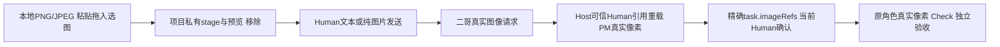

## 当前已完成：桌面图片输入 / Runtime1.3.1 / Desktop0.4.1

二哥桌面现可**粘贴截图、拖入或选择本地PNG/JPEG、预览/移除、发送纯图片**。图片实际进入当前视觉模型的三协议请求；客户历史持久可信引用，后台PM及执行角色经Host按Human来源/当前任务确认重载真实像素，引用本身不授权业务写入。`legion`命令/包名/API、内部Supervisor身份和原文本权限边界保持，**CLI本版仍为纯文本，不新增图片参数**。

[唯一当前修复记录](../../scheduling/desktop-image-input-v1-facade-repair-integration.md)中D、PM当前包、Tester、Reviewer均verified；PM本文档节点仅收口说明并运行依赖门。[当前本地安装包](../../../.ans/runtime/legion-desktop-command-center-v1/ProjectManager/packaging/desktop-image-input-v1-facade-repair-20261012/legion-runtime-1.3.1.tgz) SHA-256：`555a4184456d6457674ded591e7dea3098cdb6b3fed4ad408c782019813dae46`。102文件/99mjs/64公开Model，Desktop0.4.1实际安装runtime1.3.1，tar/sourceHashes、manifest-lock-resolved-integrity及安装字节一致；两真实公开factory均具stageImage/discardImage/readImagePreview，PM消费者强断核实际安装而非Impl。

| 当前真实门 | 结果 |
| --- | --- |
| Desktop图片/Host九单元门 | 238/238 |
| PM当前包/CLI文本兼容/Electron调用方 | 10/10，依赖门通过 |
| Tester独立安装CLI | 14个文本场景通过 |
| Tester图片/工作流集成 | 5/5 |
| Tester真实macOS Electron GUI | 2/2，零skip；22张最终图逐张核 |
| Reviewer七入口完整结构 | 83/83 |

### 用户如何发送图片

在AI连接设置中为实际所选模型显式设置图片能力`supported`；旧连接默认unknown，unknown/unsupported遇图在发送前明确拒绝并保留草稿。服务真实拒绝仍报失败，声明支持不等于任意远端模型已经验证。含图PM/worker分别使用其真实连接，也需要支持视觉。发送前移除不需要的图片；历史图片由客户显式点击有限预览，不从远程URL下载。

首版PNG/JPEG每轮≤4图/每图≤4MiB/合计≤8MiB，单边≤8192/每图≤16MP；项目私有blob≤64MiB/256引用，恢复与当前请求合计≤8图/16MiB。像素不放Org JSON/普通状态/行动日志。Provider核项目、SHA、类型、尺寸、普通文件/no-follow，原子私有0600保存；只回收本project未被历史/委托/task/恢复引用且非活动的staged孤儿，已引用历史不删。跨项目、缺失/篡改/预算明确拒绝。取消保留真实Human图片历史，不重放旧tool/yes/grant；旧无图历史与原JS文本例子字节兼容保持。



### 独立当前证据

[Tester最终报告](../../../.ans/runtime/legion-desktop-command-center-v1/Tester/evidence/desktop-image-final-b7f4biyy/verification.md)核三协议PNG/JPEG网络解码、每协议PM1次/worker3次像素请求、七字段task.imageRefs/当前Human确认、真实Check和独立Acceptance；unknown/unsupported零HTTP保草稿、重启、取消第二HTTP、跨项目/篡改/缺失/预算强门保持。SDK省图被网络前拒绝而不降为文本；内部image_omitted对公共边界投影为internal_error，实际失败/零HTTP/完整Human引用保存已测，不编造成功或公开SDK原异常。真实MacGUI含Electron44 ClipboardItem粘贴、File选图、DataTransfer拖入、预览移除/纯图/历史预览，以及原双owner/日志/返修/取消/900焦点和深浅主题。截图是采集帧，动画/轮询滞后不替代Host断言/proof。

[Reviewer桌面审查](../Reviewer/docs/review-desktop-workbench-v2.md)与[工作流审查](../Reviewer/docs/review-governed-workflow-v1.md)及[最终结构日志](../../../.ans/runtime/desktop-image-input-v1-facade-repair-integration/evidence/reviewer-image-current-1-structure-abcedd32.log)核当前真实Main→publicFactory三图片方法、有限IPC/ref与项目SHA绑定、普通DTO无像素/path、SDK零HTTP拒省图及原文本/owner/lease/commit/Shell边界。旧首轮79/83失败与1.3.0包保留；当前83/83取最新候选`653031e98b22be4f433b0abec12c7b01487600db1015bd2f4fb0163b7c17b990`，报告的旧阶段待验文字保留原时点，不覆盖唯一当前图。

### 剪贴板测试记录与交付边界

早期诊断轮确实写入fixturePNG但未保存原剪贴板快照，不能证明或恢复该轮之前内容，这个环境效果限制和旧失败图/日志保留。最终这轮按当前内容匹配条件恢复，实际[恢复证明](../../../.ans/runtime/legion-desktop-command-center-v1/Tester/evidence/desktop-image-1MvLA7/clipboard-restoration.json)为`used:true/restored:true`；原剪贴板只在当前main进程内存中快照，不输出或持久化，若当前内容已被客户改变不会覆盖。此证明仅覆盖最终这轮，不倒推消除历史问题。

仓库根已安装环境启动`npm --prefix apps/desktop start`；新环境先准备manifest引用的当前本地tar，执行`npm --prefix apps/desktop ci --ignore-scripts`、`npm --prefix apps/desktop run install:electron`后启动。CLI仍按进程环境密钥/三协议配置运行`./node_modules/.bin/legion chat`。README保留冻结打包阶段的待验措辞与原文本例子，当前完成状态以本说明/当前记录/独立报告为准，本文不改包或README。

Windows ZIP/DPAPI/Windows native picker与付费远端本轮未验，不能算通过；旧最终Shell GUI继续暂停，旧整仓库observer治理pin限制保持。两个身份不全的历史共享marker（85f6cbb5…89b5、3d85c08c…b373）及未知holder/commit.lock不删。known-key仍是受控原值/文本元数据/模型输出保证，不做像素OCR、未知秘密泛扫、图片生成或外部TOCTOU全称保证。桥1.3.0-image-bridge.1、旧1.3.0/1.2.3与历史证据原位只读；未自动发布/推送。

### 历史说明（仅原候选）

以下旧版本/待实施/旧名称说明保留原时点，当前图片交付只取上面1.3.1/0.4.1结果。

## 当前已完成：二哥展示改名 / runtime1.2.3 / Desktop0.3.3

产品和客户助手统一显示**二哥**，客户仍只有一个连续对话入口；窗口/HTML标题、品牌、欢迎/页签/输入、助手气泡/头像/问题转达、连接与任务引导、客户错误/执行确认，以及CLI banner、`二哥>`、回复、监控/风险/错误文案已核当前真实结果。后台PM职责/连接保留实际语义。持久`Supervisor` roleId、组织name/digest、实例name、channel、`legion`命令/env、npm包/import/API/目录和旧历史原文保持不变。

[唯一当前final-v2任务](../../scheduling/er-ge-display-name-v1-final-package-integration.md)中的PM当前包和独立Tester已verified，Desktop改名来源为原合法display候选84/84。当前[本地安装包](../../../.ans/runtime/legion-desktop-command-center-v1/ProjectManager/packaging/er-ge-display-name-v1-final-v2-a689a7d63d7dfc26/legion-runtime-1.2.3.tgz) SHA-256 `98953815f443fdfda082cce94561d0c77b15141f6db511feb607ebd4ff0b62f4`；102文件/99mjs，Desktop0.3.3真正安装runtime1.2.3，manifest/lock/resolved/integrity与tar/sourceHashes/安装字节一致。原README自包含JS例子原字节实际执行成功。

| 当前实际门 | 结果 |
| --- | --- |
| PM当前CLI/包/Electron调用方 | 10/10，零fail/skip |
| PM依赖身份检查 | exit0、同候选未变 |
| Tester独立真实安装CLI | 14场景通过 |
| Tester真实macOS指挥台GUI | 2通过、零fail/skip；15张窗口图逐张核 |

[Tester最终报告](../../../.ans/runtime/legion-desktop-command-center-v1/Tester/evidence/er-ge-final-ff9f8ace4a63/verification.md)记录二哥品牌与全客户助手/转达身份、实际三协议和当前Human确认、双owner/两页工作日志/文件纯读、自测及独立验收失败返修、同Host取消HTTP2续轮、六尺寸主题和900导航/主题/设置焦点。截图是采集时UI，完成以真实Host断言/proof为准。首诊断1.2.3包975dc…及CLI9/10旧监控regex失败保留；当前final-v2修精确`二哥监控: not_completed`断言，未弱化监督未完成、owner、Check/Acceptance、Shell、已知key强门。本次不声称新的regression40或Reviewer80成绩，旧1.2.2成绩属于旧候选。

当前已安装环境从仓库根运行`npm --prefix apps/desktop start`；新环境先取得manifest绑定的本地tar，执行`npm --prefix apps/desktop ci --ignore-scripts`、`npm --prefix apps/desktop run install:electron`后启动。CLI本地安装`legion-runtime-1.2.3.tgz`，按环境密钥和三协议配置运行`./node_modules/.bin/legion chat`；命令没有改名。`--ignore-scripts`不安装Electron二进制，实际GUI验收使用本机官方Electron44.6.0。包内README保留打包时“待独立验收”的真实阶段说明，冻结字节不为收尾改写；最终当前状态以本功能说明与当前任务/报告为准。

Windows ZIP/nativePicker/DPAPI本门未执行，unsupported单列；付费远端、旧暂停最终Shell GUI与旧整仓库observer治理pin限制保持，不当通过。历史未知marker `85f6cbb5d433668ee49ccc7b161b39791e434edcd1ae451c1e83bef2011f89b5.owner-source.json`、`3d85c08cf8d7485e85864710c081387c685be760e739a2e64d3d36591f1a400b.owner-source.json`保留，不删未知holder/commit.lock或租约根。已知key保护不扩为未知/编码秘密或外部TOCTOU全称保证。未发布/推送；旧1.2.2/首1.2.3包与日志只读。本说明只记当前已呈现二哥，后续侧栏主入口/角色分组不是本次已实现功能。

### 历史说明（仅原阶段）

以下旧Su名称/旧版本/待验状态属于原时点，不覆盖上面的二哥final-v2当前完成结论。

## 当前交付已完成：runtime 1.2.2 / Desktop 0.3.2（2026-10-12）

**当前独立验收已完成。** [唯一当前任务记录](../../scheduling/legion-desktop-command-center-v1-su-label-repair-integration.md)的Desktop、PM包、Tester、Reviewer四个产品节点均verified；本段文档关闭节点只更新说明并运行原依赖检查。[指挥台当前功能](../DesktopEngineer/docs/feature/desktop-console.md)包含Su唯一连续客户入口、项目文件/实际变化与产物/Check和Acceptance工作区、角色状态/依赖/分页行动日志/分类记忆工作区；后台PM职责和实际连接保持独立，成员原文、briefing和私有恢复摘要不进入公共DTO。

[当前安装包](../../../.ans/runtime/legion-desktop-command-center-v1/ProjectManager/packaging/desktop-command-center-su-label-repair-v1-9850a3707d523eba/legion-runtime-1.2.2.tgz) SHA-256：`773da2d1dbb58b7a9ff251e14f1cf80281a8b9286348d7a864589dd92832eef2`。102包文件、99 mjs源码，Pi SDK/pi-ai1.0.4；Desktop0.3.2实际安装runtime1.2.2，manifest/lock/resolved/integrity、tar/sourceHashes和安装字节一致。PM固定CLI10/10、desktop_dependency通过；README自包含Su例子原字节实际执行成功。所有源码、manifest、lock、README和tar已冻结，本次说明不重包或修改它们。

| 独立当前验收 | 结果 |
| --- | --- |
| Tester安装后真实CLI | 14场景通过 |
| Tester回归 | 40/40，零skip/cancel |
| Tester真实macOS Electron GUI | 2通过、0失败；另1个Windows平台用例unsupported/skip，不计通过 |
| Reviewer固定结构门 | 80/80，零fail/cancel/skip/todo |

[Tester最终报告](../../../.ans/runtime/legion-desktop-command-center-v1/Tester/evidence/final-122-e114e160100e/verification.md)记录三协议/两次PM问答、完整当前Human确认、双draft旧A答复拒绝与B新答、owner并行/转交、真实Check和独立验收失败返修、同Host取消后HTTP2继续、known-key及私有/公共Shell双证。GUI使用真实Electron/renderer/preload/IPC/Pi SDK，验证执行中纯读与三变更工具Host硬拒绝且grant不撤、首屏无空cursor、真实两页日志、文件读取不改变持久源、900宽项目与设置入口/主题/AI连接/Escape焦点及轮询草稿保留；1440/1280/900三宽度深浅主题与15张真实截图逐张查看。截图可能存在正常轮询滞后，阶段完成以实际Host断言与gui-proof为准。

[Reviewer桌面审查](../Reviewer/docs/review-desktop-workbench-v2.md)及[工作流审查](../Reviewer/docs/review-governed-workflow-v1.md)的最终当前structure日志为`reviewer-current-122-1-structure-3b3870cc.log`，当前候选`285754536156b9a9a17033b6d9728adfefc043bc91914ef54d2c98ee8114b172`；两份报告中的旧阶段/待验表述按原时点保留，当前完成结论仅取上述唯一任务最新verified证据。测试没有恢复私有IPC或删除强断言，产品权限仍为角色独占文件与实际Human确认，产品任务无writeSet。

### 在当前已安装环境启动

仓库根目录运行：

```sh
npm --prefix apps/desktop start
```

新环境先取得manifest引用的当前本地tar，在仓库根目录执行`npm --prefix apps/desktop ci --ignore-scripts`，再`npm --prefix apps/desktop run install:electron`准备官方Electron二进制，之后启动。`--ignore-scripts`本身不安装Electron；独立验收使用本机实际已安装Electron44.6.0，不能宣称任意机器已安装。CLI消费者可安装本地`legion-runtime-1.2.2.tgz`，按环境密钥/三协议配置运行`./node_modules/.bin/legion chat`。

包内根/桌面README保留打包时真实“验收进行中”阶段说明，其字节属于已验收包身份，不为收尾改写；当前最终状态以本功能文档、唯一当前任务与上述独立报告为准。

### 仍有的交付边界

本次macOS受控localhost协议、真实Pi SDK与Electron验收已完成；Windows ZIP/DPAPI未执行，单列unsupported，付费远端模型和旧暂停最终Shell GUI不宣称通过。真实仓库旧observer治理metadata pin限制仍unavailable；本次隔离observer边界检查通过不代表旧路径修复。已知密钥保护只保证捕获原值与受控路径，外部TOCTOU/编码秘密/子进程自构不作全称保证。

历史来源身份不完整的共享marker `85f6cbb5d433668ee49ccc7b161b39791e434edcd1ae451c1e83bef2011f89b5.owner-source.json` 与 `3d85c08cf8d7485e85864710c081387c685be760e739a2e64d3d36591f1a400b.owner-source.json`保留；不删除未知holder/commit.lock或租约根。旧1.2.1/1.2.0/1.1.3包、失败和历史报告只读保留，不充当当前通过证据。未发布npm registry。

### 历史说明（只属于原阶段）

以下旧版本、旧包目录、“待独立验收”“进行中”等表述保留当时记录，不能覆盖上面的当前1.2.2/0.3.2完成结论。

## 当前项目指挥台包：runtime 1.2.0 / Desktop 0.3.0（2026-10-12）

Su唯一连续客户入口、项目文件/变化/产物工作区和角色运行/依赖/行动日志/分类事实区由同一Workbench Host承载。[Desktop当前功能](../DesktopEngineer/docs/feature/desktop-console.md)与[已确认v0.3设计](docs/design/2026-10-12_design_desktop-command-center.md)描述新行为。新增公共只读查询在Host绑定当前project，不伪造模型actor；文件浏览不selectContext、不撤权，Memory inspect不保存修订。公共DTO移除成员原文/briefing/恢复摘要；执行中模型变更型工具由Host硬拒绝，原owner/Human/Check/Acceptance授权边界保留。

Desktop源码阶段已由原调度verify，PM当前候选将实际打包runtime1.2.0并安装Desktop0.3.0，新包路径 `.ans/runtime/legion-desktop-command-center-v1/ProjectManager/packaging/desktop-command-center-v1-bb143de38d2a/legion-runtime-1.2.0.tgz`。本阶段cli/desktop_dependency结果、源码/锁/安装身份及独立Tester/Reviewer与真实Electron视觉结果见[当前任务](../../scheduling/legion-desktop-command-center-v1.md)；尚不把Owner/历史1.1.3门宣称为完整指挥台交付。CLI与桌面共享Host，新的包调用方fixture消费当前tar，1.1.3旧包/报告保持只读。

本机macOS具备Electron44.6.0真实启动条件，Node>=22.19、Pi SDK1.0.4不变。WindowsZIP/DPAPI、付费远端模型和旧暂停Shell GUI验收未完成。新增macOS场景必须实际执行；原Windows未执行/skip单列unsupported不计通过。已知key保证沿受控原值范围，不扩大到未知/编码秘密或外部TOCTOU。

### 历史记录

以下保留原版本说明和证据，仅属于原候选；其中旧runtime0.8.2/1.1.3、成员对话和阶段待办不能覆盖上述当前产品接口与私有边界。

# ProjectManager 变更记录

## 当前交付完成：1.1.3（2026-10-11）

当前 1.1.3 Su 唯一客户入口交付已完成：[当前主图](../../scheduling/legion-supervisor-frontdoor-v1-role-memory-race-repair-integration.md)五节点全部 verified。PM 固定 cli 10/10；Desktop caller owner 207/207、host 157/157、parallel 123/123；[Tester 独立验证](../Tester/docs/verification-cli-v1.md)真实 npm 安装 14 场景及 regression 40/40；[Reviewer 结构审查](../Reviewer/docs/review-cli-v1.md)69/69。上述结果绑定当前包和候选，不由历史阶段成绩替代。

最终 tar 为 `su-frontdoor-memory-repair-v1/legion-runtime-1.1.3.tgz`，SHA256 `e0ac5ebaee7caabc52175fe28e229c6fbc195d02890ec5bffe6ba76d80a6f73a`；102 包文件、99 mjs（含 54 个 Desktop Node 闭包模块），当前源码、tar 与安装来源一致，Desktop manifest/lock/resolved/integrity/installed 身份一致。README 示例实际执行，`readmeExample=true`。三协议生产 bin 保留双草案当前确认、取消后同进程 Continue、失败计划后立即新 Human 消息，以及 owner/Check/Acceptance/Shell/已知 key 强门。取消原始私有 journal 可保留绑定 cancelled turn 的 partial；公开 history、后续 SDK body、可恢复角色记忆与事实索引不消费它，Human 原文保留。

有限保证：仅针对已捕获环境 key 的受控数据路径，不能扩为未知/编码秘密泛扫或子进程自行构造与 TOCTOU 的一般保证。旧整仓库 observer 因旧治理 pin 不可用；旧 Shell/GUI E2E 暂停，Windows ZIP 与远程付费模型未验收。Tester 早期共享租约根中来源身份无法证明的 `85f6cbb5d433668ee49ccc7b161b39791e434edcd1ae451c1e83bef2011f89b5.owner-source.json` 和 `3d85c08cf8d7485e85864710c081387c685be760e739a2e64d3d36591f1a400b.owner-source.json` 保留，不猜测清理。

## 历史阶段记录

以下原有内容按当时状态保留，其中“当前”“待验收”“独立 T/R 尚待完成”等均为历史阶段描述；当前结论以上述 1.1.3 主图及独立报告为准。

## 2026-10-08 文件归属与执行编辑

Node runtime升至0.6.0，根八项入口不变；workbench-models增至41项具名导出，增加纯文件归属/转交与跨角色写范围校验。`ProjectReadResult.sha256`指向完整文件，执行成员可用`legion_edit_file`凭旧SHA在精确归属文件内做受控局部编辑，沿原一次性许可和审计。32文件/30mjs tarball已隔离离线安装核验，旧0.4/0.5 tarball未改。Desktop本地依赖实际重装0.6.0，已恢复本机Electron二进制。[已确认设计](docs/design/2026-10-08_design_legion-file-ownership-and-agent-edit.md)、[Node发行](docs/feature/distribution.md)。

Desktop包验证更新严格Windows分支：检查0.6.0/41 Model/32文件身份、计划归属展示、同角色依赖的写后受控编辑、确认后的显式转交、重启后owner持久性，并保留真实make/ZIP/exe、原生选择、DPAPI和视觉门禁。macOS仅运行已安装包、源码和Electron本机身份检查；Windows ZIP和独立Reviewer/Tester仍未由本机证明。实际候选和检查以[当前交付任务](../../scheduling/legion-file-ownership-and-agent-edit-v1-delivery.md)为准。

## 2026-10-08 项目内广读精写

Node runtime升至0.5.0；八项根入口保持，工作台有限入口增至34项具名Model/纯函数与五个public Service，新增ProjectReadRequest/Decision/Result、路径规范化及Read Service。新32文件tarball与Desktop本地依赖锁定，原仅写入宿主继续保持原工具集。PM讨论与确认后的成员现在可由可信宿主调用受控目录列表、分段读取当前客户项目普通文本；Human手动固定的重要上下文仍独立绑定SHA，模型自主读取不自动固定或扩大写范围。写入只限确认任务的精确writeSet，旧许可、审计与取消约束保留。[客户确认设计](docs/design/2026-10-08_design_legion-project-wide-read.md)、[Node发行](docs/feature/distribution.md)。

Desktop package严格Windows分支已更新0.5.0、34 Model、Read Service、32文件/30 mjs和PM只读工具契约；macOS分支验证实际安装包与Electron44.6本机二进制。当前主机未生成或验证Windows ZIP、DPAPI重启、原生目录选择和真实exe视觉路径，不能把本机包check当作这些证据。实际检查结果以[当前任务](../../scheduling/legion-project-wide-read-v1-final.md)为准；独立Reviewer/Tester和Windows发行仍待后续验证。

Reviewer发现原0.5.0 tarball与新Kernel凭据路径修复的源码身份不一致。ProjectManager用已验证的新Kernel源码重建同版本本地tarball，桌面锁更新为当前integrity，并在隔离安装smoke中断言嵌套`.npmrc`、`.ssh`和`.docker`路径拒绝且无正文。旧0.4.0 tarball保持只读，当前刷新与重新核验以[凭据修复任务](../../scheduling/legion-project-wide-read-v1-credential-repair.md)为准。

## 2026-10-07 工作台v2历史

2026-10-07 工作台v2：客户确认single-PM/focus_conversation方案。前core-package-deps阶段冻结runtime0.4.0/29文件包、30Model/四Service公共subpath、Desktop0.2.0本地file依赖和真实SDK/Electron；三approved检查通过，由Supervisor验证。两个SDK1.0.4、Electron44.6.0、Forge8.0.1、Playwright1.63.0不升级。

原desktop-package方案更新缓存接线、thin ESM入口、双页面使用说明、严格发行测试与文档，拟从源码make并解压0.2ZIP，验证包内runtime0.4/真实Pi、原生目录选择/唯一PM/结构化计划确认与受控写/停止、DPAPI跨重启、浅深色与最小窗口及close。该段是旧版方案历史，当前0.5候选的Windows ZIP执行状态见上文；旧截图或原型不能替代当前证据。

capabilities/Interface fixture隔离必要修复由Desktop owner在独立bounded任务完成，原Interface issue/stop保留；PM不修改业务候选。实际发生的sandbox/打包/窗口错误保留证据并按owner边界修复。未向registry发布，无付费模型调用，无任意shell软件执行器。

[当前发行](docs/feature/desktop-distribution.md)、[工作台设计](docs/design/2026-10-07_design_desktop-workbench-v2.md)、[Node发行](docs/feature/distribution.md)。

## 历史

0.1桌面GUI是AI配置/角色映射/只读观察原型，不满足后来客户提出的管理对话与动态任务最终目标；其ZIP、失败和原native证据只读保留。[原型设计](docs/design/2026-10-07_design_desktop-gui-v1.md)。

0.3Node迁移采用真实同进程PiSDK与受控工具，保留Python v1历史。close竞态独立Tester发现后Kernel修复，重新package与严格回归验收；后来fixturecompat4test隔离与所有权snapshot修复保留旧141结果，不能代替当前v2完整Node回归。[Node设计](docs/design/2026-10-07_design_node-pi-v3.md)。原cache不会在新任务中写日志，仅按授权只读seed。

## 2026-10-08 runtime0.7.0发布阶段

新增共享检查/控制具名导出与CheckService子路径，实际39文件pack及Desktop本地安装；51 Model、七子路径和真实Electron Node CheckService最小smoke纳入包检查。旧读写/编辑与历史0.4/0.5/0.6产物保留。runtime实现已就绪；Desktop纯组织/交互Models完成，持久Services/Pipeline/UI待后续。正式检查与候选由task_ops package证据及Supervisor verify确定。

当前计数通道已按[Kernel返修证据](../../scheduling/legion-governed-workflow-v1-reporter-repair.md)加强：每次随机初始化key、MAC与递增序号、captured方法及固定stream入口，裸fd3 JSON拒绝。Node固定permission补充限制inspector/native addon/worker/process.binding；真实文件/网络/进程隔离仍由Seatbelt承担。已测直接伪造与入口替换等范围不构成任意恶意JS的一般不可篡改保证，同进程测试断言与覆盖仍需审阅和独立验收。需要上述受限API或替换固定stream入口的测试不支持。本次Electron smoke使用实际安全flags验证普通test通过与直接fd3伪造拒绝。

Electron禁用NODE_OPTIONS的实际包测试失败保留；Kernel返修采用显式固定权限argv，PM包与桌面依赖重新生成安装，README和全部包内容按当前source身份复核。最终固定package证据决定本阶段状态。

## 2026-10-08 普通测试入口与0.7.0候选刷新

已授权完整方案要求新机制进入普通检查。根普通test由17增至22模块，kernel/adapters/integration分类入口同步补齐Check/Control；Desktop由13增至20模块，加入组织/交互/验收、工作流边界及独立集成/UI。原用例和断言保留，现有包用例核验入口不再遗漏。manifest/README变化后重新pack、真实离线安装和lock核验，旧0.4/0.5/0.6受保护；新结果见[本次任务](../../scheduling/legion-governed-workflow-v1-test-entrypoints-release.md)。Desktop持久Services/Pipeline/UI已有owner实现与当前诊断返修，独立完整流/UI仍待当前候选验收，未据此宣称全局交付。

## 2026-10-08 模型活动预算修复后的发行刷新

Adapter因真实桌面60秒 `pi_turn_timeout` 把conversation输出/累计活动默认和cap改为8192/180000，允许原调用缩小且保留等待停表、即时取消及vendor unknown。PM按相同授权重pack0.7.0并实际离线刷新安装/lock，39文件来源一致，保存此前bb54入口阶段产物和证据，普通Node22/Desktop20模块及原断言不变。当前包检查见[新发行任务](../../scheduling/legion-governed-workflow-v1-final-runtime-release.md)，完整软件与Windows不据包检查宣称通过。


## 2026-10-09 角色上下文恢复能力的独立本地发行

按客户已确认的 v1 集成规范，将 Adapter 新的全新 single_run 首次纯文字恢复及 SDK length-stop 失败处理打入新的 0.7.0 本地包。Desktop 0.2.0 file 依赖改用 `.ans/runtime/legion-governed-workflow-v1/ProjectManager/packaging/role-context-20261009/legion-runtime-0.7.0.tgz` 并实际离线安装更新 lock；root 版本未变。Node 包测试、Desktop 包测试与依赖校验读取新候选 smoke，原包文件清单、exports、CSP、角色生成范围与 Windows ZIP 严格验证保留。所有新 smoke/evidence 使用隔离子目录，原 tarball/ZIP/记录保持。

新包 SHA256 `f45fa15e8c0f195930c35c782904690ce7073680df1e4ec0d0ea6e80215bbad7`；原 0.7.0 tarball SHA256 `00382a9d3fdb3d2a10112b110b7a20b4b18d8b376d3045e50b459294c50b3b9e`。Node 与实际 Electron Node 的公开 Service 行为验证覆盖当前绑定、只恢复一次、当前工具集、旧工具消息/实例拒绝以及 length 截断失败；无外部模型调用。固定 package 检查以[本次任务](../../scheduling/legion-persistent-role-context-and-dialogue-v1.md)实际结果为准。当前尚待 Desktop 实现自动摘要和五页签、独立 Reviewer/Tester 集成验收，Windows ZIP 未执行。


## 2026-10-10 项目Shell公共包与最终管理文档

已确认冻结v1与c872精确配置；0.8.0 bridge-v1真实包/安装后，依赖读取必要修复形成0.8.1 bridge-v2（SHA970bf9954813022cef8f396b8ac388088024cdca9ffd18d1533347723b5a73f1）。当前46文件/44mjs/62具名Model、八Service/Model子路径，Desktop仍0.2.0；原根API和八Pi生命周期保持。0.8.1包门7/7、回归包7/7、contract通过，only-dist已有.bin和readonly依赖拒整批、binary/delete、真实三协议同pending及Electron检查有实际证据。首次旧lock完整性失败与旧0.8.0/f45/全部历史产物保留。

本次仅十份角色文档同步[当前功能](docs/feature/project-shell.md)、[实际API](api-spec.md)、[架构](docs/architecture.md)及[设计/变更](docs/change/2026-10-10_change_project-shell.md)。Desktop owner当前组合177/34/199、Reader精确兼容18/199/177分别绑定当前候选；独立Reviewer/Tester及GUI/客户SSH/Windows仍后续。Reader四candidate字段保持历史，仅已接受exact元组可读；sourcepartial新Human/currentbaseline/new approval恢复追加recovered，旧partial不改，不自动源码withdraw、不整体原子、不重放旧Shell。

macOSCLT/SDK及permission signature真实探针为前提，失败unsupported；网络none/localhost实际受控，外网未测试。最终固定包门前后完整archive旧/new bridge-v2，固定JSON标latest并记录旧观察历史，原tar/source/lock/导出/原task日志不变。当前三gates与最终Source/日志以[当前任务](../../scheduling/handwell-project-shell-final-integration-v1.md)为准，不据本条历史摘要捏造新的通过。


## 2026-10-10 Model纯度修复与0.8.2当前契约

Reviewer发现Model中的三个环境时钟读取后，由原Kernel在同v1范围修复。可信Provider→Service observeTime取得fresh事实，controller.issueShellPublication第三observedAtMs每proposal新观察，真实consume/recheck/commit前仍重验expiry/oneuse/replay/abort；未注入Modelcallback或新增SDKclock字段。0.8.2 bridge-v3实际打包安装，46file/44source/62导出，tarSHA `1a2a7c483f04f2bb939d6bf4d25aa7a4318bc866a473dcac251f74d1ee592622`；Desktop产品0.2.0，Host caller由原owner修复。前0.8.1/0.8.0、旧proof与final归档保留。

本最终阶段只同步10docs；bridge-v3旧输出先完整fresh归档SHA/mode/path/logmapping，原配置三门后固定JSON记latest，再完整归档新run。tar/Source/锁/导出/旧stage和原task日志不改；不以copy让过期观察复活。当前包/Owner与独立验收成绩看[实际修复任务](../../scheduling/handwell-project-shell-model-time-facts-repair-v1.md)，本文不写尚未运行的新门已pass。WindowsZIP/descriptor本机缺失，Mac历史TGZ39/37检查不充当Win证据；外网未测试，macOSCLT/native探针前提及恢复/独立Acceptance边界保持。


## 安装后的 CLI（2026-10-11）

`legion chat` 经 `bin/chat.mjs` 调用唯一公开 `createHeadlessWorkbenchPipeline`，保留当前 Human answerInteraction、角色 owner/检查/Acceptance/监督合同。包包含完整 Node 导入闭包；环境配置及共享租约见 [CLI 功能](docs/feature/cli-project-workflow.md)。owner固定cli检查9/9通过，无skip；当前任务记录保存冻结候选与完整日志，独立Tester/Reviewer尚待完成。


## 当前Su入口（2026-10-11）

客户sendMessage只使用Supervisor；PM为Host受控后台委托。CLI真实Human interaction、执行中只读问答、角色metadata分页、当前证据交付与默认lease/key合同按接受Su v0.3接线；新1.1.0包/示例/完整固定cli结果以当前任务为准，旧PM入口记录只作历史。新增架构：Interface bin/chat→唯一Headless Pipeline→公开Services→Providers，未复制编排或新建工作日志库。当前功能见 [Su项目流程](docs/feature/cli-project-workflow.md)。


## 当前确认选择必要修复（1.1.1）

真实1.1.0生产bin在同Su turn连续A/B草案时曾重复选旧pending A。当前CLI按current planDigest及公开Host组织/context/profile绑定选最新执行请求；discussion/choice/Shell相关Human请求沿自己的绑定，最终仍由Host校验。stale_interaction/interaction_invalidated/stale_file_owners只排除精确id/version/digest，暂态organization_busy不永久丢弃。A展示后B出现，旧A yes须被Host真实拒绝；重新呈现B完整请求并等待新的Human输入，零旧任务/零旧写、不重放旧yes。新增production bin双draft回归保留原三协议/Su读/分页日志/问答/Check/Acceptance/记忆/monitor/key/取消和包Shell门。

补丁1.1.1在su-frontdoor-cli-repair-v2鲜路径，旧1.1.0及全部失败证据保留；当前冻结候选/实际固定cli结果见legion-supervisor-frontdoor-v1-cli-repair-integration任务记录，独立Dfinal/T/R仍需新候选复核。此处修复合同与用例在pack/check前写定，非复用旧1.1.0通过。


## 当前取消续轮必要修复（1.1.2）

共享Host捕获并drain取消的前台run，保留真实终态，再为同项目Su新turn准备上下文。取消后的Continue须实际到达第二HTTP并正常回复；完整Human first input与Continue保留，partial SSE未完成文字不入SDK恢复或持久history。旧工具、肯定答复/grant不重放。Adapter真实139/139对照不冒充Host修复原因；实际Host候选已四门verify后由本包消费。

PM生产bin三协议回归在首partial SSE挂起时/cancel，同进程Continue，断言第二真实请求、Su完成、恢复SDK history/roleMemories无partial，取消journal可保留标明cancelled的原始片段；known-key全持久面及零旧任务。旧双draft当前确认、三协议全局读/状态/分页日志/问答/Check/Acceptance/分类事实/monitor/密钥与Shell强门保留。1.1.2 fresh su-frontdoor-cancel-repair-v1；冻结候选与当前固定cli日志见legion-supervisor-frontdoor-v1-su-cancel-host-repair-integration任务。旧1.1.1与失败证据只读，Dfinal/T/R需当前包重验，已评审有限保证及未验收平台/远端门不变。


## 失败计划后的新Human续轮（1.1.3）

共享Host将真实member log.channel传给cacheRole，后台supervision_preflight/monitor不写su_customer，临时Shell审批不污染pm_delegate；真实来源/covered/revision变化仍严格拒绝。原D定位的revision3→4后台错channel写已修并verify，本包消费当前源码，不以旧图39/40或Adapter139/139诊断冒充完成。

生产CLI必要回归：真实Node Check导致plan.failed，后台monitor终态回复屏障在途时立即新Human消息，实际新Su HTTP到达并释放后台终态，形成新草案及当前Human确认，无stale_role_memory/旧failed停留。CLI对已排队新消息优先处理，不在终态monitor摘要等待中阻塞；无sleep/retry或CAS弱化。取消→Continue三协议、双draft/旧yes不重放、key全持久面及owner/Check/Acceptance/Shell强门保留。1.1.3在su-frontdoor-memory-repair-v1鲜目录，正式冻结候选/cli结果见legion-supervisor-frontdoor-v1-role-memory-race-repair-integration；旧包/失败记录保留，Dfinal/T/R仍需当前包重验。
