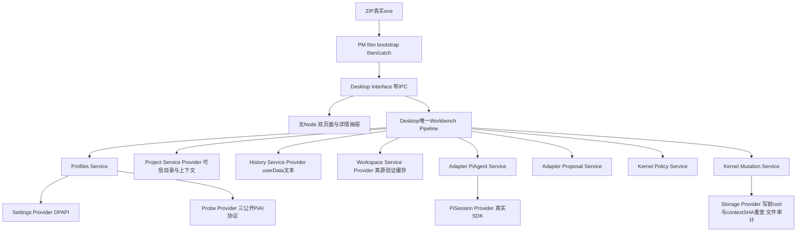

# Legion Node / Pi 项目工作台v2架构

用户从WindowsZIP进入唯一项目管理对话。DesktopEngineer维护唯一Workbench Pipeline，直接组合Desktop公共Profiles/Project/History/Workspace Services、已安装runtime0.4公共Kernel Policy/Mutation和Adapter Proposal/PiAgent Services；没有Workbench→Kernel Interface/peer PermissionRuntime边，Service不互调、Provider不上调业务callback。PM main仅启动公开Desktop Interface并管理退出。

Kernel单独维护纯immutable Agent/Workbench确认Model与品牌authority：createWorkbenchAuthority返回可信controller和只供Mutation消费/重验/释放的mutationAuthority。30具名Model及四Service通过有限npm subpaths透明导出，不公开privatehelper/Provider。Adapter复用同一真实SDK，single_run默认保持，conversation终态回idle、cancel_turn保留会话，close永久结束；静态3协议与plain连接/privatecredentials，禁止Pipeline注入推理业务callbacks。

首消息绑定每客户项目唯一PM，没有Reception或开发角色复制。讨论emptytools/emptywrite仅Adapter与userData；选择文件由Human精确readSet品牌确认，ProjectProvider实际校验root/links/bytes/SHA。合法结构化计划完整DAG验证后，Human确认绑定workspace/context/plan/profile/org/role/task/精确writeSet；一次性grant建立动态实例，原Policy工具交集与审批/deny保留，.ans普通写硬拒绝。Storage提交前真实root/context重查，失败永久撤销authority。确认后Kernel审计是明确客户目录效果。

取消、close、项目/连接/范围变化先撤销再等待会话和终态审计；重启只恢复有限user/assistant文本与中断记录，不能复活grant或自动调用模型。未知metadata/费用保持unknown，软件检查无executor显示not_executed。执行成员只能只读任务状态，IPC和Pipeline拒绝直接Human聊天/启动。

| Owner | 主责与只读交接 |
| --- | --- |
| KernelEngineer | 纯共享Model、Policy与Storage执行安全，公共契约 |
| AgentAdapterEngineer | 实例SDK session、多轮/事件/历史/取消、静态协议 |
| DesktopEngineer | 唯一Workbench Pipeline、客户目录/历史/配置/观察、窗口IPC与renderer |
| ProjectManager | 透明公共包、前core11冻结、thin entry、Forge/ZIP与发行证据 |
| Supervisor | 唯一开发任务调度与候选verify；客户任务执行不赋予开发治理权 |
| Reviewer / Tester | 独立结构、回归、真实GUI与视觉验收，不修生产 |

DAG先Kernel/Adapter→runtime真实tarball+Desktop实际安装→Desktop capabilities→Interface→ZIP→Reviewer→Tester。当前fixture隔离修复由原Desktop owner完成，原失败保留。PM package测试只证明自己实际执行的发行路径，不代下游全套；最终公开13模块串行入口另在全部业务验收后补证。固定SDK1.0.4/Electron44.6/Forge8.0.1/PW1.63，不另加引擎或任意shell。

生成按v2角色隔离，客户workspace与userData互不包含。旧0.3tarball、0.1观察ZIP、兼容历史与cache只读保护；当前0.4 core11与27mjs身份在ZIP检查前后保持。当前ZIP每次make记录descriptor身份及实际安装依赖/sourceSHA，不能固定历史ZIP SHA。源码冻结与生成产物分别记录。[发行功能](feature/desktop-distribution.md)、[公共API](../api-spec.md)、[客户设计](../../../design/2026-10-07_design_desktop-workbench-v2.md)。

旧Node PermissionRuntime仍是独立公共API，根八Model/Interface和CLI兼容保留；其Pipeline经Adapter/Policy/Mutation组合，实际write审计与close语义继续有效。旧GUI v1是配置观察原型，历史真实证据保留，不当作工作台最终验收。
