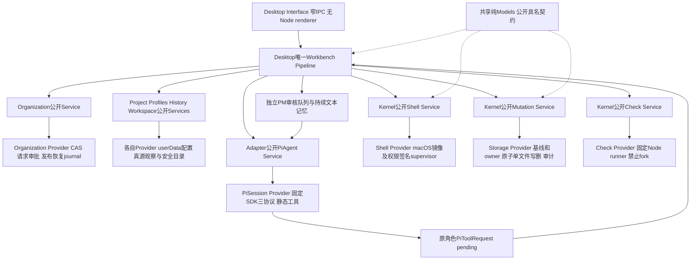
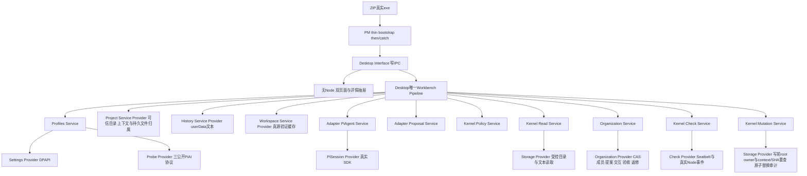

## 当前交付已完成：runtime 1.2.2 / Desktop 0.3.2（2026-10-12）

**当前独立验收已完成。** [唯一当前任务记录](../../../scheduling/legion-desktop-command-center-v1-su-label-repair-integration.md)的Desktop、PM包、Tester、Reviewer四个产品节点均verified；本段文档关闭节点只更新说明并运行原依赖检查。[指挥台当前功能](../../DesktopEngineer/docs/feature/desktop-console.md)包含Su唯一连续客户入口、项目文件/实际变化与产物/Check和Acceptance工作区、角色状态/依赖/分页行动日志/分类记忆工作区；后台PM职责和实际连接保持独立，成员原文、briefing和私有恢复摘要不进入公共DTO。

[当前安装包](../../../../.ans/runtime/legion-desktop-command-center-v1/ProjectManager/packaging/desktop-command-center-su-label-repair-v1-9850a3707d523eba/legion-runtime-1.2.2.tgz) SHA-256：`773da2d1dbb58b7a9ff251e14f1cf80281a8b9286348d7a864589dd92832eef2`。102包文件、99 mjs源码，Pi SDK/pi-ai1.0.4；Desktop0.3.2实际安装runtime1.2.2，manifest/lock/resolved/integrity、tar/sourceHashes和安装字节一致。PM固定CLI10/10、desktop_dependency通过；README自包含Su例子原字节实际执行成功。所有源码、manifest、lock、README和tar已冻结，本次说明不重包或修改它们。

| 独立当前验收 | 结果 |
| --- | --- |
| Tester安装后真实CLI | 14场景通过 |
| Tester回归 | 40/40，零skip/cancel |
| Tester真实macOS Electron GUI | 2通过、0失败；另1个Windows平台用例unsupported/skip，不计通过 |
| Reviewer固定结构门 | 80/80，零fail/cancel/skip/todo |

[Tester最终报告](../../../../.ans/runtime/legion-desktop-command-center-v1/Tester/evidence/final-122-e114e160100e/verification.md)记录三协议/两次PM问答、完整当前Human确认、双draft旧A答复拒绝与B新答、owner并行/转交、真实Check和独立验收失败返修、同Host取消后HTTP2继续、known-key及私有/公共Shell双证。GUI使用真实Electron/renderer/preload/IPC/Pi SDK，验证执行中纯读与三变更工具Host硬拒绝且grant不撤、首屏无空cursor、真实两页日志、文件读取不改变持久源、900宽项目与设置入口/主题/AI连接/Escape焦点及轮询草稿保留；1440/1280/900三宽度深浅主题与15张真实截图逐张查看。截图可能存在正常轮询滞后，阶段完成以实际Host断言与gui-proof为准。

[Reviewer桌面审查](../../Reviewer/docs/review-desktop-workbench-v2.md)及[工作流审查](../../Reviewer/docs/review-governed-workflow-v1.md)的最终当前structure日志为`reviewer-current-122-1-structure-3b3870cc.log`，当前候选`285754536156b9a9a17033b6d9728adfefc043bc91914ef54d2c98ee8114b172`；两份报告中的旧阶段/待验表述按原时点保留，当前完成结论仅取上述唯一任务最新verified证据。测试没有恢复私有IPC或删除强断言，产品权限仍为角色独占文件与实际Human确认，产品任务无writeSet。

### 在当前已安装环境启动

仓库根目录运行：

```sh
npm --prefix apps/desktop start
```

新环境先取得manifest引用的当前本地tar，在仓库根目录执行`npm --prefix apps/desktop ci --ignore-scripts`，再`npm --prefix apps/desktop run install:electron`准备官方Electron二进制，之后启动。`--ignore-scripts`本身不安装Electron；独立验收使用本机实际已安装Electron44.6.0，不能宣称任意机器已安装。CLI消费者可安装本地`legion-runtime-1.2.2.tgz`，按环境密钥/三协议配置运行`./node_modules/.bin/legion chat`。

包内根/桌面README保留打包时真实“验收进行中”阶段说明，其字节属于已验收包身份，不为收尾改写；当前最终状态以本功能文档、唯一当前任务与上述独立报告为准。

### 仍有的交付边界

本次macOS受控localhost协议、真实Pi SDK与Electron验收已完成；Windows ZIP/DPAPI未执行，单列unsupported，付费远端模型和旧暂停最终Shell GUI不宣称通过。真实仓库旧observer治理metadata pin限制仍unavailable；本次隔离observer边界检查通过不代表旧路径修复。已知密钥保护只保证捕获原值与受控路径，外部TOCTOU/编码秘密/子进程自构不作全称保证。

历史来源身份不完整的共享marker `85f6cbb5d433668ee49ccc7b161b39791e434edcd1ae451c1e83bef2011f89b5.owner-source.json` 与 `3d85c08cf8d7485e85864710c081387c685be760e739a2e64d3d36591f1a400b.owner-source.json`保留；不删除未知holder/commit.lock或租约根。旧1.2.1/1.2.0/1.1.3包、失败和历史报告只读保留，不充当当前通过证据。未发布npm registry。

### 历史说明（只属于原阶段）

以下旧版本、旧包目录、“待独立验收”“进行中”等表述保留当时记录，不能覆盖上面的当前1.2.2/0.3.2完成结论。

## 当前项目指挥台包：runtime 1.2.0 / Desktop 0.3.0（2026-10-12）

Su唯一连续客户入口、项目文件/变化/产物工作区和角色运行/依赖/行动日志/分类事实区由同一Workbench Host承载。[Desktop当前功能](../../DesktopEngineer/docs/feature/desktop-console.md)与[已确认v0.3设计](design/2026-10-12_design_desktop-command-center.md)描述新行为。新增公共只读查询在Host绑定当前project，不伪造模型actor；文件浏览不selectContext、不撤权，Memory inspect不保存修订。公共DTO移除成员原文/briefing/恢复摘要；执行中模型变更型工具由Host硬拒绝，原owner/Human/Check/Acceptance授权边界保留。

Desktop源码阶段已由原调度verify，PM当前候选将实际打包runtime1.2.0并安装Desktop0.3.0，新包路径 `.ans/runtime/legion-desktop-command-center-v1/ProjectManager/packaging/desktop-command-center-v1-bb143de38d2a/legion-runtime-1.2.0.tgz`。本阶段cli/desktop_dependency结果、源码/锁/安装身份及独立Tester/Reviewer与真实Electron视觉结果见[当前任务](../../../scheduling/legion-desktop-command-center-v1.md)；尚不把Owner/历史1.1.3门宣称为完整指挥台交付。CLI与桌面共享Host，新的包调用方fixture消费当前tar，1.1.3旧包/报告保持只读。

本机macOS具备Electron44.6.0真实启动条件，Node>=22.19、Pi SDK1.0.4不变。WindowsZIP/DPAPI、付费远端模型和旧暂停Shell GUI验收未完成。新增macOS场景必须实际执行；原Windows未执行/skip单列unsupported不计通过。已知key保证沿受控原值范围，不扩大到未知/编码秘密或外部TOCTOU。

### 历史记录

以下保留原版本说明和证据，仅属于原候选；其中旧runtime0.8.2/1.1.3、成员对话和阶段待办不能覆盖上述当前产品接口与私有边界。

# 当前Su项目架构

Human→CLI/现有Renderer→Su客户conversation→Host绑定delegate→后台PM→RoleArchitect/工作角色/Acceptance。preflight与monitor为独立后台Su。唯一Workbench Pipeline组合公开Services，Provider只处理现有持久与IO；Kernel授权/owner/共享lease/真正Human确认不由Su模型签发。Org v2独立customerTimeline/delegations/channel，旧PM History只读；无第二日志库或第二编排。

[当前功能](feature/cli-project-workflow.md)；1.1.0候选的实际检查/安装身份以legion-supervisor-frontdoor-v1任务记录为准，未用旧1.0.3证据代替。

## 历史说明（旧PM前台版本）

# Handwell 工作台与 runtime0.8.2 当前架构

用户在唯一项目管理对话确认计划后，原执行角色可申请项目通用Shell。Desktop维护唯一Workbench Pipeline，组合公开Profiles/Project/History/Workspace/Organization、Kernel Policy/Read/Mutation/Check/Shell及Adapter Proposal/PiAgent Services；Service只依赖相邻Provider，Provider不路由业务callback。PM main仅启动公开Desktop Interface和管理退出；无Workbench→Core Interface/peer PermissionRuntime边。



Model仍共享，不是跨层能力通道。Kernel主owner维护纯值、品牌许可及原Mutation当前基线；Adapter主owner维护pending一次响应和single_run/conversation预算；Desktop主owner维护产品PM审核、对话、ledger、发布与恢复。PM建设角色只负责公共包、真实安装和管理文档；Supervisor唯一派建设worker和verify。产品内PM逐Shell批准不等于建设配置接受。Tester/Reviewer独立验收不修生产。

当前透明包保留根八API，workbench-models具名62项、七Service加Models八子路径；46文件/44mjs，禁止Provider、下划线authority/receipt工厂和native helper公开。真实0.8.2 tar SHA `1a2a7c483f04f2bb939d6bf4d25aa7a4318bc866a473dcac251f74d1ee592622`，Desktop0.2.0 local file+实际integrity安装，每源字节匹配；0.8.0与历史产物保留。

## 请求、发布和恢复

原角色提交完整command/cwd/effects/network/timeout；Host绑定真实身份，prepare返回镜像与基线。PM受限审核实例使用同PM持续文本记忆，review队列及memory CAS串行，等待不占主队列或改变active generation。Host持共享项目锁后再次核验真实ledger并一次claim，任何身份/owner/plan/profile/context/基线变化撤销。

Shell只能读取安全镜像输入，使用私有HOME/TMP与干净环境。factory依赖scope∪请求output构成完整input generation，caller原样复用prepare三摘要；只发布本条output。readonly依赖file/link/mode/目录变化整批拒绝。候选整批owner/writeSet/字节/SHA/权限预检后，经原Workbench controller与Mutation逐source发布，binary留Host，删除保owner并记录缺失墓碑；共享生成目录另受scope与版本控制。

源码多文件和生成目录不是一个原子事务。partial真实日志、逐项结果、artifactSnapshots使项目暂停，重启不重放。Human确认新的恢复计划和当前SHA/absence，用新授权恢复；磁盘、当前检查、generation验证后追加recovered及新plan/evidence，旧partial不改。源文件无自动withdraw许可；生成同会话recoverGenerated与重启Host恢复处理分别受版本约束。

原pending只得到一次最终typed结果，ready_for_publication不进SDK；取消后的迟到回应拒绝，Host记录真实终态。原角色/PM“对话”分别保存申请输出/审核理由，主区显示真实等待、执行、发布阶段。Shell退出0不是Check/Acceptance证据；依赖变化失效旧成绩，固定Check的no-fork/report身份约束保持。

Workspace Reader已通过双文件补充兼容历史及c872真实接受的精确治理元组。六角色四candidate字段及AWAITING文字仍冻结；仅已接受精确tuple被识别，Supervisor保留v2，未知字段/Scope继续corrupt。读取观察不授予执行或写入权限。

## 验证和交付边界

macOS后端依赖CLT clang/SDK与实际startup探针；未具备能力返回unsupported，不裸spawn。permission signature不是kernel sandbox object ID，故意的无隔离可信Host克隆在信任边界外。network默认none，localhost/external逐条审批；本地SDK/native/离线npm/build实测，外网未实际运行，其他Shell平台不支持。当前WindowsZIP/DPAPI和客户SSH最终验收仍待，不用本机包成绩代替。

实施依赖图为Kernel→Adapter→PM实际包桥→Desktop/Reader组合→PM最终文档与包复验→Reviewer精确自有测试兼容→Tester完整流程/UI→Reviewer终审。当前Desktop owner与Reader当前组合验证，[最终任务](../../../scheduling/handwell-project-shell-model-time-facts-repair-v1.md)保留真正组合输入和后段状态；历史失败及旧0.8.0证据不覆盖。固定包复验先后完整archive bridge-v3；固定JSON是latest，原观察可能历史过期，tar/source/locks与原task日志字节不变。

[Shell当前功能](feature/project-shell.md) · [公共API](../api-spec.md) · [本地发行](feature/distribution.md) · [Desktop发行](feature/desktop-distribution.md)


## 0.8.2 显式Host时间事实

角色批准后可能在发许可与真正提交之间等待。纯Model现在不读取环境时钟或注入clock callback；Shell/Mutation的相邻Provider取得fresh safe epoch毫秒，经公开Service的 `observeTime()` 传入Model比较。Host每项proposal调用 `controller.issueShellPublication(proposal, receipt, service.observeTime())`，不为整批缓存旧时间。操作层在issue、consume、publication以及真正create/replace/delete和recheck前重新观察，缺失/无效/回退时间事实、到期、abort及replay仍失败关闭，不能凭旧issue事实延长许可。

publicfactory和62具名Model/helpers不变；该Host controller第三参数为必需caller调整，实际Desktop与包测试各自接线。SDK request/review/result、renderer与历史不新增clock字段，ordinary write/edit仍原用法。Policy的私有publication上下文使用真实receipt和 `observedAtMs: mutation.observeTime()`，Model值或时间数字不是审批授权。完整实际接口见Kernel API末节。

当前0.8.2 bridge-v3真实包SHA `1a2a7c483f04f2bb939d6bf4d25aa7a4318bc866a473dcac251f74d1ee592622`，46files/44mjs及安装每源相等，Desktop产品仍0.2.0。原0.8.1 bridge-v2和0.8.0 bridge-v1、旧proof及final before/after archive均保留。Owner实现和本阶段三固定门的最新候选/成绩、独立Reviewer/Tester状态以[时间事实修复任务](../../../scheduling/handwell-project-shell-model-time-facts-repair-v1.md)记录，不复制活任务计数，不把下一检查写成已pass。当前包源保持冻结，本阶段只更新10文档，固定门前后完整保全bridge-v3快照并按Gov策略标注latest。


本机当前WindowsZIP本体及对应descriptor缺失；macOS可核验的是历史0.7.0 TGZ/descriptor的39file/37source身份与当前0.8.2真实安装，不读取不存在的ZIP字节，不以这些结果宣称Windows支持、exe/DPAPI或GUI发行通过。旧Windows精确断言和独立发行验证由后续原Reviewer/Tester保留。外网仍未实际运行，当前Shell仅macOS CLT/SDK与startup探针实际能力范围，失败unsupported；源码/生成恢复的新Human授权、当前baseline与追加recovered语义保持。


## 0.7.0与工作台v2历史架构

以下保留当时记录；版本、待办和通过状态仅适用于原记录候选，当前状态见上文。

# Legion Node / Pi 项目工作台v2架构

用户通过项目工作台进入唯一项目管理对话。DesktopEngineer维护唯一Workbench Pipeline，直接组合Desktop公共Profiles/Project/History/Workspace Services、已安装runtime0.7公共Kernel Policy/Mutation/Read/Check和Adapter Proposal/PiAgent Services；没有Workbench→Kernel Interface/peer PermissionRuntime边，Service不互调、Provider不上调业务callback。PM main仅启动公开Desktop Interface并管理退出。当前macOS只验证了已安装包；Windows ZIP仍待该平台实际验证。



Kernel单独维护纯immutable Agent/Workbench确认、项目读取和文件归属Model、品牌authority：createWorkbenchAuthority返回可信controller和只供Mutation消费/重验/释放的mutationAuthority。51具名Model/纯函数及六Service通过七个有限npm subpaths透明导出，不公开privatehelper/Provider。Adapter复用同一真实SDK，single_run默认保持，conversation终态回idle、cancel_turn保留会话，close永久结束；静态3协议与plain连接/privatecredentials，禁止Pipeline注入推理业务callbacks。默认SDK文件/Shell工具关闭，模型工具请求交回可信宿主处理。

首消息绑定每客户项目唯一PM，没有Reception或开发角色复制。PM讨论无写权限，但可调用`legion_list_files`和`legion_read_file`；确认后的执行成员也可按需列目录、分段读取当前项目普通UTF-8文本。每次读取核对项目和运行身份、路径/链接/文件身份、预算与取消，拒绝控制目录和常见凭据文件，文件片段返回完整文件SHA；PM读取不写客户审计或持久正文。Human在详情中选定的重要文件由ProjectProvider校验root/links/bytes/SHA并固定到当前计划；模型自主读取不会自动加入该ContextSnapshot。

项目文档在userData持久保存版本化`fileOwners`。新计划把任务精确writeSet按角色聚合，不同角色申领同文件立即拒绝；同角色重复修改须由后任务明确依赖前任务。既有owner只能经计划中的显式`resource/fromRoleId/toRoleId`转交，并由Human确认完整归属变化；旧项目迁移为空表，不把历史写入自动认领。合法结构化计划完整DAG和归属验证后，Human确认绑定workspace/context/plan/profile/org/owner版本/role/task/精确writeSet；一次性grant建立动态实例，原Policy工具交集与审批/deny保留，.ans普通写硬拒绝。读取不产生写许可；执行成员可用`legion_write_file`完整写或`legion_edit_file`基于完整旧SHA做局部编辑，两者只落自己的精确文件。Storage提交前真实root/context/owner/编辑源SHA重查，编辑临时文件同步后原子替换；拒绝不部分落盘，失败永久撤销相应authority。确认后Kernel审计是明确客户目录效果。

取消、close、项目/连接/范围变化先撤销再等待会话和终态审计；重启只恢复有限user/assistant文本与中断记录，不能复活grant或自动调用模型。未知metadata/费用保持unknown，软件检查实际执行前显示not_executed，执行后保留真实证据状态。执行成员只能只读任务状态，IPC和Pipeline拒绝直接Human聊天/启动。

| Owner | 主责与只读交接 |
| --- | --- |
| KernelEngineer | 纯共享Model、Policy与Storage执行安全，公共契约 |
| AgentAdapterEngineer | 实例SDK session、多轮/事件/历史/取消、静态协议 |
| DesktopEngineer | 唯一Workbench Pipeline、客户目录/历史/配置/观察、窗口IPC与renderer |
| ProjectManager | 透明公共包、前core11冻结、thin entry、Forge/ZIP与发行证据 |
| Supervisor | 唯一开发任务调度与候选verify；客户任务执行不赋予开发治理权 |
| Reviewer / Tester | 独立结构、回归、真实GUI与视觉验收，不修生产 |

DAG先Kernel/Adapter→runtime真实tarball+Desktop实际安装→Desktop capabilities→Interface→ZIP→Reviewer→Tester。PM的macOS package测试核对安装依赖、七子路径、源码身份与Electron本机二进制；Windows ZIP的make、exe、原生选择、DPAPI和视觉仍未在当前主机执行，不能由macOS结果替代。最终公开Desktop20模块与根Node22模块串行入口在当前修复冻结后由独立验收补证。固定SDK1.0.4/Electron44.6/Forge8.0.1/PW1.63，不另加引擎或任意shell。

生成按v2角色隔离，客户workspace与userData互不包含。旧0.3/0.4/0.5 tarball、0.1观察ZIP及存在的历史cache只读保护；当前0.6包的30个mjs身份在发行检查中核对。Windows ZIP每次make须记录descriptor身份及实际安装依赖/sourceSHA，不能固定历史ZIP SHA。源码候选与生成产物分别记录。[发行功能](feature/desktop-distribution.md)、[公共API](../api-spec.md)、[客户归属与编辑设计](design/2026-10-08_design_legion-file-ownership-and-agent-edit.md)。

旧Node PermissionRuntime仍是独立公共API，根八Model/Interface和CLI兼容保留；其Pipeline经Adapter/Policy/Mutation组合，实际write审计与close语义继续有效。旧GUI v1是配置观察原型，历史真实证据保留，不当作工作台最终验收。

## 0.7.0 runtime与当前完整工作流候选

Kernel提供纯Check/Control Model、实际macOS隔离CheckProvider和公开CheckService；Adapter提供check及六control工具与四类typed结果。PM把39文件、51具名Models和七子路径实际打包并安装Desktop。CheckService public factory自己创建Provider，Pipeline只传trusted config/live validator，不能跳层构造Provider。Electron真实Node宿主smoke单独证明执行安全参数与Framework访问。首版process-fork禁止、其他平台unsupported。

Desktop持久组织/交互/验收Service与Provider、唯一Workbench Pipeline和UI已接线，owner实现见[Desktop任务](../../../scheduling/legion-governed-workflow-v1-desktop-implementation.md)；后续[角色读取修复](../../../scheduling/legion-governed-workflow-v1-workspace-reader.md)、[reporter修复](../../../scheduling/legion-governed-workflow-v1-reporter-repair.md)及[Electron修复](../../../scheduling/legion-governed-workflow-v1-electron-runner-repair.md)具有各自真实证据。当前[架构师诊断返修](../../../scheduling/legion-governed-workflow-v1-live-architect-repair.md)与[独立集成/UI验收](../../../scheduling/legion-governed-workflow-v1-final-integration.md)仍待当前候选检查；[独立结构评审](../../../scheduling/legion-governed-workflow-v1-independent-review.md)原结果只代表其记录候选。普通测试入口和包刷新见[本次任务](../../../scheduling/legion-governed-workflow-v1-test-entrypoints-release.md)。原主任务pending后段由这些具体任务接续，原状态与旧通过记录不能代替最终交付。[当前工作流状态](feature/governed-workflow.md)、[canonical只读设计](design/2026-10-08_design_legion-governed-workflow.md)。

当前计数通道已按[Kernel返修证据](../../../scheduling/legion-governed-workflow-v1-reporter-repair.md)加强：每次随机初始化key、MAC与递增序号、captured方法及固定stream入口，裸fd3 JSON拒绝。Node固定permission补充限制inspector/native addon/worker/process.binding；真实文件/网络/进程隔离仍由Seatbelt承担。已测直接伪造与入口替换等范围不构成任意恶意JS的一般不可篡改保证，同进程测试断言与覆盖仍需审阅和独立验收。需要上述受限API或替换固定stream入口的测试不支持。本次Electron smoke使用实际安全flags验证普通test通过与直接fd3伪造拒绝。


## 安装后的 CLI（2026-10-11）

`legion chat` 经 `bin/chat.mjs` 调用唯一公开 `createHeadlessWorkbenchPipeline`，保留当前 Human answerInteraction、角色 owner/检查/Acceptance/监督合同。包包含完整 Node 导入闭包；环境配置及共享租约见 [CLI 功能](feature/cli-project-workflow.md)。owner固定cli检查9/9通过，无skip；当前任务记录保存冻结候选与完整日志，独立Tester/Reviewer尚待完成。


## 当前Su入口（2026-10-11）

客户sendMessage只使用Supervisor；PM为Host受控后台委托。CLI真实Human interaction、执行中只读问答、角色metadata分页、当前证据交付与默认lease/key合同按接受Su v0.3接线；新1.1.0包/示例/完整固定cli结果以当前任务为准，旧PM入口记录只作历史。新增架构：Interface bin/chat→唯一Headless Pipeline→公开Services→Providers，未复制编排或新建工作日志库。当前功能见 [Su项目流程](feature/cli-project-workflow.md)。


## 当前确认选择必要修复（1.1.1）

真实1.1.0生产bin在同Su turn连续A/B草案时曾重复选旧pending A。当前CLI按current planDigest及公开Host组织/context/profile绑定选最新执行请求；discussion/choice/Shell相关Human请求沿自己的绑定，最终仍由Host校验。stale_interaction/interaction_invalidated/stale_file_owners只排除精确id/version/digest，暂态organization_busy不永久丢弃。A展示后B出现，旧A yes须被Host真实拒绝；重新呈现B完整请求并等待新的Human输入，零旧任务/零旧写、不重放旧yes。新增production bin双draft回归保留原三协议/Su读/分页日志/问答/Check/Acceptance/记忆/monitor/key/取消和包Shell门。

补丁1.1.1在su-frontdoor-cli-repair-v2鲜路径，旧1.1.0及全部失败证据保留；当前冻结候选/实际固定cli结果见legion-supervisor-frontdoor-v1-cli-repair-integration任务记录，独立Dfinal/T/R仍需新候选复核。此处修复合同与用例在pack/check前写定，非复用旧1.1.0通过。


## 当前取消续轮必要修复（1.1.2）

共享Host捕获并drain取消的前台run，保留真实终态，再为同项目Su新turn准备上下文。取消后的Continue须实际到达第二HTTP并正常回复；完整Human first input与Continue保留，partial SSE未完成文字不入SDK恢复或持久history。旧工具、肯定答复/grant不重放。Adapter真实139/139对照不冒充Host修复原因；实际Host候选已四门verify后由本包消费。

PM生产bin三协议回归在首partial SSE挂起时/cancel，同进程Continue，断言第二真实请求、Su完成、恢复SDK history/roleMemories无partial，取消journal可保留标明cancelled的原始片段；known-key全持久面及零旧任务。旧双draft当前确认、三协议全局读/状态/分页日志/问答/Check/Acceptance/分类事实/monitor/密钥与Shell强门保留。1.1.2 fresh su-frontdoor-cancel-repair-v1；冻结候选与当前固定cli日志见legion-supervisor-frontdoor-v1-su-cancel-host-repair-integration任务。旧1.1.1与失败证据只读，Dfinal/T/R需当前包重验，已评审有限保证及未验收平台/远端门不变。


## 失败计划后的新Human续轮（1.1.3）

共享Host将真实member log.channel传给cacheRole，后台supervision_preflight/monitor不写su_customer，临时Shell审批不污染pm_delegate；真实来源/covered/revision变化仍严格拒绝。原D定位的revision3→4后台错channel写已修并verify，本包消费当前源码，不以旧图39/40或Adapter139/139诊断冒充完成。

生产CLI必要回归：真实Node Check导致plan.failed，后台monitor终态回复屏障在途时立即新Human消息，实际新Su HTTP到达并释放后台终态，形成新草案及当前Human确认，无stale_role_memory/旧failed停留。CLI对已排队新消息优先处理，不在终态monitor摘要等待中阻塞；无sleep/retry或CAS弱化。取消→Continue三协议、双draft/旧yes不重放、key全持久面及owner/Check/Acceptance/Shell强门保留。1.1.3在su-frontdoor-memory-repair-v1鲜目录，正式冻结候选/cli结果见legion-supervisor-frontdoor-v1-role-memory-race-repair-integration；旧包/失败记录保留，Dfinal/T/R仍需当前包重验。
