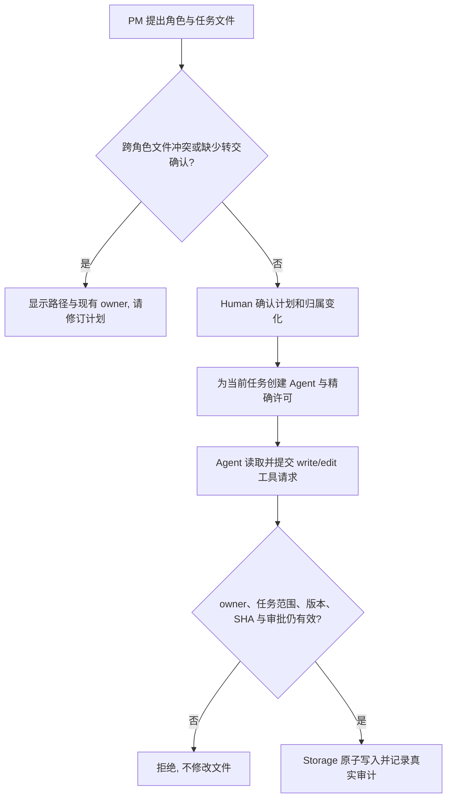

# 角色独占文件与执行 Agent 受控编辑

用户于 2026-10-08 确认本版方案并指示实施。确认时本版应用代码尚未修改或验证；实施证据由后续任务记录和角色文档提供。

例如，客户计划让 Backend 修改 `src/api.ts`、Frontend 修改 `src/page.ts`。Legion 应在展示计划时明确每个文件的归属。两个角色都能读取项目内允许读取的普通文件，但 Backend 只能修改自己的 `src/api.ts`，Frontend 只能修改自己的 `src/page.ts`。若两个角色都申领 `src/api.ts`，计划不能确认。客户以后提出新计划时，原有归属仍有效；转交文件要明确显示旧角色、新角色和路径，由客户确认。

本版只解决**文件独占和执行 Agent 的改动能力**。角色卡、开发文档先行门禁、软件检查执行器、独立 Tester 自动验收和并行派发仍按现有产品状态；本版不把 Legion 开发仓库的七个固定角色复制到客户项目。

## 范围与当前事实

- 用户已选择先做文件独占与各 Agent 改动，并确认：归属跨同一客户项目的后续计划持续有效；执行 Agent 可对已有文件做受控局部编辑。
- 现有 `planCandidate` 只检查角色、任务、依赖和单任务精确 `writeSet`，未检查跨角色文件重叠。现有 Workbench 按拓扑序逐个创建一次性执行 Agent；每个 Agent 调用受控 `legion_write_file`，由宿主核准并落盘。PM 没有写工具。现有 `legion_write_file` 写入完整文件内容，没有局部编辑操作。
- 当前客户项目的会话和计划保存在桌面 userData，确认后写文件和 Kernel 审计进入客户目录。本版将归属记录存在同一受控项目文档中；选择文件夹或讨论阶段不因此写客户目录。

## 计划中的文件归属

1. 在项目文档中新增版本化 `fileOwners`：每项是经规范化的精确项目相对文件和唯一 `roleId`。路径键按现有 Windows 大小写规则比较；拒绝绝对路径、`..`、控制目录、重复大小写别名和目录型写范围。旧项目没有归属表时，迁移为空表；旧历史写入不自动宣称已有 owner，下次计划确认时由客户审阅新申领。
2. PM 计划仍列每个任务的精确 `writeSet`。宿主先聚合每个角色的文件，再拒绝**不同角色**对同一规范化文件的申领。同一角色的多个任务若修改同一文件，后续任务必须显式依赖前一次任务，避免隐式按任务 ID 覆盖。角色级归属与任务级许可同时生效；任务 `writeSet` 仍只能缩小权限。
3. 新计划申领未归属文件时，确认计划会把它分给该角色。已归属文件只能交给原 owner 的任务。跨角色转交需要计划里显式列出 `{resource, fromRoleId, toRoleId}`，界面将转交逐项展示；只有客户确认完整计划后才撤销旧授权、更新 owner 与版本，再派发新角色。转交前后的旧许可都不能重放。被外部删除的文件仍保留原 owner，避免无声重新申领。
4. 计划摘要与确认凭据绑定完整归属变化。确认前、任务开始前以及每次写入提交前，宿主复核项目 ID、组织/计划版本、owner、roleId、taskId 和精确 `writeSet`。检测到归属冲突或版本变化时返回具体路径与现有 owner，保持客户文件不变；PM 可提出修订计划。
5. Node Runtime 的 `RoleBoundary` 在创建和更新时也拒绝不同角色相交的写范围，包括目录范围与精确文件的交叉。工作台动态生成的 `RoleBoundary` 继续用实际任务文件集合；只读项目范围不参与写归属冲突。

## 每个执行 Agent 怎样改动自己的文件

每个任务仍由自己的 Pi Agent 生成改动，PM 不代写；宿主继续作为唯一落盘者，保留 SDK 默认文件/Shell 工具关闭。新增受控 `legion_edit_file` 用于已有普通 UTF-8 文件的局部编辑，保留 `legion_write_file` 用于完整文件写入。受控读取结果增加当前**完整文件**的 SHA-256（分段读取时各段报告同一版本）；编辑请求包含精确相对路径、Agent 已读取版本的 `expectedSha256` 和最多 16 个 `{oldText,newText}` 替换。每个 `oldText` 必须非空且在当前文件中**恰好出现一次**，按顺序应用。找不到、出现多次、当前 SHA 不一致、文件超过现有 2 MiB 读取上限或路径不安全均拒绝，不部分修改。编辑沿用 `write_file` 能力和所需审批规则；完整新内容仍经过原 Policy → 一次性许可 → Storage 的原子替换与审计。工具请求及审计绑定实例、任务、角色和最终内容摘要，不能用编辑绕过 owner 或 `writeSet`。

## 参与模块与验证

| Owner | 必要工作 |
| --- | --- |
| KernelEngineer | 写范围重叠判定、归属/转交和编辑请求的纯 Model/Policy、Storage 写前复核与原子编辑；原一次性许可和审计不削弱 |
| AgentAdapterEngineer | 将受控编辑工具转成可信提案，保持 Agent 自己提交请求与严格 SDK 工具集合 |
| DesktopEngineer | 项目文档归属迁移、计划冲突/转交校验、确认与撤销、执行协调和界面归属展示 |
| ProjectManager | 公共包与桌面依赖身份、版本、发行说明及跨角色设计 |
| Reviewer / Tester | 独立验证跨角色冲突、跨计划持续归属、显式转交、并发旧许可、局部编辑 SHA/歧义拒绝、真实 SDK 和 Electron 流程 |

实现前需由 Governance 把本次确实需要的新文档、源码和测试路径加入相应角色 Section 1，建立客户审阅的精确任务配置。基线为 `8c80272` 加上前一轮已验证但尚未提交的项目级读取改动；那些现有改动须原样保留。历史 0.4/0.5 tarball、旧 ZIP 与原有任务证据保持只读。实现后先跑各 owner 检查，再跑当前候选的根包和桌面公开测试；Windows ZIP/DPAPI 只能在 Windows 实测后宣称通过。

**本记录状态：** 已确认设计；本记录本身不证明后续代码实施、测试或 Windows 发行结果。
