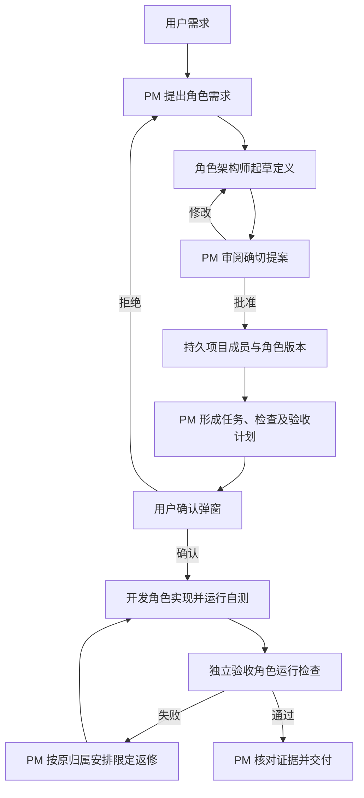

# 项目成员持续存在，交付由真实检查证明

用户已要求实施完整方案：固定项目成员、纯对话与三类弹窗、角色架构师拟定目录/职责/边界并由 PM 审批、开发角色实际自测、独立验收角色验证、PM 将失败交回原角色修复并复验。此文记录本次执行契约；具体源文件授权由同名精确任务配置及客户确认的配置哈希决定。

真实场景来自 `legion-ssh-macos`：四个执行角色开发基础 SSH，单独 Desktop 修复入口/测试命令/指纹确认，再由三个角色增加 SFTP。当前模型把计划角色用作成员表，且只提供读写工具，完成状态只检查写齐文件。外部 Codex 已运行 54 项单元测试、4 项真实 SSH 协议回归及真实窗口操作；这些不能冒充 Legion 角色自行验证。

## 用户流程

1. PM 接收需求并提出角色需要。角色架构师读取普通项目文件，提交职责、协作接口、目录安排、精确文件边界和角色文档候选。
2. PM 明确审阅所提交提案的 ID、版本与摘要，批准或要求修改。批准形成持久项目成员定义，不授予本次任意源码写入能力。
3. PM 按已批准角色和依赖生成计划，列出精确文件、检查清单、独立验收和限定返修规则。角色文档发布也必须在已确认的任务范围内，实际内容须与批准候选摘要相符。
4. 系统弹出执行确认。用户确认后才能派发；拒绝后回到对话，并记录拒绝。普通问答的“是”不替代执行确认。
5. 开发角色修改自己的文件，调用获批的检查 ID 运行自测。真实检查通过且证据仍对应当前输入时，开发任务才能通过。
6. 独立验收角色读取已实现代码和自测证据，维护自己的测试/夹具，运行跨角色、完整流程和回归检查。其写范围只包含自己的测试、夹具和报告，不包含业务源码或依赖/权限配置。
7. 验收失败交给 PM。PM 真实读取失败证据并决定返修，派给原文件所有者。原角色修复、自测，验收角色复验。
8. PM 核对独立验收、当前输入版本、覆盖与未测项目后给出结论。只写完文件、未运行、失败或不支持的检查不能被表述为软件验收通过。



## 成员、任务和交互分别存储

项目组织登记持续保存 `ProjectManager`、`RoleArchitect`、`Acceptance` 三个固定职责及已批准的执行角色。角色 ID 稳定，定义有独立修订号与摘要。计划引用这些定义；新计划不能删除未参加本轮的成员或直接替换它们的职责。停用和归属转交必须明确处理。

运行实例属于一次任务，长期角色属于项目。左侧成员稳定排序、按角色 ID 更新节点，显示正在工作/等待依赖/等待答复/失败等实际状态；后台轮询不毁掉输入或抢焦点。成员详情展示职责、目录、边界、任务与证据。

对话主区域显示用户消息、PM 回复、交互答复和简短进度。详细任务、范围和审计放入详情。待处理交互保存请求 ID、项目、类型、用途、发起者、绑定版本、问题/选项、答案与状态。

- 确认：明确的确认/拒绝动作。
- 选择：提交所列选项 ID，支持需求允许时的补充文字。
- 询问：提交文字答案。

关闭弹窗仍保持待处理；刷新/切换项目/重启不丢请求，不把关闭当成答复。请求队列按顺序显示，已处理请求不重复弹出。答复记录回到对话。

角色提案/审批、交互与验收状态使用相邻层的公共 Service/Provider，持久写入支持锁与摘要 CAS。跨进程修改、重复点击、过期请求及旧组织/计划版本必须被拒绝或重新读取，不能覆盖较新的记录。

## 模型工具与真实身份

新增明确的受控工具：

| 工具 | 可调用者 | 返回内容/效果 |
| --- | --- | --- |
| `legion_design_roles` | PM | 启动角色架构师并取得待审提案 |
| `legion_propose_roles` | 角色架构师 | 保存有摘要的职责/目录/边界/文档候选 |
| `legion_review_roles` | PM | 批准或退回所审阅确切提案 |
| `legion_request_interaction` | PM | 发起确认、选择或询问，取得真实用户答复 |
| `legion_run_check` | 当前开发/验收执行成员 | 只按已批准检查 ID 运行软件检查 |
| `legion_submit_acceptance` | 验收角色 | 提交引用真实证据的结论与问题 |
| `legion_request_repair` | PM | 在已批准返修规则内派回原文件所有者 |

工具参数不提供权限身份凭据。宿主用真实会话、角色、任务、实例和运行 ID 校验调用者，不能相信模型填写的角色名称。Pi 工具请求/结果仍为 typed Model；新检查、控制结果不通过伪造文件变更提案传输。PM 不获得业务源码写权限，角色架构师只提出/发布批准的角色治理文档。

PM 提问等待用户期间，模型请求的活动时间预算暂停，等待态单独显示；取消、窗口关闭、项目/连接/权限变更撤销等待与旧授权。恢复后从持久交互重建上下文，不能向不存在的旧会话重放工具批准。

## 检查契约与隔离

检查由批准的计划列出 ID、类型、角色/任务、准确参数、输入文件、输出位置、超时和环境能力。`legion_run_check` 只收 `checkId`，不收随意命令、Shell 文本、可执行文件或本地目录。

本次真实执行先提供 macOS 上的 Node.js 检查：固定 Node 模式运行 `--test` 和明确测试资源，参数不经 shell；用宿主的确定运行时，Electron 宿主可用其 Node 模式。循环本机协议服务必须在该检查里显式批准 `localhost`，默认无网络。其他运行方式/宿主不支持时返回 `unsupported`，不能自动降级为无限制执行或通过。接口保留受控 Provider 扩展点，不生成未实现平台的假结果。

命令 allowlist 不能约束测试程序自身。macOS 执行 Provider 必须真实隔离文件/进程：项目候选只读，控制/凭据目录不可读，仅当前检查获批的输出/临时目录可写。子进程继承隔离，日志/取消/超时有界，只终止本次跟踪的进程。模型 API Key 不进入子进程环境、参数或日志。运行器无法完成所需隔离时明确未执行。

检查证据记录真实开始/结束时间、运行时/平台、实际 argv、退出码、日志/截断标志、输入文件摘要、对应计划/角色/任务/检查 ID，以及实际结果。工具不能接受模型自报的“已通过”。测试为空或未跑完不能算通过。

输入包括任务本身与声明的依赖/测试夹具。相关源文件或依赖改变后，检查证据失效；不会仅替换摘要来延续旧通过。验收角色新建独立测试不自动伪装成重新测试了开发角色。UI 区分实现已写入、自测通过、待验收、验收通过、失败、未运行、不支持、证据过期。

## PM 的限定返修

验收失败包含复现步骤、预期/实际、涉及文件、证据和责任角色。PM 的返修调用校验文件归属及原计划范围，不能给验收角色业务源码权限，也不能扩张写入范围或检查能力。

确认计划时明确 `maxRepairRounds`，默认建议 2 次；只有用户已确认此规则才可自动重派。每次有独立尝试记录，原角色自测后再做独立验收。新文件、边界/归属变化、检查能力扩大需新确认。连续返修没有进展或达到上限时保留失败证据，报告并请求决策，禁止删测试或放宽断言获得通过。

## 跨层公共契约与职责

- KernelEngineer 主持检查/控制请求与结果的共享 Model、检查授权、证据、软件检查 Service 与实际隔离 Provider；不引用 desktop 实现。
- AgentAdapterEngineer 注册七类工具，校验 typed 请求/结果，传回真实检查/交互数据，并处理等待预算和取消；不直接操作客户文件或启动检查进程。
- DesktopEngineer 维护持久组织/交互/验收的 Model、三层组织 Service/Provider，并由唯一 Workbench Pipeline 组合公共 Services。Pipeline 调度 PM、架构师、开发和验收实例；界面不直接调用 Provider 或进程。
- ProjectManager 维护 canonical 功能设计、实际公共导出、0.7.0 runtime 打包/桌面真实安装、入口与文档。既有源文件结构保留；新增文件在各层内按职责命名。
- Tester 独立检验跨角色完整流、失败自测、验收拒绝、PM 原角色返修、再验收、重启/取消/过期交互及真实窗口。
- Reviewer 独立检查层调用、职责、权限、假证据与越界拒绝；不修生产源码。

共享 Kernel 契约阶段先建立并验证，API-spec 必须给出最终实际公开签名与 typed 字段；后续实现只依赖公共入口。检查的公共核心操作采用 `run`（请求、批准的授权和取消信号）及 `close`，失败/取消/不支持/过期有独立状态。组织的批准与持久化策略在 Service，文件/锁/原子写/进程在 Provider，顺序/分支/返修在 Pipeline，输入输出在 Interface。具体 Service 创建参数在契约阶段确定并由 API-spec 固定，不能用直接实现导入绕过尚未公开的能力。

## 迁移与验证

旧项目先从当前计划和持久文件归属恢复已知成员 ID，缺失职责标“待补全”，不编造历史批准。旧完成记录仅代表原写入状态，未执行的检查仍是 `not_executed`；不能升级成验收通过。角色架构师补齐现有定义，PM 审批。实际移动源码另需可审阅计划。

必验：稳定成员跨计划；三类弹窗正确答复/拒绝/关闭/恢复；架构师提交→PM 退回→修改→批准；无批准和重复/过期批准拒绝；开发自测真实通过与失败；实际隔离阻止越权读取/写入；独立验收发现不匹配；PM 派回原角色→自测→复验；验收角色越权源码拒绝；改变依赖使旧证据失效；返修上限；真实接口与桌面窗口回归。

新运行器首版的 Node 检查不自动代表所有软件类型和原生 GUI 流程通过。验收报告必须指出所运行检查的覆盖，窗口行为另外实际验证。完成本次工作要求所有机制真实可用、有上述失败路径证据，并在真实 Legion 界面用 SSH 项目后续变更验证组织与自测/验收流程。

用户授权：明确“Legion 的自测与验收角色机制 这个修改吧”，随后“全都要开发”；最终整套开发决定覆盖先前暂不修改的讨论决定。客户已确认精确配置 SHA-256 `ddc9cfd12dc62d413a6353c4150e488c3451bb6ac8f2f37550441e993a8ec4fa`；派发采用该配置，不扩大其范围。


---

## 2026-10-09 已确认集成追加：角色持续上下文与成员对话 v1

客户已于 2026-10-09 确认 `handwell-role-context-and-dialogue-v1` 并指示实施。下文逐字保留客户确认的具体方案原文，来源为 `/private/tmp/2026-10-09_design_handwell-role-context-and-dialogue.md`；原文中的 `status: proposed` 是准备时的历史元数据，本追加章节记录其已确认状态。此前设计与历史保留。

本次交付仅将已确认规范记录到本 ProjectManager 设计文档。新增角色记忆、自动摘要、首次恢复、五个页签、角色来源与实际 runtime 打包安装仍待各角色实现、检查与独立验收，不能将本次文档检查作为代码完成或软件验收证据。

后续实施按 `SourceRoleContextStageUser` 精确角色任务，在方案列出的 38 个已有源码、测试与说明文件范围内分工；实际 writeSet 继续缩小已批准角色范围。当前 `.ans/decisions/legion-governed-workflow-v1-design.md` 仍为治理基础原文。后续任务的 requirement 精确引用本含已确认 spec 的 ProjectManager 文档，design 继续引用原治理基础；两个引用均由任务冻结，不增加政策或权限。

### 客户确认方案原文

```markdown
---
id: handwell-role-context-and-dialogue-v1
type: design
created: "2026-10-09"
updated: "2026-10-09"
timezone: Asia/Shanghai
status: proposed
---

# Handwell 角色持续上下文与成员对话设计

本方案让 PM、角色架构师、开发成员和独立验收成员各自保有项目内的长期记忆。下一轮任务或重启后，该角色继续使用自己的摘要与最近对话；接近预算时自动整理较早内容。详情抽屉新增“对话”页签，并区分系统角色与项目角色。

## 使用体验

详情抽屉依次为 **任务、文件、成员、对话、记录**。“成员”显示当前选中角色的任务、状态、文件范围、检查和证据、职责、接口与实际模型连接。“对话”紧挨“成员”，展示同一角色的真实消息及各次运行，支持查看历史。点击左侧成员打开成员页，点击主聊天中的工作入口打开其对话页；两页共享当前选中的角色，保留阅读位置、键盘焦点与草稿。

ProjectManager、RoleArchitect、Acceptance 始终标为“系统角色”，其定义审批或修订不改变来源。通过真实角色提案批准产生的其他成员标为“项目角色”；旧迁移记录的来源不明时显示“来源未记录”。

## 角色记忆

记忆按“项目身份 + 角色 ID”分别保存，包含模型摘要、最近完整文字、安全工具事实、已覆盖消息和讨论答复的水位及输入摘要。不同项目和角色不会相互混入对话；同一角色的后续任务、返修、需求变更和重启继续使用该记忆。

原始消息与运行记录保留在当前项目的对话存储中。摘要明确标为模型生成的整理内容，不代替原文。完成摘要后，只向模型注入摘要、最近原文和尚未覆盖的新需求；不会把已经摘要过的全部历史再次灌入。选择题同时保留题目、选项与实际答案，使 a、b 或确认 true 仍有完整含义。

每次任务由宿主原样提供当前角色名称、职责、接口、精确边界、版本与摘要，以及当前任务、归属、检查和依赖。这些确定事实不会由摘要重新编写。此前规划失败的职责缩写不能再次被当作已批准定义。

## 自动整理与预算

预算计入本次完整输入、当前确定事实、分隔文字、摘要和最近原文的实际合并长度。先预留完整当前输入和必要事实的空间，再决定可携带多少历史；不截断单条当前消息。

| 项目 | 默认约束 |
| --- | --- |
| 合并模型工作文本 | 最多 65536 字符 |
| 自动整理触发 | 达到 49152 字符或 96 条消息，且有可整理的旧内容 |
| 最近原文目标 | 最多 16384 字符，最多 64 条完整消息 |
| 摘要 | 最多 8192 字符 |
| 单角色恢复记录 | 最多 128 条消息 |
| 全项目角色工作记忆 | 最多 2 MiB |
| 单次自动摘要请求 | 最多 2048 输出 token，30 秒，无工具，不自动重试 |

已明确配置真实模型上下文窗口时，另以标明为估算的保守计量提前触发。窗口或费用未提供时显示未知；SDK 内部的默认窗口与零费用占位不作为真实能力或价格。

达到触发点后，由宿主使用该角色当前实际连接发起一次只处理文本的摘要请求。这会增加一次模型调用，费用依模型服务实际计费，当前金额未知。业务请求原有的输出与活动时间上限保持。

摘要成功、来源水位与版本仍一致时，才原子保存新记忆。摘要失败、取消、超长或并发保存冲突时保留旧记忆及完整当前输入。若旧上下文仍在预算内，可明确提示后继续；若仍超出上限，则暂停该模型调用并报告原因。不能用默默遗忘、无限重试或截断当前需求取得继续执行。

## 权限与证据

长期延续的是角色的文字记忆。每项任务继续使用当前任务实例、范围、组织版本和确认授权；角色获得的写入能力来自当次精确任务。旧工具回复、执行确认 yes、写入授权和检查授权不会被恢复到 SDK 队列。

开发成员与验收成员可在新单次实例首次运行前恢复纯文本记忆，必须绑定当前实例与当前模型连接版本；运行中或结束后不能重新注入。这样保持角色连续理解，同时让每个新任务重新接受范围和权限校验。

模型摘要里“已通过测试”的文字仅是历史。当前自测与验收仍由宿主按真实检查记录、输入文件摘要和当前任务判定；文件或依赖改变后，旧证据不能作为本轮通过。

## 实现与发布

DesktopEngineer 维护角色记忆模型、同项目锁与摘要 CAS、当前事实和新消息投影、自动摘要调度、五个页签及来源标识。旧数据先验证原摘要，再补空记忆字段；旧记录保持可读。原对话预算及持久文件上限保持，达到存储预算时明确报告，不能声称无限保存。

AgentAdapterEngineer 扩展已有恢复接口：仅允许全新 single_run 实例在首次运行前恢复绑定当前实例与连接的纯文本记录。不打开 SDK 内置自动压缩，其溢出恢复可能另行重试一次；宿主控制摘要请求的范围、次数、时限与提交。

ProjectManager 生成与源码候选绑定的新 runtime tarball，更新桌面依赖路径、锁文件和依赖校验，并实际安装检验。原 tarball 与旧测试证据保留。现有公开恢复方法可复用，不增加任意 Shell、文件访问或新的业务 IPC。

拟实施 38 个已有源码、测试与说明文件：DesktopEngineer 20 个、AgentAdapterEngineer 9 个、ProjectManager 9 个。具体清单由精确任务缩小已批准角色范围；独立 Tester 适配新增第五页签并验证完整机制，Reviewer 检查调用层、权限和摘要来源。未列入本方案的功能不自动加入。

## 验证与后续 SSH 测试

必须验证四类角色跨任务、返修与重启的连续记忆；项目及角色隔离；首次恢复与旧实例拒绝；旧工具和授权无法复活；阈值、完整大消息和超预算拒绝；摘要水位去重及选择题语义；摘要失败、取消与 CAS 冲突保留原记录；当前职责与归属原样注入；五个页签的键盘、阅读位置及来源标识；桌面实际安装的新恢复能力。

完成后继续已清空 SSH 项目的真实开发：完整角色提案、合法宿主实施确认、成员自行写入与自测、独立验收和原角色返修，再追加 SFTP 与快捷命令。当前业务目录仍为空，过去失败和审批记录保留，不能把本地回归通过说成 SSH 项目已经完成。

```
