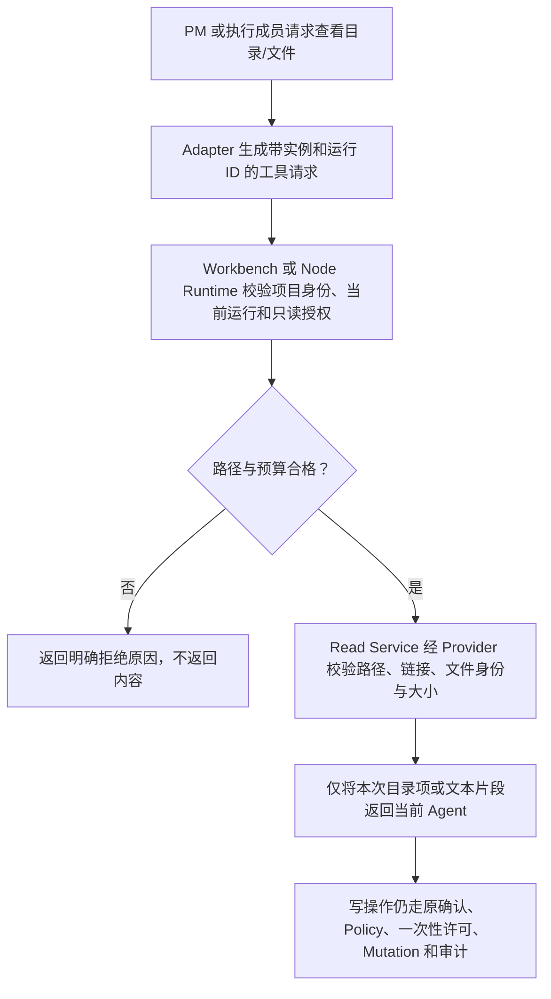

# 客户项目内广读精写

客户于 2026-10-08 确认本版方案并指示实施。应用代码尚未修改或验证。

用户在 Legion 工作台选择客户项目后，项目管理和执行成员应能按需查看项目内的普通文本文件与目录，不必由用户逐个指定上下文文件。模型写文件仍须等待用户确认计划，并且每次写入只限对应任务的精确 `writeSet`。例如 PM 可以查看 `src/` 的目录和 `package.json` 后拟定计划；确认后 Backend 成员可以读取 `src/server.ts`，但只能写计划分给它的文件。

## 已确认的产品边界

- “每个角色”包括项目管理 PM 和确认计划后创建的执行成员。
- “全局”只指**当前客户项目**，不指整台电脑、其他项目或应用的 userData。
- `.git/`、`.ans/`、`.aws/`、`.agents/`、`.codex/` 等控制或凭据目录不可由模型读取。常见凭据文件（例如 `.env`、`.env.*`、私钥文件）也按同一规则拒绝；这是一份路径规则，不能识别任意命名的秘密。
- 目录列表和文件读取都是只读；写权限不因读取而扩大。项目切换、运行取消或关闭时，旧读取请求失效。

## 现状与需要改变的地方

当前 PM 的 Pi `conversation` 会话必须为空工具；执行成员只能调用 `legion_write_file`。PM 的上下文只能由用户手动选出精确文件并读取。Kernel 的 `RoleBoundary.readScope` 是数据字段，目前没有供模型使用的读操作。这些事实见 `src/kernel/models/agent.mjs`、`src/adapters/providers/impl/pi_session.mjs`、`apps/desktop/src/pipelines/workbench.mjs` 和 `apps/desktop/src/providers/impl/project.mjs`。

新增两个受控模型工具：`legion_list_files`（列出项目根或指定普通目录，分页）和 `legion_read_file`（读取指定普通 UTF-8 文件，可按行分段）。Pi Session 只把工具请求送到宿主；不能直接把 Node 文件系统、Shell 或 SDK 默认文件工具交给模型。PM 和执行成员都使用这两项工具。现有手动选取上下文继续作为用户固定重要文件的入口，但不再是模型读取其他普通文件的前提。

## 请求如何通过

读操作采用独立的授权结果与工具结果类型，不能伪装成 `ActionProposal` 或写入许可。角色和实例的只读授权表示“本项目普通文件”；任务 `writeSet` 仍只约束写入。Node Runtime 的受控 Agent 要由可信宿主显式启用项目读取；已有仅写入的宿主配置不会静默获得新工具。工作台为 PM 和执行成员启用它。读路径每次从当前工作区根解析，拒绝绝对路径、`..`、控制目录、链接与非普通文件；大小与 UTF-8 在返回前检查，项目根和文件身份在读取前后复核。目录输出每页最多 200 项，文件输出每次最多 64 KiB，支持按行续读；每轮最多返回 2 MiB 文本。超预算返回明确错误，不截断后声称已读完整文件。

PM 读取不写客户项目审计，也不持久保存文件正文。模型自主读取是当次请求的实时结果；它不会悄悄加入原有计划的 `ContextSnapshot`。用户手动选定的重要上下文仍按原流程绑定 SHA，源变化继续使原确认失效。因此，模型自主读取过、但用户未固定为上下文的文件，之后变化不会自动撤销计划；界面和说明不能把这种读取称作已固定的计划上下文。执行成员读取发生在已确认任务中，不改变写入范围；读取失败不会被当成写入成功。模型输出的文本历史也不作为文件内容的可信证据。

## 责任与需要授权的文件范围

| 角色 | 必要变更 |
| --- | --- |
| KernelEngineer | 读授权、受控读结果及工作区路径验证；保留原写许可和审计规则 |
| AgentAdapterEngineer | Pi 读工具协议、事件、响应与多轮 PM 会话；保持默认 SDK 文件/Shell 工具关闭 |
| DesktopEngineer | PM/执行成员读请求协调、项目目录与文本读取、状态提示和相关测试 |
| ProjectManager | Node 公共入口与桌面依赖/包验证、兼容性及发行说明 |
| Reviewer / Tester | 独立检查越根、链接、控制目录、预算、取消、确认前后写入和真实工作台流程 |

当前角色边界只列出旧版精确文件；新增文档、新公共入口或测试文件需要 Governance 更新 Section 1 和任务配置后，相关角色才可写入。旧版冻结产物和历史证据继续保留。实施时先固定新的 Model/Service 合同，再按 Kernel → Adapter → Desktop → Package → Reviewer/Tester 验证。

拟修改的既有源码集中在 `src/kernel/models/{core,agent,workbench}.mjs`、`src/kernel/pipelines/permission.mjs`、`src/kernel/services/impl/policy.mjs`、`src/kernel/providers/impl/storage.mjs`、`src/adapters/providers/impl/pi_session.mjs`、`apps/desktop/src/pipelines/workbench.mjs`、`apps/desktop/src/{services,providers}/.../project.mjs` 与必要的公开入口、包清单。拟新增 `src/kernel/services/{abstract,public,impl}/read.mjs`，由 Read Service 使用现有 Storage Provider 的受控读取能力；Workbench Pipeline 只调用公开 Service。各 owner 更新自己现有的单元/集成测试和功能文档，ProjectManager 更新打包测试、包版本及说明；新产品文件与精确测试文件须先写进相应角色的 Section 1 和项目任务配置。

实施合同：基线为克隆仓库 `main` 的 `8c80272`，目前工作树干净；代码变更只为上述读取能力、保持精确写入限制及其测试/文档。旧 `.ans/runtime/` 历史产物、前版 ZIP/tarball、未列出的其他角色源码保持只读。结构检查验证五层公开入口和所有权；行为检查覆盖根 Node、Desktop、真实工作台与包身份。新公开 API 将以新的包版本发布，旧的仅写入宿主须保持原工具集。此文档仍是草案，不是角色授权或测试通过的证据。

## 待验证的结果

1. PM 和执行成员都能列出普通目录、分段读取普通文本文件；用户无需逐个选择文件。
2. `.git/.ans/.aws/.agents/.codex`、常见凭据文件、越根路径、链接、目录伪装、二进制及超预算文件均拒绝，模型得不到其内容。
3. 读取不能产生写许可。确认前无模型写入；确认后只有精确 `writeSet` 内的写入成功，旧许可仍不可重放。
4. 项目切换、取消、关闭及读取中的文件变化能终止或拒绝旧请求；内容不进入持久日志或界面状态。
5. 根 Node 测试、Desktop 单元/集成/真实 UI、包身份及独立 Reviewer/Tester 在当前候选上重新运行。现阶段未改应用代码，也未运行这些测试。

相关当前功能：[项目管理架构](/Users/wangzhongren/code/vibeingcode/解压/ans-legion/docs/roles/ProjectManager/docs/architecture.md)、[桌面功能](/Users/wangzhongren/code/vibeingcode/解压/ans-legion/docs/roles/DesktopEngineer/docs/feature/desktop-console.md)、[权限功能](/Users/wangzhongren/code/vibeingcode/解压/ans-legion/docs/roles/KernelEngineer/docs/feature/permission.md)。
