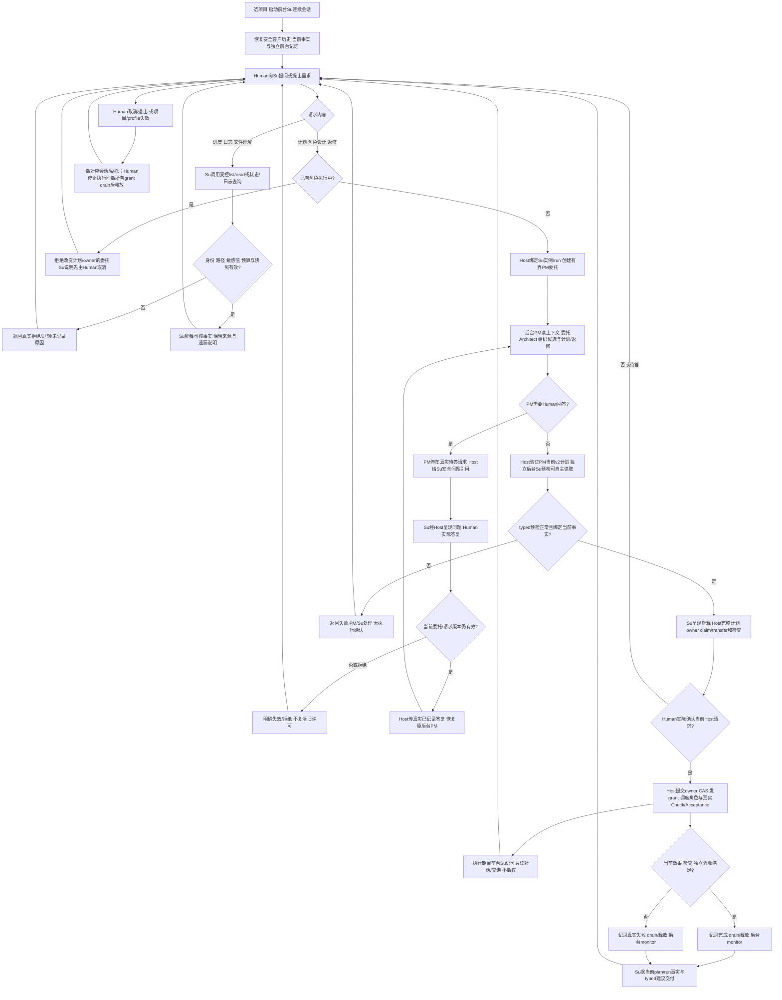
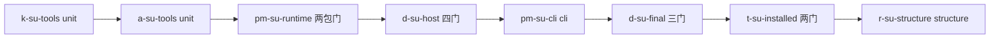

# Su 与客户对话，PM 在后台组织实施

客户运行 `legion chat` 后，连续对话对象为 Supervisor（Su）。客户可在角色正在执行时询问谁在工作、谁被依赖阻塞、哪些文件已实际改变、哪些检查或验收失败；Su 可自主浏览项目普通文件和分页查看各角色的实际行动记录。客户请求开发时，Su 向后台 PM 提出受控委托；PM 组织角色设计、计划、审阅及原角色返修。角色开始实施仍须客户确认 Host 生成的完整计划与归属差异。

成功交付须有真实当前输出、Check、独立 Acceptance，以及已验证的监督结果；Su 据这些事实向客户解释结果。读不到文件、委托或模型失败、等待回答、检查失败、取消等均明确显示实际状态，不补造百分比或完成结论。普通对话、Su 建议或 PM 文本都不发授权。

本文是待跨角色评审的 v0.3 可评审候选。新设计文件已被 Governance 加入 ProjectManager Section 1，仅授权方案准备。应用源码、测试、包和新精确实施配置尚未获批或实施。现有已验证1.0.3包及[旧v2设计](2026-10-10_design_cli-role-owned-files-v2.md)保留原身份；不能把它们的结果当作本文实现证据。

## 1. 当前事实与推荐

当前 `bin/chat.mjs` 把客户消息交给 `sendMessage({roleId:'ProjectManager'})`。`apps/desktop/src/models/workbench.mjs` 的 `workbenchInput` 硬校验该角色；`pipelines/workbench.mjs` 的 `#ensureManager/#startConversation` 承载客户 PM，`sendMessage` 遇活动执行返回 execution_busy，并调用 #invalidate。直接把显示名改成 Su 会保留错误身份与执行中撤权行为。

后台 Su 当前为独立 preflight/monitor Pi 实例，SUPERVISOR_TOOLS 仅含 remember/query/submit_supervision。它没有项目读取工具，runner 把所有请求送给 #controlTool。前台苏需要新独立会话，后台 runner 需要明确的 read 分支。现有 `#readTool` → Policy.evaluateRead → Read Service/Storage 已有普通全项目读取、实例/run、敏感值、路径、文件稳定性、预算与取消守门，可复用。

Host 已有 `getState.roles.activity`、项目 tasks、当前证据/验收和 `memberConversations.runs/events`。事件包含真实工具/status/resource/checkId/time，亦含 assistant_text。Su 应取得前者的安全投影，不能直接获整个 memberConversations 或调用模型自行读取私有日志。`roleMemories` 当前按 roleId 存储，`roleContextSources` 把 PM 客户来源与 Supervisor 的过去监督来源组合；新前台与后台需要明确 channel 分区。

推荐在唯一 Workbench 内增加前台 Su 生命周期及一个后台 PM 委托状态机。复用原 PM/Architect/Acceptance 和 owner 调度，不建立第二套 Pipeline、状态事实库或监控服务。CLI优先，Desktop复用相同API只做入口、身份与现有投影的必要兼容，无新增页面。

## 2. 客户完整流程



Su提供解释，Host提供完整不可删改的确认事实块；客户无需手抄SHA。后台苏预检/monitor建议不代替确认。用户说“取消”只可触发已定义的Human Host操作，不把模型文本作为隐式cancel/grant。

## 3. 会话与执行生命周期

前台Su为 conversation Pi会话，scope.write=[]，工具为既有list/read、remember/query、request_interaction，以及下节三个新控制工具。无write/edit/delete、Check、Shell、submit_supervision、role proposal/review/repair或grant工具。后台preflight/monitor为独立single_run，工具为list/read、remember/query、role activity/log查询与submit_supervision；无PM委托、Human交互或业务效果工具。PM在后台保留其原受控计划、Architect设计、审阅、Human待答桥及返修能力，role owner始终为空。

Host分别登记客户会话、PM委托和监督run，绑定真实project/instance/run/profileVersion/context generation。模型传来的角色名或用途不激活另一权限。Su和PM各有Pi实例、AbortController与日志；不能重播前台历史建立PM或把后台监督历史恢复成客户对话。

**执行中读取是必须行为。** 新Su sendMessage不得沿用旧PM sendMessage的execution_busy或#invalidate。使用独立front turn generation和只读生命周期，不更改active.plan、authorityEpoch、owner generation、task状态或已确认context。文件/日志查询仍检查项目物理身份及当前实例；文件变化返回现有read失败或安全的新读，不把当前观察当旧计划输入证据。

活动执行期间，Su可读、问答和报告；会改计划、角色/owner或安排返修的PM委托返回execution_busy且不产生状态副作用。客户先明确停止当前执行，Host撤权并drain，再讨论新计划并重新确认。普通进度问题、分页查询、前台新turn结束不能取消任务。

`/cancel`、SIGINT和Desktop现有停止按钮需区分前台取消/委托取消与Human停止实施的明示语义；CLI帮助须明确其实际效果。本版建议保留用户显式/cancel停止当前客户turn及其委托，并调用既有stopExecution停止当前项目实施的行为，绝不由Su模型自动执行。/exit和切项目取消前台、委托、后台监督并等待自身所有实例；只在真实提交收束后释放租约，不回滚已成功字节。profile/组织/owner失效保持既有执行失效规则。

## 4. 三个typed控制工具与PM委托

新工具名建议统一为 `legion_delegate_pm`、`legion_query_role_activity`、`legion_query_role_log`，沿用 PiToolRequest → AgentControlDecision/Result。Kernel只增加工具/capability允许列表及纯数据校验；Adapter注册有界schema与描述；效果由Host经公开Service处理，无Provider→Host IO回调。

### 委托请求与响应

初稿请求：

```json
{"payload":{"action":"start","purpose":"plan","instruction":"客户明确要求的有限工作说明","sourceRefs":["human:已记录消息ID"]}}
```

purpose仅plan/role_design/repair；instruction非空≤8192 UTF-8字节，sourceRefs最多32项、每项≤200字符且必须属于本项目当前受信来源。repair还需明确实际acceptanceId/taskId，Host核原owner/原目标/checks/已确认轮次。start不接受projectId/roleId/instanceId/runId/profile/owner/permit、计划确认value或任意工具能力。模型不造委托身份。

暂停PM时，Host向Su返回安全typed数据，例如：

```json
{"kind":"needs_human","delegationId":"Host生成ID","questionRef":"Host待答引用","status":"awaiting_human"}
```

具体使用现有控制工具的新互斥payload分支：

```json
{"tool":"legion_request_interaction","parameters":{"payload":{"questionRef":"Host待答引用"}}}
```

此分支只接受questionRef。现有完整 `{kind,purpose,title,text,options,allowSupplement}` 分支保留给前台Su自己的discussion澄清；后台PM在受控委托内用原完整结构产生私有问题，不直接发布客户请求。两种形状不能混用，Su引用问题时不得提交或改写title/text/options/purpose。Interaction Model新增questionRef分支及Host私有delegation-origin结构，Kernel/Adapter继续用有界纯payload。

Host创建PM私有问题引用，绑定原PM实例/run/toolRequest、delegationId、版本与源问题digest；将PM挂起，将外层delegate结果返回needs_human。Su引用后Host原样生成新的当前公共discussion Interaction，由前台Su呈现。公共请求绑定当前Su实例/run及原PM问题；Host登记的关系不接受模型自报。Su可另加解释，但确认事实块由Host固定呈现。

真正的execute_plan Interaction仍只能由Host在PM候选计划和独立预检通过后生成；任何Su/PM request_interaction的purpose:execute_plan均拒绝。Human经原answerInteraction提交真实value，Host记录answerId/版本/digest并按私有关系生成humanAnswerRef；模型不读取私有Human授权对象。对讨论问题，resume只把该实际已记录答复送回原PM挂起工具；对execute_plan true，唯一执行入口仍是Host当前确认处理，并非delegate/resume。false保留实际拒绝事实，取消该待答或候选，不签发许可。

真实答复落入Host队列后可用resume：

```json
{"payload":{"action":"resume","delegationId":"Host生成ID","humanAnswerRef":"Host已记录实际答案ID"}}
```

Host核当前项目、同一前台Su用途、活跃instance/run、delegation generation及待答问题与答案的一一关系。新前台turn仅可通过Host登记的continuation恢复，不能拿旧run/答案跨委托续接。resume不接受自造answer/value。重复相同resume幂等，冲突重复、错误版本、跨项目、过期、取消均拒绝。

委托状态为running → awaiting_human → running → completed/failed/cancelled/stale。AgentControlResult的completed只说明本次控制请求已返回，内部kind/status仍明确PM是否待答；不能据它宣布开发完成。PM终态返回有限plan_ref/result_ref或安全错误，完整计划/证据从Host读取，不把整个后台prompt/history作为Su工具结果。

同一客户项目一次只激活一个PM委托；后台PM不得再调用delegate_pm，最大委托深度1。单客户turn最多4次start/resume组合中的有效恢复链，超限明确失败而非隐式重试。具体恢复计数与PM轮次由owner评审确认，但不得无界。Pi既有工具等待停表保留；业务SDK预算与Host待Human超时分开，不因客户思考耗尽模型turn预算。

## 5. Su自主读取与真实工作查询

list/read使用现有ProjectReadRequest/Read Service。前台和后台苏各登记read-only RoleBoundary、AgentScope和当前run，runner将READ_TOOLS送#readTool，其余送#controlTool。普通文件读取不受任务writeSet或owner文件子集限制，但受原项目边界、受限文件/凭据路径、链接/别名、UTF-8/文件稳定性、known-key与预算约束；Su不能读取Host userData、租约/私有会话或借Shell绕过。

activity查询输入为有限 `{roleId?, taskId?, planDigest?}`，缺省当前项目当前计划的所有成员；roleId只作为过滤器，不是调用者身份。输出来自当前roles.activity、tasks、ready-set依赖、当前run的Check和Acceptance。返回实际status、blockingTaskIds、phase、observed changes/check/acceptance counts和来源引用；没有时间或进度就返回未记录，不能虚构百分比/预计完成。历史计划显式标记history并与当前结果分开。

log查询输入为 `{roleId, taskId?, planDigest?, cursor?, limit?}`，默认20条、最大50条、单页≤32KiB。Host/Organization Service从已有memberConversations.runs/events及已有任务/委托事件派生安全行动投影：role/task/计划关联、事件类型、工具名、status/reason、安全resource/checkId、成功/拒绝/失败/取消、时间与实际来源引用。排除assistant_text、私有prompt/summary、工具参数及原始结果正文、密钥、私有授权/nonce和其他角色原会话。长度不足返回nextCursor/omitted说明，不能用截断后的半项冒充完整事件。

cursor绑定project、过滤器、plan与被查询snapshot（revision/digest及位置）。记录变化使cursor不再符合绑定时返回stale_cursor，Su刷新安全快照，不把前后页拼成同一证据。所有角色包括后台PM的工作步骤须用既有journal记录；当前memberConversations拒绝PM角色，需owner调整其用途/校验，记录PM委托的开始、角色设计、审阅、候选、待答、失败/取消及终态。新增的委托记录仅存真实协议状态/绑定，不另存同一份任务进度事实，不复制日志库。

前台与后台苏都可读该安全投影，不能append/update他人的日志。Model做纯投影，公开Organization Service加载既有记录并校验actor/project/filter/snapshot，Pipeline只消费公开Service。getState复用同一模型投影规则，避免UI、Su和PM各推导一套进度。输出≤32KiB以及分页limit默认值属于必须的预算建议，最终由Kernel/Host共同固定；不是扩宽原64KiB输入或2MiB读取上限。

## 6. Profile来源、四channel与确定迁移

### 独立连接与Shell审核

前台Su由新增Host内部customerProfile解析：优先Supervisor项目映射，随后可信environment/defaultProfile；没有可用连接时返回profile_missing并提示客户设置，不能静默拿后台会话的credentials或实例。

后台PM委托由pmProfile解析：优先ProjectManager项目映射、其次有效的原project.manager.profileId（保留兼容的PM配置）、随后可信environment/defaultProfile。PM与Su即使选同一连接也分别resolve和创建独立实例、session、run与profileVersion绑定，私有key只在Host集合流转。

工人触发的PM Shell review是原授权计划中的独立审批能力：Host用pmProfile创建仅legion_review_shell的专用PM实例，绑定原请求/任务/plan/owner/准备快照。它无需前台Su存在或当前delegate记录，不能等Su委托才合法；也不借前台Su credentials、工具或历史。原逐条PM审核与Kernel真正执行/发布规则不变。其实际步骤记入原Shell workflow及安全PM行动journal；使用Host短期审批绑定，不恢复或写入pm_delegate私有checkpoint/summary。审批结果是当前请求的typed决定，不是委托会话。

模型不能指定Profile、凭据或审批实例。显式设置连接的Human操作保持当前saveProfile加密凭据例外及metadata守门；对话/委托/日志没有该例外。

### 持久结构

选择唯一可执行路径：**不改History六层，不改Kernel owner catalog/project schema2。** 已读History公开load/save合同；save固定roleId:ProjectManager，不能拿它存Su。Pipeline仅load旧PM History作标明来源的只读历史，并停止#saveConversationProjection向旧History保存任何新Su或新后台PM消息。其旧文件原字节与当前API保持，迁移/重启也不调用History.save。

新客户timeline、PM委托journal与channel checkpoint的事实来源统一放现有Organization持久域：Organization域根从schemaVersion1迁到2，保留原PM timeline为只读旧客户来源，新增customerTimeline（Su客户timeline，显式schemaVersion2/actor）与delegations（显式schemaVersion1）；roleMemories从schemaVersion1按roleId键迁到schemaVersion2按(roleId,channel)键。不会另建同样任务状态/日志的存储。Checkpoint仍从实际安全sources投影重建PiConversationHistory，不持久化SDK工具/grant对象。

前/后台四channel固定为su_customer、pm_delegate、supervision_preflight、supervision_monitor；普通成员使用member_task，均由Host registry指定。PM Shell review使用Host短期审批绑定，不混入pm_delegate私有记忆；角色身份及事实作者不变。旧roleMemories完整v1原值置于只读legacy档案，不猜测旧Supervisor摘要来自preflight还是monitor，不复制到新前台。允许从安全的实际旧PM客户Human/公开回复构造标记历史的数据源；不重放旧队列、工具或肯定答复。

Organization的新customerTimeline保存新Su消息/turn和实际Human答案；pm_delegate经已有memberConversations记录PM行动。memberConversations仅放宽为允许Host登记的后台PM委托/审批run，不把前台客户聊天伪装成其他角色日志。旧PM客户timeline原值只读保留在原timeline，公共history/turn从当前customerTimeline投影，仍用现有user/assistant有限格式。getState/wire不暴露私有checkpoint、PM原文或legacy私有摘要；旧公开客户历史可明确标“历史PM客户对话”阅读。

固定职责只更新Supervisor为客户入口、项目/工作事实读取、后台PM委托与独立监督。ProjectManager现有“讨论需求、审批角色提案、形成计划、安排原角色返修并汇报真实结果”在后台仍成立，**不改其字面职责**。新legacy validator保留旧Supervisor精确合法值及旧digest规则，验证完整旧组织后才能一次CAS更新Su职责/成员revision/digest；非法旧purpose/boundary不被覆盖成合法值。

### 迁移顺序与失败

1. 暖入当前连接known-key集合，只读验证旧Project/schema2、Organization v1和History原格式/固定职责/digest/物理身份。必须先按旧字段及旧Supervisor精确职责验证；已有key污染、非法旧职责或预算问题直接拒绝，不先复制后清理。
2. 获取原共享物理项目lease，核来源/holder，撤销并drain本Host旧客户、委托、成员及PM Shell审批实例；旧pending讨论/执行/成员/Shell审批记录在新域标invalidated/interrupted。保留真实完成/失败结果，旧true只当历史事实。History只load，不调用save。
3. 内存构造Organization v2：原PM timeline保持只读，新customerTimeline为空；delegations为空；roleMemories v2按(roleId,channel)唯一，旧v1完整存只读档案。使用新合法Su固定职责更新对应member revision及organization revision/digest；PM字面职责不变。项目及owner catalog仍schema2，project.manager仍后台PM身份，无新owner映射或generation。
4. 公开Organization Service用读取到的**旧原始digest**调用现有JSON Provider CAS，提交完整新v2域。不能拿迁移后重算digest作expectedDigest。Provider既有临时文件/rename/目录同步流程与接口原样复用，本版不改Provider。
5. 新organization revision/digest使旧plan绑定不再有效；Host在任何dispatch/确认恢复前核组织版本，新前台激活前按原失效处理将旧pending计划留作invalidated历史。任何中断重启都先核Org/plan绑定，不复活旧许可。只有当前v2域合法且失效流程收束后才激活新客户channel；新PM待答必须来自本版委托。

验证、准备、CAS或rename前失败：原Org/History/Project字节保持，清本次临时数据，无新实例/grant。rename已成功而目录sync失败：不谎称字节回滚；关闭新会话/权限，下次读取按已提交v2及当前组织版本恢复。CAS竞争失败重新读取后再构造，不覆盖较新来源。旧已成功业务字节/旧PM History均不删改；失效的旧许可绝不作为回滚结果恢复。项目plan失效沿既有Project API处理，不新增schema或Project实现参数，也不虚称多文件事务。

旧pending讨论问题仅历史可见、不能直接续答。客户需要继续旧问题时，Su以原问题作为历史来源向Host创建全新的discussion请求/版本；Host登记旧来源标签，实际新答案成为新Human事实。不存在原PM live delegation时，不恢复其旧工具等待者；必要时由Su发新的PM委托。

### 预算与来源

保留完整Human来源、65536字节prompt硬上限、128条checkpoint、摘要8192等守门。新Su/PM问题答复登记真实来源，execute_plan答案不进入可恢复权限。前/后台私有channel隔离，普通remember/query分类事实继续按原项目/作者/source/revision规则共享；Su不获得改他人事实或日志的权限。

instruction≤8KiB、sourceRefs≤32、日志默认20/最大50/页≤32KiB；每run及关联委托链累计读取/查询≤2MiB，不以子实例重置绕过。前台/PM沿现Pi conversation标准预算，后台预检/monitor保留当前小预算与工具等待停表。过限明确失败，不截断当前Human或隐藏完整授权事实。所有新路径沿known-key/跨delta/终态合并/写前校验；原编码值/外部TOCTOU/child自构限制不扩大。

## 7. 精确实施候选与配置缺口

以下仅为待Human审阅的新精确配置输入，**不是现行源码授权**。均优先使用现有文件，不改旧已批准设计或冻结包。每个数组项是单个project-relative authored路径；未列源码只读。History六层、History tests、Project Service/Provider、Memory三层、Organization Provider及Kernel Read/Storage在本方案中只读，不泛增其权限。

### KernelEngineer

仅注册三个control tool/capability与纯数据/既有read契约回归；unit检查。

```json
[
  "src/kernel/models/agent.mjs",
  "src/kernel/models/core.mjs",
  "tests/kernel/test_agent_models.test.mjs",
  "tests/kernel/test_agent_scope.test.mjs",
  "tests/kernel/test_control_memory.test.mjs",
  "tests/kernel/test_project_read.test.mjs",
  "docs/roles/KernelEngineer/api-spec.md",
  "docs/roles/KernelEngineer/changelog.md",
  "docs/roles/KernelEngineer/docs/feature/cli-controls.md"
]
```

### AgentAdapterEngineer

pi_session的schema/描述与三协议/取消/用途scope；沿现unit五文件。

```json
[
  "src/adapters/providers/impl/pi_session.mjs",
  "tests/adapters/test_control_tools.mjs",
  "tests/adapters/test_memory_supervision_tools.mjs",
  "tests/adapters/test_pi_provider.mjs",
  "tests/adapters/test_pi_service.mjs",
  "tests/adapters/test_proposal.mjs",
  "docs/roles/AgentAdapterEngineer/api-spec.md",
  "docs/roles/AgentAdapterEngineer/changelog.md",
  "docs/roles/AgentAdapterEngineer/docs/feature/cli-controls.md"
]
```

### DesktopEngineer

Model承担Org v2、channel、精确interactionRef与安全查询；Pipeline承担委托/生命周期/Profile/迁移；Org Service复用既有Provider的原始digest CAS；renderer只适配已有客户入口；main/wire复用现有共享Model校验。Project/History/Memory Service与Provider、Organization Provider及GUI main/preload本版只读；普通fact域格式不变。

```json
[
  "apps/desktop/src/models/desktop.mjs",
  "apps/desktop/src/models/workbench.mjs",
  "apps/desktop/src/models/interaction.mjs",
  "apps/desktop/src/models/organization.mjs",
    "apps/desktop/src/pipelines/workbench.mjs",
  "apps/desktop/src/services/abstract/organization.mjs",
  "apps/desktop/src/services/public/organization.mjs",
  "apps/desktop/src/services/impl/organization.mjs",
  "apps/desktop/src/interface/renderer.mjs",
  "apps/desktop/tests/unit/organization-model.test.mjs",
  "apps/desktop/tests/unit/interaction-model.test.mjs",
  "apps/desktop/tests/unit/organization.test.mjs",
  "apps/desktop/tests/unit/workbench-model.test.mjs",
  "apps/desktop/tests/unit/workbench.test.mjs",
  "apps/desktop/tests/unit/acceptance.test.mjs",
  "apps/desktop/tests/unit/memory.test.mjs",
  "apps/desktop/tests/unit/project.test.mjs",
  "apps/desktop/tests/unit/pipeline.test.mjs",
  "apps/desktop/tests/unit/ipc.test.mjs",
  "apps/desktop/tests/unit/parallel-scheduler.test.mjs",
  "apps/desktop/tests/unit/shell-publication.test.mjs",
  "apps/desktop/tests/unit/shell-review.test.mjs",
  "docs/roles/DesktopEngineer/api-spec.md",
  "docs/roles/DesktopEngineer/changelog.md",
  "docs/roles/DesktopEngineer/feature-map.md",
  "docs/roles/DesktopEngineer/docs/feature/cli-project-host.md"
]
```

### ProjectManager

中间tar仅七包文件；最终CLI及当前文档按上述总体合同。新change路径需要Governance补Section1。

```json
[
  "bin/chat.mjs",
  "bin/legion.mjs",
  "README.md",
  "package.json",
  "package-lock.json",
  "tests/cli/test_chat.test.mjs",
  "tests/package/test_package.mjs",
  "apps/desktop/package.json",
  "apps/desktop/package-lock.json",
  "apps/desktop/scripts/verify-dependencies.mjs",
  "apps/desktop/tests/package/desktop-package.test.mjs",
  "docs/roles/ProjectManager/api-spec.md",
  "docs/roles/ProjectManager/changelog.md",
  "docs/roles/ProjectManager/docs/architecture.md",
  "docs/roles/ProjectManager/feature-map.md",
  "docs/roles/ProjectManager/docs/feature/cli-project-workflow.md",
  "docs/roles/ProjectManager/docs/change/2026-10-11_change_supervisor-frontdoor-global-read.md"
]
```

### Tester

真实生产Su安装13类流及旧强回归，改既有fixture路由而非删除失败门，无新GUI验收。

```json
[
  "tests/integration/test_cli_installed_flow.mjs",
  "tests/integration/test_generic_agents.mjs",
  "tests/integration/test_permission_flow.mjs",
  "tests/integration/test_check_flow.mjs",
  "tests/integration/test_shell_flow.mjs",
  "apps/desktop/tests/integration/workbench-flow.test.mjs",
  "apps/desktop/tests/integration/governed-workflow.test.mjs",
  "apps/desktop/tests/integration/shell-workflow.test.mjs",
  "docs/roles/Tester/docs/verification-cli-v1.md",
  "docs/roles/Tester/changelog.md"
]
```

### Reviewer

独立层/工具/日志投影/前后台隔离/迁移/包/权限检查，报告当前新候选。

```json
[
  "tests/reviewer/test_cli_boundaries.mjs",
  "tests/reviewer/test_structure.mjs",
  "tests/reviewer/test_shell_boundaries.mjs",
  "apps/desktop/tests/reviewer/workbench-boundaries.test.mjs",
  "apps/desktop/tests/reviewer/governed-workflow-boundaries.test.mjs",
  "apps/desktop/tests/reviewer/shell-workflow-boundaries.test.mjs",
  "docs/roles/Reviewer/docs/review-cli-v1.md",
  "docs/roles/Reviewer/changelog.md"
]
```

### Governance必须处理的精确差异

- 已授DOCUMENT_PREPARATION_ONLY的新设计仅纳入新config.designFiles作冻结输入，不列ProjectManager实施role.writeFiles；worker不得修改获批设计，这不自动授源码写入。
- 新PM变更文档 `docs/roles/ProjectManager/docs/change/2026-10-11_change_supervisor-frontdoor-global-read.md` 是唯一新增author文件，需精确补PM Section1后列新配置。
- GUI main/preload现有操作仍使用共享workbenchInput/governedWireDTO与原API，无新增IPC方法或页面；本版不增加其writeFiles。
- History六层、Project/Memory服务与Provider、Org Provider及GUI main/preload不增加到新writeFiles；无新Source角色、新日志库或新owner catalog schema。
- Governance更新Supervisor系统职责/角色说明与调度规范，新Root配置逐项核现有Section1和唯一owner。每角色效果目录沿原 `.ans/runtime/legion-cli-role-owned-v2/<role>/` 已授精确子目录建立su-frontdoor鲜子run，旧产物不覆盖；新task_ops记录路径由Supervisor/Governance核其记录边界。

## 8. 必须项、可选项与验证门

必须项：唯一Su客户入口；前/后台自主普通项目read；执行中无撤权的只读问答；绑定有界PM委托及真实Human接续；Host完整确认/独占授权；现有真实状态/分页行动日志；四channel隔离；旧历史只读与确认不重放；known-key/路径/预算/取消保护；CLI+必要Desktop兼容；fresh包与独立验收。

可选项均不在初稿推荐实施范围：O1多条PM委托并行（增加实例/答案路由复杂度）；O2额外实时进度界面/新页面（增加UI工作）；O3全项目索引/读取缓存（增加事实失效/持久面）；O4后台定时监控服务（增加生命周期成本）。不以默认勾选当批准。

门顺序：①各owner只读评审并修订本设计/精确范围，Human批准；②Kernel工具/capability纯契约；③Adapter三协议注册/拒绝；④PM中间runtime及Desktop依赖；⑤Host Su read/状态日志安全投影、前/后台/channel迁移、委托/问答/取消与执行中只读；⑥PM最终真实安装CLI/README及Desktop调用方重验；⑦Tester完整流与Reviewer独立权限/分层/包身份。依赖变动后重验调用方，不套用旧通过。

关键验收：

- Su在没有任何owned业务文件时读多个角色普通文件；拒绝受限路径、链接、跨项目、known-key和超预算；后台preflight/monitor亦可真实读。
- 运行中的两个owner保持真实授权/并行，Human连续问Su进度、阻塞原因、分页日志和文件；证明query未调用invalidate、未改owner/任务、未停止现有run。
- Su/后台监督无Mutation/Check/Shell/grant；后台无delegate/客户问答；直接PM客户消息拒绝；错误目的、伪caller、过期/跨项目/循环或重复冲突委托拒绝。
- PM待答→Su呈现→实际Human答复→原委托恢复；执行计划仅当前Host请求true生效；普通yes/旧答案/Su自造answerRef不执行；等待Human不发生委托死锁。
- 进度/日志只来自真实角色与task/plan/run证据；保留失败/取消/未记录、分页stale_cursor；raw assistant_text/prompt/工具正文/私有摘要/key不得进入Su结果；Su不能写其他角色日志。
- 前台与后台Su隔离checkpoint/摘要/source集合；PM私有历史不冒充客户会话；取消任何委托晚回调拒绝、Human停止执行撤全部grant并drain，关闭/重启无历史许可复活。
- 三协议真实npm隔离消费者从生产bin完成Su多轮、PM委托、Architect、Human完整owner确认、不同owner并行/同role串行、真实Check/Acceptance/返修、查询与最终Su交付。随机已知key负例核全持久面和输出；默认共享lease只清本fixture身份匹配项。
- 新格式迁移核旧原字节/备份、digest与CAS，旧pending确认失效；版本/组织/profile/owner变化后旧委托无效。无新页面，必要Desktop入口与已有强回归通过。

Desktop、Adapter、Kernel三owner独立只读评估已完成并采纳；确定合同、文件清单及固定命令已收敛，目前仅待Root项目配置review与Human确认设计及新配置。暂无新实现或验证结论。

## 9. 固定检查与依赖DAG候选

下列check ID及其精确argv沿新配置固定，单门timeout300秒、Node --test-concurrency=1；不是批准前可运行命令。Kernel/Adapter/Tester/Reviewer argv沿当前key-guard配置原强门，Desktop沿当前owner/host/headless/parallel原强门，PM沿runtime_package/desktop_dependency/cli；新行为加入上述已列测试，不能以旧通过证据替代。

| 节点 | Owner | 前置节点 | 固定check IDs | 实際门槛 |
| --- | --- | --- | --- | --- |
| k-su-tools | KernelEngineer | 无 | unit | 三control tools/capability、read正反对照、无write/check/shell scope |
| a-su-tools | AgentAdapterEngineer | k-su-tools | unit | 三协议schema/拒绝、前后台tools、取消/恢复 |
| pm-su-runtime | ProjectManager | a-su-tools | runtime_package, desktop_dependency | fresh桥包真实pack/隔离消费，Desktop精确依赖身份；不跑未接线Su全流 |
| d-su-host | DesktopEngineer | pm-su-runtime | headless, owner, host, parallel | Org v2/channel迁移、questionRef与Profile、读/查询、执行中无撤权、Host唯一Human授权和强回归 |
| pm-su-cli | ProjectManager | d-su-host | cli | production bin Human↔Su↔PM真实全流、README、fresh最终闭包/安装及key负例 |
| d-su-final | DesktopEngineer | pm-su-cli | owner, host, parallel | 真实最终tar调用方复核及产品字节/安装身份匹配 |
| t-su-installed | Tester | d-su-final | installed, regression | 独立生产Su消费者、多轮/读/日志/委托待答/迁移/执行中问答/串并行/返修/取消/隔离 |
| r-su-structure | Reviewer | t-su-installed | structure | 当前新候选的结构、权限、schema/日志/上下文隔离与包身份独立核查 |



建议桥包版本 `1.1.0-bridge.1`，最终版 `1.1.0`。都在PM原packaging批准子树的su-frontdoor鲜目录创建不可覆盖tar；最终重新计算Node相对闭包，不复用桥包Host快照。Desktop manifest/lock/installed版本、resolved/integrity/sourceHashes必须对应当前tar。旧1.0.3和证据只读。正式新配置仍须Human确认具体版本/范围；版本建议不是已生成包。

### 拟固定argv逐项

**KernelEngineer.unit**

```json
{
  "argv": [
    "node",
    "--test",
    "--test-concurrency=1",
    "tests/kernel/test_agent_models.test.mjs",
    "tests/kernel/test_agent_runtime.test.mjs",
    "tests/kernel/test_agent_scope.test.mjs",
    "tests/kernel/test_check_models.test.mjs",
    "tests/kernel/test_check_provider.test.mjs",
    "tests/kernel/test_check_service.test.mjs",
    "tests/kernel/test_demo.test.mjs",
    "tests/kernel/test_events.test.mjs",
    "tests/kernel/test_models.test.mjs",
    "tests/kernel/test_mutation.test.mjs",
    "tests/kernel/test_policy.test.mjs",
    "tests/kernel/test_project_read.test.mjs",
    "tests/kernel/test_shell_models.test.mjs",
    "tests/kernel/test_shell_provider.test.mjs",
    "tests/kernel/test_shell_service.test.mjs",
    "tests/kernel/test_workbench_models.test.mjs",
    "tests/kernel/test_control_memory.test.mjs"
  ],
  "timeoutSeconds": 300
}
```

**AgentAdapterEngineer.unit**

```json
{
  "argv": [
    "node",
    "--test",
    "--test-concurrency=1",
    "tests/adapters/test_control_tools.mjs",
    "tests/adapters/test_pi_provider.mjs",
    "tests/adapters/test_pi_service.mjs",
    "tests/adapters/test_proposal.mjs",
    "tests/adapters/test_memory_supervision_tools.mjs"
  ],
  "timeoutSeconds": 300
}
```

**ProjectManager.runtime_package**

```json
{
  "argv": [
    "node",
    "--test",
    "--test-concurrency=1",
    "tests/package/test_package.mjs"
  ],
  "timeoutSeconds": 300
}
```

**ProjectManager.desktop_dependency**

```json
{
  "argv": [
    "node",
    "apps/desktop/scripts/verify-dependencies.mjs"
  ],
  "timeoutSeconds": 300
}
```

**ProjectManager.cli**

```json
{
  "argv": [
    "node",
    "--test",
    "--test-concurrency=1",
    "tests/package/test_package.mjs",
    "tests/cli/test_chat.test.mjs",
    "apps/desktop/tests/package/desktop-package.test.mjs"
  ],
  "timeoutSeconds": 300
}
```

**DesktopEngineer.headless**

```json
{
  "argv": [
    "node",
    "--test",
    "--test-concurrency=1",
    "apps/desktop/tests/unit/environment-profiles.test.mjs",
    "apps/desktop/tests/unit/project-lease.test.mjs"
  ],
  "timeoutSeconds": 300
}
```

**DesktopEngineer.owner**

```json
{
  "argv": [
    "node",
    "--test",
    "--test-concurrency=1",
    "apps/desktop/tests/unit/workbench-model.test.mjs",
    "apps/desktop/tests/unit/organization-model.test.mjs",
    "apps/desktop/tests/unit/organization.test.mjs",
    "apps/desktop/tests/unit/project.test.mjs",
    "apps/desktop/tests/unit/pipeline.test.mjs",
    "apps/desktop/tests/unit/workbench.test.mjs",
    "apps/desktop/tests/unit/acceptance.test.mjs",
    "apps/desktop/tests/unit/ipc.test.mjs",
    "apps/desktop/tests/unit/shell-publication.test.mjs",
    "apps/desktop/tests/unit/shell-review.test.mjs"
  ],
  "timeoutSeconds": 300
}
```

**DesktopEngineer.host**

```json
{
  "argv": [
    "node",
    "--test",
    "--test-concurrency=1",
    "apps/desktop/tests/unit/organization-model.test.mjs",
    "apps/desktop/tests/unit/interaction-model.test.mjs",
    "apps/desktop/tests/unit/organization.test.mjs",
    "apps/desktop/tests/unit/workbench-model.test.mjs",
    "apps/desktop/tests/unit/workbench.test.mjs",
    "apps/desktop/tests/unit/acceptance.test.mjs",
    "apps/desktop/tests/unit/memory.test.mjs"
  ],
  "timeoutSeconds": 300
}
```

**DesktopEngineer.parallel**

```json
{
  "argv": [
    "node",
    "--test",
    "--test-concurrency=1",
    "apps/desktop/tests/unit/parallel-scheduler.test.mjs",
    "apps/desktop/tests/unit/workbench.test.mjs",
    "apps/desktop/tests/unit/project.test.mjs",
    "apps/desktop/tests/unit/pipeline.test.mjs"
  ],
  "timeoutSeconds": 300
}
```

**Tester.installed**

```json
{
  "argv": [
    "node",
    "--test",
    "--test-concurrency=1",
    "tests/integration/test_cli_installed_flow.mjs"
  ],
  "timeoutSeconds": 300
}
```

**Tester.regression**

```json
{
  "argv": [
    "node",
    "--test",
    "--test-concurrency=1",
    "tests/integration/test_generic_agents.mjs",
    "tests/integration/test_permission_flow.mjs",
    "tests/integration/test_check_flow.mjs",
    "tests/integration/test_shell_flow.mjs",
    "apps/desktop/tests/integration/workbench-flow.test.mjs",
    "apps/desktop/tests/integration/governed-workflow.test.mjs",
    "apps/desktop/tests/integration/shell-workflow.test.mjs"
  ],
  "timeoutSeconds": 300
}
```

**Reviewer.structure**

```json
{
  "argv": [
    "node",
    "--test",
    "--test-concurrency=1",
    "tests/reviewer/test_cli_boundaries.mjs",
    "tests/reviewer/test_structure.mjs",
    "tests/reviewer/test_shell_boundaries.mjs",
    "apps/desktop/tests/reviewer/workbench-boundaries.test.mjs",
    "apps/desktop/tests/reviewer/governed-workflow-boundaries.test.mjs",
    "apps/desktop/tests/reviewer/shell-workflow-boundaries.test.mjs"
  ],
  "timeoutSeconds": 300
}
```


## 10. 独立owner评审状态

Kernel只读评估确认仅agent/core工具/capability注册；Read/Policy/Provider可复用，普通项目跨角色读取不取owner写scope；Host须明确不授Check/Shell。Adapter只读评估确认三typed控制工具、现Pi外壳足够且无Provider→Host回调，delegate仅可信前台，activity/log前后台都可用。

已吸收Desktop指出的execution_busy/#invalidate、按roleId混用记忆、Project/History/Organization影响与严格question/profile来源问题；Desktop独立只读评估已确认上述确定最小路径：Org外层v2/customerTimeline/delegations、roleMemories内层v2与五用途channel；旧原始digest一次CAS及rename后恢复；History/Project/Memory三层/Org Provider/GUI main与preload/Kernel Read只读。已据此收窄本v0.3，实施时严格沿已评估接口。主代理/仓库Supervisor据此形成精确配置；没有Human批准、源码任务或新检查通过结论。
