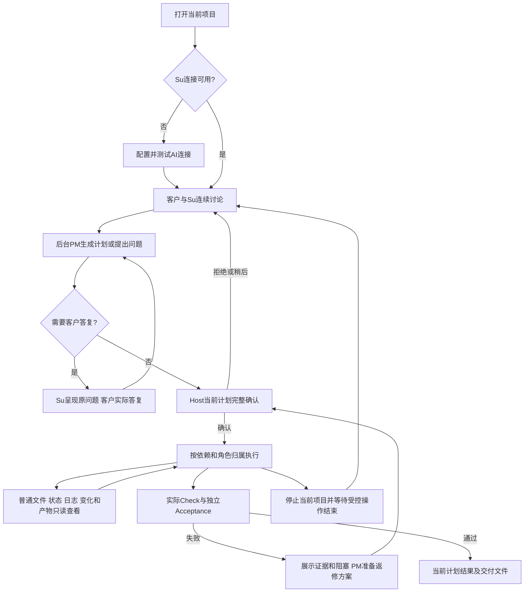
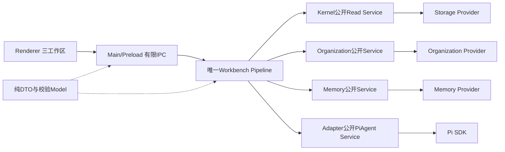
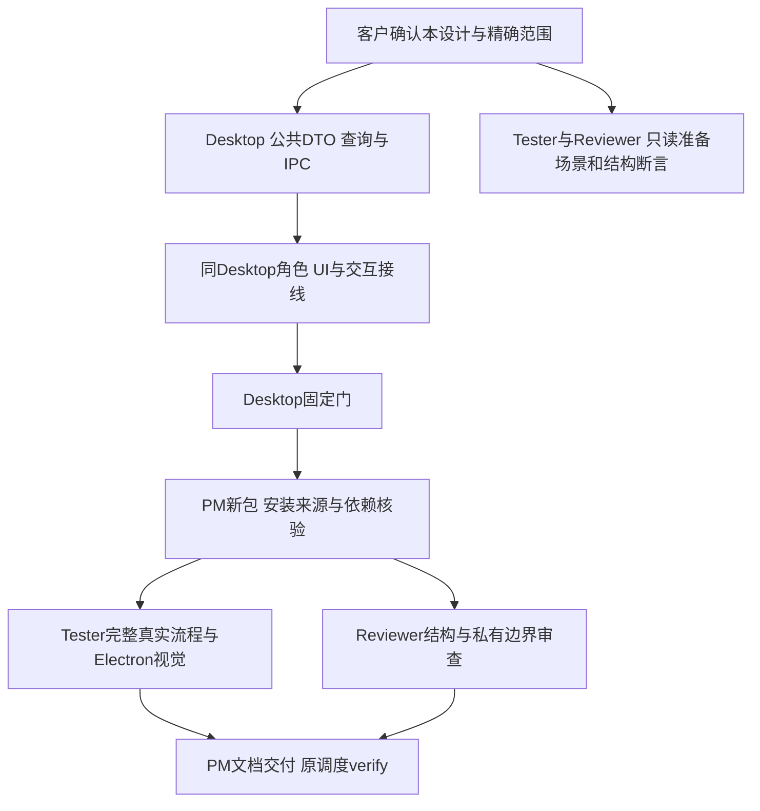

# 桌面项目指挥台设计 v0.3

日期：2026-10-12。作者及管理评审：ProjectManager。状态：具体方案准备完成，推荐确认后实施；源码、GUI 和新测试尚未开发或验收。本设计依据[本次需求与准备范围](../../../../../.ans/decisions/legion-desktop-command-center-v1-requirement-and-scope.md)，复用当前 1.1.3 [CLI 工作流](../feature/cli-project-workflow.md)，不以旧暂停 GUI 成绩代替本次验收。

## 1. 客户场景与交付目标

客户打开项目，告诉 Su：“帮我完成这个功能”。Su 与客户讨论，后台 PM 设计职责、文件归属和任务依赖；有疑问时经 Su 请求客户答复。客户审阅当前完整计划并确认执行后，能同时看到项目文件、真实修改和产物、角色工作与依赖阻塞、检查和独立验收。执行中客户仍可问 Su：“哪一项卡住了？”或者打开文件阅读。

第一版交付一个可实际启动的桌面指挥台：选项目 → 配连接 → Su 讨论 → PM 问答 → 当前 Human 确认 → 按依赖并行执行 → 查看真实变化与验收 → 失败返修或取消后继续。客户不需要打开各角色聊天窗口；角色身份和权限在后台持续保存。

## 2. 已读源码与实际差距

源码基线：`apps/desktop/src/interface/{index.html,renderer.mjs,styles.css,main.mjs,preload.cjs}`、`apps/desktop/src/pipelines/workbench.mjs`、`apps/desktop/src/models/{workbench,interaction,memory}.mjs`、Organization/Memory/Project 的公开 Service 与实现、Kernel 公开 Read Service。包当前依赖 `legion-runtime` 1.1.3，Pi SDK/pi-ai 1.0.4、Electron 44.6.0。桌面包自身仍为 0.2.0，不能把 runtime 版本当桌面发布版本。

| 已有事实 | 本次拟完成 |
| --- | --- |
| 唯一 Workbench Pipeline 已支持 Su 客户轮、PM 委托、Host 确认、并行执行、取消、分类事实及监督 | 保留并作为桌面唯一运行入口，增加面向客户的有限只读查询 |
| renderer 已用 Supervisor 发送，但界面仍以单聊天与任务抽屉为主 | 明确 Su 连续入口、项目工作区、角色运行区，按任务进度组织信息 |
| 公共 IPC 仍只覆盖 getState、选择项目、连接、对话、上下文、确认、取消等既有操作 | 增加普通项目文件列表/预览、角色状态/分页行动日志、分类事实、真实修改/产物分页查询 |
| roleLogPage 已过滤 assistant_text/host_briefing，默认20、最多50项、每页≤32KiB，游标绑定来源快照 | 复用该纯模型与检查，不能用当前成员聊天页充当工作日志 |
| 当前 governedDTO/wireDTO 仍向 renderer 传 member_task 原始回复与 briefing；旧页面允许查看原始回复 | 从 Host→公开 DTO 边界移除私有会话，所有客户查询只返回明确字段的事实投影 |
| roleMemory DTO 仅包含恢复记忆元信息；MemoryService.query 是模型角色调用，还可能写入 stale 修订 | 增加独立客户只读事实入口，计算有效性但不写记忆、不伪造 Su 模型身份 |
| 文件页仅展示选中上下文/owner，缺少普通项目浏览器 | 浏览与 selectContext 分离，执行中浏览不修改固定上下文或计划 |

DesktopEngineer 独立只读评估已确认上述差距与新增客户查询可复用原Core ReadService，无需Kernel/Adapter新增接口（2026-10-12，向本管理上下文回报）；其评估不是源码完成或客户授权。内核无需新增授权类型，Adapter 不新增工具或第二会话；本设计主要变更 Desktop 公共投影、只读入口与 UI，由 PM 集成包并安排独立 Tester/Reviewer。

## 3. 信息架构与布局

### 3.1 三个工作区

顶部固定显示当前项目、实际计划状态、正在运行/等待/失败数量、待答复提示、AI 连接入口和停止动作。状态来自 Host；不显示虚构进度百分比或把模型文字当执行完成。

1. **Su 对话区**：完整客户消息、Su 回复、PM 转达的原问题、待答复卡片、输入框。保持连续，切换工作区不丢输入或滚动位置。后台 PM、RoleArchitect 与工作角色不成为客户发送入口。
2. **项目工作区**：文件、实际变更与产物、检查/验收三个页签。点击文件在只读预览中打开；点击变化定位当前文件及所属任务；失败检查可跳到关联角色/任务。仅有计划文件但尚未真正写入时明确标“计划涉及，未观察到变更”。
3. **角色运行区**：角色列表与状态、任务依赖、分页工作日志、分类记忆。选角色显示职责、所属文件和关联任务；从阻塞卡片定位上游；“记忆”只展示可共享事实，不展示私有恢复摘要。

宽屏默认三工作区，Su 占约40%、项目约35%、角色约25%，各区有独立滚动和明确最小宽度。≤1280px 采用 Su+当前工作区两列，角色区可折叠侧栏；≤900px 使用 Su/项目/角色顶层页签及全宽内容。第一版不强制所有窗口同时三列。折叠有可发现按钮和未读/待答复状态；焦点、文本选区、滚动和未提交答案不能被轮询重建破坏。

现有深浅主题可保留，标题和品牌统一为 Legion 项目指挥台，不借原 Handwell 品牌暗示新发行。连接设置是独立设置页/对话框；角色数量多时列表滚动，不推挤客户输入框。键盘可达、可见焦点、Escape 关闭只读详情，确认与拒绝操作可清楚区分。

### 3.2 工作流



## 4. 完整交互与失败分支

| 入口 | 成功时 | 失败与边界 |
| --- | --- | --- |
| 打开项目 | 选择文件夹，经原 selectProject 加载角色归属和项目私有数据 | 目录/租约来源错误显示安全原因；不猜测删除锁，不自动换私有目录接管项目 |
| 设置连接 | 复用 Profiles 三协议、连接测试和既有加密保存 | 测试失败保留非秘密输入；密钥不进入状态、IPC响应或日志。桌面已明确保存凭据的能力沿原 safeStorage，不能拿CLI的ENV方案替换 |
| Su 讨论 | sendMessage(Supervisor)并展示 customerTimeline | 单轮模型忙显示可诊断状态；执行中只读讨论可用；改计划/owner请求需先停止后重新确认 |
| PM 问答 | 原 question/choice 通过Su呈现；保留完整文字/optionId/补充 | 关闭是稍后答复，未授权执行；请求更新后保留该请求草稿但标失效，不把旧答复转用 |
| 当前计划确认 | 展示完整目标、角色职责/连接、任务/依赖/检查/Acceptance、当前归属与所有claims/transfers，再提交精确requestId/version/digest | 只选择当前planDigest及organization/context/profile的有效确认，优先最新。stale_interaction/interaction_invalidated/stale_file_owners仅排除该精确旧请求并显示新请求；organization_busy可重试，不重复利用yes |
| 执行中浏览 | 普通文件只读、角色状态和分页日志不改变plan/context/owner、活动generation或grant | 非当前项目响应丢弃；目录变化/失效游标显式刷新，不改写上下文以“修复”浏览错误 |
| 停止并继续 | 用户可停止当前项目（取消客户轮/委托并停止执行），显示“正在停止”直到真实drain结束；成功写入保留 | 晚到模型结果不能恢复旧许可；取消后的partial仅存原私有journal，不进客户/恢复历史。同Host新消息产生真实新轮 |
| 文件查看 | 当前普通文件，版本/摘要、行区间、分页/截断说明，归属可见 | 缺失/删除/二进制/过大/符号链接/受保护资源以真实状态表示，不把错误变空文件 |
| 修改/产物 | 按当前plan/task/run展示已观察Mutation、发布资源及实际生成快照，关联检查与验收 | planned不等于written；失败、partial、缺失和过期分别标记；未有保存基线正文时不生成伪造diff |
| Check/Acceptance | 显示executed/status/testCount/输入摘要、真实证据引用和独立验收结果 | 未运行显示未运行；旧run、旧输入或过期证据不标当前通过；Shell退出0不能替代Check |
| 依赖阻塞 | 显示阻塞taskIds、各上游真实状态、对应Check/Acceptance失败 | 无记录显示未知，不能由聊天推断已完成；仅待依赖不误报角色失败 |
| 分页日志 | 默认20最多50/32KiB，角色/任务/计划筛选，下一页绑定固定快照 | 筛选/项目变化清游标；stale_cursor明确重新加载，保留阅读位置，不无限重试 |
| 分类记忆 | pitfall/decision/preference，事实文本、作者、修订、来源/有效性 | 查询不创建或修改事实；失效事实不得当当前偏好注入；没有来源标签显示历史来源而非编造 |
| 重启恢复 | 新Su客户历史持续，旧PM History只读标历史，当前Host重新核绑定 | pending确认/死委托/旧grant不恢复执行；原后台摘要和成员原文不传renderer；旧observer不可用显示不可用 |

停止当前项目可以组合既有cancelTurn与stopExecution，界面在完整结果到达后宣布停止；如存在部分失败显示实际结果。若实现新增原子stop入口，应在同一公开Pipeline中封装上述已有步骤，不新造调度器，不弱化等待生命周期。

## 5. 公共读取契约和私有隔离

### 5.1 入口与责任

拟在当前 WB_OPERATIONS/Facade/preload/main 增加有限操作：`listProjectFiles`、`readProjectFile`、`queryRoleActivity`、`queryRoleLog`、`queryProjectFacts`、`queryProjectOutputs`。正式DTO由Desktop更新其[API文档](../../../DesktopEngineer/api-spec.md)，以下是设计约束，不把第二份自由JSON当执行契约。

所有输入只接受 projectId、规范化相对资源、筛选/分页字段；Host以实际选中项目绑定工作区，renderer不能传workspace绝对路径、actor、instance、run授权、Provider路径或秘密。所有结果为精确允许字段，不通过“先传私有文档再隐藏DOM”实现隔离。查询没有业务写工具、owner变更或授权能力。

- 文件列表/内容：Host以当前物理项目身份复用Kernel公开ReadService typed request；原Storage路径限制、no-follow、分页及字节预算保持。请求前后核当前项目/根身份；临时浏览requestId不冒充模型Su run，不签发Mutation许可。不使用会失效计划的selectContext作为浏览入口。
- 状态/日志：Organization增加客户查询公共方法，与模型 `queryRoleActivity/queryRoleLog(trustedActor)` 分开。前者由Host绑定项目，复用 `roleActivityFacts/roleLogPage`；后者原Supervisor模型身份校验保持。客户浏览不触发Su模型轮、不伪造角色身份。
- 分类事实：Memory增加客户只读检查方法，复用现有Provider.read和currentFacts/stale有效性规则；计算投影不persist，不调用remember或原具有stale写入副作用的模型query。Host从真实来源重建registry，不接收renderer注册来源。返回事实id/kind/statement/owner/revision/status/安全来源，过滤秘密；按固定摘要和筛选分页。
- 修改与产物：当前计划的task.results、retained/generatedOutputs、Shell发布结果、当前Check/Acceptance形成分页事实。资源需存在真实成功mutation/发布/生成证据，不仅来自task指令或模型声明。文件当前预览用前述普通文件只读入口；生成产物用原批准artifactScopes内的inventory确认metadata，不开放私有userData、镜像或任意临时目录浏览。

第一版产物提供资源、生成/发布状态、大小/摘要（实际可得时）、关联任务和证据；文本业务文件可打开当前内容，删除只显示墓碑。二进制和生成目录不提供内嵌执行/任意路径预览，也不新增OS“打开应用”。没有保存的旧文件正文时仅显示真实修改操作、摘要和当前文件，不宣称完整Git diff。完整历史diff/二进制预览不在第一版范围。

### 5.2 执行中硬边界与查询并发

当前Su客户工具集仍含remember_fact和request_interaction，执行期间的“只读”主要由提示词要求；本次在Host control-tool处落实硬门：有当前活动执行时，拒绝PM委托、remember/revise/retract事实和创建讨论交互等变更型动作，仅允许普通项目list/read、状态、日志与事实inspect查询。拒绝以安全typed结果反馈Su，不停止或撤销worker。已有真正Human请求的答复仍按原目的/完整绑定验证；不可因本规则绕过或自动确认授权。

执行中模型事实查询也走纯读inspect而非带staleView写入副作用的原query；非执行期模型remember原授权流程保留。后台预检/监控私有journal与恢复channel保存是Host自身生命周期，并不成为客户业务写或记忆篡改入口；对现有生成事实注册/保存仍维持原语义。

文件/日志/事实查询在有限独立读通道中完成，不能把整个command tail占到IO结束而堵住取消和业务控制；前后核选中project/epoch和来源版本，不增加活动generation、不修改grant。发起只读Su问答也保留原任务执行授权。长页按预算返回，异步结果只写匹配的当前project/view，过期结果显示失效而不是盲重试。

Su预检发生在Human执行确认前，monitor在执行/返修后独立推进；顶部可展示真实preflight/monitor pending/completed/failed及typed建议。监督block是建议，不是Host批准；实际Check和Acceptance状态独立。

### 5.3 DTO与历史

从getState和IPC结果删除成员原始assistant_text/host_briefing、原始prompt、原始工具参数/返回全文、raw PM shell reviewText和私有摘要。可显示运行身份的有限事实（role/task/plan/status/time）、安全动作日志、结构化Shell请求/决策/结果、已知密钥过滤后的有限Check诊断和可共享分类事实。客户Human/Su连续对话仍完整；PM原问题经Host验证才呈现。

不删除或改写已有私有journal。模型记忆恢复继续按 `su_customer`、`pm_delegate`、`supervision_preflight`、`supervision_monitor`、`member_task` 隔离；shell_review不污染PM恢复缓存。客户端只拿公共投影。旧PM历史标“旧历史，不能授权”，旧成功记录不能覆盖当前计划。

`getState`调用者含CLI和真实包消费者，公共投影收紧后须核caller；内部私有memorySources仍读原domain，不能因为UI隐藏而破坏恢复。若纯内部工具需要原journal，不复用面向客户wireDTO。分类查询和浏览执行不写事实、不触发授权generation变化，允许审计自身只读动作，但不把查询当角色业务运行。

## 6. 架构与实现约束



保留Interface→Pipeline→Service→Provider→外部设施，Model共享纯值；Interface不能直读fs或Provider，Service不互调。Pipeline组合公开Service，不调用私有接口、不使用Core Interface或第二PermissionRuntime。内核、Adapter及全局存储Schema不因布局迁移；确需接口变化返回其owner评审，不能在Desktop范围偷偷修改。

运行授权保留角色独占文件、真实Human确认、当前plan/owner/context/profile和租约校验；产品任务继续没有task.writeSet。ANS本次实现派发的精确文件集合仍约束开发角色。客户不需要手工操作SHA，Host及交付证据继续使用摘要绑定版本。

## 7. 管理评审、收益与风险

**结论：recommend approval，范围为本设计第一版闭环。** 这是ProjectManager自己的集成提案，已有受影响DesktopEngineer独立源码评估；不是虚构独立管理评审。主要产品逻辑复用1.1.3，内核与Adapter本次只读；Desktop已确认客户查询、安全文件请求及Memory inspect可由上述既有Desktop文件实现；验证与结构角色在实施前细化各自固定检查，不能被管理建议代替。

比较现有“聊天+抽屉”：实现量较小，但文件浏览、并行阻塞和验收结果被深藏，不能支撑项目指挥台。推荐三工作区且窄窗折叠，能用真实项目/任务证据解释进度，代价是更多读取DTO与UI状态。把角色原始聊天直接公开虽方便调试，会破坏私有上下文，已排除；单独新建仪表板和状态库会形成双真源，也排除。

| 风险 | 处理与验收 |
| --- | --- |
| 公共快照收紧影响CLI/caller | 独立公共DTO与内部domain，运行原CLI/包/取消/记忆相关回归，按本候选核源码和安装来源 |
| 浏览改变上下文或撤权 | 独立纯读入口，真实执行中同时读文件、日志和向Su发问，核run/grant不被失效 |
| UI状态更新丢输入/错确认 | 以project/request完整绑定保存草稿，当前计划选择，乱序结果丢弃，真实Electron试验双draft旧yes/新请求 |
| 产物/检查失真 | 当前plan/task/run/inputDigest绑定，planned/partial/stale/missing分开，保存证据引用 |
| 私有内容在IPC流出 | DTO负例检查整个wire JSON，原始成员消息、摘要、工具原文和key全都不出；不只测DOM |
| 密集布局难读 | 1280/900阈值可折叠，独立滚动与键盘操作，真实窗口截图人工核 |
| 旧测试依赖原私有聊天UI | 由各原owner将断言改为公共事实/日志，并保留业务强断言；不删测、不以skip通过 |

### v0.2 管理预审修订：当前包调用方证据

Governance预审与源码核对确认三个原fixture仍固定读取旧阶段1.1.3：PM的 `tests/cli/test_chat.test.mjs` 使用旧packaging/version/cache；Tester的 `tests/integration/test_cli_installed_flow.mjs` 绑定旧tar及SHA；Reviewer的 `tests/reviewer/test_cli_boundaries.mjs` 绑定旧stage、版本和安装身份。只让新Host调用方运行原命令会实际测到旧产品，不能证明本次共享Host/DTO变更。

因此将上述三文件分别纳入各自原owner精确scope（总64文件），仅迁移消费路径、新候选版本、来源与隐私DTO强断言；原安装流程/授权/取消/并行/密钥/检查断言保留，不弱化为能执行命令就通过。包与测试产物在新stage中按UUID/唯一run生成，旧1.1.3包、缓存、日志与报告只读。迁移后各门验证当前包/source/lock/installed的身份，版本与SHA只能取当前真实生成结果，不先假定版本。该修订是shared Host调用方必要重验，不增加产品功能或新的用户可选项。管理结论仍为recommend approval，对应本v0.3与64路径配置；v0.1/v0.2不再用于实施批准。

没有待选可选增强。本次不扩多项目并行、MCP/专属技能绑定、定时运行、云同步、OS应用控制、交付部署、任意文件编辑、完整Git diff或全新日志库。旧GUI最终验收继续暂停；本次独立验收新指挥台，不宣称旧Shell GUI或Windows已经通过。

## 8. 精确实施文件草案与角色依赖

以下是拟纳入精确配置的 authored 路径，当前文档授权不等于这些源码已授权。Governance须确认原owner并生成配置；未列出内容只读。优先使用既有文件，不新增产品目录或源文件。

### DesktopEngineer：公共查询、DTO与UI（31个既有文件）

```text
apps/desktop/src/models/workbench.mjs
apps/desktop/src/models/memory.mjs
apps/desktop/src/pipelines/workbench.mjs
apps/desktop/src/interface/main.mjs
apps/desktop/src/interface/preload.cjs
apps/desktop/src/interface/index.html
apps/desktop/src/interface/renderer.mjs
apps/desktop/src/interface/styles.css
apps/desktop/src/services/abstract/organization.mjs
apps/desktop/src/services/public/organization.mjs
apps/desktop/src/services/impl/organization.mjs
apps/desktop/src/services/abstract/memory.mjs
apps/desktop/src/services/public/memory.mjs
apps/desktop/src/services/impl/memory.mjs
apps/desktop/tests/unit/workbench-model.test.mjs
apps/desktop/tests/unit/workbench.test.mjs
apps/desktop/tests/unit/pipeline.test.mjs
apps/desktop/tests/unit/ipc.test.mjs
apps/desktop/tests/unit/organization.test.mjs
apps/desktop/tests/unit/memory.test.mjs
apps/desktop/tests/unit/parallel-scheduler.test.mjs
apps/desktop/tests/unit/shell-review.test.mjs
apps/desktop/tests/unit/interaction-model.test.mjs
apps/desktop/tests/unit/acceptance.test.mjs
apps/desktop/tests/unit/project-lease.test.mjs
apps/desktop/tests/unit/environment-profiles.test.mjs
apps/desktop/tests/unit/shell-publication.test.mjs
docs/roles/DesktopEngineer/api-spec.md
docs/roles/DesktopEngineer/feature-map.md
docs/roles/DesktopEngineer/changelog.md
docs/roles/DesktopEngineer/docs/feature/desktop-console.md
```

新接口正式描述写入既有api-spec，指挥台行为写入既有desktop-console；私有journal持久Model/Provider不修改。需要更多源文件时返回Governance，不能以“UI顺手修复”扩大范围。

### ProjectManager：包与发行/集成说明（14个既有文件及本新设计）

```text
package.json
package-lock.json
README.md
apps/desktop/package.json
apps/desktop/package-lock.json
apps/desktop/README.md
apps/desktop/scripts/verify-dependencies.mjs
tests/package/test_package.mjs
tests/cli/test_chat.test.mjs
apps/desktop/tests/package/desktop-package.test.mjs
docs/roles/ProjectManager/feature-map.md
docs/roles/ProjectManager/changelog.md
docs/roles/ProjectManager/docs/feature/desktop-distribution.md
docs/roles/ProjectManager/docs/architecture.md
docs/roles/ProjectManager/docs/design/2026-10-12_design_desktop-command-center.md
```

本次源码闭包变化会影响npm包：生成新版本、新目录tar，更新真实本地依赖和lock后再验证；不能覆盖1.1.3已验收tar，也不能在README变更后宣称同摘要。无需改CLI业务入口或Forge/Windows发布配置。版本号由最终包步骤确认，不提前宣布已发布。

### Tester：独立完整流与真实UI（9个既有文件）

```text
tests/integration/test_cli_installed_flow.mjs
apps/desktop/tests/integration/workbench-flow.test.mjs
apps/desktop/tests/integration/governed-workflow.test.mjs
apps/desktop/tests/e2e/workbench-ui.test.mjs
apps/desktop/tests/e2e/governed-workflow-ui.test.mjs
docs/roles/Tester/feature-map.md
docs/roles/Tester/changelog.md
docs/roles/Tester/docs/verification-desktop-workbench-v2.md
docs/roles/Tester/docs/verification-governed-workflow-v1.md
```

### Reviewer：结构/边界与独立审查（9个既有文件）

```text
tests/reviewer/test_cli_boundaries.mjs
tests/reviewer/test_structure.mjs
apps/desktop/tests/reviewer/desktop-boundaries.test.mjs
apps/desktop/tests/reviewer/workbench-boundaries.test.mjs
apps/desktop/tests/reviewer/governed-workflow-boundaries.test.mjs
docs/roles/Reviewer/feature-map.md
docs/roles/Reviewer/changelog.md
docs/roles/Reviewer/docs/review-desktop-workbench-v2.md
docs/roles/Reviewer/docs/review-governed-workflow-v1.md
```

草案合计64个文件（31 Desktop、15 PM、9 Tester、9 Reviewer），其中仅本设计文档为本阶段新建。生成效果需要四角色各自 `.ans/runtime/legion-desktop-command-center-v1/<role>/` 下明确子目录（evidence/fixtures/user-data/tmp/packaging/npm-cache/electron-cache/screenshots，按实际检查角色缩小）；允许受控localhost、真实Electron及仅本次跟踪进程。项目依赖node_modules及Desktop out仅PM真实安装/打包效果，不手改依赖源码，不全局安装，不发布npm registry。task_ops调度记录路径由原调度角色提出，不由本文或PM直接创建。

### 阶段图与并行边界



PM包步骤有Desktop源码依赖，不能在UI变更中并行冻结同一候选。Tester/Reviewer可并行各自准备自有测试；最终测试和审查可在相同冻结候选并行，最多3名worker。Desktop后端与UI文件同一长期owner，第一版用同一Desktop worker顺序闭合，避免两个worker争写Pipeline/renderer；不为名义并行拆新角色。Kernel/Adapter无需派发；若实际发现其公开读取能力不够，停在该接口并提交具体追加方案。

## 9. 固定检查与真正验收标准

配置保持显式命令，不在执行中自由追加Shell。现有脚本可复用并由各owner在自有测试中加入新断言：

- Desktop：原unit归属/Host/parallel/headless调用门，重点workbench-model/pipeline/ipc/organization/memory/interaction/acceptance及取消、租约、Shell caller；具体argv由当前配置中的原fixed checks原样核对，再明确新增指挥台断言所属文件。
- PM：`node apps/desktop/scripts/verify-dependencies.mjs`、根package门、Desktop package门，真实pack/npm安装源码闭包与锁/integrity核；保留已验收README自包含Host示例和CLI消费者回归。由于shared Host/DTO改变，PM的原cli门采用根目录 `node --test --test-concurrency=1 tests/package/test_package.mjs tests/cli/test_chat.test.mjs apps/desktop/tests/package/desktop-package.test.mjs`，并核当前真实安装bin，不用旧CLI成绩代替。PM只调整其自有CLI fixture的候选包路径、版本/缓存和公共DTO断言，不修改CLI业务入口或削弱原流程断言。
- Tester：原installed门在根目录执行 `node --test --test-concurrency=1 tests/integration/test_cli_installed_flow.mjs`，安装并核当前新tar的独立SHA/integrity和全部既有场景；fixture由Tester迁本阶段新版本及路径。桌面流程在Desktop目录执行 `node --test --test-concurrency=1 tests/integration/workbench-flow.test.mjs tests/integration/governed-workflow.test.mjs`；当前本机Electron.app及Playwright存在，是可执行验收条件，尚未运行本阶段GUI；Windows发行配置不能当macOS发行支持。真实Electron执行 `node --test --test-concurrency=1 tests/e2e/workbench-ui.test.mjs tests/e2e/governed-workflow-ui.test.mjs`。GUI test默认hidden隔离，截图在本角色路径；最后真实可见指挥台按owner展示，不能用HTML原型或静态截图替代实际接线。
- Reviewer：当前包/结构门在根目录执行 `node --test --test-concurrency=1 tests/reviewer/test_cli_boundaries.mjs tests/reviewer/test_structure.mjs`，核新包闭包、唯一Host、实际安装来源及私有DTO；cli_boundaries由Reviewer迁本阶段候选，旧安装身份不能当新门。另在Desktop `node --test --test-concurrency=1 tests/reviewer/desktop-boundaries.test.mjs tests/reviewer/workbench-boundaries.test.mjs tests/reviewer/governed-workflow-boundaries.test.mjs`，审查layer、有限IPC及私有字段不会出wire。

最低通过场景：

1. 新打开项目和无连接状态 → 配置/测试 → Su真实多轮讨论 → 后台PM两次实际提问/choice → 当前完整确认。
2. 同一Su轮双draft，旧A yes真实拒绝，B完整呈现并要求新输入；拒绝/稍后/重启不能执行旧请求。
3. 两个不同owner按依赖并行真实写，运行时打开普通文件、翻角色日志、向Su发只读问答，不撤权；运行中Su模型尝试PM委托、remember和request_interaction必须Host真实拒绝且worker继续，事实查询不写修订；上游失败显示下游阻塞。
4. 已观察写入/删除/生成产物与真实资源一致；相同当前run的Check/Acceptance可追溯；未运行、旧证据、partial、缺失不能标完成。
5. 成员私有原文/briefing/摘要/原始工具正文和随机已知key不在getState或任何IPC响应/DOM/日志中；分类事实仍可读。
6. 日志20/50/32KiB、筛选/游标变化、项目切换晚响应；事实按来源有效性只读，浏览前后持久记忆/plan/owner/grant未被修改。
7. 取消首Su实际partial后，同Host/同进程继续有第二真实HTTP轮；执行停止drain、成功写保留，旧结果不能复活授权。
8. 计划真实Check失败后立即新Human，无sleep/盲retry，后台监督channel不干扰su_customer，新草案和当前确认实际出现。
9. 重启保留有效Su历史与分类事实；旧PM History只读，私有角色上下文未泄漏，旧pending/dead delegation/grant不重放。
10. 1440×900、1280×800、900×700窄窗及深浅主题：输入/确认可达、三工作区可折叠、文字不溢出、滚动/焦点/草稿轮询不丢。真实截图逐张人工核；键盘完成文件定位与确认关闭。

每个门绑定实际候选、包身份、命令、退出码和证据；本次新增macOS指挥台验收场景不得skip，不得弱化断言或用“历史已通过”替代。原Windows ZIP/DPAPI平台用例在macOS未执行或skip须单列unsupported，不计入通过，不删除原用例；当前macOS适用门仍须实际全部执行通过。新桌面代码尚未通过上述门。本次可承诺macOS当前Electron与受控本地三协议/真实Pi SDK验证；Windows、付费远端、旧Shell GUI最终验收仍按实际未完成陈述。

## 10. 交付给客户的结果

实现并独立验收后，交付可启动桌面指挥台、真实安装方式、新包与源码/安装身份、当前功能说明、独立流程/视觉/结构报告及尚未覆盖平台。先让客户在一个项目完整走通需求到验收，之后再决定增强项；本设计的完成标志是闭环真正可用，不是三列页面截图。
