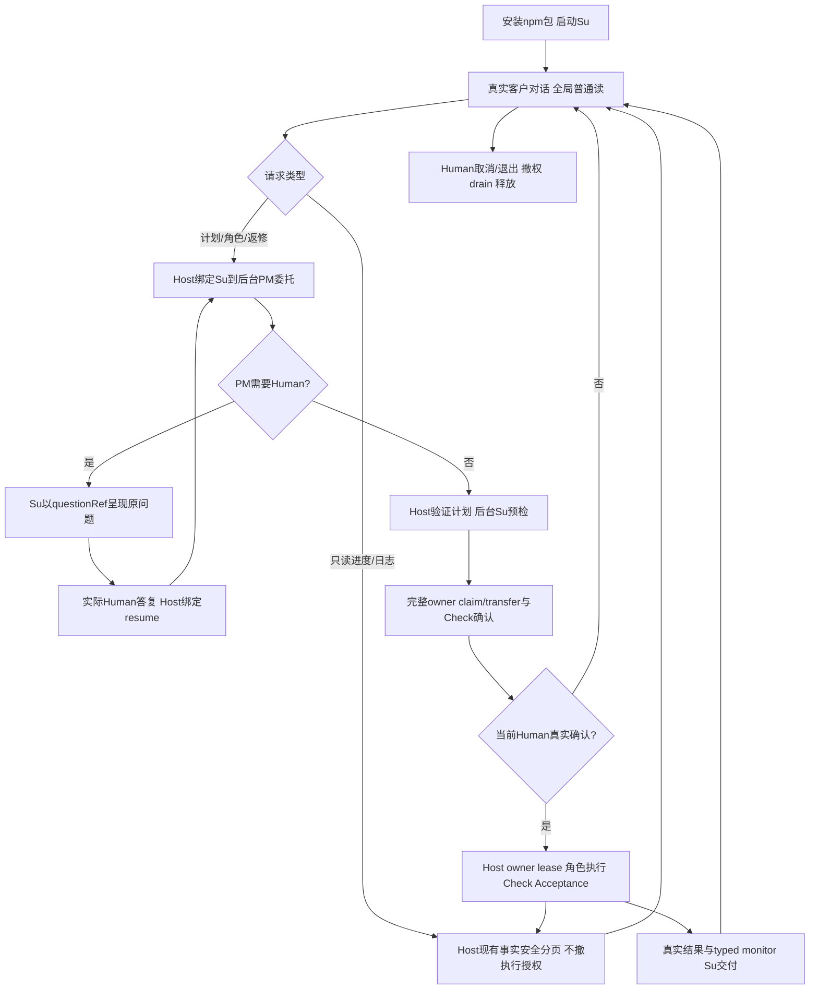

# 安装后的 Su CLI 项目流程

## 当前交付完成：1.1.3（2026-10-11）

当前 1.1.3 Su 唯一客户入口交付已完成：[当前主图](../../../../scheduling/legion-supervisor-frontdoor-v1-role-memory-race-repair-integration.md)五节点全部 verified。PM 固定 cli 10/10；Desktop caller owner 207/207、host 157/157、parallel 123/123；[Tester 独立验证](../../../Tester/docs/verification-cli-v1.md)真实 npm 安装 14 场景及 regression 40/40；[Reviewer 结构审查](../../../Reviewer/docs/review-cli-v1.md)69/69。上述结果绑定当前包和候选，不由历史阶段成绩替代。

最终 tar 为 `su-frontdoor-memory-repair-v1/legion-runtime-1.1.3.tgz`，SHA256 `e0ac5ebaee7caabc52175fe28e229c6fbc195d02890ec5bffe6ba76d80a6f73a`；102 包文件、99 mjs（含 54 个 Desktop Node 闭包模块），当前源码、tar 与安装来源一致，Desktop manifest/lock/resolved/integrity/installed 身份一致。README 示例实际执行，`readmeExample=true`。三协议生产 bin 保留双草案当前确认、取消后同进程 Continue、失败计划后立即新 Human 消息，以及 owner/Check/Acceptance/Shell/已知 key 强门。取消原始私有 journal 可保留绑定 cancelled turn 的 partial；公开 history、后续 SDK body、可恢复角色记忆与事实索引不消费它，Human 原文保留。

有限保证：仅针对已捕获环境 key 的受控数据路径，不能扩为未知/编码秘密泛扫或子进程自行构造与 TOCTOU 的一般保证。旧整仓库 observer 因旧治理 pin 不可用；旧 Shell/GUI E2E 暂停，Windows ZIP 与远程付费模型未验收。Tester 早期共享租约根中来源身份无法证明的 `85f6cbb5d433668ee49ccc7b161b39791e434edcd1ae451c1e83bef2011f89b5.owner-source.json` 和 `3d85c08cf8d7485e85864710c081387c685be760e739a2e64d3d36591f1a400b.owner-source.json` 保留，不猜测清理。

## 历史阶段记录

以下原有内容按当时状态保留，其中“当前”“待验收”“独立 T/R 尚待完成”等均为历史阶段描述；当前结论以上述 1.1.3 主图及独立报告为准。

客户运行legion chat后只与Su连续对话。Su读普通项目文件、查询真实角色活动与分页行动日志；开发请求经受控delegate交给后台PM。PM角色设计、计划、返修及独立Architect/Acceptance保持职责，Host独占完整Human确认、owner提交与授权调度。成功展示当前plan/run输出、Check、Acceptance和typed monitor；失败、缺证据、取消明确保留实际状态。

入口bin/legion.mjs→bin/chat.mjs→唯一公开Headless工厂；环境key仅进程LEGION_API_KEY，未加载Electron密钥服务。生产不接受leaseRoot、HOME不替换；默认共享lease只清本fixture证明匹配的项。CLI不造questionRef/humanAnswerRef、不能代答Human。运行中允许只读对话，改计划委托由Host拒绝；/cancel显式取消对话/委托并停止执行，成功效果不回滚。

Org外层schema2保存customerTimeline/delegations与多channel角色记忆，旧PM History原字节只读、旧确认不重放。role query只呈现真实metadata，raw assistant/prompt/private摘要不进入Su工作日志。Project/owner schema2与业务写/Check/Shell许可边界保持。完整Human原文与known-key拒绝沿原Host门。

## 当前候选与验证门

目标最终1.1.0 tar在PM packaging/su-frontdoor-final-v1鲜目录；根/desktop manifest、lock、resolved、integrity、installed和当前sourceHashes须一致。README实际Su Host示例必须执行并readmeExample=true；桥包stage-deferred仅历史。PM固定cli门验证真实npm pack、离线隔离消费者production bin三协议、多轮全局读、Su→PM问题relay/Human resume、完整确认、不同owner在途时只读activity/分页log无撤权、真实Check/独立Acceptance、分类事实、monitor及取消/key失败。冻结候选/结果以[本次任务](../../../../../docs/scheduling/legion-supervisor-frontdoor-v1.md)正式记录为准，当前尚未跑最终门，不把旧1.0.3证据当Su完成。

独立Tester/Reviewer后续验证串行、转交、返修、迁移/旧PM History及完整场景；PM原包/Shell/key强回归保留。已知key有限保证包括编码值/外部TOCTOU/child自构边界，旧observer治理pin unavailable、旧GUI/E2E/Windows ZIP/付费远端未验收。历史包/失败证据及不明身份marker不删除。

[已接受设计](../design/2026-10-11_design_supervisor-frontdoor-global-read.md) · [本次变更](../change/2026-10-11_change_supervisor-frontdoor-global-read.md)

## 当前确认选择必要修复（1.1.1）

真实1.1.0生产bin在同Su turn连续A/B草案时曾重复选旧pending A。当前CLI按current planDigest及公开Host组织/context/profile绑定选最新执行请求；discussion/choice/Shell相关Human请求沿自己的绑定，最终仍由Host校验。stale_interaction/interaction_invalidated/stale_file_owners只排除精确id/version/digest，暂态organization_busy不永久丢弃。A展示后B出现，旧A yes须被Host真实拒绝；重新呈现B完整请求并等待新的Human输入，零旧任务/零旧写、不重放旧yes。新增production bin双draft回归保留原三协议/Su读/分页日志/问答/Check/Acceptance/记忆/monitor/key/取消和包Shell门。

补丁1.1.1在su-frontdoor-cli-repair-v2鲜路径，旧1.1.0及全部失败证据保留；当前冻结候选/实际固定cli结果见legion-supervisor-frontdoor-v1-cli-repair-integration任务记录，独立Dfinal/T/R仍需新候选复核。此处修复合同与用例在pack/check前写定，非复用旧1.1.0通过。

## 当前取消续轮必要修复（1.1.2）

共享Host捕获并drain取消的前台run，保留真实终态，再为同项目Su新turn准备上下文。取消后的Continue须实际到达第二HTTP并正常回复；完整Human first input与Continue保留，partial SSE未完成文字不入SDK恢复或持久history。旧工具、肯定答复/grant不重放。Adapter真实139/139对照不冒充Host修复原因；实际Host候选已四门verify后由本包消费。

PM生产bin三协议回归在首partial SSE挂起时/cancel，同进程Continue，断言第二真实请求、Su完成、恢复SDK history/roleMemories无partial，取消journal可保留标明cancelled的原始片段；known-key全持久面及零旧任务。旧双draft当前确认、三协议全局读/状态/分页日志/问答/Check/Acceptance/分类事实/monitor/密钥与Shell强门保留。1.1.2 fresh su-frontdoor-cancel-repair-v1；冻结候选与当前固定cli日志见legion-supervisor-frontdoor-v1-su-cancel-host-repair-integration任务。旧1.1.1与失败证据只读，Dfinal/T/R需当前包重验，已评审有限保证及未验收平台/远端门不变。

## 失败计划后的新Human续轮（1.1.3）

共享Host将真实member log.channel传给cacheRole，后台supervision_preflight/monitor不写su_customer，临时Shell审批不污染pm_delegate；真实来源/covered/revision变化仍严格拒绝。原D定位的revision3→4后台错channel写已修并verify，本包消费当前源码，不以旧图39/40或Adapter139/139诊断冒充完成。

生产CLI必要回归：真实Node Check导致plan.failed，后台monitor终态回复屏障在途时立即新Human消息，实际新Su HTTP到达并释放后台终态，形成新草案及当前Human确认，无stale_role_memory/旧failed停留。CLI对已排队新消息优先处理，不在终态monitor摘要等待中阻塞；无sleep/retry或CAS弱化。取消→Continue三协议、双draft/旧yes不重放、key全持久面及owner/Check/Acceptance/Shell强门保留。1.1.3在su-frontdoor-memory-repair-v1鲜目录，正式冻结候选/cli结果见legion-supervisor-frontdoor-v1-role-memory-race-repair-integration；旧包/失败记录保留，Dfinal/T/R仍需当前包重验。
