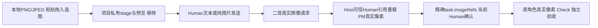
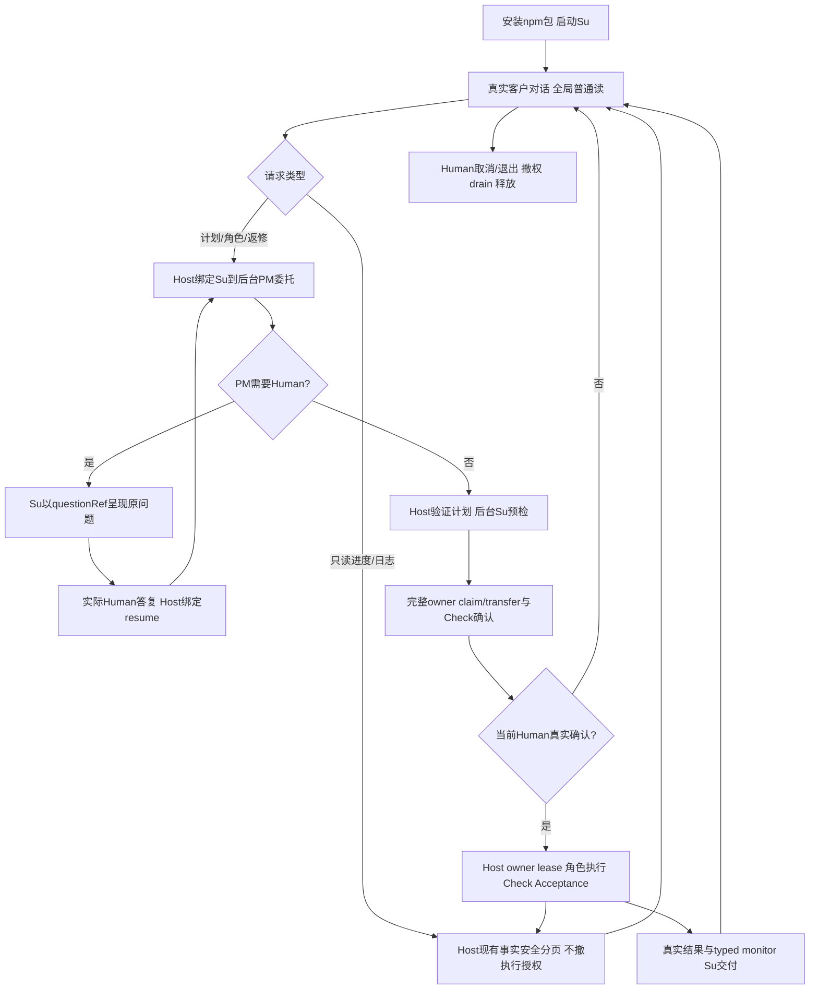

## 当前已完成：桌面图片输入 / Runtime1.3.1 / Desktop0.4.1

二哥桌面现可**粘贴截图、拖入或选择本地PNG/JPEG、预览/移除、发送纯图片**。图片实际进入当前视觉模型的三协议请求；客户历史持久可信引用，后台PM及执行角色经Host按Human来源/当前任务确认重载真实像素，引用本身不授权业务写入。`legion`命令/包名/API、内部Supervisor身份和原文本权限边界保持，**CLI本版仍为纯文本，不新增图片参数**。

[唯一当前修复记录](../../../../scheduling/desktop-image-input-v1-facade-repair-integration.md)中D、PM当前包、Tester、Reviewer均verified；PM本文档节点仅收口说明并运行依赖门。[当前本地安装包](../../../../../.ans/runtime/legion-desktop-command-center-v1/ProjectManager/packaging/desktop-image-input-v1-facade-repair-20261012/legion-runtime-1.3.1.tgz) SHA-256：`555a4184456d6457674ded591e7dea3098cdb6b3fed4ad408c782019813dae46`。102文件/99mjs/64公开Model，Desktop0.4.1实际安装runtime1.3.1，tar/sourceHashes、manifest-lock-resolved-integrity及安装字节一致；两真实公开factory均具stageImage/discardImage/readImagePreview，PM消费者强断核实际安装而非Impl。

| 当前真实门 | 结果 |
| --- | --- |
| Desktop图片/Host九单元门 | 238/238 |
| PM当前包/CLI文本兼容/Electron调用方 | 10/10，依赖门通过 |
| Tester独立安装CLI | 14个文本场景通过 |
| Tester图片/工作流集成 | 5/5 |
| Tester真实macOS Electron GUI | 2/2，零skip；22张最终图逐张核 |
| Reviewer七入口完整结构 | 83/83 |

### 用户如何发送图片

在AI连接设置中为实际所选模型显式设置图片能力`supported`；旧连接默认unknown，unknown/unsupported遇图在发送前明确拒绝并保留草稿。服务真实拒绝仍报失败，声明支持不等于任意远端模型已经验证。含图PM/worker分别使用其真实连接，也需要支持视觉。发送前移除不需要的图片；历史图片由客户显式点击有限预览，不从远程URL下载。

首版PNG/JPEG每轮≤4图/每图≤4MiB/合计≤8MiB，单边≤8192/每图≤16MP；项目私有blob≤64MiB/256引用，恢复与当前请求合计≤8图/16MiB。像素不放Org JSON/普通状态/行动日志。Provider核项目、SHA、类型、尺寸、普通文件/no-follow，原子私有0600保存；只回收本project未被历史/委托/task/恢复引用且非活动的staged孤儿，已引用历史不删。跨项目、缺失/篡改/预算明确拒绝。取消保留真实Human图片历史，不重放旧tool/yes/grant；旧无图历史与原JS文本例子字节兼容保持。

### 独立当前证据

[Tester最终报告](../../../../../.ans/runtime/legion-desktop-command-center-v1/Tester/evidence/desktop-image-final-b7f4biyy/verification.md)核三协议PNG/JPEG网络解码、每协议PM1次/worker3次像素请求、七字段task.imageRefs/当前Human确认、真实Check和独立Acceptance；unknown/unsupported零HTTP保草稿、重启、取消第二HTTP、跨项目/篡改/缺失/预算强门保持。SDK省图被网络前拒绝而不降为文本；内部image_omitted对公共边界投影为internal_error，实际失败/零HTTP/完整Human引用保存已测，不编造成功或公开SDK原异常。真实MacGUI含Electron44 ClipboardItem粘贴、File选图、DataTransfer拖入、预览移除/纯图/历史预览，以及原双owner/日志/返修/取消/900焦点和深浅主题。截图是采集帧，动画/轮询滞后不替代Host断言/proof。

[Reviewer桌面审查](../../../Reviewer/docs/review-desktop-workbench-v2.md)与[工作流审查](../../../Reviewer/docs/review-governed-workflow-v1.md)及[最终结构日志](../../../../../.ans/runtime/desktop-image-input-v1-facade-repair-integration/evidence/reviewer-image-current-1-structure-abcedd32.log)核当前真实Main→publicFactory三图片方法、有限IPC/ref与项目SHA绑定、普通DTO无像素/path、SDK零HTTP拒省图及原文本/owner/lease/commit/Shell边界。旧首轮79/83失败与1.3.0包保留；当前83/83取最新候选`653031e98b22be4f433b0abec12c7b01487600db1015bd2f4fb0163b7c17b990`，报告的旧阶段待验文字保留原时点，不覆盖唯一当前图。

### 剪贴板测试记录与交付边界

早期诊断轮确实写入fixturePNG但未保存原剪贴板快照，不能证明或恢复该轮之前内容，这个环境效果限制和旧失败图/日志保留。最终这轮按当前内容匹配条件恢复，实际[恢复证明](../../../../../.ans/runtime/legion-desktop-command-center-v1/Tester/evidence/desktop-image-1MvLA7/clipboard-restoration.json)为`used:true/restored:true`；原剪贴板只在当前main进程内存中快照，不输出或持久化，若当前内容已被客户改变不会覆盖。此证明仅覆盖最终这轮，不倒推消除历史问题。

仓库根已安装环境启动`npm --prefix apps/desktop start`；新环境先准备manifest引用的当前本地tar，执行`npm --prefix apps/desktop ci --ignore-scripts`、`npm --prefix apps/desktop run install:electron`后启动。CLI仍按进程环境密钥/三协议配置运行`./node_modules/.bin/legion chat`。README保留冻结打包阶段的待验措辞与原文本例子，当前完成状态以本说明/当前记录/独立报告为准，本文不改包或README。

Windows ZIP/DPAPI/Windows native picker与付费远端本轮未验，不能算通过；旧最终Shell GUI继续暂停，旧整仓库observer治理pin限制保持。两个身份不全的历史共享marker（85f6cbb5…89b5、3d85c08c…b373）及未知holder/commit.lock不删。known-key仍是受控原值/文本元数据/模型输出保证，不做像素OCR、未知秘密泛扫、图片生成或外部TOCTOU全称保证。桥1.3.0-image-bridge.1、旧1.3.0/1.2.3与历史证据原位只读；未自动发布/推送。

### 历史说明（仅原候选）

以下旧版本/待实施/旧名称说明保留原时点，当前图片交付只取上面1.3.1/0.4.1结果。

## 当前已完成：二哥展示改名 / runtime1.2.3 / Desktop0.3.3

产品和客户助手统一显示**二哥**，客户仍只有一个连续对话入口；窗口/HTML标题、品牌、欢迎/页签/输入、助手气泡/头像/问题转达、连接与任务引导、客户错误/执行确认，以及CLI banner、`二哥>`、回复、监控/风险/错误文案已核当前真实结果。后台PM职责/连接保留实际语义。持久`Supervisor` roleId、组织name/digest、实例name、channel、`legion`命令/env、npm包/import/API/目录和旧历史原文保持不变。

[唯一当前final-v2任务](../../../../scheduling/er-ge-display-name-v1-final-package-integration.md)中的PM当前包和独立Tester已verified，Desktop改名来源为原合法display候选84/84。当前[本地安装包](../../../../../.ans/runtime/legion-desktop-command-center-v1/ProjectManager/packaging/er-ge-display-name-v1-final-v2-a689a7d63d7dfc26/legion-runtime-1.2.3.tgz) SHA-256 `98953815f443fdfda082cce94561d0c77b15141f6db511feb607ebd4ff0b62f4`；102文件/99mjs，Desktop0.3.3真正安装runtime1.2.3，manifest/lock/resolved/integrity与tar/sourceHashes/安装字节一致。原README自包含JS例子原字节实际执行成功。

| 当前实际门 | 结果 |
| --- | --- |
| PM当前CLI/包/Electron调用方 | 10/10，零fail/skip |
| PM依赖身份检查 | exit0、同候选未变 |
| Tester独立真实安装CLI | 14场景通过 |
| Tester真实macOS指挥台GUI | 2通过、零fail/skip；15张窗口图逐张核 |

[Tester最终报告](../../../../../.ans/runtime/legion-desktop-command-center-v1/Tester/evidence/er-ge-final-ff9f8ace4a63/verification.md)记录二哥品牌与全客户助手/转达身份、实际三协议和当前Human确认、双owner/两页工作日志/文件纯读、自测及独立验收失败返修、同Host取消HTTP2续轮、六尺寸主题和900导航/主题/设置焦点。截图是采集时UI，完成以真实Host断言/proof为准。首诊断1.2.3包975dc…及CLI9/10旧监控regex失败保留；当前final-v2修精确`二哥监控: not_completed`断言，未弱化监督未完成、owner、Check/Acceptance、Shell、已知key强门。本次不声称新的regression40或Reviewer80成绩，旧1.2.2成绩属于旧候选。

当前已安装环境从仓库根运行`npm --prefix apps/desktop start`；新环境先取得manifest绑定的本地tar，执行`npm --prefix apps/desktop ci --ignore-scripts`、`npm --prefix apps/desktop run install:electron`后启动。CLI本地安装`legion-runtime-1.2.3.tgz`，按环境密钥和三协议配置运行`./node_modules/.bin/legion chat`；命令没有改名。`--ignore-scripts`不安装Electron二进制，实际GUI验收使用本机官方Electron44.6.0。包内README保留打包时“待独立验收”的真实阶段说明，冻结字节不为收尾改写；最终当前状态以本功能说明与当前任务/报告为准。

Windows ZIP/nativePicker/DPAPI本门未执行，unsupported单列；付费远端、旧暂停最终Shell GUI与旧整仓库observer治理pin限制保持，不当通过。历史未知marker `85f6cbb5d433668ee49ccc7b161b39791e434edcd1ae451c1e83bef2011f89b5.owner-source.json`、`3d85c08cf8d7485e85864710c081387c685be760e739a2e64d3d36591f1a400b.owner-source.json`保留，不删未知holder/commit.lock或租约根。已知key保护不扩为未知/编码秘密或外部TOCTOU全称保证。未发布/推送；旧1.2.2/首1.2.3包与日志只读。本说明只记当前已呈现二哥，后续侧栏主入口/角色分组不是本次已实现功能。

### 历史说明（仅原阶段）

以下旧Su名称/旧版本/待验状态属于原时点，不覆盖上面的二哥final-v2当前完成结论。

# 安装后的 Su CLI 项目流程

## 当前交付完成：1.1.3（2026-10-11）

当前 1.1.3 Su 唯一客户入口交付已完成：[当前主图](../../../../scheduling/legion-supervisor-frontdoor-v1-role-memory-race-repair-integration.md)五节点全部 verified。PM 固定 cli 10/10；Desktop caller owner 207/207、host 157/157、parallel 123/123；[Tester 独立验证](../../../Tester/docs/verification-cli-v1.md)真实 npm 安装 14 场景及 regression 40/40；[Reviewer 结构审查](../../../Reviewer/docs/review-cli-v1.md)69/69。上述结果绑定当前包和候选，不由历史阶段成绩替代。

最终 tar 为 `su-frontdoor-memory-repair-v1/legion-runtime-1.1.3.tgz`，SHA256 `e0ac5ebaee7caabc52175fe28e229c6fbc195d02890ec5bffe6ba76d80a6f73a`；102 包文件、99 mjs（含 54 个 Desktop Node 闭包模块），当前源码、tar 与安装来源一致，Desktop manifest/lock/resolved/integrity/installed 身份一致。README 示例实际执行，`readmeExample=true`。三协议生产 bin 保留双草案当前确认、取消后同进程 Continue、失败计划后立即新 Human 消息，以及 owner/Check/Acceptance/Shell/已知 key 强门。取消原始私有 journal 可保留绑定 cancelled turn 的 partial；公开 history、后续 SDK body、可恢复角色记忆与事实索引不消费它，Human 原文保留。

有限保证：仅针对已捕获环境 key 的受控数据路径，不能扩为未知/编码秘密泛扫或子进程自行构造与 TOCTOU 的一般保证。旧整仓库 observer 因旧治理 pin 不可用；旧 Shell/GUI E2E 暂停，Windows ZIP 与远程付费模型未验收。Tester 早期共享租约根中来源身份无法证明的 `85f6cbb5d433668ee49ccc7b161b39791e434edcd1ae451c1e83bef2011f89b5.owner-source.json` 和 `3d85c08cf8d7485e85864710c081387c685be760e739a2e64d3d36591f1a400b.owner-source.json` 保留，不猜测清理。

## 历史阶段记录

以下原有内容按当时状态保留，其中“当前”“待验收”“独立 T/R 尚待完成”等均为历史阶段描述；当前结论以上述 1.1.3 主图及独立报告为准。

客户运行legion chat后只与Su连续对话。Su读普通项目文件、查询真实角色活动与分页行动日志；开发请求经受控delegate交给后台PM。PM角色设计、计划、返修及独立Architect/Acceptance保持职责，Host独占完整Human确认、owner提交与授权调度。成功展示当前plan/run输出、Check、Acceptance和typed monitor；失败、缺证据、取消明确保留实际状态。

入口bin/legion.mjs→bin/chat.mjs→唯一公开Headless工厂；环境key仅进程LEGION_API_KEY，未加载Electron密钥服务。生产不接受leaseRoot、HOME不替换；默认共享lease只清本fixture证明匹配的项。CLI不造questionRef/humanAnswerRef、不能代答Human。运行中允许只读对话，改计划委托由Host拒绝；/cancel显式取消对话/委托并停止执行，成功效果不回滚。

Org外层schema2保存customerTimeline/delegations与多channel角色记忆，旧PM History原字节只读、旧确认不重放。role query只呈现真实metadata，raw assistant/prompt/private摘要不进入Su工作日志。Project/owner schema2与业务写/Check/Shell许可边界保持。完整Human原文与known-key拒绝沿原Host门。

## 当前候选与验证门

目标最终1.1.0 tar在PM packaging/su-frontdoor-final-v1鲜目录；根/desktop manifest、lock、resolved、integrity、installed和当前sourceHashes须一致。README实际Su Host示例必须执行并readmeExample=true；桥包stage-deferred仅历史。PM固定cli门验证真实npm pack、离线隔离消费者production bin三协议、多轮全局读、Su→PM问题relay/Human resume、完整确认、不同owner在途时只读activity/分页log无撤权、真实Check/独立Acceptance、分类事实、monitor及取消/key失败。冻结候选/结果以[本次任务](../../../../../docs/scheduling/legion-supervisor-frontdoor-v1.md)正式记录为准，当前尚未跑最终门，不把旧1.0.3证据当Su完成。

独立Tester/Reviewer后续验证串行、转交、返修、迁移/旧PM History及完整场景；PM原包/Shell/key强回归保留。已知key有限保证包括编码值/外部TOCTOU/child自构边界，旧observer治理pin unavailable、旧GUI/E2E/Windows ZIP/付费远端未验收。历史包/失败证据及不明身份marker不删除。

[已接受设计](../design/2026-10-11_design_supervisor-frontdoor-global-read.md) · [本次变更](../change/2026-10-11_change_supervisor-frontdoor-global-read.md)

## 当前确认选择必要修复（1.1.1）

真实1.1.0生产bin在同Su turn连续A/B草案时曾重复选旧pending A。当前CLI按current planDigest及公开Host组织/context/profile绑定选最新执行请求；discussion/choice/Shell相关Human请求沿自己的绑定，最终仍由Host校验。stale_interaction/interaction_invalidated/stale_file_owners只排除精确id/version/digest，暂态organization_busy不永久丢弃。A展示后B出现，旧A yes须被Host真实拒绝；重新呈现B完整请求并等待新的Human输入，零旧任务/零旧写、不重放旧yes。新增production bin双draft回归保留原三协议/Su读/分页日志/问答/Check/Acceptance/记忆/monitor/key/取消和包Shell门。

补丁1.1.1在su-frontdoor-cli-repair-v2鲜路径，旧1.1.0及全部失败证据保留；当前冻结候选/实际固定cli结果见legion-supervisor-frontdoor-v1-cli-repair-integration任务记录，独立Dfinal/T/R仍需新候选复核。此处修复合同与用例在pack/check前写定，非复用旧1.1.0通过。

## 当前取消续轮必要修复（1.1.2）

共享Host捕获并drain取消的前台run，保留真实终态，再为同项目Su新turn准备上下文。取消后的Continue须实际到达第二HTTP并正常回复；完整Human first input与Continue保留，partial SSE未完成文字不入SDK恢复或持久history。旧工具、肯定答复/grant不重放。Adapter真实139/139对照不冒充Host修复原因；实际Host候选已四门verify后由本包消费。

PM生产bin三协议回归在首partial SSE挂起时/cancel，同进程Continue，断言第二真实请求、Su完成、恢复SDK history/roleMemories无partial，取消journal可保留标明cancelled的原始片段；known-key全持久面及零旧任务。旧双draft当前确认、三协议全局读/状态/分页日志/问答/Check/Acceptance/分类事实/monitor/密钥与Shell强门保留。1.1.2 fresh su-frontdoor-cancel-repair-v1；冻结候选与当前固定cli日志见legion-supervisor-frontdoor-v1-su-cancel-host-repair-integration任务。旧1.1.1与失败证据只读，Dfinal/T/R需当前包重验，已评审有限保证及未验收平台/远端门不变。

## 失败计划后的新Human续轮（1.1.3）

共享Host将真实member log.channel传给cacheRole，后台supervision_preflight/monitor不写su_customer，临时Shell审批不污染pm_delegate；真实来源/covered/revision变化仍严格拒绝。原D定位的revision3→4后台错channel写已修并verify，本包消费当前源码，不以旧图39/40或Adapter139/139诊断冒充完成。

生产CLI必要回归：真实Node Check导致plan.failed，后台monitor终态回复屏障在途时立即新Human消息，实际新Su HTTP到达并释放后台终态，形成新草案及当前Human确认，无stale_role_memory/旧failed停留。CLI对已排队新消息优先处理，不在终态monitor摘要等待中阻塞；无sleep/retry或CAS弱化。取消→Continue三协议、双draft/旧yes不重放、key全持久面及owner/Check/Acceptance/Shell强门保留。1.1.3在su-frontdoor-memory-repair-v1鲜目录，正式冻结候选/cli结果见legion-supervisor-frontdoor-v1-role-memory-race-repair-integration；旧包/失败记录保留，Dfinal/T/R仍需当前包重验。
