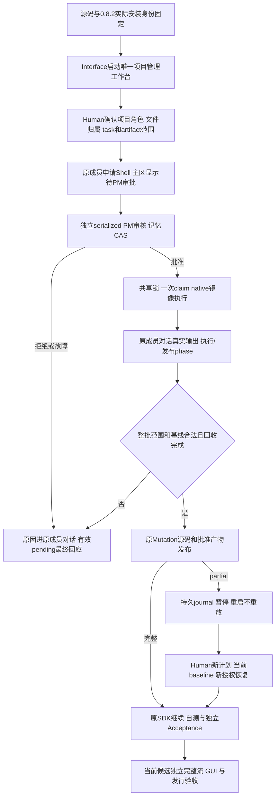
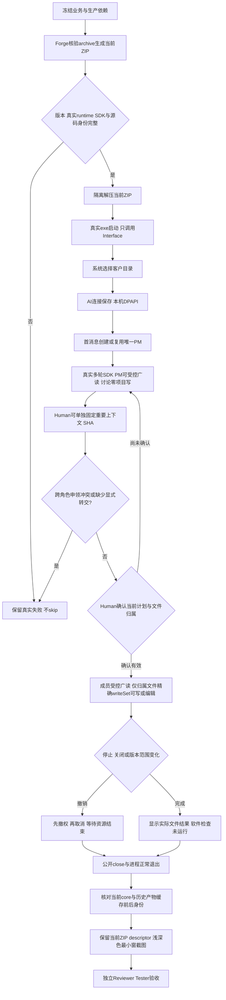
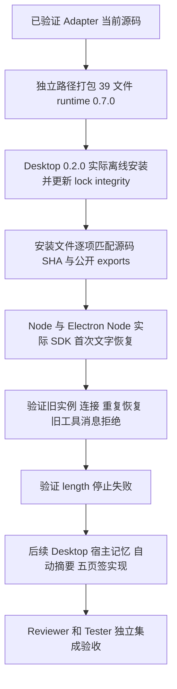

# Desktop包依赖、运行与验收

Desktop0.2.0通过本地file依赖实际安装runtime0.8.2，原包名、thin main和窄IPC保持。当前macOS已安装官方Electron44.6.0，包门验证实际Node/Electron运行、公开Service、44源字节和完整性；当前WindowsZIP/DPAPI/原生exe交付未验证，旧ZIP不代表此候选。PM建设角色负责发行依赖与证据，DesktopEngineer负责UI、唯一Pipeline和产品运行行为。

选择项目不自动执行模型或改源码。重要上下文与SHA、owner转交和DAG通过Human确认；其他执行成员“对话”供查看工作和日志，不是独立Human聊天/启动入口。工作主区显示原成员真实等待、执行和发布phase，PM审核理由进入PM对话。SDK pending只回应最终typed结果，binary body、receipt/permit/privateartifact snapshots不出renderer或历史。

权限来自真实项目/plan/task/role/session/profile与当前owner/基线。Shell干净HOME/TMP/environment，无SDK key、SSH agent、个人npm设置和Host额外fd。控制/凭据/HostuserData/原目录拒读，源码经原roleMutation精确create/replace/delete；safe mode和缺失墓碑是实际交付。读取fixed dependencies不意味着发布node_modules，only-dist构建保持依赖inode/bytes/link/mode；readonly改动拒整批。

source/generated部分发布不伪装原子：实际已发布列表与私有版本journal持久、证据失效、暂停。Human确认当前SHA/absence的新恢复计划，按新owner授权与审批执行，全部当前checks/generation/磁盘版本通过后追加recovered关联；旧partial保留，没有自动源码withdraw或重跑旧Shell。Check和Acceptance独立，Shell退出0不等于通过。

macOS实际隔离需要CLT clang/SDK及startup探针，任何不足返回unsupported；permission signature不是内核object ID，可信Host故意clone不在该边界内。network默认none，localhost/external逐调用审批，外网未实际运行，其他Shell平台不支持。当前软件发行不能宣称WindowsShell、完整客户SSH或GUI视觉已验收。

## 当前证据与交付门槛

真实runtime archive1a2a7c48…、46文件/44mjs/62Model与8工作台subpaths在[依赖修复桥](../../../../scheduling/handwell-project-shell-dependency-read-repair-v1.md)安装核对；其实际包门与contract结果。实际本地SDK三协议request/review、同pending拒重复、Node与Electron恢复、Electron固定Check及native/npm/build/text/binary/delete都有当前实证。Desktop组合Owner当前组合验证，[Reader当前证据补修](../../../../scheduling/handwell-project-shell-workspace-reader-v1.md)只允许历史/当前已批准exact治理tuple，四candidate历史标签不激活权，Supervisor保留v2。

[最终组合](../../../../scheduling/handwell-project-shell-model-time-facts-repair-v1.md)在显式Reader2 readSet上记录后续Reviewer/Tester完整流程/UI当前证据。本PMfinal不改bridge源码或生产安装，也不把Owner/包通过当独立交付。原bridge-v3证据完整归档后，固定JSON可作latest复验刷新，检查后另存新run；不说原JSON hash不变，不借copy伪current，tar/source/locks/历史task日志不变。新截图和ZIP必须来自未来相应实际发行检查，不把静态原型或旧WindowsZIP冒新候选。

[项目Shell](project-shell.md) · [公共API](../../api-spec.md) · [架构](../architecture.md) · [同版设计](../design/2026-10-10_design_project-shell.md) · [变更](../change/2026-10-10_change_project-shell.md)

## 0.8.2 显式Host时间事实

角色批准后可能在发许可与真正提交之间等待。纯Model现在不读取环境时钟或注入clock callback；Shell/Mutation的相邻Provider取得fresh safe epoch毫秒，经公开Service的 `observeTime()` 传入Model比较。Host每项proposal调用 `controller.issueShellPublication(proposal, receipt, service.observeTime())`，不为整批缓存旧时间。操作层在issue、consume、publication以及真正create/replace/delete和recheck前重新观察，缺失/无效/回退时间事实、到期、abort及replay仍失败关闭，不能凭旧issue事实延长许可。

publicfactory和62具名Model/helpers不变；该Host controller第三参数为必需caller调整，实际Desktop与包测试各自接线。SDK request/review/result、renderer与历史不新增clock字段，ordinary write/edit仍原用法。Policy的私有publication上下文使用真实receipt和 `observedAtMs: mutation.observeTime()`，Model值或时间数字不是审批授权。完整实际接口见Kernel API末节。

当前0.8.2 bridge-v3真实包SHA `1a2a7c483f04f2bb939d6bf4d25aa7a4318bc866a473dcac251f74d1ee592622`，46files/44mjs及安装每源相等，Desktop产品仍0.2.0。原0.8.1 bridge-v2和0.8.0 bridge-v1、旧proof及final before/after archive均保留。Owner实现和本阶段三固定门的最新候选/成绩、独立Reviewer/Tester状态以[时间事实修复任务](../../../../scheduling/handwell-project-shell-model-time-facts-repair-v1.md)记录，不复制活任务计数，不把下一检查写成已pass。当前包源保持冻结，本阶段只更新10文档，固定门前后完整保全bridge-v3快照并按Gov策略标注latest。

本机当前WindowsZIP本体及对应descriptor缺失；macOS可核验的是历史0.7.0 TGZ/descriptor的39file/37source身份与当前0.8.2真实安装，不读取不存在的ZIP字节，不以这些结果宣称Windows支持、exe/DPAPI或GUI发行通过。旧Windows精确断言和独立发行验证由后续原Reviewer/Tester保留。外网仍未实际运行，当前Shell仅macOS CLT/SDK与startup探针实际能力范围，失败unsupported；源码/生成恢复的新Human授权、当前baseline与追加recovered语义保持。

## 保留的历史发行记录

以下原文中的“当前”和待办仅适用于当时版本及候选，不是本次交付结论。

# Windows 项目工作台发行

用户解压0.2.0 ZIP、双击LegionDesktop.exe，不安装产品用Python/Node。选择任意客户文件夹，在默认项目管理对话中澄清目标；Human确认精确方案后动态Agent执行。两个主页面是对话和AI设置，任务/上下文/来源按需展开；支持浅深色和最小窗口。其他执行成员只有任务/状态，不是聊天入口。

入口只持有plain startup options/readiness/close，Promise.then/catch避免Electron ESM顶层等待ready。密钥不进renderer/历史/日志；保存后输入清空，重启DPAPI认证使用，不支持跨机器密钥移植和明文fallback。连接测试与发送/确认执行才实际请求模型，发行fixture只调用localhost，费用和metadata未知不伪造。

PM使用Pi conversation，写范围为空，但可用`legion_list_files`与`legion_read_file`按需查看当前项目的普通目录和分段UTF-8文本。确认后的成员也有这两项受控读工具；路径、链接、控制目录、常见凭据文件、大小与累计预算由宿主和Read Service逐次校验，成功片段带完整文件SHA；切换项目、取消或关闭使旧读取失效。PM自主读取不写客户审计，也不固定到计划上下文。Human在详情中另选重要文件，验证SHA后纳入ContextSnapshot；这些文件变化使确认失效。

项目userData保存跨后续计划持续有效的版本化文件归属。计划将精确writeSet按角色聚合，拒绝跨角色同文件申领；同角色重复修改须由后任务明确依赖前任务。既有文件的跨角色转交逐项展示旧角色/新角色/路径，Human确认后才更新owner与版本；旧项目迁移为空归属表，历史写入不自动申领。Human确认绑定workspace/plan/contextSHA/profile/org/owner版本/role/task/writeSet/tools，才通过Kernel Policy/Mutation/Storage一次性许可执行`legion_write_file`或`legion_edit_file`。后者要求已有普通UTF-8文件的完整旧SHA和最多16个唯一文本替换，旧SHA或歧义文本拒绝整次编辑。读工具不产生写许可，成员只能写自身任务归属的精确writeSet。停止与close撤销不可重放，不给SDK默认文件/编辑/Shell工具。写了测试文件也不代表运行软件测试，UI保持not_executed。选择与讨论不生成客户.ans；执行审计效果在确认说明内。重启恢复文本与归属，运行中任务标interrupted，不自动模型调用或执行。

Node0.6真实32文件tarball先安装至Desktop；Workbench只bare import41具名Model/纯函数与五publicServices，无开发树相对或symlink。Windows ZIP须包含Electron44.6与全部生产依赖，两SDK1.0.4，排除开发工具与缓存/测试/锁。Forge只用本阶段核验cache archive；缺SDK/binary失败。Workspace记录预算16MiB/4096事件/64MiB，全链校验后缓存并显示观察/验证时间，过期来源不可用不当作在线或业务失败。

当前macOS包check运行入口惰性导入与本机已安装0.6包/41 Model/Read Service/32文件身份及纯归属Model，并核对Electron44.6 macOS二进制；它不产生Windows ZIP验证。Windows严格分支仍须实际make→解压exe→原生UI/三协议/PM计划与归属转交/受控编辑/stop/DPAPI重启/close；截图至少对话/设置浅深色与960×640。完整独立验收仍在Reviewer/Tester后段。目标ZIP路径为.ans/runtime/legion-desktop-workbench-v2/ProjectManager/desktop/packaging/LegionDesktop-0.2.0-win32-x64.zip；当前0.6候选尚无已验证的Windows ZIP或desktop-package.json。该平台执行后须记录实际SHA、bytes、源码验证与证据，不把历史SHA固定为本次产物。

清理仅本次tracked进程和生成目录，核验绝对范围及所有祖先无链接；workspace与userData分离。当前0.6包30mjs与旧0.5/0.4/0.3tgz、0.1ZIP和存在的历史cache分别核对身份或保持缺失，临时consumer结束归零。[使用说明](../../../../../apps/desktop/README.md)、[接口](../../api-spec.md)、[架构](../architecture.md)、[客户归属与编辑设计](../design/2026-10-08_design_legion-file-ownership-and-agent-edit.md)。[GUI v1](../design/2026-10-07_design_desktop-gui-v1.md)保留为原型历史，未registry发布。

## 当前0.7.0 runtime与已接线工作流候选

Desktop真实依赖安装为新39文件/51 Model本地包，新增公开CheckService。macOS包检查调用真正Electron Node模式，传process.execPath、隔离candidate/output、真实输入hash与live validator/AbortSignal，验证安全flags和Electron Framework依赖。此前Windows流程仍是待该平台复验的历史流程，不能由macOS smoke替代。

Desktop持久组织/交互/验收Service与Provider、唯一Workbench Pipeline和UI已接线，owner实现见[Desktop任务](../../../../scheduling/legion-governed-workflow-v1-desktop-implementation.md)；后续[角色读取修复](../../../../scheduling/legion-governed-workflow-v1-workspace-reader.md)、[reporter修复](../../../../scheduling/legion-governed-workflow-v1-reporter-repair.md)及[Electron修复](../../../../scheduling/legion-governed-workflow-v1-electron-runner-repair.md)具有各自真实证据。当前[架构师诊断返修](../../../../scheduling/legion-governed-workflow-v1-live-architect-repair.md)与[独立集成/UI验收](../../../../scheduling/legion-governed-workflow-v1-final-integration.md)仍待当前候选检查；[独立结构评审](../../../../scheduling/legion-governed-workflow-v1-independent-review.md)原结果只代表其记录候选。普通测试入口和包刷新见[本次任务](../../../../scheduling/legion-governed-workflow-v1-test-entrypoints-release.md)。原主任务pending后段由这些具体任务接续，原状态与旧通过记录不能代替最终交付。实际检查前checkStatus为not_executed，之后由真实Kernel结果和输入新鲜度决定。首版测试禁止启动其他进程，非macOS执行unsupported。新发布副作用只在legion-governed-workflow-v1/ProjectManager本阶段目录，旧ZIP与tarballs保持。详见[新发行功能](distribution.md)、[完整设计](../design/2026-10-08_design_legion-governed-workflow.md)。

当前计数通道已按[Kernel返修证据](../../../../scheduling/legion-governed-workflow-v1-reporter-repair.md)加强：每次随机初始化key、MAC与递增序号、captured方法及固定stream入口，裸fd3 JSON拒绝。Node固定permission补充限制inspector/native addon/worker/process.binding；真实文件/网络/进程隔离仍由Seatbelt承担。已测直接伪造与入口替换等范围不构成任意恶意JS的一般不可篡改保证，同进程测试断言与覆盖仍需审阅和独立验收。需要上述受限API或替换固定stream入口的测试不支持。本次Electron smoke使用实际安全flags验证普通test通过与直接fd3伪造拒绝。

## 2026-10-09 角色连续文字上下文的发行候选

新本地 runtime 的恢复能力让宿主可在开发成员或验收成员的新任务实例第一次运行之前，注入此前角色的纯文字摘要与最近对话。宿主须提供当前实例与连接版本的 typed checkpoint；过期或重复恢复会失败，旧工具执行确认和 grant 不从文本中复活。当次写范围与工具集合仍由当前任务决定。`length` 模型停止视为失败，保留错误而不提交不完整摘要。

新包位于 `.ans/runtime/legion-governed-workflow-v1/ProjectManager/packaging/role-context-20261009/legion-runtime-0.7.0.tgz`，SHA256 `f45fa15e8c0f195930c35c782904690ce7073680df1e4ec0d0ea6e80215bbad7`；桌面 lock 精确固定该新路径与 integrity。同版本旧包 `packaging/legion-runtime-0.7.0.tgz`、原 smoke 与 Windows ZIP 保留。新 package-smoke 记录全部源码来源和 isolated consumer 的实际行为，installed-role-memory-smoke 记录 Node 24.14.0 与 Electron 44.6.0/Node 24.21.0 的真实结果。两 SDK 仍为 1.0.4，公开入口和 CSP 断言保持。

此发行候选已实际安装恢复能力；宿主长期角色记忆、阈值自动摘要、五页签、角色来源与真实 SSH 后续开发仍待相应角色交付。Windows ZIP 未在本机执行。固定 package 检查最终证据见[本次任务](../../../../scheduling/legion-persistent-role-context-and-dialogue-v1.md)，设计依据为[已确认集成追加](../design/2026-10-08_design_legion-governed-workflow.md)。
