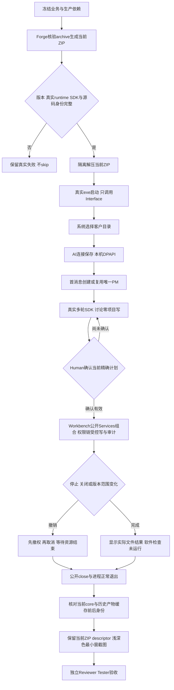

# Windows 项目工作台发行

用户解压0.2.0 ZIP、双击LegionDesktop.exe，不安装产品用Python/Node。选择任意客户文件夹，在默认项目管理对话中澄清目标；Human确认精确方案后动态Agent执行。两个主页面是对话和AI设置，任务/上下文/来源按需展开；支持浅深色和最小窗口。其他执行成员只有任务/状态，不是聊天入口。

入口只持有plain startup options/readiness/close，Promise.then/catch避免Electron ESM顶层等待ready。密钥不进renderer/历史/日志；保存后输入清空，重启DPAPI认证使用，不支持跨机器密钥移植和明文fallback。连接测试与发送/确认执行才实际请求模型，发行fixture只调用localhost，费用和metadata未知不伪造。

PM使用Pi conversation、empty tools/write；Human确认绑定workspace/plan/contextSHA/profile/org/role/task/writeSet/tools，才通过Kernel Policy/Mutation/Storage一次性许可执行legion_write_file。停止与close撤销不可重放，不给shell/edit/read默认工具。写了测试文件也不代表运行软件测试，UI保持not_executed。选择与讨论不生成客户.ans；执行审计效果在确认说明内。重启恢复文本，运行中任务标interrupted，不自动模型调用或执行。

Node0.4真实29文件tarball先安装至Desktop；Workbench只bare import30Model与四publicServices，无开发树相对或symlink。ZIP包含Electron44.6与全部生产依赖，两SDK1.0.4，排除开发工具与缓存/测试/锁。Forge只用本阶段核验cache archive；缺SDK/binary失败，不skip。Workspace记录预算16MiB/4096事件/64MiB，全链校验后缓存并显示观察/验证时间，过期来源不可用不当作在线或业务失败。

当前包check是2项，实际make→解压exe→原生UI/三协议/PM计划与stop/DPAPI重启/close；截图至少对话/设置浅深色与960×640。完整独立验收仍在Reviewer/Tester后段。稳定ZIP为.ans/runtime/legion-desktop-workbench-v2/ProjectManager/desktop/packaging/LegionDesktop-0.2.0-win32-x64.zip；desktop-package.json记录实际SHA、bytes、源码验证与证据。每次make重新核验当前descriptor，不把历史SHA固定为本次产物。

清理仅本次tracked进程和生成目录，核验绝对范围及所有祖先无链接；workspace与userData分离。当前core11/27mjs与旧0.3tgz/0.1ZIP/历史cache逐file保护，临时consumer结束归零。[使用说明](../../../../../apps/desktop/README.md)、[接口](../../api-spec.md)、[架构](../architecture.md)、[客户确认设计](../design/2026-10-07_design_desktop-workbench-v2.md)。[GUI v1](../design/2026-10-07_design_desktop-gui-v1.md)保留为原型历史，未registry发布。
