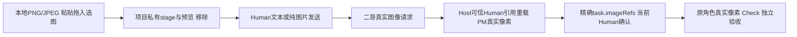
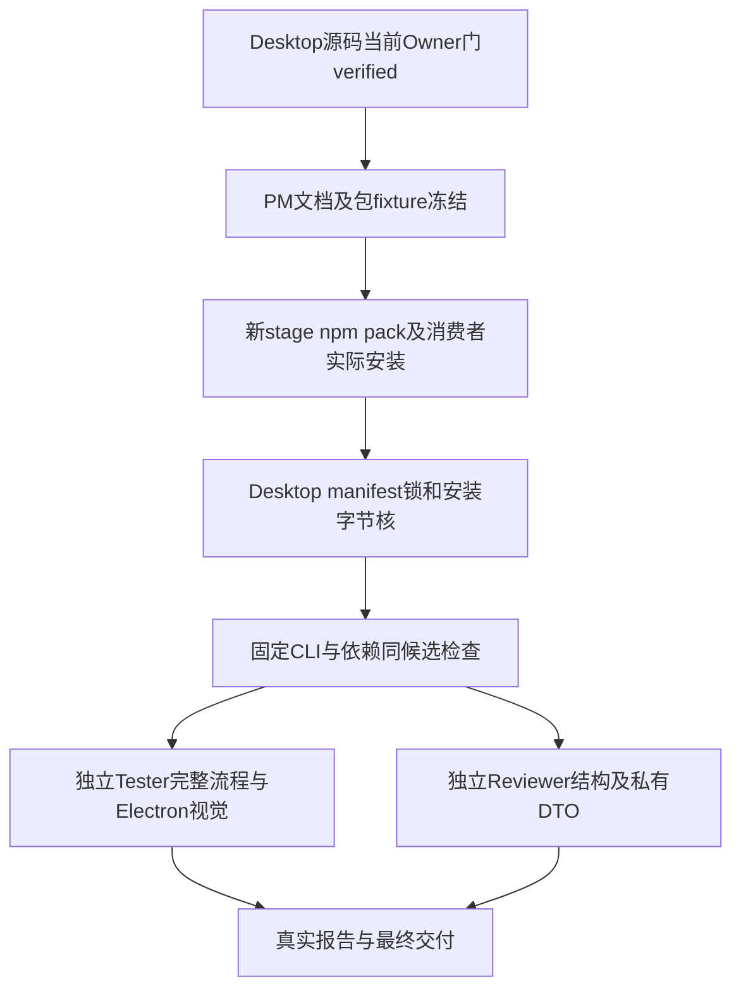

## 当前已完成：桌面图片输入 / Runtime1.3.1 / Desktop0.4.1

二哥桌面现可**粘贴截图、拖入或选择本地PNG/JPEG、预览/移除、发送纯图片**。图片实际进入当前视觉模型的三协议请求；客户历史持久可信引用，后台PM及执行角色经Host按Human来源/当前任务确认重载真实像素，引用本身不授权业务写入。`legion`命令/包名/API、内部Supervisor身份和原文本权限边界保持，**CLI本版仍为纯文本，不新增图片参数**。

[唯一当前修复记录](../../../../scheduling/desktop-image-input-v1-facade-repair-integration.md)中D、PM当前包、Tester、Reviewer均verified；PM本文档节点仅收口说明并运行依赖门。[当前本地安装包](../../../../../.ans/runtime/legion-desktop-command-center-v1/ProjectManager/packaging/desktop-image-input-v1-facade-repair-20261012/legion-runtime-1.3.1.tgz) SHA-256：`555a4184456d6457674ded591e7dea3098cdb6b3fed4ad408c782019813dae46`。102文件/99mjs/64公开Model，Desktop0.4.1实际安装runtime1.3.1，tar/sourceHashes、manifest-lock-resolved-integrity及安装字节一致；两真实公开factory均具stageImage/discardImage/readImagePreview，PM消费者强断核实际安装而非Impl。

| 当前真实门 | 结果 |
| --- | --- |
| Desktop图片/Host九单元门 | 238/238 |
| PM当前包/CLI文本兼容/Electron调用方 | 10/10，依赖门通过 |
| Tester独立安装CLI | 14个文本场景通过 |
| Tester图片/工作流集成 | 5/5 |
| Tester真实macOS Electron GUI | 2/2，零skip；22张最终图逐张核 |
| Reviewer七入口完整结构 | 83/83 |

### 用户如何发送图片

在AI连接设置中为实际所选模型显式设置图片能力`supported`；旧连接默认unknown，unknown/unsupported遇图在发送前明确拒绝并保留草稿。服务真实拒绝仍报失败，声明支持不等于任意远端模型已经验证。含图PM/worker分别使用其真实连接，也需要支持视觉。发送前移除不需要的图片；历史图片由客户显式点击有限预览，不从远程URL下载。

首版PNG/JPEG每轮≤4图/每图≤4MiB/合计≤8MiB，单边≤8192/每图≤16MP；项目私有blob≤64MiB/256引用，恢复与当前请求合计≤8图/16MiB。像素不放Org JSON/普通状态/行动日志。Provider核项目、SHA、类型、尺寸、普通文件/no-follow，原子私有0600保存；只回收本project未被历史/委托/task/恢复引用且非活动的staged孤儿，已引用历史不删。跨项目、缺失/篡改/预算明确拒绝。取消保留真实Human图片历史，不重放旧tool/yes/grant；旧无图历史与原JS文本例子字节兼容保持。



### 独立当前证据

[Tester最终报告](../../../../../.ans/runtime/legion-desktop-command-center-v1/Tester/evidence/desktop-image-final-b7f4biyy/verification.md)核三协议PNG/JPEG网络解码、每协议PM1次/worker3次像素请求、七字段task.imageRefs/当前Human确认、真实Check和独立Acceptance；unknown/unsupported零HTTP保草稿、重启、取消第二HTTP、跨项目/篡改/缺失/预算强门保持。SDK省图被网络前拒绝而不降为文本；内部image_omitted对公共边界投影为internal_error，实际失败/零HTTP/完整Human引用保存已测，不编造成功或公开SDK原异常。真实MacGUI含Electron44 ClipboardItem粘贴、File选图、DataTransfer拖入、预览移除/纯图/历史预览，以及原双owner/日志/返修/取消/900焦点和深浅主题。截图是采集帧，动画/轮询滞后不替代Host断言/proof。

[Reviewer桌面审查](../../../Reviewer/docs/review-desktop-workbench-v2.md)与[工作流审查](../../../Reviewer/docs/review-governed-workflow-v1.md)及[最终结构日志](../../../../../.ans/runtime/desktop-image-input-v1-facade-repair-integration/evidence/reviewer-image-current-1-structure-abcedd32.log)核当前真实Main→publicFactory三图片方法、有限IPC/ref与项目SHA绑定、普通DTO无像素/path、SDK零HTTP拒省图及原文本/owner/lease/commit/Shell边界。旧首轮79/83失败与1.3.0包保留；当前83/83取最新候选`653031e98b22be4f433b0abec12c7b01487600db1015bd2f4fb0163b7c17b990`，报告的旧阶段待验文字保留原时点，不覆盖唯一当前图。

### 剪贴板测试记录与交付边界

早期诊断轮确实写入fixturePNG但未保存原剪贴板快照，不能证明或恢复该轮之前内容，这个环境效果限制和旧失败图/日志保留。最终这轮按当前内容匹配条件恢复，实际[恢复证明](../../../../../.ans/runtime/legion-desktop-command-center-v1/Tester/evidence/desktop-image-1MvLA7/clipboard-restoration.json)为`used:true/restored:true`；原剪贴板只在当前main进程内存中快照，不输出或持久化，若当前内容已被客户改变不会覆盖。此证明仅覆盖最终这轮，不倒推消除历史问题。

仓库根已安装环境启动`npm --prefix apps/desktop start`；新环境先准备manifest引用的当前本地tar，执行`npm --prefix apps/desktop ci --ignore-scripts`、`npm --prefix apps/desktop run install:electron`后启动。CLI仍按进程环境密钥/三协议配置运行`./node_modules/.bin/legion chat`。README保留冻结打包阶段的待验措辞与原文本例子，当前完成状态以本说明/当前记录/独立报告为准，本文不改包或README。

Windows ZIP/DPAPI/Windows native picker与付费远端本轮未验，不能算通过；旧最终Shell GUI继续暂停，旧整仓库observer治理pin限制保持。两个身份不全的历史共享marker（85f6cbb5…89b5、3d85c08c…b373）及未知holder/commit.lock不删。known-key仍是受控原值/文本元数据/模型输出保证，不做像素OCR、未知秘密泛扫、图片生成或外部TOCTOU全称保证。桥1.3.0-image-bridge.1、旧1.3.0/1.2.3与历史证据原位只读；未自动发布/推送。

### 历史说明（仅原候选）

以下旧版本/待实施/旧名称说明保留原时点，当前图片交付只取上面1.3.1/0.4.1结果。

## 当前已完成：二哥展示改名 / runtime1.2.3 / Desktop0.3.3

产品和客户助手统一显示**二哥**，客户仍只有一个连续对话入口；窗口/HTML标题、品牌、欢迎/页签/输入、助手气泡/头像/问题转达、连接与任务引导、客户错误/执行确认，以及CLI banner、`二哥>`、回复、监控/风险/错误文案已核当前真实结果。后台PM职责/连接保留实际语义。持久`Supervisor` roleId、组织name/digest、实例name、channel、`legion`命令/env、npm包/import/API/目录和旧历史原文保持不变。

[唯一当前final-v2任务](../../../../scheduling/er-ge-display-name-v1-final-package-integration.md)中的PM当前包和独立Tester已verified，Desktop改名来源为原合法display候选84/84。当前[本地安装包](../../../../../.ans/runtime/legion-desktop-command-center-v1/ProjectManager/packaging/er-ge-display-name-v1-final-v2-a689a7d63d7dfc26/legion-runtime-1.2.3.tgz) SHA-256 `98953815f443fdfda082cce94561d0c77b15141f6db511feb607ebd4ff0b62f4`；102文件/99mjs，Desktop0.3.3真正安装runtime1.2.3，manifest/lock/resolved/integrity与tar/sourceHashes/安装字节一致。原README自包含JS例子原字节实际执行成功。

| 当前实际门 | 结果 |
| --- | --- |
| PM当前CLI/包/Electron调用方 | 10/10，零fail/skip |
| PM依赖身份检查 | exit0、同候选未变 |
| Tester独立真实安装CLI | 14场景通过 |
| Tester真实macOS指挥台GUI | 2通过、零fail/skip；15张窗口图逐张核 |

[Tester最终报告](../../../../../.ans/runtime/legion-desktop-command-center-v1/Tester/evidence/er-ge-final-ff9f8ace4a63/verification.md)记录二哥品牌与全客户助手/转达身份、实际三协议和当前Human确认、双owner/两页工作日志/文件纯读、自测及独立验收失败返修、同Host取消HTTP2续轮、六尺寸主题和900导航/主题/设置焦点。截图是采集时UI，完成以真实Host断言/proof为准。首诊断1.2.3包975dc…及CLI9/10旧监控regex失败保留；当前final-v2修精确`二哥监控: not_completed`断言，未弱化监督未完成、owner、Check/Acceptance、Shell、已知key强门。本次不声称新的regression40或Reviewer80成绩，旧1.2.2成绩属于旧候选。

当前已安装环境从仓库根运行`npm --prefix apps/desktop start`；新环境先取得manifest绑定的本地tar，执行`npm --prefix apps/desktop ci --ignore-scripts`、`npm --prefix apps/desktop run install:electron`后启动。CLI本地安装`legion-runtime-1.2.3.tgz`，按环境密钥和三协议配置运行`./node_modules/.bin/legion chat`；命令没有改名。`--ignore-scripts`不安装Electron二进制，实际GUI验收使用本机官方Electron44.6.0。包内README保留打包时“待独立验收”的真实阶段说明，冻结字节不为收尾改写；最终当前状态以本功能说明与当前任务/报告为准。

Windows ZIP/nativePicker/DPAPI本门未执行，unsupported单列；付费远端、旧暂停最终Shell GUI与旧整仓库observer治理pin限制保持，不当通过。历史未知marker `85f6cbb5d433668ee49ccc7b161b39791e434edcd1ae451c1e83bef2011f89b5.owner-source.json`、`3d85c08cf8d7485e85864710c081387c685be760e739a2e64d3d36591f1a400b.owner-source.json`保留，不删未知holder/commit.lock或租约根。已知key保护不扩为未知/编码秘密或外部TOCTOU全称保证。未发布/推送；旧1.2.2/首1.2.3包与日志只读。本说明只记当前已呈现二哥，后续侧栏主入口/角色分组不是本次已实现功能。

### 待实施：侧栏二哥主入口分组（2026-10-12，draft v1）

**管理评审：推荐确认后实施。** DesktopEngineer独立只读复核确认D6覆盖现有实现与两个导航/焦点分支，无新增路径。 按客户参考图，左侧保留角色列表，分为“主入口”和“其他角色（查看/调试）”。这是当前项目侧栏的Interface调整，尚未实现；本draft与精确配置须Human一次确认后才派发。已完成二哥改名、现有连续对话和运行权限保持。

“主入口”仅放当前项目`Supervisor`对应的**二哥卡片**，视觉突出，显示“内置”标识和真实状态。状态来自Host已有`getState.roles[].activity`和turn/plan/pending：空项目“选择项目”、无计划“待讨论”、当前draft确认才“等待你确认”、waiting才“等待你的答复”，执行中标真实工作/只读对话；不把无计划误报待确认，不编造进度百分比。原孤立“对话”导航与卡片合为一个主入口，避免两个重复入口；点击二哥选择当前项目conversation和conversation工作区，当前旧`conversation-nav`只navigate，必须同时`selectZone('conversation')`才能从900项目/角色区真正回chat；关闭导航后焦点进入可用客户输入框，未选项目或输入disabled时落可用“选择项目/连接”CTA，不能指向隐藏或禁用输入。点击不启动新模型轮或新会话。

“其他角色（查看/调试）”排除Supervisor，沿当前组织列真实角色名称、职责短摘要与状态，视觉次级；不把参考图的测试者/规划者/实现者写死为项目角色。点击继续原`selectedRoleId → roles zone → refreshRoleZone`，不调用sendMessage，沿现有角色资料、运行区与安全行动日志查看，不新增直聊、原始私有消息、跨项目聊天、另一主页或Host。206/190px侧栏与900抽屉采用两行职责截断并用title保留完整说明，现有项目选择、AI连接、主题和900导航继续可达，状态需区分二哥对话与角色查看；设置页不能误标主卡选中。

未选项目时主卡显示“先选择项目”并禁用；当前项目缺Supervisor时明确“入口不可用”，不伪造内置角色。轮询复用稳定节点并只更新真实状态，不丢未发输入、问题草稿、滚动或焦点；角色查看后回二哥仍是原连续历史与输入。键盘可达、主卡aria-current/选择态准确，900导航Escape仍按既有规则归还焦点。

| owner | 精确文件 |
| --- | --- |
| DesktopEngineer（6） | `apps/desktop/src/interface/index.html`；`apps/desktop/src/interface/renderer.mjs`；`apps/desktop/src/interface/styles.css`；`apps/desktop/tests/unit/pipeline.test.mjs`；`apps/desktop/tests/unit/ipc.test.mjs`；`docs/roles/DesktopEngineer/docs/feature/desktop-console.md` |
| Tester（1） | `apps/desktop/tests/e2e/governed-workflow-ui.test.mjs` |

固定检查全部从仓库根执行：Desktop `node --test --test-concurrency=1 apps/desktop/tests/unit/pipeline.test.mjs apps/desktop/tests/unit/ipc.test.mjs`；独立Tester `node --test --test-concurrency=1 apps/desktop/tests/e2e/governed-workflow-ui.test.mjs`。保留现有Mac完整工作流与布局两用例，新增真实分组/唯一主卡/其它角色只查看、二哥回原chat、900键盘/主题及轮询草稿焦点断言。宽屏及900深浅主题真实Electron窗口逐图核验，不用静态原型或DOM隐藏替代；Windows/付费远端不计通过。Desktop完成后Tester验当前Interface候选；失败原owner必要修复，不扩功能或降低断言。

三份Interface不在Node包闭包，本次**不改Host/Model/IPC能力、版本/manifest/lock、README或冻结runtime1.2.3 tar**，不重包、不发布/推送；验收绑定当前Interface源码及同一冻结包。主要风险是错误选择态/误进入角色区或轮询丢输入，由上述分支与真实窗口断言验证。无待选增强；阶段目前仅文档准备，不宣称新布局已完成。

### 已完成：桌面图片输入 v1 / Runtime1.3.1 / Desktop0.4.1

原图片draft已按Human接受的74文件方案完成；冻结方案与授权保留在`.ans/decisions/desktop-image-input-v1-scope.md`及授权记录。真实公开工厂Facade遗漏已修复，当前结果以上面的修复图、安装包及独立报告为准，不用旧1.3.0或bridge成绩替代。

### 历史说明（仅原阶段）

以下旧Su名称/旧版本/待验状态属于原时点，不覆盖上面的二哥final-v2当前完成结论。

## 当前交付已完成：runtime 1.2.2 / Desktop 0.3.2（2026-10-12）

**当前独立验收已完成。** [唯一当前任务记录](../../../../scheduling/legion-desktop-command-center-v1-su-label-repair-integration.md)的Desktop、PM包、Tester、Reviewer四个产品节点均verified；本段文档关闭节点只更新说明并运行原依赖检查。[指挥台当前功能](../../../DesktopEngineer/docs/feature/desktop-console.md)包含Su唯一连续客户入口、项目文件/实际变化与产物/Check和Acceptance工作区、角色状态/依赖/分页行动日志/分类记忆工作区；后台PM职责和实际连接保持独立，成员原文、briefing和私有恢复摘要不进入公共DTO。

[当前安装包](../../../../../.ans/runtime/legion-desktop-command-center-v1/ProjectManager/packaging/desktop-command-center-su-label-repair-v1-9850a3707d523eba/legion-runtime-1.2.2.tgz) SHA-256：`773da2d1dbb58b7a9ff251e14f1cf80281a8b9286348d7a864589dd92832eef2`。102包文件、99 mjs源码，Pi SDK/pi-ai1.0.4；Desktop0.3.2实际安装runtime1.2.2，manifest/lock/resolved/integrity、tar/sourceHashes和安装字节一致。PM固定CLI10/10、desktop_dependency通过；README自包含Su例子原字节实际执行成功。所有源码、manifest、lock、README和tar已冻结，本次说明不重包或修改它们。

| 独立当前验收 | 结果 |
| --- | --- |
| Tester安装后真实CLI | 14场景通过 |
| Tester回归 | 40/40，零skip/cancel |
| Tester真实macOS Electron GUI | 2通过、0失败；另1个Windows平台用例unsupported/skip，不计通过 |
| Reviewer固定结构门 | 80/80，零fail/cancel/skip/todo |

[Tester最终报告](../../../../../.ans/runtime/legion-desktop-command-center-v1/Tester/evidence/final-122-e114e160100e/verification.md)记录三协议/两次PM问答、完整当前Human确认、双draft旧A答复拒绝与B新答、owner并行/转交、真实Check和独立验收失败返修、同Host取消后HTTP2继续、known-key及私有/公共Shell双证。GUI使用真实Electron/renderer/preload/IPC/Pi SDK，验证执行中纯读与三变更工具Host硬拒绝且grant不撤、首屏无空cursor、真实两页日志、文件读取不改变持久源、900宽项目与设置入口/主题/AI连接/Escape焦点及轮询草稿保留；1440/1280/900三宽度深浅主题与15张真实截图逐张查看。截图可能存在正常轮询滞后，阶段完成以实际Host断言与gui-proof为准。

[Reviewer桌面审查](../../../Reviewer/docs/review-desktop-workbench-v2.md)及[工作流审查](../../../Reviewer/docs/review-governed-workflow-v1.md)的最终当前structure日志为`reviewer-current-122-1-structure-3b3870cc.log`，当前候选`285754536156b9a9a17033b6d9728adfefc043bc91914ef54d2c98ee8114b172`；两份报告中的旧阶段/待验表述按原时点保留，当前完成结论仅取上述唯一任务最新verified证据。测试没有恢复私有IPC或删除强断言，产品权限仍为角色独占文件与实际Human确认，产品任务无writeSet。

### 在当前已安装环境启动

仓库根目录运行：

```sh
npm --prefix apps/desktop start
```

新环境先取得manifest引用的当前本地tar，在仓库根目录执行`npm --prefix apps/desktop ci --ignore-scripts`，再`npm --prefix apps/desktop run install:electron`准备官方Electron二进制，之后启动。`--ignore-scripts`本身不安装Electron；独立验收使用本机实际已安装Electron44.6.0，不能宣称任意机器已安装。CLI消费者可安装本地`legion-runtime-1.2.2.tgz`，按环境密钥/三协议配置运行`./node_modules/.bin/legion chat`。

包内根/桌面README保留打包时真实“验收进行中”阶段说明，其字节属于已验收包身份，不为收尾改写；当前最终状态以本功能文档、唯一当前任务与上述独立报告为准。

### 仍有的交付边界

本次macOS受控localhost协议、真实Pi SDK与Electron验收已完成；Windows ZIP/DPAPI未执行，单列unsupported，付费远端模型和旧暂停最终Shell GUI不宣称通过。真实仓库旧observer治理metadata pin限制仍unavailable；本次隔离observer边界检查通过不代表旧路径修复。已知密钥保护只保证捕获原值与受控路径，外部TOCTOU/编码秘密/子进程自构不作全称保证。

历史来源身份不完整的共享marker `85f6cbb5d433668ee49ccc7b161b39791e434edcd1ae451c1e83bef2011f89b5.owner-source.json` 与 `3d85c08cf8d7485e85864710c081387c685be760e739a2e64d3d36591f1a400b.owner-source.json`保留；不删除未知holder/commit.lock或租约根。旧1.2.1/1.2.0/1.1.3包、失败和历史报告只读保留，不充当当前通过证据。未发布npm registry。

### 已完成：二哥展示改名（runtime1.2.3 / Desktop0.3.3）

本节原待实施草案已按Human接受的30文件范围完成，原冻结方案与授权留在`.ans/decisions/er-ge-display-name-v1-scope.md`及补充授权中；当前结果以上面的唯一final-v2记录和独立验收为准。没有重构、权限扩展或发布，后续侧栏入口/角色分组需求尚未设计批准，不属于本次交付。

### 历史说明（只属于原阶段）

以下旧版本、旧包目录、“待独立验收”“进行中”等表述保留当时记录，不能覆盖上面的当前1.2.2/0.3.2完成结论。

---
id: desktop-distribution
type: feature
title: 项目指挥台包依赖、运行与验收
updated: "2026-10-12"
status: implemented-awaiting-current-package-and-independent-acceptance
---

# 项目指挥台包依赖、运行与验收

Desktop0.3.0通过真实本地tar依赖runtime1.2.0；客户通过Su连续对话进入唯一Workbench Host，项目与角色工作区读取同一项目事实。PM管理发行依赖、包身份与调用方检查，Desktop维护产品，Tester/Reviewer独立完成流程、视觉和结构验收。



本次fresh stage为 `.ans/runtime/legion-desktop-command-center-v1/ProjectManager/packaging/desktop-command-center-v1-bb143de38d2a/`，tar与package-smoke记录当前版本、SHA/integrity、全部打包文件和sourceHashes。未修改的Kernel/Adapter/CLI业务入口仍打入完整Node闭包，不能拿旧1.1.3安装做本次调用方门。Desktop Node依赖不含renderer/Electron；CLI不依赖Electron/Python，Desktop启动依赖实际官方Electron二进制。

[桌面启动说明](../../../../../apps/desktop/README.md)给出真实本地依赖准备与启动方法；[当前桌面功能](../../../DesktopEngineer/docs/feature/desktop-console.md)给出文件/产物/依赖/日志/记忆及响应布局。Host公共DTO不包含私有成员原文，文件浏览不改变固定上下文；执行中记忆变更与新增交互由硬门拒绝，归属与Human授权不放宽。

当前包/依赖检查以及独立测试仍以[本次任务](../../../../scheduling/legion-desktop-command-center-v1.md)当前候选为准；Owner通过不等于完整交付。macOS受控HTTP+真实Pi SDK与Electron门实际执行后才记录成绩；Windows ZIP/DPAPI、付费远端与旧暂停Shell GUI验收不能算通过。每次fresh run保留失败与历史产物，生成新版本不覆盖1.1.3。

[已确认设计](../design/2026-10-12_design_desktop-command-center.md) · [整体架构](../architecture.md)
