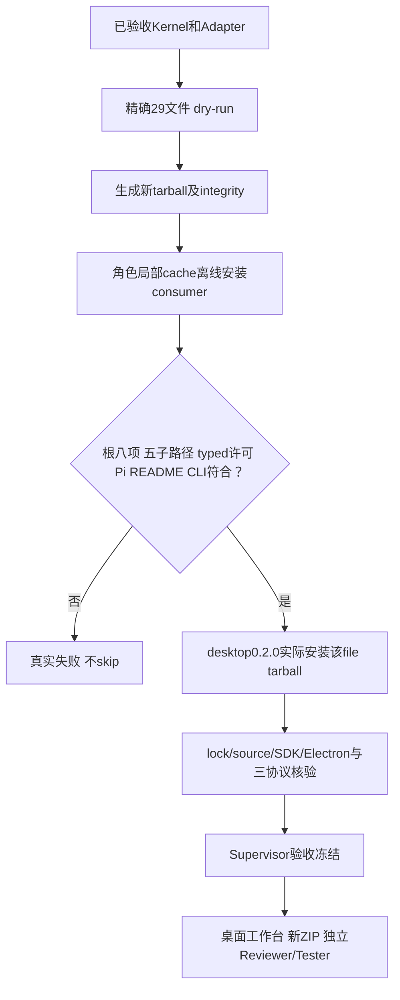
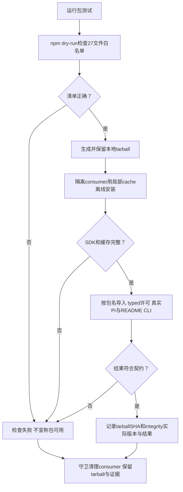

# 当前0.4.0：受控Node能力与真实桌面依赖

用户安装legion-runtime0.4.0本地tarball即可使用原八项根API/CLI；可信工作台通过五个公开子路径消费Kernel/Adapter Service和30项纯Model。根API和single_run行为保持；conversation是真实SDK的无工具多轮，不另造Agent引擎。Node>=22.19.0，两Pi包固定1.0.4。

当前tarball精确29文件：24个Kernel/Adapter.mjs、runtime/workbench/bin三个产品入口，加README/package.json。五子路径为workbench-models、services/policy、mutation、proposal、pi-agent；具名转发，不导出星号、私有authority helper或Provider。Python、.ans、tests、cache、node_modules排除。27个产品.mjs按ordinal统一/相对路径TAB文件SHA LF UTF8生成摘要，与tarball身份分别记录。

包测试保留原两项全部typed许可/permit不可重放、真实Pi两调用写入审计、可运行README和CLI六场景23事件断言；新版本精确清单/五子路径/无工具双轮追加严格核验。稳定tarball位于.ans/runtime/legion-desktop-workbench-v2/ProjectManager/node/packaging/legion-runtime-0.4.0.tgz，package-smoke.json记录SHA256/npm integrity/source27/实际安装结果。consumer清理先核对绝对包含和lstat祖先无链接。旧0.3.0tgz、GUIv1ZIP与三个历史runtime树逐文件保护，只复制旧_cacache种子。

桌面依赖声明唯一Legion本地tarball，实际安装到自身node_modules，不用源码相对路径、workspace link或开发树。verify-dependencies只允许该local resolved例外，核对integrity和source27；其他依赖registry HTTPS/sha512严格。实际公开Pi Service通过三协议localhost双轮、空工具、私有凭据和恢复验证。官方Electron44.6.0显式installer使用新任务archive及官方checksum；Forge8.0.1/Playwright1.63.0，不额外Chromium或付费调用。

本阶段当前结果以[工作台任务](../../../../scheduling/legion-desktop-workbench-v2.md)和新packaging证据为准；桌面UI/计划确认/WindowsZIP后段尚待实现与独立验收。源码完整npm test为16个串行模块，须等下游旧tests迁移完成后运行，旧141不是新版证据。[本阶段冻结设计](../design/2026-10-07_design_desktop-workbench-v2.md)、[当前README](../../../../../README.md)。不发布registry。

## 以下为0.3.0历史记录

用户安装legion-runtime本地tarball即可按包名导入createRuntime，或运行legion demo。源码入口与CLI不需要编译，也不需要Python。

固定包只含23个Node owner源码、根facade、CLI、README与package.json，共27文件。Python、.ans、tests、缓存和node_modules不会进入包。根入口公开Interface和必要纯Model，不公开内部authority或Service/Provider。

最短使用方式是npm install ./legion-runtime-0.3.0.tgz --ignore-scripts，再运行npm exec --offline -- legion demo。离线Pi示例见项目根[README](../../../../../README.md)，其modelProviders数组、精确任务writeSet与真实SDK实际由包测试执行。

本地检查两项首次通过、零跳过；实际tarball的installed API typed prepare/execute/submit、重放拒绝、真实Pi两次推理/文件/审计、README与CLI均成功。源码candidate不包含生成tarball，因此记录路径/SHA256/npm integrity和consumer lock摘要。失败不能skip；文件修改和结果审计不是跨文件事务。

生成位置为项目.ans/runtime/legion-pi-node-v3/packaging/legion-runtime-0.3.0.tgz；对应package-smoke.json含最后通过的实际产物证据。consumer清理前验证解析后绝对路径处于本任务packaging内，并逐组件lstat拒绝链接。正式unit首次realpath清理遇本机EPERM，发行断言均通过但该次检查失败；修复记录和最终unit/pack/cli与独立验收见[task_ops记录](../../../../scheduling/legion-pi-node-v3.md)。

[API与检查命令](../../api-spec.md)、[当前架构](../architecture.md)、[入口源码](../../../../../runtime.mjs)、[包测试](../../../../../tests/package/test_package.mjs)。

| 日期 | 类型 | 状态 | 变化 | 记录 |
| --- | --- | --- | --- | --- |
| 2026-10-07 | Node发行 | owner smoke通过待最终验收 | 固定依赖、27文件tarball、公共SDK与CLI隔离验证；没有npm发布 | [设计](../design/2026-10-07_design_node-pi-v3.md) |

| 2026-10-07 | 同版关停修复发行刷新 | 当前结果见修复任务 | 等待运行终态审计后关闭存储；原两项package smoke与27文件产物重新验证，README补充全15模块npm test | [修复任务](../../../../scheduling/legion-pi-node-v3-close-repair.md) |

package-smoke.json现用于记录最新修复产物；旧tarball SHA和25产品基线保留在同目录close-repair-before.json。稳定tarball仍位于原v3 packaging目录，不新建repair packaging目录。源码全15模块检查在全部修复节点验收后独立执行。
