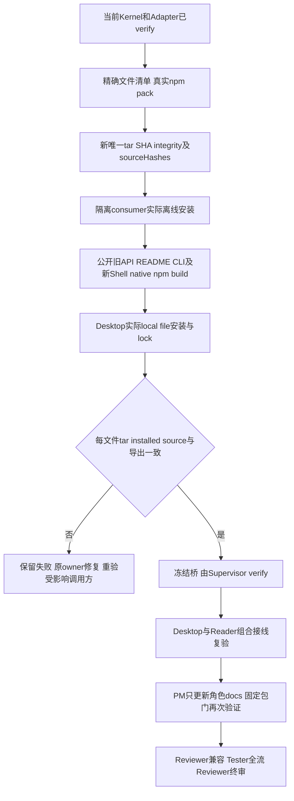
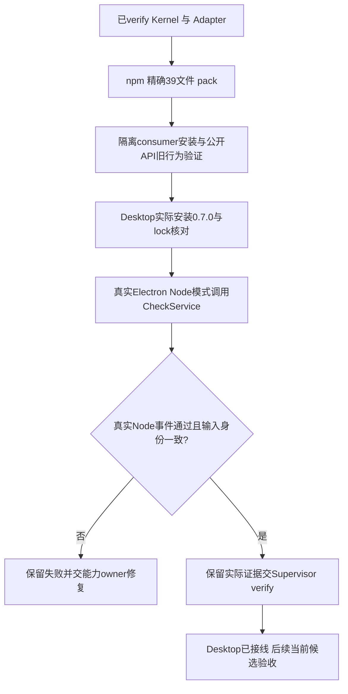
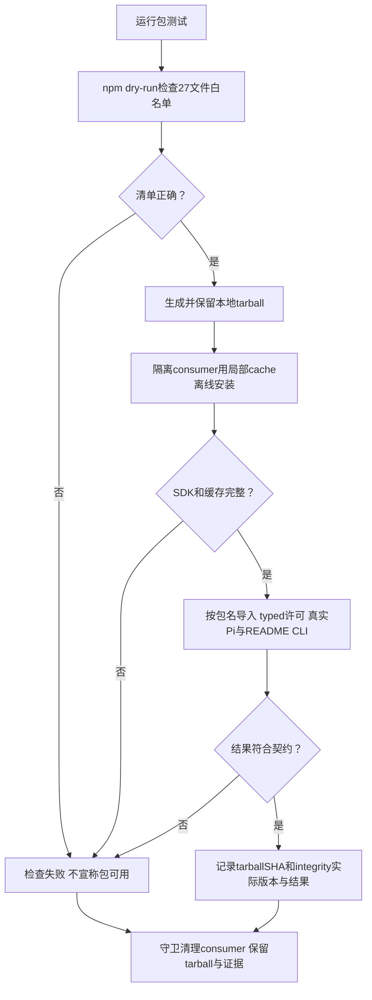

# 本地Node包与安装身份

可信Host安装真实本地runtime包后，以包名使用公共Models和Services，不依赖开发树相对路径或symlink。当前0.8.2包含46个精确文件、44mjs、README和package.json；根8API兼容，workbench-models62具名项目、7Service加Models共8子路径，新增ShellService与11个纯Shell值/helper。不公开Provider、私有receipt/authority工厂或native helper。

当前真实安装指向 `.ans/runtime/handwell-pm-approved-project-shell-v1/ProjectManager/packaging/bridge-v3/legion-runtime-0.8.2.tgz`，SHA `1a2a7c483f04f2bb939d6bf4d25aa7a4318bc866a473dcac251f74d1ee592622`，Desktop仍0.2.0。npm离线/ignore-scripts不全局安装、不注册表发布，也不重新安装已有官方Electron二进制。SDK1.0.4/Electron44.6.0/Forge8.0.1/Playwright1.63.0保持。

## Host怎么使用Shell

以 `legion-runtime/services/shell` 取得公开factory，传可信private paths、共享项目lockRoot、Human计划artifactScopes和live validator；Model构造不授权限。原角色的申请经PM真实structured审核和Hostledger一次claim，镜像运行后仅原owner/task源码及本条产物可发布。fixed dependency reads∪request outputs是完整input generation；复用prepare opaque值，不为读取已有.bin扩张发布权限。binary/mode/delete留在原Mutation边界，receipt和正文不进SDK。

[项目Shell流程](project-shell.md)说明拒绝/取消/partial/restart恢复。独立Check仍禁止fork、使用固定runner和真实报告；Shell0退出不替代checks/Acceptance。macOSCLT/SDK与startup探针是前提，失败unsupported，不裸spawn；其他Shell平台未支持，外网未实际测试，不承诺域名隔离。

## 实际验证与历史

[依赖修复桥](../../../../scheduling/handwell-project-shell-dependency-read-repair-v1.md)记录实际包门与contract结果，真实native/npm/build、only-dist既有.bin、readonly依赖拒整批、text/binary/delete、SDK三协议原pending及Electron Check通过；44 source byte与真实安装相等。0.8.0 bridge-v1、0.7/f45与更早tar/ZIP、全部真实失败和旧日志保留。Node根旧行为、README例子与CLI都在包门继续检查，独立完整验收仍另行。

当前[最终任务](../../../../scheduling/handwell-project-shell-model-time-facts-repair-v1.md)只有PM10docs写域，桥source/README/lock/exports和业务owner全只读，不重pack生产tar或重装Desktop。固定harness仍在fresh smoke目录生成比对tar并安装隔离consumer；既有tar wx/samebytes，原1a2a7c48身份保持。harness固定JSON是latest，先完整归档早期bridge-v3字节/mode/SHA/path及日志关联，当前复验后再归档，不把已改变旧JSON路径视作同hash，不复制旧成绩冒新候选。原task日志不覆盖。

[公开API](../../api-spec.md) · [架构](../architecture.md) · [同版设计](../design/2026-10-10_design_project-shell.md) · [变更](../change/2026-10-10_change_project-shell.md)

## 0.8.2 显式Host时间事实

角色批准后可能在发许可与真正提交之间等待。纯Model现在不读取环境时钟或注入clock callback；Shell/Mutation的相邻Provider取得fresh safe epoch毫秒，经公开Service的 `observeTime()` 传入Model比较。Host每项proposal调用 `controller.issueShellPublication(proposal, receipt, service.observeTime())`，不为整批缓存旧时间。操作层在issue、consume、publication以及真正create/replace/delete和recheck前重新观察，缺失/无效/回退时间事实、到期、abort及replay仍失败关闭，不能凭旧issue事实延长许可。

publicfactory和62具名Model/helpers不变；该Host controller第三参数为必需caller调整，实际Desktop与包测试各自接线。SDK request/review/result、renderer与历史不新增clock字段，ordinary write/edit仍原用法。Policy的私有publication上下文使用真实receipt和 `observedAtMs: mutation.observeTime()`，Model值或时间数字不是审批授权。完整实际接口见Kernel API末节。

当前0.8.2 bridge-v3真实包SHA `1a2a7c483f04f2bb939d6bf4d25aa7a4318bc866a473dcac251f74d1ee592622`，46files/44mjs及安装每源相等，Desktop产品仍0.2.0。原0.8.1 bridge-v2和0.8.0 bridge-v1、旧proof及final before/after archive均保留。Owner实现和本阶段三固定门的最新候选/成绩、独立Reviewer/Tester状态以[时间事实修复任务](../../../../scheduling/handwell-project-shell-model-time-facts-repair-v1.md)记录，不复制活任务计数，不把下一检查写成已pass。当前包源保持冻结，本阶段只更新10文档，固定门前后完整保全bridge-v3快照并按Gov策略标注latest。

本机当前WindowsZIP本体及对应descriptor缺失；macOS可核验的是历史0.7.0 TGZ/descriptor的39file/37source身份与当前0.8.2真实安装，不读取不存在的ZIP字节，不以这些结果宣称Windows支持、exe/DPAPI或GUI发行通过。旧Windows精确断言和独立发行验证由后续原Reviewer/Tester保留。外网仍未实际运行，当前Shell仅macOS CLT/SDK与startup探针实际能力范围，失败unsupported；源码/生成恢复的新Human授权、当前baseline与追加recovered语义保持。

## 保留的历史发行记录

以下原文中的“当前”和待办仅适用于当时版本及候选，不是本次交付结论。

# 当前 0.7.0：受控检查与控制工具的 runtime 发行

可信宿主安装本地tarball后可消费51项具名共享Model和七个子路径，包含新CheckService。原根八项API、读取完整SHA、文件归属、局部编辑及Pi行为保留。CheckService由宿主配置真实路径与live validator，自己的Service factory创建相邻Provider；typed授权不是批准凭证。允许结果必须提供matching decision/authorization/真实AbortSignal，批准撤销即取消。

包包含37个mjs、README和package.json，排除tests/.ans/vendor/node_modules。副作用位于本阶段PM目录，旧0.4/0.5/0.6 tarballs保持字节。npm离线缓存和ignore-scripts安装真实包，现有官方Electron44.6二进制保持可用。首版macOS Node检查固定isolation none并禁止process-fork，不支持另起进程的测试；其他平台unsupported/executed=false。只读reporter fd3真实Node事件统计，stdout假TAP/空suite不能通过。

SDK新增check与六项controls及四类typed结果已实现。Desktop持久组织/交互/验收Service与Provider、唯一Workbench Pipeline和UI已接线，owner实现见[Desktop任务](../../../../scheduling/legion-governed-workflow-v1-desktop-implementation.md)；后续[角色读取修复](../../../../scheduling/legion-governed-workflow-v1-workspace-reader.md)、[reporter修复](../../../../scheduling/legion-governed-workflow-v1-reporter-repair.md)及[Electron修复](../../../../scheduling/legion-governed-workflow-v1-electron-runner-repair.md)具有各自真实证据。当前[架构师诊断返修](../../../../scheduling/legion-governed-workflow-v1-live-architect-repair.md)与[独立集成/UI验收](../../../../scheduling/legion-governed-workflow-v1-final-integration.md)仍待当前候选检查；[独立结构评审](../../../../scheduling/legion-governed-workflow-v1-independent-review.md)原结果只代表其记录候选。普通测试入口和包刷新见[本次任务](../../../../scheduling/legion-governed-workflow-v1-test-entrypoints-release.md)。原主任务pending后段由这些具体任务接续，原状态与旧通过记录不能代替最终交付。当前固定package检查覆盖包白名单、安装身份/公开API、旧读写/编辑、真实Pi与README/CLI及Electron CheckService最小实际执行。真实结果见[任务证据](../../../../scheduling/legion-governed-workflow-v1.md)。

[已确认设计](../design/2026-10-08_design_legion-governed-workflow.md) · [API](../../api-spec.md) · [README](../../../../../README.md)

## 以下为0.3.0历史记录

用户安装legion-runtime本地tarball即可按包名导入createRuntime，或运行legion demo。源码入口与CLI不需要编译，也不需要Python。

固定包只含23个Node owner源码、根facade、CLI、README与package.json，共27文件。Python、.ans、tests、缓存和node_modules不会进入包。根入口公开Interface和必要纯Model，不公开内部authority或Service/Provider。

最短使用方式是npm install ./legion-runtime-0.3.0.tgz --ignore-scripts，再运行npm exec --offline -- legion demo。离线Pi示例见项目根[README](../../../../../README.md)，其modelProviders数组、精确任务writeSet与真实SDK实际由包测试执行。

本地检查两项首次通过、零跳过；实际tarball的installed API typed prepare/execute/submit、重放拒绝、真实Pi两次推理/文件/审计、README与CLI均成功。源码candidate不包含生成tarball，因此记录路径/SHA256/npm integrity和consumer lock摘要。失败不能skip；文件修改和结果审计不是跨文件事务。

生成位置为项目.ans/runtime/legion-pi-node-v3/packaging/legion-runtime-0.3.0.tgz；对应package-smoke.json含最后通过的实际产物证据。consumer清理前验证解析后绝对路径处于本任务packaging内，并逐组件lstat拒绝链接。正式unit首次realpath清理遇本机EPERM，发行断言均通过但该次检查失败；修复记录和最终unit/pack/cli与独立验收见[task_ops记录](../../../../scheduling/legion-pi-node-v3.md)。

[API与检查命令](../../api-spec.md)、[当前架构](../architecture.md)、[入口源码](../../../../../runtime.mjs)、[包测试](../../../../../tests/package/test_package.mjs)。

| 日期 | 类型 | 状态 | 变化 | 记录 |
| --- | --- | --- | --- | --- |
| 2026-10-07 | Node发行 | owner smoke通过待最终验收 | 固定依赖、27文件tarball、公共SDK与CLI隔离验证；没有npm发布 | [设计](../design/2026-10-07_design_node-pi-v3.md) |

| 2026-10-07 | 同版关停修复发行刷新 | 当前结果见修复任务 | 等待运行终态审计后关闭存储；原两项package smoke与27文件产物重新验证，README补充全15模块npm test | [修复任务](../../../../scheduling/legion-pi-node-v3-close-repair.md) |

package-smoke.json现用于记录最新修复产物；旧tarball SHA和25产品基线保留在同目录close-repair-before.json。稳定tarball仍位于原v3 packaging目录，不新建repair packaging目录。源码全15模块检查在全部修复节点验收后独立执行。

当前计数通道已按[Kernel返修证据](../../../../scheduling/legion-governed-workflow-v1-reporter-repair.md)加强：每次随机初始化key、MAC与递增序号、captured方法及固定stream入口，裸fd3 JSON拒绝。Node固定permission补充限制inspector/native addon/worker/process.binding；真实文件/网络/进程隔离仍由Seatbelt承担。已测直接伪造与入口替换等范围不构成任意恶意JS的一般不可篡改保证，同进程测试断言与覆盖仍需审阅和独立验收。需要上述受限API或替换固定stream入口的测试不支持。本次Electron smoke使用实际安全flags验证普通test通过与直接fd3伪造拒绝。

Electron NODE_OPTIONS兼容问题已由Kernel原owner返修并verify，普通Node与真实Electron162项通过。当前执行显式argv固定四个权限参数后接isolation/reporter/spec.argv，Service逐参数核对；NODE_OPTIONS不设置或继承，逻辑CheckSpec.argv保持不变。PM当前包检查核验刷新后的源码/README/tarball/安装身份与真实Electron通过及fd3拒绝，最终以task_ops package结果和Supervisor验收为准。[实际失败任务](../../../../scheduling/legion-governed-workflow-v1.md)。

本次入口修复：根普通检查现覆盖22模块，Desktop覆盖20模块，原断言保留。manifest/README变化要求重pack和实际离线安装；包/完整UI结果各取其真实当前证据。

前次普通入口阶段实际检查：core package 2/2通过；`verify-dependencies.mjs` 的macOS分支3/3通过，真实Electron44.6.0/Node24.21.0验证普通test、安全argv/API限制、直接fd3伪造拒绝及撤权不执行。初次受工具外层sandbox限制的Seatbelt `EPERM` 保留，获准实际隔离执行后的结果另存；没有降级隔离或弱化断言。前次tarball SHA-256为 `bb54a2fef136c7cfffeb4cf6b79bc1751c677e8b02435c244a5a652beb40de19`；npm离线安装仅刷新1个runtime包，lock integrity对应当前tarball，全39文件root/tar/installed字节一致。最终本阶段是否通过取当前task_ops `package`证据，完整产品仍待独立验收。

## 当前模型预算修复的发行刷新

真实桌面工程角色在原60秒活动预算下返回 `pi_turn_timeout`，Adapter owner已把conversation默认和最大预算改为输出8192、模型活动180000ms，仍只允许向下设定。此次已授权发行任务重建同版0.7.0并实际离线安装，使新进程使用当前Adapter源码；全39文件重新核对root→tar→installed，保留上一入口任务与旧tarball证据。SDK等待宿主时暂停活动计时，答复后仅恢复剩余预算；cancel/close仍立即终止当前请求。8192是宿主请求上限，供应商能力/价格缺失仍为unknown。

该必要刷新按已确认完整工作流及同一精确139文件配置执行，未增加权限或任意Shell入口。先更新PM公开说明，再运行已有包检查、实际npm安装及真实Electron helper，最后使用[本次发行任务](../../../../scheduling/legion-governed-workflow-v1-final-runtime-release.md)的固定package检查记录当前候选。Adapter具体调用和三协议预算验证见[owner修复任务](../../../../scheduling/legion-governed-workflow-v1-model-budget-final.md)；当前Desktop纯对话/架构师交互修复和独立完整流/UI仍须其最终证据，Windows未在本机执行。
