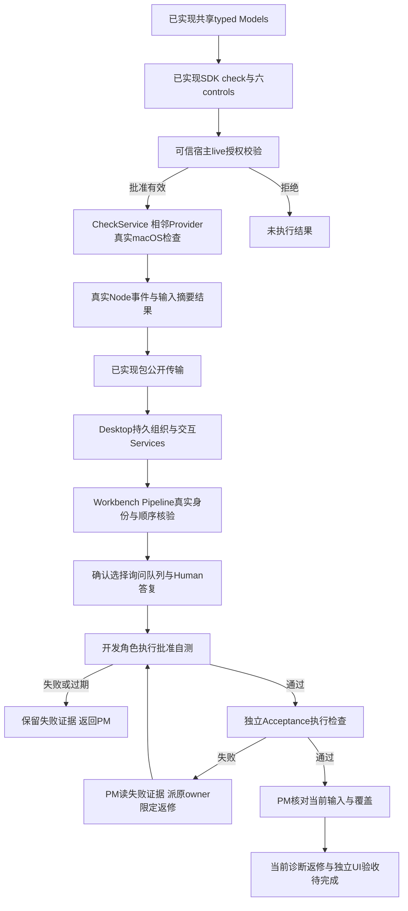

# 持久成员与真实检查已接线，当前候选等待最终验收

用户希望成员持久存在，由角色架构师提出边界、PM审批与用户确认后开发角色自测，独立验收再测试，失败交原归属角色限定返修。当前runtime0.7提供共享Check/Control Models、真实macOS检查Service/Provider及SDK七项工具和四类结果。Desktop持久组织/交互/验收Service与Provider、唯一Workbench Pipeline和UI已接线，owner实现见[Desktop任务](../../../../scheduling/legion-governed-workflow-v1-desktop-implementation.md)；后续[角色读取修复](../../../../scheduling/legion-governed-workflow-v1-workspace-reader.md)、[reporter修复](../../../../scheduling/legion-governed-workflow-v1-reporter-repair.md)及[Electron修复](../../../../scheduling/legion-governed-workflow-v1-electron-runner-repair.md)具有各自真实证据。当前[架构师诊断返修](../../../../scheduling/legion-governed-workflow-v1-live-architect-repair.md)与[独立集成/UI验收](../../../../scheduling/legion-governed-workflow-v1-final-integration.md)仍待当前候选检查；[独立结构评审](../../../../scheduling/legion-governed-workflow-v1-independent-review.md)原结果只代表其记录候选。普通测试入口和包刷新见[本次任务](../../../../scheduling/legion-governed-workflow-v1-test-entrypoints-release.md)。原主任务pending后段由这些具体任务接续，原状态与旧通过记录不能代替最终交付。

首版检查仅批准Node测试，固定isolation none并禁止子进程；其他平台unsupported而非通过。live validator返回matching typed授权与真实AbortSignal，撤销/取消/close终止本次检查。空suite、stdout假TAP、输入变化均不能作当前通过证据。包验证核对实际安装39文件、51 Models、七子路径及旧读写；真实Electron Node smoke证明宿主可以执行此最小检查，不能替代完整UI验收。

[已确认只读设计](../design/2026-10-08_design_legion-governed-workflow.md) · [API](../../api-spec.md) · [发行功能](distribution.md) · [任务证据](../../../../scheduling/legion-governed-workflow-v1.md)

当前计数通道已按[Kernel返修证据](../../../../scheduling/legion-governed-workflow-v1-reporter-repair.md)加强：每次随机初始化key、MAC与递增序号、captured方法及固定stream入口，裸fd3 JSON拒绝。Node固定permission补充限制inspector/native addon/worker/process.binding；真实文件/网络/进程隔离仍由Seatbelt承担。已测直接伪造与入口替换等范围不构成任意恶意JS的一般不可篡改保证，同进程测试断言与覆盖仍需审阅和独立验收。需要上述受限API或替换固定stream入口的测试不支持。本次Electron smoke使用实际安全flags验证普通test通过与直接fd3伪造拒绝。

Electron NODE_OPTIONS兼容问题已由Kernel原owner返修并verify，普通Node与真实Electron162项通过。当前执行显式argv固定四个权限参数后接isolation/reporter/spec.argv，Service逐参数核对；NODE_OPTIONS不设置或继承，逻辑CheckSpec.argv保持不变。PM当前包检查核验刷新后的源码/README/tarball/安装身份与真实Electron通过及fd3拒绝，最终以task_ops package结果和Supervisor验收为准。[实际失败任务](../../../../scheduling/legion-governed-workflow-v1.md)。

## 普通测试入口修复（本次已授权范围）

已确认完整工作流要求普通开发检查包含新机制。根 `package.json` 的 `test`、`test:kernel`、`test:adapters`、`test:integration` 分别补入三项 Check 单元模块、受控工具模块与 Check 集成模块；Desktop 的 `test` 补入组织/交互/验收四项单元模块、工作流边界检查及工作流集成/UI两模块。保留全部原模块和断言。包测试同时核验入口包含这些模块，防止遗漏再次发生。

修改 manifest 与 README 后重新运行现有包检查生成同版0.7.0 tarball，使用 npm 离线、ignore-scripts 实际刷新 Desktop 安装和 lock，并核验 root→tarball→installed 全39文件的字节身份。旧包结果仅代表旧候选；新 UI 与独立完整流程的完成状态由其当前任务证据决定。本修复不增加产品功能，依据同版 canonical 设计及已确认精确配置实施。

本次普通入口已补齐并由包用例核验；新包实际安装身份一致，core2项和真实Electron helper3项阶段检查通过。最终固定package及独立完整流/UI各以当前任务证据为准。[发行阶段实际结果](distribution.md)。

当前真实模型预算修复已由Adapter owner冻结：conversation输出/累计活动默认及最大8192/180000，仅可缩小，host等待暂停且取消即时。真实旧60秒超时、当前caller/cap/三协议/取消检查见[Adapter当前任务](../../../../scheduling/legion-governed-workflow-v1-model-budget-final.md)；新包安装和limited package证据见[当前发行刷新](../../../../scheduling/legion-governed-workflow-v1-final-runtime-release.md)。这不代表Desktop当前纯对话/架构师修复和独立完整UI已验收，Windows仍未在本机验证。
