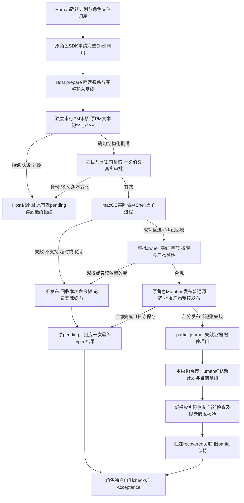

# 项目命令的审批、发布与包交付

执行角色需要安装依赖、编译或处理项目文件时，提交完整命令，由该项目的 PM 逐次审核。批准后，命令在隔离项目副本执行；只有当前角色拥有且本任务允许的源码、Human 确认的产物可发布。结果回到原角色同一待处理工具调用，使其继续任务。ProjectManager 建设角色负责真实公共包与安装身份；产品内审核、执行和发布分别由 Desktop、Adapter 与 Kernel 负责。

## 当前使用流程

先在项目管理对话中确认角色、任务、精确 writeSet、文件归属以及产物 scope/kind。运行期间主区显示工作成员与真实阶段，点击成员进入其“对话”。角色的 `legion_request_shell` 提交 command、cwd、reason、generatedEffects、network、timeoutSeconds；Host 从实际运行确定身份，模型不能自报授权。

PM 以 `legion_review_shell` 提交精确 requestId/digest/revision 的批准或拒绝。审核使用原 PM 的持续文本记忆和受限审核实例，回合与记忆 CAS 串行；不复用会撤销 active generation 的普通初始化流程，不占主 Pipeline 队列等待模型。产品内 PM 不代角色执行，也不代表建设任务的配置授权。

申请与有限输出保存在原成员对话；真实审核文本和理由保存在 PM 对话，请求 ID 关联两者。阶段包括 `waiting_pm_approval`、`executing_shell`、`publishing`。输出是安全纯文本，不执行终端序列或 HTML。只有最终 typed ShellDecision/ShellResult 回到原 PiToolRequest；`ready_for_publication` 不进入 SDK。已取消的 pending 不接受迟到回应，Host 仍保存真实终态。

## 成功后改变什么

原角色通过既有 Workbench controller 与 Mutation 发布精确创建、替换和删除。UTF-8 与 canonical base64 的真实字节/SHA、present/absent 基线和安全 executable 位均须匹配候选；二进制正文、opaque receipt、permit 只留 Host。删除保留 owner，输出和依赖交接记录 missing/tombstone；Source body 不作为任务交接自动塞入后继模型。

生成产物只能发布本条 generatedEffects。计划中固定 `kind: dependencies` 的目录可作为读取输入，只有读依赖的命令不获得该目录发布权限。例如已有 node_modules 时，角色申请 `node_modules/.bin/工具 > dist/result.txt`，只提交 `dist/`；Host 原样使用 prepare 的 inputVersions/snapshotDigest/generationDigest，generation 覆盖固定读取依赖与本条输出，包含链接目标、字节、执行位及目录存在。只读依赖变化拒绝整批，审批后输入或同字节链接重定向使旧许可过期。

Shell 退出码0表示命令退出状态。角色仍须调用独立 `legion_run_check`，检查固定 Node runner、受批准输入和真实报告；Acceptance 核对当前版本与证据。依赖 generation 变化使旧检查和验收失效。Shell 的自由子进程不放宽 Check 的禁止 fork 沙箱。

## 失败、取消与恢复

发布前的失败只影响私有镜像。源码多文件与生成目录没有天然整体原子性：发布中断保留真实已发布列表、逐操作 journal、私有产物版本，项目暂停并失效检查。重新打开仍暂停，不重跑旧 command、不恢复旧 receipt/许可。

源码没有自动 withdraw permit。Human 可在看到当前 SHA/缺失状态后确认新的恢复计划；当前 owner 或经 Human 显式转交后的 owner 用新 task、基线和新审批恢复。恢复期间重新核验，后续合法修改不得被覆盖。所有实际任务、当前 checks、磁盘与产物 generation 匹配后才追加 `recovered`、新 plan/evidence 关联；旧 `partial_published` 记录不改写。generated 的同会话版本受控 `recoverGenerated` 与重启后的 Host 恢复处理是不同路径，不能据暂停宣称恢复完成。

取消、关闭、项目/计划/连接/角色变化先撤待审与许可，再取消审核及回收整棵本次进程树。命令预算默认300秒、最大900秒，审批最长等待5分钟，超时清理另计最多30秒；回收或审计失败关闭后端，无裸 Shell 后备。模型活动预算与 Host 等待分别计时。归档上限1MiB，模型预览默认8KiB、最多64KiB并进一步受当前上下文剩余量约束。

## 平台、凭据和治理读取

当前 Shell 后端是 macOS Seatbelt 与 private native permission-signature supervisor。本机 CLT clang/SDK 为前提，startup 安全探针失败或缺工具返回 unsupported。SBPL 是弃用/私有接口，不能把单机通过扩成其他版本保证。权限签名不是 kernel sandbox object ID；同用户/可信 Host 在沙箱外故意克隆完整 profile 属于 Host 信任边界外。

运行使用固定干净环境、私有 HOME/TMP/cache，控制目录、凭据、Host userData 与原项目不可读写；不全局安装或 sudo。网络默认 none，localhost/external 每条审核；已实际验证本地受控 SDK、native、离线 npm/build，未实际测试外网服务或下载，不能宣称域名隔离。其他 Shell 平台失败关闭，当前 Windows ZIP 不据 macOS 包测试交付。

Workspace Reader 识别历史合法快照和真人接受 c872 配置的精确 YAML/Section1 元组；六角色的四个 candidate 字段仍是冻结历史，AWAITING 文字不自激活权限。Supervisor 保留原 v2 定义。Reader 只是只读观察，不产生客户文件或执行授权，未知字段/范围/元组继续拒绝。

## 公共包与证据

当前 runtime0.8.2 为46文件、44 `.mjs`、62具名 Model/helpers、七个 Service 加 Models 共八个工作台子路径；根八API兼容。真实 tar SHA为 `1a2a7c483f04f2bb939d6bf4d25aa7a4318bc866a473dcac251f74d1ee592622`，Desktop0.2.0按 local file+integrity 安装，每源字节匹配；不公开 Provider 或私有 receipt 注册函数。

[依赖修复桥任务](../../../../scheduling/handwell-project-shell-dependency-read-repair-v1.md)记录实际包门与contract结果。Desktop 当前组合的 owner当前组合验证；[Reader补修](../../../../scheduling/handwell-project-shell-workspace-reader-v1.md)记录当前候选；后续[最终组合任务](../../../../scheduling/handwell-project-shell-model-time-facts-repair-v1.md)记录本阶段包复验、Reviewer与Tester当前状态。Owner及包证据不代替尚待的独立完整流程、GUI、实际客户 SSH 后续开发和 Windows 验收。

本阶段先完整归档旧 bridge-v3 文件、SHA/mode/path及原检查日志关联，再运行原配置检查。桥的固定 JSON 是 latest 输出，可随当前复验刷新；旧 run 的冻结字节有独立只读归档，不能说原 JSON 路径仍同 hash，也不能借归档把旧 pinned 观察说成当前通过。原 tar、源码、锁、导出与历史 task_ops 日志不改，检查后另存新完整快照。

入口与维护：[公共API](../../api-spec.md)、[架构](../architecture.md)、[Desktop当前流程](../../../DesktopEngineer/docs/feature/project-shell.md)。演变：[同版接线设计](../design/2026-10-10_design_project-shell.md)、[变更记录](../change/2026-10-10_change_project-shell.md)。

## 0.8.2 显式Host时间事实

角色批准后可能在发许可与真正提交之间等待。纯Model现在不读取环境时钟或注入clock callback；Shell/Mutation的相邻Provider取得fresh safe epoch毫秒，经公开Service的 `observeTime()` 传入Model比较。Host每项proposal调用 `controller.issueShellPublication(proposal, receipt, service.observeTime())`，不为整批缓存旧时间。操作层在issue、consume、publication以及真正create/replace/delete和recheck前重新观察，缺失/无效/回退时间事实、到期、abort及replay仍失败关闭，不能凭旧issue事实延长许可。

publicfactory和62具名Model/helpers不变；该Host controller第三参数为必需caller调整，实际Desktop与包测试各自接线。SDK request/review/result、renderer与历史不新增clock字段，ordinary write/edit仍原用法。Policy的私有publication上下文使用真实receipt和 `observedAtMs: mutation.observeTime()`，Model值或时间数字不是审批授权。完整实际接口见Kernel API末节。

当前0.8.2 bridge-v3真实包SHA `1a2a7c483f04f2bb939d6bf4d25aa7a4318bc866a473dcac251f74d1ee592622`，46files/44mjs及安装每源相等，Desktop产品仍0.2.0。原0.8.1 bridge-v2和0.8.0 bridge-v1、旧proof及final before/after archive均保留。Owner实现和本阶段三固定门的最新候选/成绩、独立Reviewer/Tester状态以[时间事实修复任务](../../../../scheduling/handwell-project-shell-model-time-facts-repair-v1.md)记录，不复制活任务计数，不把下一检查写成已pass。当前包源保持冻结，本阶段只更新10文档，固定门前后完整保全bridge-v3快照并按Gov策略标注latest。

本机当前WindowsZIP本体及对应descriptor缺失；macOS可核验的是历史0.7.0 TGZ/descriptor的39file/37source身份与当前0.8.2真实安装，不读取不存在的ZIP字节，不以这些结果宣称Windows支持、exe/DPAPI或GUI发行通过。旧Windows精确断言和独立发行验证由后续原Reviewer/Tester保留。外网仍未实际运行，当前Shell仅macOS CLT/SDK与startup探针实际能力范围，失败unsupported；源码/生成恢复的新Human授权、当前baseline与追加recovered语义保持。
