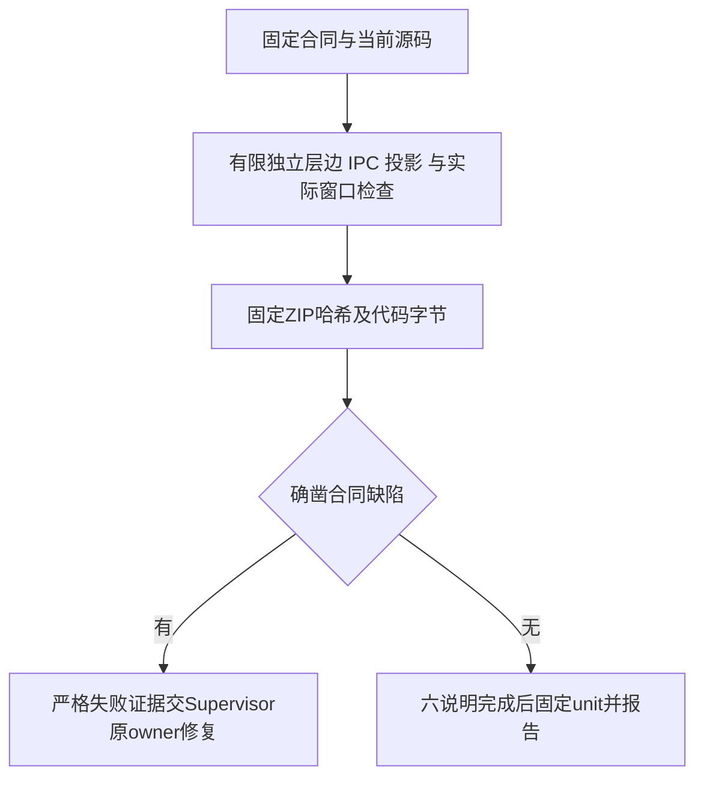

# GUI v1 有限独立审查方案

2026-10-07，Reviewer固定身份；依据[已授权GUI设计](../../../../design/2026-10-07_design_desktop-gui-v1.md)，SHA256 `58c79cae70bc45dcdda038e0e7944883dbee3ecfb2e277664a5954c3ec6a398d`。只写本阶段一个独立测试与六份说明；生产、其他测试、冻结Node历史、ZIP与PM缓存只读，O1未选择。

检查当前源码的五层边、公有工厂、Model纯投影；实际IPC窗口/frame/URL与字段拒绝；原始秘密不回显、保存动作与安全错误；真实Workspace有界读取、task_ops表格/散列链与双事件格式、版本/时间/过期状态；实际Electron沙箱窗口、主进程加密与重复close；只读解析固定ZIP并逐文件匹配当前产品代码。正常错误必须可见，失败不skip。真实窗口测试在Reviewer隔离userData/fixtures运行，不重复owner全套或旧Node141。

固定命令 `node --test apps/desktop/tests/reviewer/desktop-boundaries.test.mjs`，实际config超时300秒。生成根限定 `.ans/runtime/legion-desktop-gui-v1/{fixtures,user-data}/Reviewer/`，仅本次跟踪的进程；清理前验证绝对路径和祖先链接。对1MB以上两个历史任务及当前已增长的GUI任务的unavailable表示读取上限，不把它解释成旧任务失败。单元替身与词法检查不证明所有OS reparse竞态或恶意宿主隔离；完整三协议、重启、ZIP交互仍由独立Tester验证。

## 当前有限结果

已实际执行八项，8通过/0失败/0跳过。原沙箱EPERM/native启动失败及两轮测试假设修正均保留；必要提权后仍保持严格IPC/秘密/只读/字节断言。ZIP按当前PM descriptor精确验证，24源码/README原字节和完整Forge生产manifest一致；同进程DPAPI与窗口重开证明不替代跨进程/解压ZIP完整验收。见[当前审查](../review-desktop-gui-v1.md)，客户最新提出需求聊天入口与UI改进，本轮仅收束v1有限技术证据，Tester暂不派发，新方案另评审；七文件最终完成后执行一次固定unit并停止编辑。
