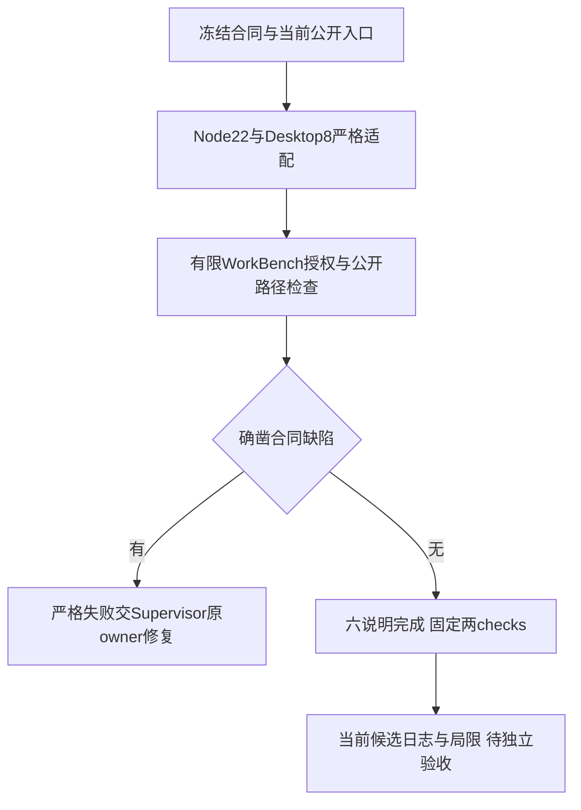

# Workbench v2 独立有限审查方案

2026-10-07，固定Reviewer；[客户已确认canonical](../../../../design/2026-10-07_design_desktop-workbench-v2.md) SHA715639b5…，config2546ebd0…、[合同](../../../../../.ans/contracts/desktop-workbench.yaml)与ownership87808cec…固定。当前任务[fixture-repair](../../../../scheduling/legion-desktop-workbench-v2-fixture-repair.md)仅授九文件，不修生产，不派worker。

保留原Node22安全断言，适配24下层源码/27产品文件/29包项和新公开子路径；先校验Gov ownership原始字节SHA，再读取历史primaryOwner，不把本阶段writeFiles当所有权。原Desktop8保留IPC、秘密、只读记录、生命周期和包源身份目标，精确适配36桌面源码、两主页、v004、扩大但有界完整记录验证、当前PM descriptor及严格生产manifest变换。新Workbench有限检查只针对唯一PM聊天/worker只读、无确认零写、typed grant与整个plan永久撤销、同步取消、写前context/目标重查、无输出不能算完成和not_executed。

正式node-unit与desktop-unit按config各300秒，桌面两文件serial。不重复owner全套/Node完整regression，不调用付费模型。LEGION_NODE_TEST_ROLE与LEGION_DESKTOP_TEST_ROLE=Reviewer，TEMP/TMP/cache仅v2 Reviewer/node或desktop六目录，禁compile cache并清全局Node options。可使用受控localhost和本次Electron，递归清理前验证祖先与子树链接；旧phase目录、TGZ/ZIP、其他owner证据只读。

若环境realpath/Electron在普通沙箱拒绝，保留失败后仅相同有限check必要提权。词法结构检查、测试替身不证明所有OS重解析/竞态或恶意宿主隔离。真实独立完整三协议、多轮、重启、ZIP GUI和视觉由Tester后续验证；本轮8项历史及owner成绩不能替代v2新证据。

本方案已先于测试实现落盘。实际实现新增7项，desktop-unit合计15项；原22/8名称与安全目标保持。文档在正式checks前封存，最后同候选证据从任务记录与完成回执取得。
